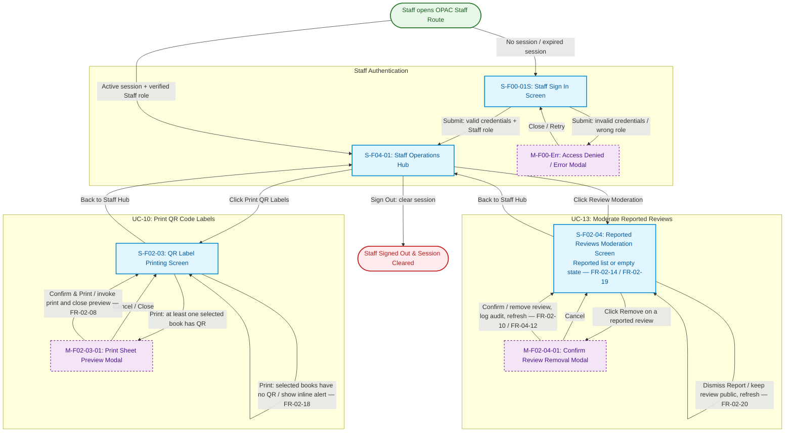

# Screen Transition Matrix: On-site Staff Operations

## 1. Screen Transition Diagram

The following Mermaid diagram shows the staff entry route, authentication flow, and navigation between the UC-10 and UC-13 screens. GitHub renders the diagram automatically because the code is enclosed in a fenced `mermaid` block.

## 2. Screen Transition Matrix

| Source Screen / State (From) | User Action / Trigger | Condition / Guard | Target Screen / Modal (To) | Traceability | System Behavior & Data Change |
| ----- | ----- | ----- | ----- | ----- | ----- |
| **Start** (Staff Route) | Staff opens `/staff` URL | `[No session / expired session]` | `S-F00-01S` (Staff Sign In Screen) | FR-04-08 | Middleware intercepts unauthenticated request and redirects to staff sign-in page. |
| **Start** (Staff Route) | Staff opens `/staff` URL | `[Active session + verified Staff role]` | `S-F04-01` (Staff Operations Hub) | `FR-04-07`, `FR-04-08` | Verifies active session token and Staff role; opens Staff Operations Hub directly. |
| `S-F00-01S` (Staff Sign In) | Click "Sign In" button | `[Valid credentials + Staff role]` | `S-F04-01` (Staff Operations Hub) | `FR-04-07` | Validates credentials against internal library system; establishes session; navigates to Hub. |
| `S-F00-01S` (Staff Sign In) | Click "Sign In" button | `[Invalid credentials / wrong role]` | `M-F00-Err` (Access Denied / Error Modal) | `FR-04-08` | Rejects sign-in attempt; opens modal alert; retains input fields for retry. |
| `M-F00-Err` (Error Modal) | Click "Close / Retry" | — | `S-F00-01S` (Staff Sign In Screen) | `FR-04-08` | Closes modal dialog; returns focus to credentials input form. |
| `S-F04-01` (Staff Hub) | Click "Sign Out" | — | `Exit_SignOut` (OPAC Public Home) | `FR-04-08` | Clears staff session and cookies; redirects user safely to public OPAC home. |
| `S-F04-01` (Staff Hub) | Click "Print QR Labels" | `[At least one selected book has QR]` | `S-F02-03` (QR Label Printing Screen) | `FR-02-08` | Loads physical books catalogue; renders list with selection checkboxes. |
| `S-F04-01` (Staff Hub) | Click "Review Moderation" | Active staff session | `S-F02-04` (Reported Reviews Screen) | `FR-02-14` | Queries flagged reviews; displays moderation list or empty state (`FR-02-19`). |
| `S-F02-03` (QR Label Printing) | Click "Print QR Labels" button | `[Selected books have no QR]` | `S-F02-03` (QR Label Printing Screen) | `FR-02-17` | **Self-transition:** Displays inline alert requiring staff to select at least one physical book. |
| `S-F02-03` (QR Label Printing) | Click "Print QR Labels" button | `[Selected books have no QR]` | `S-F02-03` (QR Label Printing Screen) | `FR-02-18` | **Self-transition:** Omits books lacking QR codes; displays inline warning listing excluded titles. |
| `S-F02-03` (QR Label Printing) | Click "Print QR Labels" button | `[At least one selected book has QR]` | `M-F02-03-01` (Print Sheet Preview Modal) | `FR-02-08` | Generates formatted PDF label grid for valid books; opens modal preview overlay. |
| `M-F02-03-01` (Preview Modal) | Click "Cancel / Close" | — | `S-F02-03` (QR Label Printing Screen) | — | Closes modal overlay; returns to screen preserving current book selections. |
| `M-F02-03-01` (Preview Modal) | Click "Confirm & Print" button | — | `S-F02-03` (QR Label Printing Screen) | `FR-02-08`, `FR-04-12` | Invokes browser print engine; logs audit entry (`FR-04-12`); closes modal; shows success toast. |
| `S-F02-03` (QR Label Printing) | Click "Back to Staff Hub" | — | `S-F04-01` (Staff Operations Hub) | — | Exits QR printing module; navigates back to Staff Operations Hub. |
| `S-F02-04` (Reported Reviews) | Click "Remove" on a reported review | Review violates community rules | `M-F02-04-01` (Confirm Removal Modal) | `FR-02-10` | Opens confirmation modal displaying reported review content and report reasons. |
| `M-F02-04-01` (Confirm Modal) | Click "Cancel" | — | `S-F02-04` (Reported Reviews Screen) | — | Closes modal; review remains pending in moderation queue unchanged. |
| `M-F02-04-01` (Confirm Modal) | Click "Confirm" removal | Deletion confirmed | `S-F02-04` (Reported Reviews Screen) | `FR-02-10`, `FR-04-12` | Removes review from public display; logs audit entry; refreshes list (shows empty state if 0 left). |
| `S-F02-04` (Reported Reviews) | Click "Dismiss Report" on a review | Review adheres to rules (valid) | `S-F02-04` (Reported Reviews Screen) | `FR-02-20` | **Self-transition:** Retains review on public display; clears report flag; removes item from queue and refreshes list. |
| `S-F02-04` (Reported Reviews) | Click "Back to Staff Hub" | — | `S-F04-01` (Staff Operations Hub) | — | Exits moderation module; navigates back to Staff Operations Hub. |
