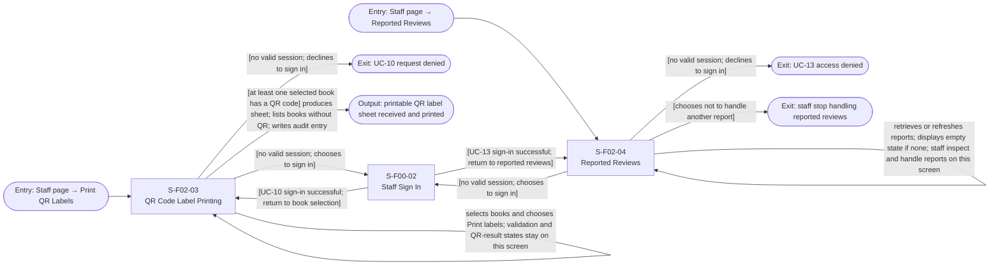

# Screen Transition Diagram: Group H Library Core System

<!--
DBIZ2 Lesson 8 template. File: docs/external-design/screen-transition.md
Nodes are Screen IDs from docs/external-design/screen-list.md. Arrows are user actions or system events.
-->

The On-site Staff uses 3 screens (`S-F00-02`, `S-F02-03`, `S-F02-04`), fewer than 15, so there is one diagram for the actor. UC-10 and UC-13 are the two On-site Staff use cases in the supplied Screen Lists. The automatic QR-generation process in UC-10 is time-triggered and has no screen, so it is not included as a screen transition.

## 1. On-site Staff

Conventions: the two entry nodes represent the existing Staff Page routes to the two functions; the Staff Page is not assigned a new Screen ID. When staff have no valid session, they choose whether to sign in before opening the shared sign-in screen (`S-F00-02`). If they sign in successfully, they return to the screen that requested sign-in: `S-F02-03` for UC-10 or `S-F02-04` for UC-13. If they decline, the request is denied; no additional screen is opened.

On `S-F02-03`, an empty selection produces a validation message on the same screen. If none of the selected books has a QR code, no sheet is produced. If at least one selected book has a QR code, the system produces the printable sheet; selected books without QR codes are left out and listed to staff, and an audit entry is written. These are screen states and outcomes, not separate screens. The printable sheet is an output, not a navigable screen.

On `S-F02-04`, the empty-list message is a state of the same screen. Staff select and inspect a reported review, then either remove it or dismiss its report. Choosing Remove opens the “Confirm removal of reported review” modal on `S-F02-04`: confirming removes the review from public display and writes an audit entry; cancelling leaves the review public and in the reported list. Dismissing a report keeps the review public and removes it from the reported list. The list is refreshed when staff handle another report. The modal is not a separate screen.

The automatic QR generation after the daily catalogue sync (FR-02-07) is not shown: it is a time-triggered background process, not a screen or a staff navigation path.

## Usage-flow paths

| Usage-flow arrow / action | Path on this diagram |
|---|---|
| UC-10: On-site Staff opens QR label printing | Entry `Staff page → Print QR Labels` → `S-F02-03` |
| UC-10: staff sign in when there is no valid session | `S-F02-03` → `S-F00-02` → `S-F02-03` (successful sign-in returns to book selection) |
| UC-10: staff decline to sign in | `S-F02-03` → Exit: request denied |
| UC-10: print labels | `S-F02-03` → output: printable QR label sheet received and printed |
| UC-13: On-site Staff opens reported reviews | Entry `Staff page → Reported Reviews` → `S-F02-04` |
| UC-13: staff sign in when there is no valid session | `S-F02-04` → `S-F00-02` → `S-F02-04` (successful sign-in returns to reported reviews) |
| UC-13: staff decline to sign in | `S-F02-04` → Exit: access denied |
| UC-13: remove a violating review | `S-F02-04` → confirmation modal on the same screen → confirm → updated `S-F02-04` |
| UC-13: cancel removal | `S-F02-04` → confirmation modal on the same screen → cancel → `S-F02-04` (review remains public and reported) |
| UC-13: dismiss a report | `S-F02-04` → dismiss report → updated `S-F02-04` |
| UC-13: handle another report | `S-F02-04` → refresh and inspect the next report on `S-F02-04` |

## Checks

- [x] Every On-site Staff screen in the supplied Screen Lists appears: 3 of 3 (`S-F00-02`, `S-F02-03`, `S-F02-04`).
- [x] Every screen is reachable from an entry point.
- [x] The shared staff sign-in screen is included and returns staff to the screen that requested sign-in.
- [x] The sign-in decision is shown before entering `S-F00-02`; declining sign-in does not incorrectly branch out of the sign-in screen.
- [x] UC-10 and UC-13 are the only On-site Staff use cases represented.
- [x] UC-10 empty-selection, no-QR and partial-QR outcomes are states or outputs of `S-F02-03`, not extra screens.
- [x] UC-10 does not include a print-preview modal; none is specified in its Screen List.
- [x] UC-13 empty-list state belongs to `S-F02-04`.
- [x] The UC-13 confirmation modal is represented as an interaction on `S-F02-04`, not as a separate screen.
- [x] UC-13 confirm, cancel and dismiss outcomes match the Screen List and Activity Diagram.
- [x] The automatic QR-generation process is excluded because it has no screen.
- [x] No unconfirmed Staff Hub Screen ID, error screen, preview screen or sign-out transition has been invented.
- [x] The diagram uses Mermaid `flowchart LR`.
