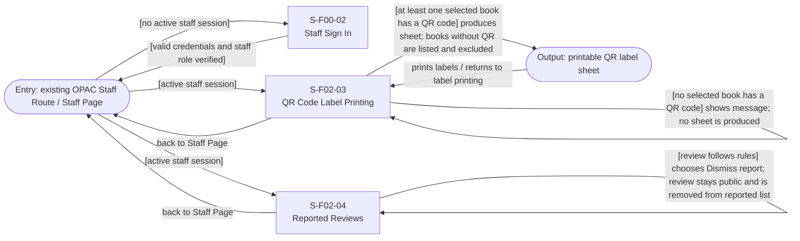

# Screen Transition Diagram: Group H Library Core System

<!--
DBIZ2 Lesson 8 template. File: docs/external-design/screen-transition.md
Nodes are Screen IDs from the Screen Lists. Arrows are user actions or system events.
-->

The On-site Staff uses 3 screens (`S-F00-02`, `S-F02-03`, `S-F02-04`), fewer than 15, so there is one diagram for the actor. The two staff use cases in scope are UC-10 and UC-13. Reader screens are covered by the Reader diagram. The automatic QR-generation process in UC-10 is a background process and has no screen transition.

## 1. On-site Staff

Conventions: `eStaff` represents the existing Staff Route / Staff Page used as the entry point; it is not a separately specified Screen ID. Staff who already have a valid session can open either staff screen directly. Staff without a valid session use the shared sign-in screen (`S-F00-02`); after valid credentials and staff-role verification, they continue to the Staff Page and choose a function. The Screen Lists do not specify a separate sign-in error screen or a staff hub Screen ID, so neither is added.

UC-10 states such as empty selection, no available QR codes and partial QR availability remain on `S-F02-03`; they are not separate screens. When at least one selected book has a QR code, the system produces a printable sheet, excludes and lists selected books without QR codes, and writes an audit entry when the sheet is produced. The printable sheet is an output of the printing flow, not an additional Screen ID.

In UC-13, the confirmation modal is opened from `S-F02-04` and is represented as an interaction on that same screen, not as a separate screen. Confirming removal removes the review from public display and writes an audit entry. Cancelling leaves the review public and in the reported list. Dismissing a report leaves the review public but removes it from the reported list. The empty-list message is a state of `S-F02-04`.

## Usage-flow paths

| Usage-flow arrow | Path on this diagram |
|---|---|
| UC-10: On-site Staff starts printing QR labels | Entry `existing OPAC Staff Route / Staff Page` → `S-F02-03` |
| UC-10: Staff must sign in first | Entry `existing OPAC Staff Route / Staff Page` → `S-F00-02` → Entry `existing OPAC Staff Route / Staff Page` → `S-F02-03` |
| UC-13: On-site Staff starts reviewing reports | Entry `existing OPAC Staff Route / Staff Page` → `S-F02-04` |
| UC-13: Staff must sign in first | Entry `existing OPAC Staff Route / Staff Page` → `S-F00-02` → Entry `existing OPAC Staff Route / Staff Page` → `S-F02-04` |
| UC-10: empty selection, no QR codes or partial QR availability | `S-F02-03` → same screen state; if a sheet is produced, output `printable QR label sheet` |
| UC-13: remove a violating review | `S-F02-04` → confirmation modal on the same screen → confirm → refreshed `S-F02-04` |
| UC-13: cancel removal | `S-F02-04` → confirmation modal on the same screen → cancel → `S-F02-04` |
| UC-13: dismiss a report | `S-F02-04` → dismiss report → refreshed `S-F02-04` |

## Checks

- [x] Every On-site Staff screen in the supplied Screen Lists appears: 3 of 3 (`S-F00-02`, `S-F02-03`, `S-F02-04`).
- [x] Every screen is reachable from an entry point.
- [x] The shared staff sign-in screen is included.
- [x] UC-10 and UC-13 are the only staff-initiated Usage Flows represented.
- [x] Empty-selection, no-QR, partial-QR and empty-reported-list outcomes are states of their existing screens.
- [x] The UC-13 confirmation modal is represented as an interaction on `S-F02-04`, not as a separate screen.
- [x] The confirm, cancel and dismiss outcomes match the UC-13 Usage Flow.
- [x] The automatic QR-generation process is excluded from screen navigation because no screen is involved.
- [x] No unconfirmed Staff Hub Screen ID, sign-in error screen, QR preview screen or sign-out transition has been invented.
- [x] The diagram uses Mermaid `flowchart LR`.
