# Screen Transition Diagram: Group H Library Core System

<!--
DBIZ2 Lesson 8 template. File: docs/external-design/screen-transition.md
Nodes are Screen IDs from docs/external-design/screen-list.md. Arrows are user actions or system events.
-->

The Reader sees 9 screens (S-F00-01, S-F00-02, S-F01-01, S-F01-02, S-F02-01, S-F02-02, S-F03-01, S-F03-02, S-F03-03), fewer than 15, so there is one diagram for the actor. Staff screens (S-F02-03, S-F02-04) belong to the On-site Staff diagram. UC-08 and UC-09 (AI) have no screen list yet and are not in this diagram.

## 1. Reader

```mermaid
flowchart LR
  eRes(["Entry: existing OPAC catalogue and search results"])
  eMenu(["Entry: existing OPAC main menu"])
  eBD(["Entry: existing OPAC Book Detail"])
  ePA(["Entry: existing OPAC personal area"])
  eQR(["Entry: scans the QR code on a physical book"])
  eOnline(["Exit: online book on the current OPAC"])

  S00_01["S-F00-01<br>Sign in"]
  S00_02["S-F00-02<br>Verify email OTP"]
  S01_01["S-F01-01<br>Book Detail: Shelf location"]
  S01_02["S-F01-02<br>Interactive Digital Library Map"]
  S02_01["S-F02-01<br>Book Reviews"]
  S02_02["S-F02-02<br>Book Information and Reviews (QR landing page)"]
  S03_01["S-F03-01<br>Book Catalogue and Access Format Filter"]
  S03_02["S-F03-02<br>Reading History and Preferences"]
  S03_03["S-F03-03<br>Saved Books List"]

  eRes -->|"filters by access format"| S03_01
  S03_01 -->|"opens an online book"| eOnline
  S03_01 -->|"back"| eRes

  eBD -->|"taps shelf location"| S01_01
  S01_01 -->|"taps view the book on the map"| S01_02
  S01_01 -->|"back"| eBD
  eMenu -->|"opens the map"| S01_02
  S01_02 -->|"back, when opened from a book"| S01_01
  S01_02 -->|"back, when opened from the menu"| eMenu

  eBD -->|"taps Reviews"| S02_01
  S02_01 -->|"back"| eBD
  S02_01 -->|"submits own review, or deletes it and confirms in dialog"| S02_01
  S02_01 -->|"asks to write, edit, delete or report without a session"| S00_01

  eQR --> S02_02
  S02_02 -->|"submits own review, or deletes it and confirms in dialog"| S02_02
  S02_02 -->|"asks to write, edit or delete without a session"| S00_01
  S02_02 -->|"closes the page"| eQR

  ePA -->|"[not signed in]"| S00_01
  ePA -->|"[signed in] opens history and preferences"| S03_02
  ePA -->|"[signed in] opens saved books"| S03_03
  S03_02 -->|"back"| ePA
  S03_03 -->|"back"| ePA

  S00_01 -->|"[card number found]"| S00_02
  S00_01 -->|"cancels, when sign-in started from Book Reviews"| S02_01
  S00_01 -->|"cancels, when sign-in started from the QR landing page"| S02_02
  S00_01 -->|"cancels, when sign-in started from the personal area"| ePA
  S00_02 -->|"[OTP accepted]"| S02_01
  S00_02 -->|"[OTP accepted]"| S02_02
  S00_02 -->|"[OTP accepted]"| ePA
  S00_02 -->|"back"| S00_01
```

Conventions: arrows go from S-F00-02 to the screen that asked for sign in. The three "[OTP accepted]" arrows are one rule: the reader returns to the screen where the sign-in started. The three "cancels" arrows from S-F00-01 follow the same rule. Sign-in starts from S-F02-01, S-F02-02 and the existing personal area only. The personal-area routes to S-F03-02 and S-F03-03 are available only when the reader is signed in. OTP failure, expiry, resend and attempt-limit transitions are not added here because their exact screen-level behavior must be confirmed against the approved UC-11 Activity Diagram before being represented.

## Usage-flow paths

| Usage-flow arrow | Path on this diagram |
|---|---|
| UC-01 to UC-02 | S-F01-01 → S-F01-02 (taps view the book on the map) |
| UC-03 | No arrow to another UC; entry "existing OPAC catalogue and search results" → S-F03-01 (filters by access format) |
| UC-05 to UC-04 | S-F02-01 (taps Write, Edit or Delete; same screen, no new screen) |
| UC-06 to UC-04 | Entry "scans the QR code" → S-F02-02 (taps Write, Edit or Delete; same screen) |
| UC-05 to UC-11 | S-F02-01 → S-F00-01 (asks to act without a session) |
| UC-06 to UC-11 | S-F02-02 → S-F00-01 (asks to act without a session) |
| UC-11 to UC-04 | S-F00-01 → S-F00-02 → S-F02-01 or S-F02-02 (OTP accepted) |
| UC-05 to UC-14 | S-F02-01 (taps Report; same screen) |
| UC-11 to UC-14 | S-F00-01 → S-F00-02 → S-F02-01 (OTP accepted) |
| UC-11 to UC-07 | S-F00-01 → S-F00-02 → entry "existing OPAC personal area" (OTP accepted) → S-F03-02 (opens history and preferences) |
| UC-11 to UC-12 | S-F00-01 → S-F00-02 → entry "existing OPAC personal area" (OTP accepted) → S-F03-03 (opens saved books) |
