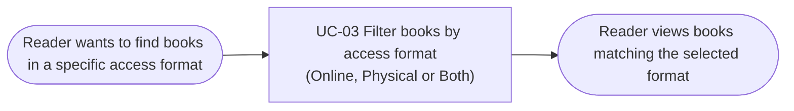

# Usage Flow: UC-03 Filter Books by Access Format

| Field | Value |
|---|---|
| Product | OPAC |
| Use Case | UC-03 Filter books by access format (online, physical or both) |
| Primary Actor | Reader |
| Activity Diagram | `AD-UC-03.md` |
| Version | Based on AD-UC-03 v1.2 |

## Reader: Find books by access format

## Step mapping

| Step | Use case | Activity diagram | Screens |
|---|---|---|---|
| 1 | UC-03 Filter books by access format | `AD-UC-03.md` | Search Results |

## Flow description

1. The Reader starts with the goal of finding books in a particular access format.
2. The Reader uses UC-03 to choose Online, Physical or Both.
3. The system displays books matching the selected format, or informs the Reader when no books are found.
4. The Reader may choose another access format or open an online book.
5. When the Reader opens an online book, the system records the read anonymously. If the Reader is signed in with a library card, the book is also added to their reading history.

## Use Cases without a flow

UC-03 is initiated directly by the Reader, so it is not a system-triggered Use Case. Online-read logging and reading-history updates are internal processing steps within UC-03, not separate Use Cases in this flow.

## Checks before you save

- [x] Reader is the correct Actor.
- [x] UC-03 ID and name match the Activity Diagram.
- [x] The flow represents the Reader's goal, not individual clicks.
- [x] Online, Physical and Both are retained.
- [x] The no-results alternative is covered in the Activity Diagram.
- [x] Online book opening and reading-history recording are covered.
- [x] No additional Use Cases have been invented.
- [x] The flow uses Mermaid `flowchart LR`.

## Screen note

The Screen List identifies **Search Results** as the screen for UC-03. The Advanced Filter Panel is treated as an area within this screen, not as a separate screen.
