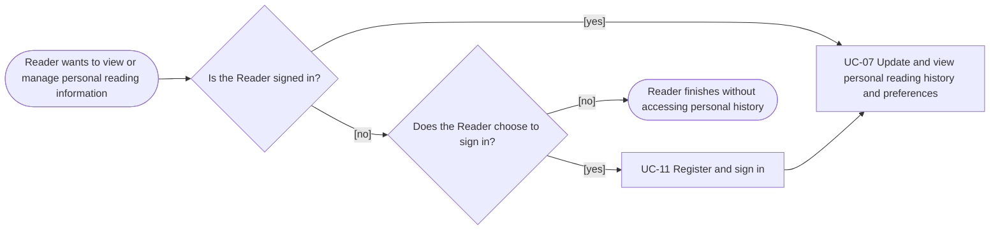

# Usage Flow: Group H Library Core System

| Field | Value |
|---|---|
| Product | National Library of Vietnam OPAC |
| Use Case | UC-07 Update and view personal reading history and preferences |
| Primary Actor | Reader |
| Feature | F-03 Discovery, Reading History & Recommendation |
| Activity Diagram | `AD-UC-07.md` |
| Source | Screen List: UC-07 · FR-03-01, FR-03-02, FR-03-03, FR-03-04, FR-03-05, FR-03-22, FR-04-08 |

## Before you draw: input check

- [x] The primary actor is Reader.
- [x] UC-07 requires a valid signed-in reader session (FR-04-08).
- [x] The shared sign-in use case is UC-11; its screen is `S-F00-01`.
- [x] The UC-07 screen is `S-F03-02 – Reading History & Preferences`.
- [x] Automatic history updates under FR-03-02 and FR-03-03 do not require separate screens.

## Reader: manage personal reading history and preferences

## Step mapping

| Step | Use case | Activity diagram | Screens |
|---|---|---|---|
| 1 (if needed) | UC-11 Register and sign in | Shared use case; not detailed in `AD-UC-07.md` | `S-F00-01` |
| 2 | UC-07 Update and view personal reading history and preferences | `AD-UC-07.md` | `S-F03-02` |

## What the Reader does in UC-07

After a valid session is available, the Reader can use UC-07 to:

- View personal reading history and reading status.
- Update a book's reading status and manually entered progress (FR-03-04).
- Update personal reading preferences (FR-03-05).
- Finish using the feature.

The system validates submitted updates. If an update is invalid, it rejects the update, keeps the previously saved data unchanged and displays an error (FR-03-22). These are actions and states within UC-07, not separate Use Cases or screens.

## Background events that update the reading history

These processes update the data later displayed in UC-07. They are not separate Reader-initiated Usage Flows and do not require additional screens.

| Event / trigger | System process | Requirement | Screen |
|---|---|---|---|
| An online book is opened by a signed-in Reader in UC-03 | Add the opened book to that Reader's reading history | FR-03-02 | No separate screen; data appears in `S-F03-02` |
| Daily loan-record sync is completed | Find new borrow records and add borrowed books to Readers' histories | FR-03-03 | No screen; background process |

## Use cases without a Reader flow

There are no additional standalone, system-triggered Use Cases identified for UC-07 in the supplied Screen List. The two background processes above are requirement-level events, not separate Use Cases.

## Checks before you save

- [x] The Actor name matches the project: Reader.
- [x] UC-07 ID and name match the Screen List.
- [x] UC-11 appears only as the shared sign-in Use Case when needed.
- [x] The flow is at Use Case level; boxes are not clicks or screen names.
- [x] The sign-in and no-sign-in branches are represented.
- [x] The UC-07 screen `S-F03-02` is mapped to the UC-07 step.
- [x] Background history updates are documented without inventing separate screens or Use Cases.
- [x] Invalid updates preserve previously saved data, as required by FR-03-22.
- [x] The Mermaid diagram uses `flowchart LR`.
