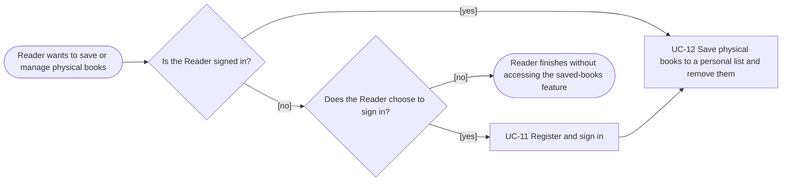

# Usage Flow: Group H Library Core System

| Field | Value |
|---|---|
| Product | Group H Library Core System (OPAC) |
| Use case | UC-12 Save physical books to a personal list and remove them |
| Primary actor | Reader |
| Feature | F-03 Discovery, Reading History & Recommendation |
| Login required | Yes |
| Sources | `screen-list-UC12.md`; `AD-UC-12` and requirements listed in the Screen List; `usage-flow.md` teaching example |

## Before you draw: source checks

- [x] The actor is **Reader**, matching the UC-12 Screen List.
- [x] UC-12 requires a valid reader session (FR-04-08).
- [x] Sign-in is handled by the shared UC-11, not by a new UC-12 screen.
- [x] Saving a physical book is an action on the existing OPAC book detail/catalogue display.
- [x] Viewing and removing saved books use `S-F03-03 Saved Books List`.
- [x] Empty-list, duplicate-save and unavailable-location messages are screen states, not separate screens or use cases.

## Reader: save and manage physical books

## Step mapping

| Step | Use case | Activity diagram | Screens |
|---|---|---|---|
| 1 (if needed) | UC-11 Register and sign in | Shared use case; sign-in details are outside the UC-12 flow | `S-F00-01` |
| 2 | UC-12 Save physical books to a personal list and remove them | `AD-UC-12` | Existing OPAC book detail/catalogue display; `S-F03-03` |

## What the Reader does in UC-12

After a valid reader session is available, the Reader can use UC-12 for three related purposes:

- **Save a physical book:** select Save on the existing OPAC book display. The system checks whether the book is already saved (FR-03-24). If it is already present, the system does not create a duplicate; otherwise, it adds the book to the Reader's saved-books list (FR-03-06).
- **View saved books:** open the Saved Books List. The system retrieves saved physical books and their synced shelf locations (FR-03-07). If the list is empty, the screen displays the empty-list state (FR-03-25).
- **Remove a saved book:** select Remove from the Saved Books List. The system deletes the selected entry and refreshes the list (FR-03-08).

If a saved book has a missing or inconsistent shelf location, the list shows the location as unavailable and directs the Reader to library staff (FR-01-07). This is a state of the saved-book entry, not a separate screen.

## Screens and states

| Screen / UI location | Role in the flow |
|---|---|
| `S-F00-01` Sign in | Shared UC-11 screen used only when the Reader chooses to sign in |
| Existing OPAC book detail / catalogue display | Contains the Save action for a physical book; it is not a new UC-12 screen |
| `S-F03-03` Saved Books List | Displays saved physical books and shelf locations; supports Remove |

The following are **states or system actions**, not additional screens: checking for a duplicate saved entry, adding or deleting a saved entry, the empty-list message, and an unavailable shelf location. The Screen List does not specify a confirmation modal for removal.

## Use cases without a Reader flow

| Use case / process | Started by | Treatment |
|---|---|---|
| UC-12 | Reader | Included in the Reader flow above |
| Check session validity (FR-04-08) | System access-control check | Part of the UC-12 flow; not a separate use case |
| Check for duplicate / add saved entry / retrieve list / delete entry | System actions | Internal UC-12 behavior; not separate use cases |

No additional standalone, system-triggered use case is identified in the supplied UC-12 Screen List.

## Checks before you save

- [x] The Actor name and UC-12 name match the supplied Screen List.
- [x] UC-11 appears only as the shared sign-in use case when needed.
- [x] The Mermaid boxes represent use cases, not clicks, screens or internal system actions.
- [x] The sign-in and no-sign-in branches are represented.
- [x] The existing OPAC book display and `S-F03-03` are both mapped.
- [x] Duplicate-save, empty-list and unavailable-location outcomes are treated as states, not new screens.
- [x] No confirmation modal or additional screen has been invented.
- [x] The diagram uses `flowchart LR`.
