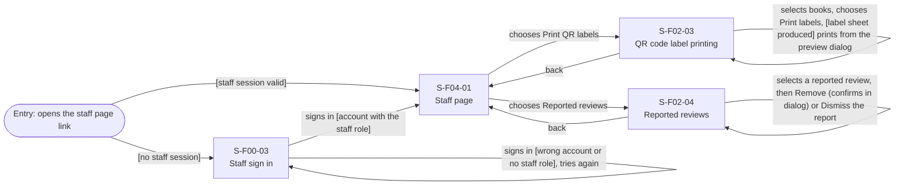

# Screen Transition Diagram: Group H Library Core System

Product: Group H Library Core System · Version v1.0 · Date 2026-11-08 · Screen IDs from [screen-list.md](screen-list.md)

One diagram per actor. The Reader sees 11 product screens (fewer than 15), so the Reader has one
diagram; On-site Staff see 4 screens and have their own diagram.

## 1. Reader

```mermaid
flowchart LR
  eRes(["Entry: OPAC catalogue or search results (existing)"])
  eBD(["Entry: OPAC Book Detail (existing)"])
  eMenu(["Entry: OPAC main menu (existing)"])
  ePA(["Entry: OPAC personal area (existing)"])
  eQR(["Entry: scans the QR code on a physical book"])
  eOnline(["Exit: online book on the current OPAC"])

  S00_01["S-F00-01<br>Sign in: library card number"]
  S00_02["S-F00-02<br>Verify email OTP"]
  S01_01["S-F01-01<br>Shelf location (with Save to my list)"]
  S01_02["S-F01-02<br>Interactive digital library map"]
  S02_01["S-F02-01<br>Book reviews"]
  S02_02["S-F02-02<br>Book information and reviews (QR landing page)"]
  S03_01["S-F03-01<br>Access-format filter and results"]
  S03_02["S-F03-02<br>Reading history and preferences"]
  S03_03["S-F03-03<br>Saved books list"]
  S03_06["S-F03-06<br>AI chatbot book search"]
  S03_07["S-F03-07<br>Book recommendations"]

  eRes -->|"chooses Filter by access format"| S03_01
  S03_01 -->|"chooses another access format"| S03_01
  S03_01 -->|"opens an online book"| eOnline
  S03_01 -->|"opens a physical book"| eBD
  S03_01 -->|"back"| eRes

  eBD -->|"requests the shelf location"| S01_01
  S01_01 -->|"chooses View on map"| S01_02
  S01_01 -->|"chooses Save to my list [signed in]"| S01_01
  S01_01 -->|"Save without a session, chooses Sign in in dialog"| S00_01
  S01_01 -->|"back"| eBD
  eMenu -->|"chooses Library map"| S01_02
  S01_02 -->|"views another floor or selects a reading room"| S01_02
  S01_02 -->|"back, when opened from a book"| S01_01
  S01_02 -->|"back, when opened from the menu"| eMenu

  eBD -->|"chooses Reviews"| S02_01
  S02_01 -->|"next page; writes, edits or deletes own review (confirms delete in dialog)"| S02_01
  S02_01 -->|"chooses Report on a review, confirms in dialog"| S02_01
  S02_01 -->|"review action or Report without a session, chooses Sign in in dialog"| S00_01
  S02_01 -->|"back"| eBD

  eQR --> S02_02
  S02_02 -->|"writes, edits or deletes own review (confirms delete in dialog)"| S02_02
  S02_02 -->|"review action without a session, chooses Sign in in dialog"| S00_01
  S02_02 -->|"chooses View this book on the OPAC"| eBD

  ePA -->|"chooses Reading history"| S03_02
  S03_02 -->|"submits reading status and progress, or preferences"| S03_02
  S03_02 -->|"opened without a session, chooses Sign in in dialog"| S00_01
  S03_02 -->|"back, when opened from the personal area"| ePA
  S03_02 -->|"back, when opened from recommendations"| S03_07

  ePA -->|"chooses Saved books"| S03_03
  S03_03 -->|"removes a saved book"| S03_03
  S03_03 -->|"opened without a session, chooses Sign in in dialog"| S00_01
  S03_03 -->|"back"| ePA

  eMenu -->|"chooses Ask the library chatbot"| S03_06
  S03_06 -->|"sends a message [signed in]"| S03_06
  S03_06 -->|"sends a message without a session, chooses Sign in in dialog"| S00_01
  S03_06 -->|"[AI search unavailable] chooses Use the format filter"| S03_01
  S03_06 -->|"opens a book card"| eBD
  S03_06 -->|"back"| eMenu

  eMenu -->|"chooses Recommended for you"| S03_07
  S03_07 -->|"opened without a session, chooses Sign in in dialog"| S00_01
  S03_07 -->|"[no reading data yet] chooses Set your preferences"| S03_02
  S03_07 -->|"opens a recommended book"| eBD
  S03_07 -->|"back"| eMenu

  eMenu -->|"chooses Sign in"| S00_01
  S00_01 -->|"submits card number [card number not found]"| S00_01
  S00_01 -->|"submits card number [card number found]"| S00_02
  S00_02 -->|"submits a wrong OTP [fewer than 5 attempts]"| S00_02
  S00_02 -->|"requests a new OTP"| S00_02
  S00_02 -->|"back"| S00_01
  S00_02 -->|"[OTP accepted]"| S01_01
  S00_02 -->|"[OTP accepted]"| S02_01
  S00_02 -->|"[OTP accepted]"| S02_02
  S00_02 -->|"[OTP accepted]"| S03_02
  S00_02 -->|"[OTP accepted]"| S03_03
  S00_02 -->|"[OTP accepted]"| S03_06
  S00_02 -->|"[OTP accepted]"| S03_07
  S00_02 -->|"[OTP accepted]"| eMenu
```

Main task "find where a physical book is": OPAC Book Detail → S-F01-01 (floor, room and shelf code)
→ S-F01-02 (room on the map): 2 screens. The longest signed-out task, writing a review, is
S-F02-01 → S-F00-01 → S-F00-02 → back to S-F02-01: 3 screens.

Sign-in return rule (open question L8-01 in `ACTIVITY DIAGRAM/activity-index.md`), drawn once per origin screen: the eight "[OTP accepted]" arrows are one rule.
The reader returns to the screen where sign-in started (from the OPAC main menu: back to the menu), and
the action they asked for continues there (Save, review, report, message). **Cancel** on S-F00-01 or
S-F00-02 follows the same rule and is not drawn, to keep the diagram readable. **Not now** in the
dialog closes it and the reader stays on the same screen.

Sign in (AD-UC-11), moves and states: card number found → S-F00-02 (move). Card number not found →
error state of S-F00-01. Wrong OTP with fewer than 5 attempts → "code incorrect" state of S-F00-02,
the reader enters it again. Code expired or already used, 5th wrong attempt, or OTP email not sent →
rejection state of S-F00-02 with **Request a new OTP**, which stays on S-F00-02 (new code sent). The
reader who does not ask for a new OTP leaves by Cancel (return rule above).

## 2. On-site Staff

Main task "print QR labels": S-F04-01 → S-F02-03, preview dialog, print: 2 screens. Without a staff
session: S-F00-03 → S-F04-01 → S-F02-03: 3 screens.

The staff page opens only with a valid staff session (FR-04-08): without one, the staff sign-in
S-F00-03 opens first, and after sign-in staff land on S-F04-01 (FR-04-07; `s10` in AD-UC-10 and
AD-UC-13). A wrong account or an account without the staff role is an error state of S-F00-03
(FR-04-18). "No book selected", "no selected book has a QR code", books left out and "no
reported reviews waiting" are states of the screen staff are on.

Conventions:

- Node ID: the Screen ID with `-` replaced by `_`; the label shows the real Screen ID on the first line.
- Arrow label: the user action ("chooses View on map"), or a system event in brackets ("[OTP accepted]").
  A loop arrow is an action that keeps the reader or staff on the same screen.
- A modal is not a node; it is written on the arrow. "Sign in in dialog" = M-F00-01 Sign in to continue?
  (Reader only; staff sign in before the staff page opens). "Confirms delete in dialog" =
  M-F02-01-01, "Report … confirms in dialog" = M-F02-01-02, "preview dialog" = M-F02-03-01,
  "Remove (confirms in dialog)" = M-F02-04-01.
- Rounded stadium nodes are existing OPAC pages, the QR scan and the staff page link (outside the
  product). An arrow into a stadium means the reader leaves the product for that existing page.
- Not drawn because no one navigates: automatic QR generation after the daily catalogue sync
  (AD-UC-10), reading-history entries from loan sync (AD-UC-07) and the planned data sync use case.

## Checks before you save

- [x] Every screen in the Screen List appears in one or more of the diagrams: 15 of 15 (Reader 11:
      S-F00-01, S-F00-02, S-F01-01, S-F01-02, S-F02-01, S-F02-02, S-F03-01, S-F03-02, S-F03-03, S-F03-06,
      S-F03-07; On-site Staff 4: S-F04-01, S-F00-03, S-F02-03, S-F02-04). No modal is a node.
- [x] Every screen is reachable from an entry point: OPAC catalogue → S-F03-01; OPAC Book Detail →
      S-F01-01, S-F02-01; OPAC main menu → S-F01-02, S-F03-06, S-F03-07, S-F00-01; personal area →
      S-F03-02, S-F03-03; QR scan → S-F02-02; S-F00-01 → S-F00-02; staff page link → S-F00-03 or
      S-F04-01 → S-F02-03, S-F02-04.
- [x] No dead end: every screen has a way out. S-F02-02 (QR landing page) has "View this book on the
      OPAC" to the existing OPAC Book Detail (team decision 2026-11-08). Screens whose only way out, apart
      from sign-in and same-screen actions, is a back arrow: S-F01-02, S-F02-01, S-F03-02, S-F03-03,
      S-F02-03, S-F02-04 (the task is finished on the screen itself).
- [x] The main task of each actor reaches its result in three screens or fewer: Reader "find where a
      physical book is" 2 screens; On-site Staff "print QR labels" 2 screens (3 with sign-in).
- [x] Every arrow label is a user action or a system event, never a screen name (56 Reader and 10 staff
      labels checked; the entry arrow from the QR scan carries no label).
- [x] Usage-flow paths: all 20 Reader arrows of usage-flow.md (17 solid, 3 dashed "not signed in") have a path (table below); the staff
      usage flows have no UC-to-UC arrow. UC-03, UC-08 and UC-09 → UC-01 pass through the existing OPAC
      Book Detail (the reader leaves the product in between).
- [x] The diagram renders: both diagrams pass the Mermaid 11.4.1 parser without error (scripted check,
      2026-11-08); every label quoted, ` ` for line breaks, no node named `end`, no `-` in node IDs.
      The Reader layout (56 arrows) is dense: look at it once on mermaid.live before the review.

## Usage-flow paths

| Actor | Usage-flow arrow | Path on this diagram |
|---|---|---|
| Reader | UC-03 to UC-01 | S-F03-01 → entry point "OPAC Book Detail" ("opens a physical book") → S-F01-01 ("requests the shelf location") |
| Reader | UC-01 to UC-02 | S-F01-01 → S-F01-02 ("chooses View on map") |
| Reader | UC-01 to UC-12 | Same screen: S-F01-01 "chooses Save to my list [signed in]"; "Saved" and "Already saved" are states |
| Reader | UC-11 to UC-12 | S-F01-01 → S-F00-01 ("Save without a session, chooses Sign in in dialog") → S-F00-02 → S-F01-01 ("[OTP accepted]"), or S-F03-03 → S-F00-01 → S-F00-02 → S-F03-03 |
| Reader | UC-08 to UC-03 | S-F03-06 → S-F03-01 ("[AI search unavailable] chooses Use the format filter") |
| Reader | UC-08 to UC-01 | S-F03-06 → entry point "OPAC Book Detail" ("opens a book card") → S-F01-01 ("requests the shelf location") |
| Reader | UC-09 to UC-07 | S-F03-07 → S-F03-02 ("[no reading data yet] chooses Set your preferences") |
| Reader | UC-07 to UC-09 | S-F03-02 → S-F03-07 ("back, when opened from recommendations") |
| Reader | UC-09 to UC-01 | S-F03-07 → entry point "OPAC Book Detail" ("opens a recommended book") → S-F01-01 ("requests the shelf location") |
| Reader | UC-11 to UC-08 | S-F03-06 → S-F00-01 ("sends a message without a session, chooses Sign in in dialog") → S-F00-02 → S-F03-06 ("[OTP accepted]") |
| Reader | UC-11 to UC-09 | S-F03-07 → S-F00-01 ("opened without a session, chooses Sign in in dialog") → S-F00-02 → S-F03-07 ("[OTP accepted]") |
| Reader | UC-06 to UC-04 | Same screen: S-F02-02 "writes, edits or deletes own review"; delete confirms in M-F02-01-01 |
| Reader | UC-05 to UC-04 | Same screen: S-F02-01 "writes, edits or deletes own review"; delete confirms in M-F02-01-01 |
| Reader | UC-05 to UC-14 | Same screen: S-F02-01 "chooses Report on a review, confirms in dialog" (M-F02-01-02) |
| Reader | UC-11 to UC-04 | S-F02-01 or S-F02-02 → S-F00-01 ("review action without a session, chooses Sign in in dialog") → S-F00-02 → the same screen ("[OTP accepted]") |
| Reader | UC-11 to UC-14 | S-F02-01 → S-F00-01 ("Report without a session, chooses Sign in in dialog") → S-F00-02 → S-F02-01 ("[OTP accepted]") |
| Reader | UC-11 to UC-07 | S-F03-02 → S-F00-01 ("opened without a session, chooses Sign in in dialog") → S-F00-02 → S-F03-02 ("[OTP accepted]"), direct return, not through the personal area |
| Reader | UC-01 to UC-11 | S-F01-01 → S-F00-01 ("Save without a session, chooses Sign in in dialog" M-F00-01) |
| Reader | UC-05 to UC-11 | S-F02-01 → S-F00-01 ("review action or Report without a session, chooses Sign in in dialog" M-F00-01) |
| Reader | UC-06 to UC-11 | S-F02-02 → S-F00-01 ("review action without a session, chooses Sign in in dialog" M-F00-01) |
| On-site Staff | none | UC-10 and UC-13 have no UC-to-UC arrow; each starts from entry point "opens the staff page link" → S-F04-01 |

