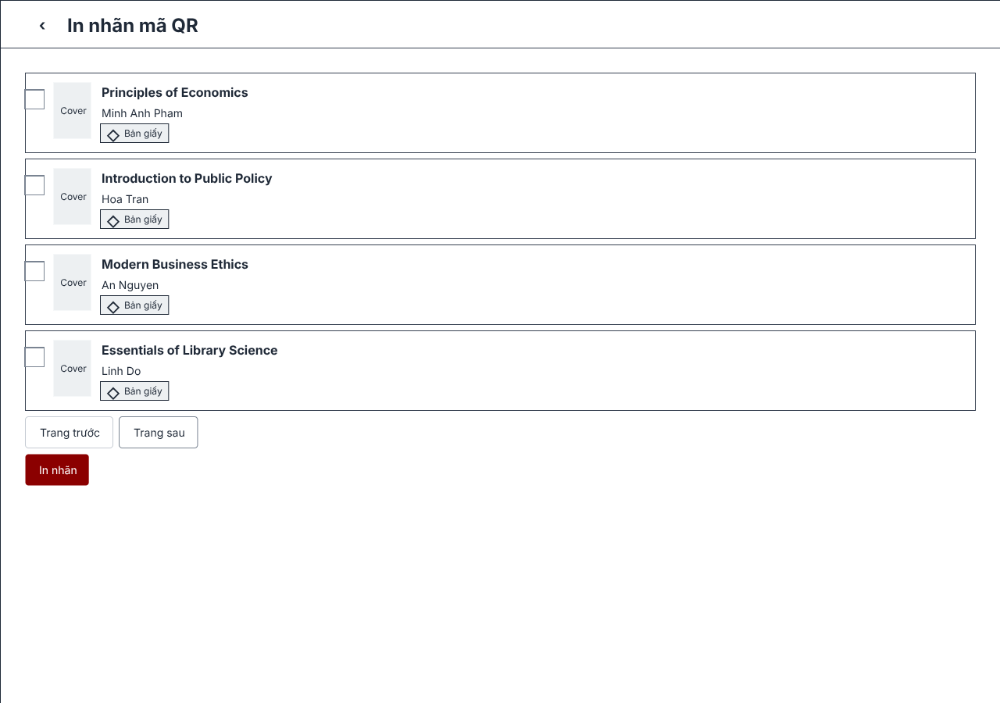
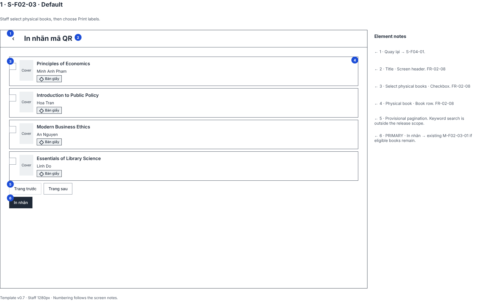
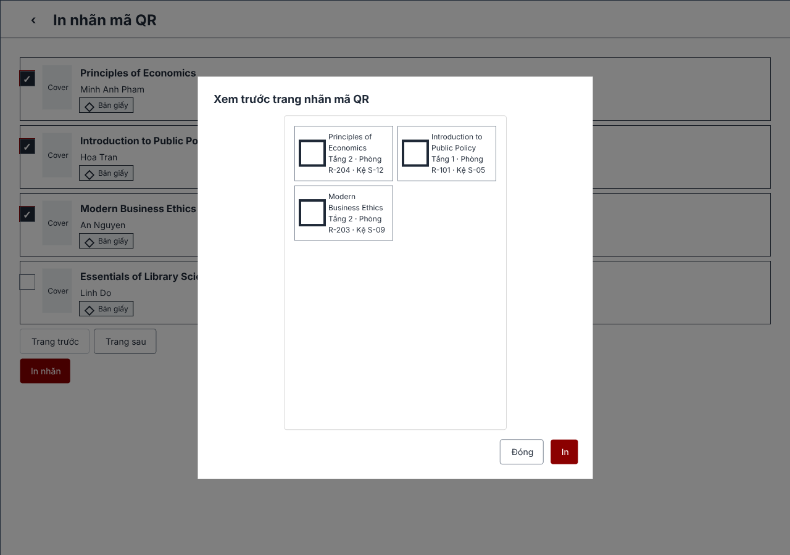
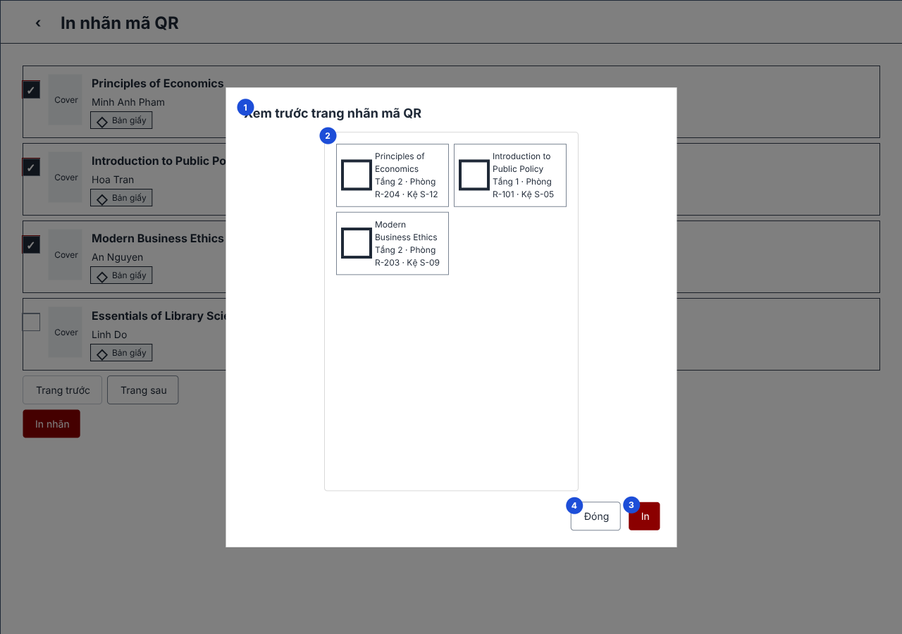

# Screen Spec: S-F02-03 QR code label printing

| Field | Value |
| --- | --- |
| Screen ID | S-F02-03 |
| Screen name | QR code label printing |
| Actor | On-site Staff |
| Priority | Must |
| Feature | F-02 Reviews & QR |
| Activity diagrams | AD-UC-10 |
| Mockup image | img/S-F02-03.png |
| Status | Draft |
| Frame width | 1280px, export 1x |
| Wireframe source | src/Ha-wireframe-1.drawio |
| Author | Ha |
| UI conventions | v0.8, 21/11/2026 |

## 1. Purpose

**Shown when:** Signed-in On-site Staff choose Print QR labels on S-F04-01.

**The user leaves this screen when:** Back opens S-F04-01. Producing a label sheet opens the existing M-F02-03-01 overlay; closing it keeps staff on S-F02-03.

## 2. Mockup

Styles follow [UI conventions v0.8](../ui-conventions.md#6-design-tokens). Each image contains one product frame.

| State | Image |
| --- | --- |
| Default | [S-F02-03.png](img/S-F02-03.png), [S-F02-03-numbered.png](img/S-F02-03-numbered.png) |
| Empty | [S-F02-03-empty.png](img/S-F02-03-empty.png), [S-F02-03-empty-numbered.png](img/S-F02-03-empty-numbered.png) |
| Loading | [S-F02-03-loading.png](img/S-F02-03-loading.png), [S-F02-03-loading-numbered.png](img/S-F02-03-loading-numbered.png) |
| Error — no selection | [S-F02-03-error.png](img/S-F02-03-error.png), [S-F02-03-error-numbered.png](img/S-F02-03-error-numbered.png) |
| Error — all lack QR | [S-F02-03-error-2.png](img/S-F02-03-error-2.png), [S-F02-03-error-2-numbered.png](img/S-F02-03-error-2-numbered.png) |
| Error — network | [S-F02-03-error-3.png](img/S-F02-03-error-3.png), [S-F02-03-error-3-numbered.png](img/S-F02-03-error-3-numbered.png) |
| Warning — some lack QR | [S-F02-03-warning.png](img/S-F02-03-warning.png), [S-F02-03-warning-numbered.png](img/S-F02-03-warning-numbered.png) |
| Success | [S-F02-03-success.png](img/S-F02-03-success.png) |
| Next page | [S-F02-03-page-2.png](img/S-F02-03-page-2.png) |

### Modal M-F02-03-01

## 3. Element inventory

| # | Element | Type | Content / data source | Required | Validation |
| --- | --- | --- | --- | --- | --- |
| 1 | Back | Screen header | Quay lại | Yes | none |
| 2 | Title | Screen header | In nhãn mã QR | Yes | none |
| 3 | Select physical books | Checkbox | Selection for each physical book | Yes | Only catalogue physical books can be selected. Require at least one on Print labels (FR-02-17). |
| 4 | Physical book | Book row | Book catalogue › title, author, access format | Yes | none |
| 5 | Pagination | Secondary button | Trang trước / Trang sau | Yes | none |
| 6 | Print labels | Primary button | In nhãn | Yes | none |
| 8 | Validation / load error | Banner | Hãy chọn ít nhất 1 sách bản giấy. / MSG-04 | No | none |
| 9 | Books without QR codes | Banner | Book catalogue › title for each omitted book | No | none |
| 10 | Catalogue loading | Skeleton | MSG-05 | No | none |
| 11 | No physical books | Empty state | Chưa có sách bản giấy. Bạn thử lại sau khi danh mục được đồng bộ. | No | none |
| 12 | Try again | Secondary button | Thử lại | Yes | none |

### 3.1 Modal M-F02-03-01 QR label sheet preview

| # | Element | Type | Content / data source | Required | Validation |
| --- | --- | --- | --- | --- | --- |
| 1 | Title | Modal | Xem trước trang nhãn mã QR | Yes | none |
| 2 | A4 preview | Label sheet | Book QR codes › QR code; Book catalogue › title; Book placement & library layout › floor, room code, shelf code | Yes | none |
| 3 | Print | Primary button | In | Yes | none |
| 4 | Close | Secondary button | Đóng | Yes | none |
| 5 | Omitted books | Banner | Book catalogue › title for each book left out (partial success only) | No | none |

## 4. States

| State | What the user sees | Trigger |
| --- | --- | --- |
| Default | Physical books, checkboxes and Print labels. | A signed-in staff member chooses Print QR labels on S-F04-01 (FR-02-08). |
| Empty | No synced physical books to select. | The synced physical-book list contains no books. |
| Loading | Skeleton while opening the book list. | The physical-book list request is pending. |
| Error — no selection | Hãy chọn ít nhất 1 sách bản giấy. | Staff choose In nhãn with no selected physical book (FR-02-17). |
| Error — all lack QR | Modern Business Ethics and Essentials of Library Science are listed. No sheet is produced. | None of the selected books has a QR code (FR-02-18). |
| Error — network | MSG-04, existing selections retained. | Loading the list or producing a sheet fails (FR-04-20). |
| Warning — some lack QR | Modern Business Ethics is listed as omitted. | Some selected books have no QR code and some are eligible (FR-02-18). |
| Success | Two QR labels from three selected books. M-F02-03-01 overlays the list. | Eligible labels were produced and the preview opens (FR-02-08); the illustrated sample selects three books and omits one. |
| Next page | Next page of newly synced physical books. | Staff choose Trang sau and another page of synced physical books is available. |

| Modal state | What the user sees | Trigger |
| --- | --- | --- |
| M-F02-03-01 › Default | Preview with three labels and Print / Close. | FR-02-08 |
| M-F02-03-01 › Empty | Not applicable: validation keeps the user on S-F02-03. | — |
| M-F02-03-01 › Loading | Not applicable: the preview opens after the sheet is ready. | — |
| M-F02-03-01 › Error | Not applicable: validation and failures are shown on S-F02-03. | — |
| M-F02-03-01 › Success — partial | Two-label A4 preview and the omitted book name. | FR-02-08, FR-02-18 |

## 5. Interactions and navigation

| # | Element | User action | System response | Goes to screen |
| --- | --- | --- | --- | --- |
| 1 | S-F02-03 › Back | Return to the staff page. | Return to the linked preceding screen. | S-F04-01 |
| 2 | S-F02-03 › Select physical books | Check or uncheck books (AD-UC-10 a1). | Update the selected physical books. | stays |
| 3 | S-F02-03 › Pagination | Move between pages of physical books. | Show the next or preceding page of the newly synced physical-book list. | stays |
| 4 | S-F02-03 › Print labels | Build a sheet with Print labels, element 6 (AD-UC-10 a2). Include only eligible checked books and list omitted titles. | Recheck the staff session/role. Require selection, omit books without QR codes and list their titles. If eligible books remain, build a sheet, write the print audit entry and open M-F02-03-01; otherwise stay. | M-F02-03-01 / stays |
| 5 | S-F02-03 › Print labels | Recheck staff session before creating a sheet (FR-04-08). | Recheck the staff session/role. Require selection, omit books without QR codes and list their titles. If eligible books remain, build a sheet, write the print audit entry and open M-F02-03-01; otherwise stay. | S-F00-03 |
| 6 | S-F02-03 › Try again | Retry after a network failure. | Retry the failed request while retaining displayed data and entered values (FR-04-20). | stays |
| 7 | M-F02-03-01 › Print | Open the browser print dialog (AD-UC-10 a5). | Open the browser print dialog for the A4 sheet (AD-UC-10 a5). | Browser print dialog (exit) |
| 8 | M-F02-03-01 › Close | Dismiss the preview and return to book selection (AD-UC-10 a4). | Dismiss the existing preview modal and restore S-F02-03. | S-F02-03 |

## 6. Screen-level rules

| Rule ID | Rule | Source |
| --- | --- | --- |
| SR-001 | Check valid staff session and role when opening the screen and again before producing the sheet. Without them open S-F00-03. | FR-04-08; AD-UC-10 d0 |
| SR-002 | Print labels with no selection produces no sheet and shows “Hãy chọn ít nhất 1 sách bản giấy.” | FR-02-17 |
| SR-003 | List the title of every selected book without a QR code and omit it. If none are eligible, produce no sheet. | FR-02-18; AD-UC-10 d3, d4 |
| SR-004 | With three selected books and one missing QR code, the preview contains two labels and names the omitted book. | AD-UC-10 acceptance test d3 [No] → d4 [Yes] |
| SR-005 | Produce the printable sheet and log actor, action and time before the preview is shown. | FR-02-08, FR-04-12; AD-UC-10 s4, s5 |
| SR-006 | Use newly synced physical books, newest first, with pagination. | Q3 confirmed by Ha, 21/11/2026 |
| SR-007 | Use A4 portrait, QR graphic + title + shelf location, 2 columns × 5 rows. | Q4 confirmed by Ha, 21/11/2026 |
| SR-008 | In in M-F02-03-01 opens the browser print dialog. Closing returns to the selection screen. | FR-02-08; AD-UC-10 a4, a5 |
| SR-009 | Keep existing selections and displayed book data when a request fails; offer retry. | FR-04-20 |

## 7. Linked requirements

| FR ID | What this screen does for it |
| --- | --- |
| FR-02-08 | Select, prepare, preview and print QR labels. |
| FR-02-17 | Require selection. |
| FR-02-18 | Omit and list books without QR codes. |
| FR-04-08 | Staff role/session check. |
| FR-04-12 | Print audit entry. |
| FR-04-20 | Retain data and retry. |

## 8. Responsive and accessibility notes

- Smallest product width is 360px. The staff reference is 1280px; on a narrow viewport stack book metadata, controls and modal actions while preserving reading order.
- Use the shared token fonts, 16px input text, body 16px and small text at least 12px. Reader targets are at least 44 × 44px. Text contrast must meet ui-conventions §5.
- Error feedback has a message, icon and error styling. Use visible labels, keyboard focus rings and DOM order matching the inventory. Loading disables duplicate submissions.
- Modal focus enters the dialog, remains within it while open, and returns to its trigger on dismissal. Print is a browser-controlled exit. After closing the preview, return focus to In nhãn.

## 9. Open questions

| # | Question | Blocking? | Status |
| --- | --- | --- | --- |
| Q3 | How do staff find books to select? | Yes | Closed 21/11/2026: Confirmed by Ha. Newly synced physical books, newest first, with pagination. |
| Q4 | What is on each QR label and how many labels per A4 sheet? | No | Closed 21/11/2026: Confirmed by Ha. QR + book title + shelf location; A4 portrait, 2 columns × 5 rows. |
| Q-Selection | [NEEDS CLARIFICATION: Must selection carry across pagination?] | No | Open. No additional control is drawn. |

---

## Completion checklist

- [x] The mockup is a separate cropped image file, named with the Screen ID.
- [x] Every visible element in the mockup appears in the element inventory.
- [x] Every input element has a validation rule or an explicit none.
- [x] All five states are filled in, or marked not applicable with a reason.
- [x] Every navigation target is a Screen ID in the Screen List or a documented modal/browser exit.
- [x] Every element that displays data names its field.
- [x] Every linked FR exists in the current Function List and every AD user action has an interaction row.
- [x] Modal inventory and interactions are included where applicable.
- [ ] Cross-review by Hoa and final review by Linh are complete.
