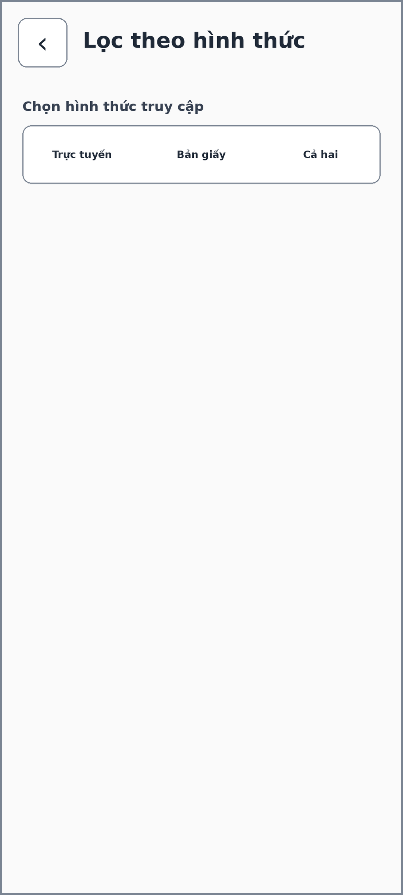
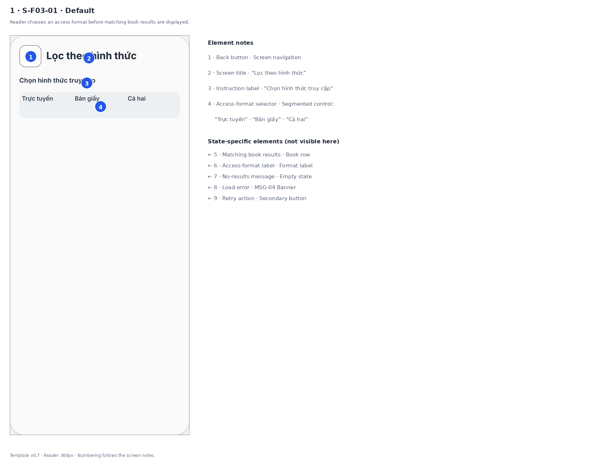

# Screen Spec: S-F03-01 Access-format filter and results

| Field | Value |
|---|---|
| Screen ID | `S-F03-01` |
| Screen name | Access-format filter and results |
| Actor | Reader |
| Priority | Should |
| Feature | `F-03` Discovery, Reading History & Recommendation |
| Activity diagrams | `AD-UC-03` (v1.2) |
| Mockup image | `img/S-F03-01.png` |
| Status | Draft |
| Frame width | 360px (exported at 3x = 1080px) |
| Wireframe source | No editable source in `screens/src/`; the state images are cropped from Nhi's sheet `img/S-F03-01-states.png` |
| Wireframe author | Nhi |
| Screen spec author | Linh |
| UI conventions | v0.8 |

## 1. Purpose

**Shown when:** The reader opens the `Filter by access format` link on the existing OPAC catalogue/search results, or follows the `use the format filter` link from `S-F03-06` when AI search is unavailable.

**The user leaves this screen when:** The reader opens an online book on the current OPAC, opens a physical book on the existing OPAC Book Detail page, or returns to the existing OPAC catalogue/search results using Back. Choosing another format or finishing the filtering activity keeps the reader on this screen.

## 2. Mockup

**State → Image**

| State | Image | Numbered image |
|---|---|---|
| Default | `img/S-F03-01.png` | `img/S-F03-01-numbered.png` |
| Empty (no data) | `img/S-F03-01-empty.png` | — |
| Loading | `img/S-F03-01-loading.png` | — |
| Error | `img/S-F03-01-error.png` | — |
| Success / confirmation (results) | `img/S-F03-01-success.png` | — |
| Next page | Not drawn | — |

Overview sheet of all states (reference only, not the main image): `img/S-F03-01-states.png`.

Use `ui-conventions.md` v0.8 §6 for all design tokens. Reader frame: 360px, exported at 3x (1080px). Titles use Plus Jakarta Sans; other text uses Inter.

## 3. Element inventory

**Numbering check:** Items 1–4 are the main numbered Default wireframe elements. Conditional results, empty, loading and error UI must be reconciled against their corresponding state images; system logging/history actions are not visible numbered controls. No format is selected on first entry (D19).

| # | Element | Type | Content / data source | Required | Validation |
|---|---|---|---|---|---|
| 1 | Back navigation | Screen header | Returns to the existing OPAC catalogue / search results from which the reader opened the filter. | Yes | Navigation only; preserve the originating OPAC destination. |
| 2 | Screen title | Screen header | `Lọc theo hình thức`. | Yes | Static text; title is confirmed in `ui-conventions.md` v0.8 §1. |
| 3 | Access-format selector | Segmented control | Exactly three choices: `Trực tuyến`, `Bản giấy`, and `Cả hai`. `Cả hai` means books that have both a physical copy and an online version. | Yes | One option can be selected at a time. No option is selected on first entry; no results are shown until the reader chooses a format (D19). |
| 4 | Matching book results | Book row | Book catalogue (W0 Table 4) › book title, author, cover placeholder, and applicable access-format label(s). Each format label uses an icon + Vietnamese word (`Trực tuyến` and/or `Bản giấy`). A book that has both formats shows both Format labels, `Bản giấy` and `Trực tuyến` (D9). | No (shown when results exist) | Read-only catalogue data. Only display the format information returned for each book; do not infer availability or stock status. |
| 5 (empty state) | No-results message | Empty state | `Không tìm thấy sách. Hãy chọn hình thức khác.` (`ui-conventions.md` §4, No results; Nhi's notes #7). | No (shown when no matches exist) | Not an input. Keep the selector available so the reader can choose another format. |
| 6 (results state) | Online-book link | Text link | Opens the selected online book on the current OPAC. No new online reader or download function is part of this product. | No (shown for online book results) | Open the matching book's existing OPAC online-book page. |
| 8 (error state) | Load error | Banner | `MSG-04`: `Không tải được trang. Bạn kiểm tra kết nối mạng rồi thử lại.` | No (shown on a load failure) | Not an input. Keep the selected format and any data already shown. |
| 9 (error state) | Try again | Secondary button | `Thử lại` | No (shown with the error Banner) | Retries loading results for the currently selected format. |
| 10 (results state) | Pagination | Secondary button | `Trang trước` / `Trang sau`, same pagination component as `S-F02-03`; 20 results per page (D9). | No (shown when results exceed one page) | Navigation only. `Trang trước` disabled on the first page, `Trang sau` disabled on the last page. |
| — (system) | Anonymous online-read log | Background system action; not a visible UI element | Online read log › book and read time only; no reader identity. | Yes (system action) | Create an anonymous record each time an online book is opened; do not include reader identity. |
| — (system) | Signed-in reader history update | Background system action; not a visible UI element | Reader reading history › book entry. | Conditional (system action) | Add the book to reading history only if the reader is signed in with a library card; otherwise do not create a history entry. |

## 4. States

| State | What the user sees | Trigger |
|---|---|---|
| Default | `Lọc theo hình thức` and the three-option selector with no option selected; no results are shown until the reader chooses a format (D19). | Reader opens the access-format filter. |
| Empty (no data) | `Không tìm thấy sách. Hãy chọn hình thức khác.` The selector remains available on this screen. | No books match the selected format (`AD-UC-03 d1 [No]`, `s3`; FR-03-23). |
| Loading | Skeleton placeholders while the system retrieves books matching the selected format (`MSG-05`; no loading text by default). | Reader selects an access format and matching books are retrieved. |
| Error | Shared `MSG-04` Banner `Không tải được trang. Bạn kiểm tra kết nối mạng rồi thử lại.` with `Thử lại`; the selected format and any data already shown are kept (`img/S-F03-01-error.png`). | Retrieving the books fails because of a network or server error (FR-04-20). |
| Success / confirmation | Matching books appear with their access-format labels (both labels on a book that has both formats), 20 per page, with `Trang trước` / `Trang sau` when there is more than one page. This is the results outcome, not a separate toast or confirmation message. | The selected format has matching books (`AD-UC-03 d1 [Yes]`, `s2`; FR-03-12). |
| Next page | The next or preceding 20 matching books for the same selected format; the selector stays as chosen. | The reader chooses `Trang sau` / `Trang trước` (D9). |

## 5. Interactions and navigation

| # | Element | User action | System response | Goes to screen |
|---|---|---|---|---|
| 1 | Entry | Open the access-format filter from the existing OPAC catalogue/search results, or follow the format-filter link from `S-F03-06` when AI search is unavailable. | Load the filter screen and make the three access-format choices available. | `S-F03-01` |
| 2 | Access-format selector | Choose `Trực tuyến`, `Bản giấy`, or `Cả hai`. | Retrieve matching books from the whole synced catalogue, not only the current OPAC search-result subset; display matching results from page 1 (also when the reader was on a later page of the previous format), or the no-results state (D14). | stays |
| 3 | Matching book results — physical book | Open a physical book result. | Hand off to the selected book's existing OPAC Book Detail page. | Existing OPAC Book Detail (exit) |
| 4 | Online-book link | Open an online book result. | Open the selected online book on the current OPAC. Trigger the anonymous online-read log. | Existing OPAC online-book page (exit) |
| 5 | Anonymous online-read log | System records the online-book opening. | Record the book and read time only; do not include reader identity. | stays (background action) |
| 6 | Signed-in reader history update | System checks whether the reader is signed in with a library card after an online book is opened. | If signed in, add the book to reading history; otherwise do not create a history entry. | stays (background action) |
| 7 | No-results state / Access-format selector | Choose another format after seeing no results. | Retrieve results for the newly selected format and update the same screen, starting at page 1 (D14). | stays |
| 8 | Back navigation | Select Back. | Return to the existing OPAC catalogue/search results that opened the filter. | Existing OPAC catalogue / search results (exit) |
| 9 | Finish | Stop filtering. | End the activity; the current result list remains displayed. | stays |
| 10 | Pagination | Choose `Trang sau` or `Trang trước`. | Show the next or preceding page of 20 matching books for the selected format (D9). | stays |
| 11 | Try again | Select `Thử lại` after `MSG-04`. | Retry loading results for the currently selected format, keeping the data already shown (FR-04-20). | stays |

## 6. Screen-level rules

| Rule ID | Rule | Source |
|---|---|---|
| SR-001 | The access-format filter does not require reader sign-in. | AD-UC-03 preconditions; Nhi-wireframe-2.md §2.3 |
| SR-002 | The selector contains exactly three choices: `Trực tuyến`, `Bản giấy`, and `Cả hai`; `Cả hai` means the book has both a physical copy and an online version. | FR-03-12; AD-UC-03; `ui-conventions.md` §2 |
| SR-003 | Retrieve matches from the whole synced catalogue, not only the current OPAC search results. | FR-03-12; L8-12 |
| SR-004 | Each result displays the applicable access-format label using an icon and a Vietnamese word; colour must not be the only signal. A book with both formats shows both Format labels, `Bản giấy` and `Trực tuyến`. | FR-03-12; `ui-conventions.md` §§2, 3, 5; D9 |
| SR-005 | If no books match, display the no-results state and allow another format to be selected without leaving this screen. | FR-03-23; AD-UC-03 `d1`, `s3`, `d2` |
| SR-006 | Opening an online book hands off to the current OPAC; this product does not build an online-book viewer or download function. | FR-03-13; W0 Table 3; AD-UC-03 |
| SR-007 | Every online-book opening creates an anonymous read-log record containing the book and time only; no reader identity is stored in that log. | FR-03-13; AD-UC-03 `s4` |
| SR-008 | Add an online-book opening to reading history only when the reader is signed in with a library card. | FR-03-02; AD-UC-03 `d3`, `s5` |
| SR-009 | When the screen first opens, no access format is selected and no results are shown until the reader chooses a format. | D19; S-F03-01 wireframe notes |
| SR-010 | Do not add keyword search, collection-status filtering, an online reader, or PDF download controls. | W0 Table 3; Nhi-wireframe-2.md §2.3 |
| SR-011 | The results list is paginated, 20 books per page, using the same pagination component as `S-F02-03` (`Trang trước` / `Trang sau`). | D9 |
| SR-012 | Changing the access format always returns the results to page 1. | D14 |
| SR-013 | A network or loading failure shows the shared `MSG-04` Banner with `Thử lại`; the selected format and the data already shown are kept. | FR-04-20; `ui-conventions.md` §4 |

## 7. Linked requirements

| FR ID | What this screen does for it |
|---|---|
| FR-03-12 | Filters the whole synced catalogue by Online, Physical, or Both and displays each result's access-format label. |
| FR-03-23 | Displays a no-results state and lets the reader choose another format on the same screen. |
| FR-03-13 | Records each opened online book and read time without reader identity. |
| FR-03-02 | Adds an online-book opening to reading history only for a reader signed in with a library card. This is a background action, not a separate UI element. |
| FR-04-20 | Handles a network/load failure with `MSG-04` and `Thử lại`, keeping the selected format and the data already shown. |

## 8. Responsive and accessibility notes

- Smallest supported width: 360px.
- Reader frame: 360px, exported at 3x (1080px).
- Preserve Nhi's approved selector and result-row grouping; do not introduce a different layout without updating the wireframe.
- Access-format labels must use an icon plus the Vietnamese word `Trực tuyến` and/or `Bản giấy`; never communicate format by colour alone.
- Interactive targets on Reader screens must be at least 44×44px; all controls must have a visible 2px focus ring.
- Text contrast: at least 4.5:1; control borders: at least 3:1.
- Body and input text: at least 16px; title: 20px; use Plus Jakarta Sans for titles and Inter for other text, per `ui-conventions.md` v0.8 §§5–6.
- Book title and author follow the catalogue and are truncated after two lines with an ellipsis, per `ui-conventions.md` §2.

## 9. Open questions

None. Decisions: see [decision-index.md](../decision-index.md#s-f03-01).

---

## Completion checklist

- [x] The Default mockup is a separate cropped image file named with the Screen ID and is 1080px wide (`img/S-F03-01.png`).
- [x] Every element in Nhi's notes appears in the element inventory, retaining the original `#`.
- [x] Every input element has a validation rule or an explicit `none` (there are no text-entry fields).
- [x] All five states are filled in or marked not applicable with a reason.
- [x] Every navigation target is an existing Screen ID, `stays`, or an existing OPAC destination marked `(exit)`.
- [x] Every element that displays data names its data source (W0 Table 4 group `Book catalogue`).
- [x] Linked FRs are drawn from the Screen List and Nhi's notes; all listed user/system actions are represented in the interaction table.
