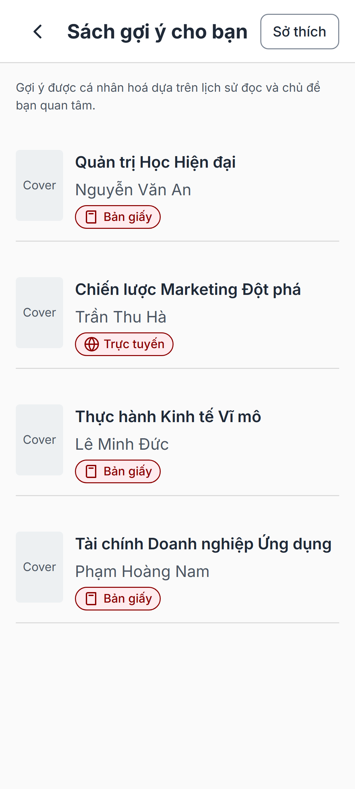

# Screen Spec: S-F03-07 Book recommendations

| Field | Value |
|---|---|
| Screen ID | `S-F03-07` |
| Screen name | Book recommendations |
| Vietnamese title | Sách gợi ý cho bạn |
| Frame width | 360px (export 3x = 1080px) |
| Actor | Reader |
| Priority | Could |
| Feature | F-03 Discovery, Reading History & Recommendation |
| Activity diagrams | `AD-UC-09` |
| Wireframe source | `src/S-F03-07.html` |
| Mockup image | `img/S-F03-07.png` |
| Author | Trieu |
| Status | Draft |

---

## 1. Purpose

**Shown when:**
- A signed-in reader selects "Recommended for you" (Sách gợi ý cho bạn) link on the existing OPAC main menu (`AD-UC-09` action `r1`).
- Or returns directly from `S-F00-02` after completing reader sign-in (if the screen was initially opened without an active session, `FR-03-21`).
- Or returns from `S-F03-02` after updating reading preferences.

**The user leaves this screen when:**
- The reader taps the Back navigation button (`<`) in the screen header, returning to the existing OPAC main menu (`exit`).
- The reader taps the header «Sở thích» Secondary button (shown in every signed-in state; D10b) or the cold-start banner link "Thiết lập sở thích đọc ngay", navigating to `S-F03-02` (`UC-07`).
- The reader taps any book row, opening that book on the existing OPAC Book Detail (`exit`, leading to `S-F01-01` / `UC-01`).

---

## 2. Mockup

### State Mockup Inventory

| State | Image file | Description |
|---|---|---|
| Default | `img/S-F03-07.png` | Personalized recommendation list (displays up to 10 books) with access format labels. Whole book row is tappable. |
| Numbered | `img/S-F03-07-numbered.png` | Default view with numbered callouts `#1`–`#5` matching Section 3 Element Inventory (re-exported 22/11/2026; `#6`–`#13` appear in the other states). |
| Cold-start | `img/S-F03-07-cold-start.png` | Reader has zero reading history or preferences: header with «Sở thích» button, callout banner with “Thiết lập sở thích đọc ngay” text link, followed by popular books list. |
| Topped-up | `img/S-F03-07-topped-up.png` | Fewer than 3 personalized matches: shows personalized books supplemented by trending books in the same subject from the last 30 days; each trending book carries the Trend tag «Xu hướng». |
| Loading | `img/S-F03-07-loading.png` | Skeleton rows displayed during recommendation algorithm calculation (`MSG-05`). |
| Error | `img/S-F03-07-error.png` | Network or system load error banner (`MSG-04`) with “Thử lại” action button. |

*Visual styling strictly follows design tokens defined in [ui-conventions.md#6-design-tokens](file:///C:/Users/admin/.gemini/antigravity/scratch/dbiz2-group-h/dbiz2-group-h-main/[DBIZ%202]%20GROUP%20H/EXTERNAL%20DESIGN/ui-conventions.md#6-design-tokens).*

---

## 3. Element inventory

| # | Element | Type | Content / data source | Required | Validation |
|---|---|---|---|---|---|
| 1 | Back navigation | Screen header | Icon button `<` (Quay lại); returns to existing OPAC main menu | Yes | none |
| 2 | Screen title | Screen header | Static text: “Sách gợi ý cho bạn” | Yes | none |
| 3 | Preferences shortcut | Secondary button | Static text: “Sở thích”; compact Secondary button at the right of the screen header, shown in every signed-in state (Default, Cold-start, Topped-up, Loading, Error); opens `S-F03-02` (D10b) | Yes | none |
| 4 | Section subtitle | Paragraph text | Static text: “Gợi ý được cá nhân hoá dựa trên lịch sử đọc và chủ đề bạn quan tâm.” (displayed in Default and Topped-up states) | Yes | none |
| 5 | Recommended book row | Book row | Book catalogue › title, author, neutral grey “Cover” placeholder; format label (“Bản giấy” / “Trực tuyến”) with icon. Whole row is tappable | Yes | none |
| 6 | Cold-start notice banner | Banner | Static text: “Bạn chưa có lịch sử đọc hoặc sở thích. Dưới đây là các sách được bạn đọc quan tâm nhiều nhất qua mã QR.” | Yes | none |
| 7 | Set preferences CTA | Text link | Static text: “Thiết lập sở thích đọc ngay”; styled as text link inside cold-start banner leading to `S-F03-02` | Yes | none |
| 8 | Popular books section title | Headings | Static text: “Sách phổ biến” | Yes | none |
| 9 | Popular book row | Book row | Most popular catalogue books ranked by loan/QR scan count; whole row is tappable | Yes | none |
| 10 | Supplemented trending books | Book row | Trending catalogue books in the same subject category from the last 30 days, integrated into list when personalized matches < 3; each row carries `#13` Trend tag | Yes | none |
| 11 | Loading placeholder | Skeleton | Skeleton rows for 5 book rows preserving layout during recommendation computation | Yes | none |
| 12 | Page-level load error | Banner | Static text: “Không tải được trang. Bạn kiểm tra kết nối mạng rồi thử lại.” (`MSG-04`) with secondary button “Thử lại” | Yes | none |
| 13 | Trending mark | Trend tag | Static text «Xu hướng» with trending icon, below the format label, only on books added from trending titles (`FR-03-20`); text always shown (D10a) | Yes | none |

---

## 4. States

| State | What the user sees | Trigger |
|---|---|---|
| Default | Personalized recommendation list (displays up to 10 books; wireframe illustrates representative entries) with format labels. Entire book row is tappable. | Reader opens S-F03-07 with active session and >= 3 personalized matches (`FR-03-11`). |
| Cold-start | Header with `#3` «Sở thích» button, info banner (#6) with guidance and “Thiết lập sở thích đọc ngay” text link (#7), followed by section "Sách phổ biến" ranking books by QR scans and loans. | Signed-in reader has zero reading history and zero subject preferences (`FR-03-19`). |
| Topped-up | Personalized books followed by trending books (#10) from the same subject categories borrowed within the last 30 days; each trending book carries the Trend tag «Xu hướng» (#13). No recommendation-reason text on any row. | Number of personalized matches is greater than 0 but strictly fewer than 3 (`FR-03-20`). |
| Loading | 5 skeleton book rows with animated shimmering effect (`aria-busy="true"`). | Screen initial load or recommendation computation in progress (`MSG-05`). |
| Error | Page-level banner (`banner.error`) with text `MSG-04` and secondary button “Thử lại”. | Network failure or recommendation service unavailable (`FR-04-20`). |
| Empty (no data) | *Not applicable* | Khi chưa có dữ liệu đọc cá nhân, hệ thống tự động hiển thị danh sách sách phổ biến nhất (`FR-03-19`), do đó màn hình không bao giờ bị trống. |
| Success / confirmation | *Not applicable* | Màn hình hiển thị danh sách kết quả trực tiếp, không sử dụng thông báo Toast xác nhận riêng (`FR-03-11`). |

---

## 5. Interactions and navigation

| # | Element | User action | System response | Goes to screen |
|---|---|---|---|---|
| 1 | Entry without session | Reader opens S-F03-07 without active session | Intercepts unauthenticated access; opens sign-in prompt modal | `M-F00-01` (variant `MSG-03`; see `screen-spec-S-F00-01.md §3.1`) |
| 2 | Back navigation (#1) | Tap `<` button | Exits recommendations screen; returns to main menu | Existing OPAC main menu (`exit`) |
| 3 | «Sở thích» Secondary button (#3) | tap | Navigates to Reading history & preferences screen; available any time, in every signed-in state, not only when there is no reading data (D10b) | `S-F03-02` (`UC-07`) |
| 4 | Thiết lập sở thích (#7) | Tap text link in cold-start banner | Navigates to `S-F03-02` to configure reading preferences; returning recalculates recommendations | `S-F03-02` (`UC-07`) |
| 5 | Book row (#5, #9, #10) | Tap anywhere on book row | Navigates to Book Detail on current OPAC, allowing reader to view full information or shelf location map (`UC-01`) | Existing OPAC Book Detail (`exit`, leading to `S-F01-01`) |
| 6 | Thử lại (#12) | Tap “Thử lại” button on error banner | Retries computing and retrieving book recommendations | `stays` |

---

## 6. Screen-level rules

| Rule ID | Rule | Source |
|---|---|---|
| SR-F03-07-001 | Viewing personalized recommendations strictly requires reader authentication (`FR-03-21`). Unauthenticated entry triggers modal `M-F00-01` with message `MSG-03` (“Gợi ý riêng cho bạn cần tài khoản thẻ thư viện. Hãy đăng nhập để xem.”). Successful login via `S-F00-01` → `S-F00-02` returns directly to `S-F03-07`. | `FR-03-21`, `FR-04-08`, `AD-UC-09 d1, c1`, `ui-conventions.md §4` |
| SR-F03-07-002 | The recommendation list displays a maximum of 10 books. | `AD-UC-09 Q3` |
| SR-F03-07-003 | If personalized matches are fewer than 3, the system automatically supplements the list with trending books in the same subject category borrowed within the last 30 days until at least 3 books are displayed (up to 10 total). | `FR-03-20`, `AD-UC-09 Q2` |
| SR-F03-07-004 | In cold-start condition (reader has no loans, online reads, or preferences), the system presents popular books ranked by QR scan count and loan records, accompanied by a cold-start banner linking to `S-F03-02`. | `FR-03-19`, `AD-UC-09 Q1` |
| SR-F03-07-005 | Every book row is tappable in its entirety and opens the existing OPAC Book Detail. There is no in-scope online reader or download mechanism on this screen. | `W0 Table 3`, `screen-transition.md` |
| SR-F03-07-007 | All book rows must display an access format label with an SVG icon and text ("Bản giấy" / "Trực tuyến"). | `ui-conventions.md §5` |
| SR-F03-07-008 | Books added to a short list from trending titles carry the Trend tag «Xu hướng» (`#13`, icon + text, info colours) below the format label; personalised matches and cold-start popular books carry no tag. No star ratings or other badges. | `FR-03-20`, D10a |
| SR-F03-07-009 | The «Sở thích» Secondary button (`#3`) is shown in the header in every signed-in state, including Cold-start, Loading and Error; it opens `S-F03-02` at any time. | `AD-UC-09` d4, D10b |
| SR-F03-07-010 | Book rows show no recommendation-reason text (e.g. “vì bạn đã đọc X”, “Khớp sở thích: …”) in release 1. | D11 |

---

## 7. Linked requirements

| FR ID | What this screen does for it |
|---|---|
| FR-03-11 | Generates and displays personalized book recommendations based on reading history, preferences, and chatbot inquiry topics. |
| FR-03-19 | Displays popular books ranked by QR code scans/loans and presents a setup callout when no reader data exists. |
| FR-03-20 | Automatically supplements personalized recommendations with trending books in the same subject category from the last 30 days when matches < 3, marking each added book with the Trend tag «Xu hướng» (`#13`). |
| FR-03-21 | Requires reader library card sign-in before accessing the personalized book recommendations screen. |
| FR-04-08 | Enforces active reader session verification upon accessing the recommendations feature. |
| FR-04-20 | Displays `MSG-04` error banner with retry button when recommendation computation or network retrieval fails. |

---

## 8. Responsive and accessibility notes

- **Smallest supported width:** 360px (Reader mobile frame width; exported at 3x DPR = 1080px).
- **Collapses or stacks on narrow screen:** Book rows display cover thumbnail on left and stacked book metadata on right (title, author, format label). Touch target for the entire row exceeds 64px in height.
- **Information never carried by colour alone:**
  - Access format uses both icon (open book for physical, globe for online) and explicit Vietnamese text ("Bản giấy", "Trực tuyến").
  - Cold-start notice banner uses info circle icon in addition to border/background tint.
  - Trend tag «Xu hướng» (`#13`) always shows its text with a trending icon; it does not rely on its info colour.
- **Text contrast and minimum size:**
  - Header font: Plus Jakarta Sans 20px (`--font-heading`).
  - Book title: Inter 16px medium/bold, line height 1.4.
  - Subtext and authors: Inter 14px muted (`--colour-text-muted`), meeting WCAG AA 4.5:1 contrast requirement.
  - Touch targets: each row provides a minimum 48px height (`--size-control`) with full row clickable area.

---

## 9. Open questions

None. Decisions: see [decision-index.md](../decision-index.md#s-f03-07).

---

## Completion checklist

- [x] The mockup is a separate cropped image file, named with the Screen ID (`img/S-F03-07.png`).
- [x] Every visible element in the mockup appears in the element inventory (#1 to #13).
- [x] Every input element has a validation rule or an explicit "none".
- [x] All five states are filled in (Default, Cold-start, Topped-up, Loading, Error; Empty & Success marked Not applicable with reasons).
- [x] Every navigation target is a Screen ID that exists in the Screen List (`M-F00-01`, `S-F03-02`, `stays`, OPAC Book Detail `exit`).
- [x] Every element that displays data names the field it displays.
- [x] Every linked FR exists in the Function List, and every action of this screen in an activity diagram is covered by an interaction row.
- [x] Modal trigger references `M-F00-01` with specific message variant (`MSG-03`).
- [x] Screen spec written in English with Vietnamese UI strings strictly preserved.
