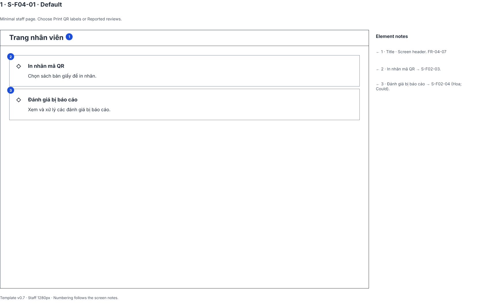
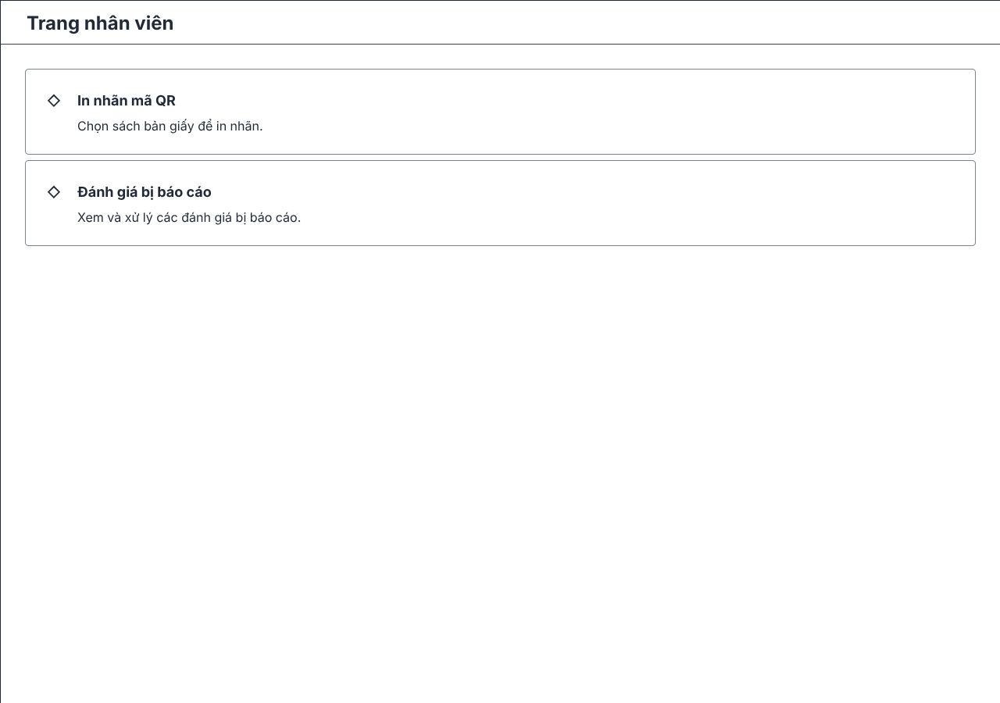

# Screen Spec: S-F04-01 Staff page

| Field | Value |
|---|---|
| Screen ID | `S-F04-01` |
| Screen name | Staff page |
| Actor | On-site Staff |
| Priority | Must (staff landing page); reported-reviews entry is Could |
| Feature | `F-04` |
| Activity diagrams | `AD-UC-10`, `AD-UC-13` (staff access and review workflow; confirm diagram references against the team's current index) |
| Mockup image | `img/S-F04-01.png` (reference from Ha's notes; v0.8 review pending) |
| Status | **Draft — Pending Wireframe Alignment and Group Review** |
| Frame width | 1280px (Staff, export 1x) |
| Wireframe source | `screens/src/Ha-wireframe-1.drawio` |
| Wireframe author | Ha |
| Screen spec author | Linh |
| UI conventions | v0.8 |

## 1. Purpose

**Shown when:** An On-site Staff member opens the staff page with a valid staff session, including after successful staff sign-in at `S-F00-03`.

**The user leaves this screen when:** They select **In nhãn mã QR** to open `S-F02-03`, or select **Đánh giá bị báo cáo** to open `S-F02-04` if the Could-scope UC-13 functionality is included. If the staff session is missing or invalid, route to `S-F00-03` rather than exposing staff actions.

## 2. Mockup

**Current numbered wireframe (for group review; not yet approved against UI Conventions v0.8):**

[Open original numbered image on GitHub](https://github.com/chihvcte-beep/dbiz2-group-h/blob/main/%5BDBIZ%202%5D%20GROUP%20H/EXTERNAL%20DESIGN/screens/img/S-F04-01-numbered.png)

> **Draft review note:** This is the wireframe owner's existing image, linked from the repository rather than edited or copied. Replace/verify the mockup after the owner updates the export. State-specific image paths below are pending confirmation.

**Numbered reference:** `img/S-F04-01-numbered.png`. These are references from Ha's notes, **not approved v0.8 exports** until checked against the current token and export rules.

| State | Image / outcome | Verification |
|---|---|---|
| Default | `img/S-F04-01.png`, `img/S-F04-01-numbered.png` | Pending check |
| Empty | N/A — the menu contains fixed task choices, not a data-driven list | N/A |
| Loading | `img/S-F04-01-loading.png`, `img/S-F04-01-loading-numbered.png` | Pending check |
| Error (network/load) | `img/S-F04-01-error.png`, `img/S-F04-01-error-numbered.png` | Pending check |
| Success | N/A — opening the menu is the Default state; tile actions navigate to their target screens | N/A |

**Do not modify Ha's Draw.io or PNG files as part of this Screen Spec.** Any necessary mockup corrections must be reported to the wireframe owner. The cited paths reflect the files named in Ha's notes; existence, export width, and v0.8 compliance must be verified before final approval.

## 3. Element inventory

Numbering follows `S-F04-01-notes.md` exactly. Elements #4–#6 are state-specific, not permanent Default controls. Component names follow UI Conventions v0.8 §3.

| # | Element | Type | Content / data source | Required | Validation / visibility |
|---|---|---|---|---|---|
| 1 | Title | Screen header | `Trang nhân viên` (static title) | Yes | Show only after staff-session access check; no extra controls invented. |
| 2 | Print QR labels | Menu tile | `In nhãn mã QR` (staff task entry) | Yes | Selecting opens `S-F02-03`; requires a valid staff session. |
| 3 | Reported reviews | Menu tile | `Đánh giá bị báo cáo` (Could feature) | Conditional | Selecting opens `S-F02-04` **only if UC-13 is in the shipped scope**. Do not silently treat Could as Must. |
| 4 (Loading) | Staff page loading | Skeleton | `MSG-05`; no text by default | Conditional | Visible while the staff page loads; replaces task tiles as appropriate. |
| 5 (Error) | Network error | Banner | `MSG-04`: `Không tải được trang. Bạn kiểm tra kết nối mạng rồi thử lại.` | Conditional | Error Banner at top of content after a load/network failure. |
| 6 (Error) | Try again | Secondary button | `Thử lại` | Conditional | Retries the failed load; remains on this screen unless the staff session is invalid. |

## 4. States

| State | What the user sees | Trigger / outcome |
|---|---|---|
| Default | `Trang nhân viên` with two Menu tiles: `In nhãn mã QR` and `Đánh giá bị báo cáo` (the latter is Could-scope). | Valid staff session and staff-page data loaded. |
| Empty | Not applicable: task menu has fixed entries; no data list requires an Empty state. | — |
| Loading | Skeleton placeholders (`MSG-05`) with no text by default. | Opening/loading the staff page. |
| Error | Shared `MSG-04` error Banner plus `Thử lại`. If there is no valid staff session, route to `S-F00-03` instead of displaying a staff menu. | Network/server load failure or invalid session. |
| Success / confirmation | Not applicable: the page itself is the staff landing state. Selecting a tile navigates to the relevant workflow, with no separate success Toast. | Successful load returns Default. |

## 5. Interactions and navigation

| # | Element | User action | System response | Goes to screen |
|---|---|---|---|---|
| 1 | Staff page address / session gate | Open staff page. | Check valid staff session; render the staff menu only if authorised. | `S-F04-01` or `S-F00-03` |
| 2 | Print QR labels | Select `In nhãn mã QR`. | Open the QR label printing workflow. | `S-F02-03` |
| 3 | Reported reviews | Select `Đánh giá bị báo cáo`. | Open reported reviews if the Could feature is shipped. | `S-F02-04` (conditional) |
| 4 | Try again | Select `Thử lại` after `MSG-04`. | Retry loading the staff page; recheck the session if necessary. | stays; `S-F00-03` if session invalid |

No sign-out action is added: Ha's wireframe explicitly leaves this as an open question.

## 6. Screen-level rules

| Rule ID | Rule | Source |
|---|---|---|
| SR-001 | Only an On-site Staff member with a valid staff session can access this page. | FR-04-07, FR-04-08; Ha notes |
| SR-002 | Without a valid staff session, navigate to `S-F00-03`. | FR-04-08; Ha notes |
| SR-003 | `In nhãn mã QR` navigates to `S-F02-03`. | FR-02-08; Ha notes |
| SR-004 | `Đánh giá bị báo cáo` is a Could-scope entry; it navigates to `S-F02-04` only if UC-13 ships. | FR-02-14; Ha notes |
| SR-005 | Loading uses `MSG-05` Skeleton; a network failure uses `MSG-04` Banner and `Thử lại`. | FR-04-08, FR-04-20; UI Conventions §4 |
| SR-006 | Do not add sign-out or other unapproved staff actions before group confirmation. | Ha notes, Open question 1 |
| SR-007 | Keep component names, labels, colours, and layout consistent with UI Conventions v0.8. | UI Conventions §§1, 3–6 |

## 7. Linked requirements

| FR ID | What this screen does for it |
|---|---|
| `FR-04-07` | Presents the staff landing page after successful staff sign-in. |
| `FR-04-08` | Enforces valid staff-session access and displays the loading state. |
| `FR-02-08` | Provides the entry to QR label printing (`S-F02-03`). |
| `FR-02-14` | Provides the conditional entry to reported-review handling (`S-F02-04`, Could scope). |
| `FR-04-20` | Handles network/load errors with shared `MSG-04` and retry. |

## 8. Responsive and accessibility notes

- **Frame:** Staff 1280px wide; export at 1x (1280px). Behaviour below 1280px is not established by the wireframe notes; ask the group rather than inventing breakpoints.
- **Typography and tokens:** Use UI Conventions v0.8 §6, including the agreed title/body fonts, brand-red and neutral surfaces. No arbitrary Draw.io colours.
- **Keyboard:** Both Menu tiles and `Thử lại` must be keyboard accessible, with a visible 2px focus ring and clear accessible names.
- **Contrast:** At least 4.5:1 for normal text and 3:1 for meaningful control boundaries. Do not rely on colour alone to communicate errors or selection.
- **Staff controls:** Apply the v0.8 Staff sizing and spacing tokens; preserve legible text and visible focus.
- **Access:** A failed session check must not reveal staff task contents.

## 9. Open questions

| # | Question | Blocking? | Status |
|---|---|---|---|
| 1 | [NEEDS CLARIFICATION: Should the staff page include an explicit sign-out action?] Ha's current wireframe includes only the two task tiles. | No (do not add without approval) | Open |
| 2 | [NEEDS CLARIFICATION: Is UC-13 / `Đánh giá bị báo cáo` included in the current deliverable?] The wireframe labels this entry Could. | Yes (final Default-state content) | Open |
| 3 | Confirm that the Default, Loading, and Error PNG files listed in Ha's notes exist, are exported at 1280px, and comply with v0.8 §6 tokens. Any required fixes belong to Ha. | Yes (mockup approval) | Open |
| 4 | [NEEDS CLARIFICATION: Confirm staff layout below the 1280px design frame without introducing new controls.] | No | Open |
| 5 | Confirm whether the separate HTML demonstration described in Ha's notes is required as a formal Screen Spec deliverable; the Draw.io source remains owned by Ha. | No | Open |

---

## Completion checklist

- [x] All six numbered elements in Ha's notes are accounted for.
- [x] All five states are described or explicitly marked N/A.
- [x] Navigation targets follow Ha's notes and use existing Screen IDs.
- [x] All required UI messages use the shared v0.8 wording.
- [x] Could-scope staff action is marked conditional.
- [ ] Group has confirmed whether UC-13 ships and whether sign-out is needed.
- [ ] Ha's exports have been verified at 1280px and reviewed against v0.8 tokens.
- [ ] Final cross-review and approval completed.

---

### Review handoff (21/11/2026)

- **Spec owner:** Linh. **Wireframe owner:** Ha. Do not edit another member’s source or images.
- **Reviewers:** Ha cross-reviews this spec; Linh performs final consolidation on 26/11/2026.
- **Status:** Draft until the linked state PNGs exist, render on GitHub, and meet the UI conventions v0.8 requirements.
- **Repository destination:** `EXTERNAL DESIGN/screens/screen-spec-S-F04-01.md` (not the repository root).
