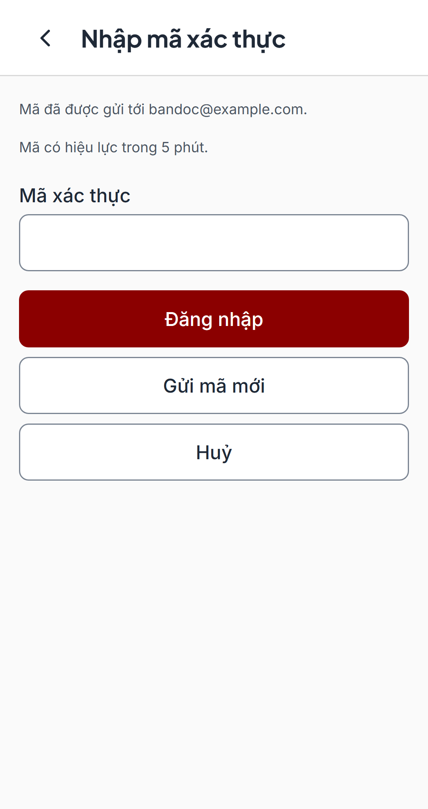
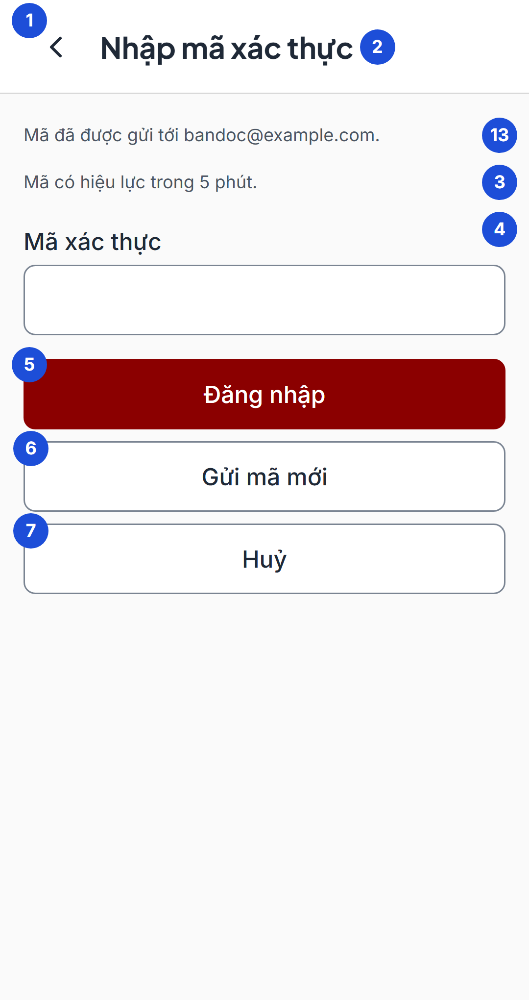

# Screen Spec: S-F00-02 Verify email OTP

| Field | Value |
| --- | --- |
| Screen ID | S-F00-02 |
| Screen name | Verify email OTP |
| Actor | Reader |
| Priority | Must |
| Feature | F-00 shared sign-in (Screen List grouping) |
| Activity diagrams | AD-UC-11 |
| Mockup image | ../img/S-F00-02/S-F00-02.png |
| Status | Draft |
| Frame width | 360px, export 3x = 1080px |
| Wireframe source | ../src/S-F00-02.html |
| Author | Ha |
| UI conventions | v0.8, 21/11/2026 |

## 1. Purpose

**Shown when:** The card lookup succeeded and the reader must verify the emailed code, or recover from failed delivery.

**The user leaves this screen when:** A correct, unexpired, unused code signs the reader in, returns to the origin and the pending action continues automatically. Back returns to S-F00-01; Cancel returns to the origin with the pending action still waiting (D1).

## 2. Mockup

Styles follow [UI conventions v0.8](../../ui-conventions.md#6-design-tokens). Each image contains one product frame.

| State | Image |
| --- | --- |
| Default | [S-F00-02.png](../img/S-F00-02/S-F00-02.png), [S-F00-02-numbered.png](../img/S-F00-02/S-F00-02-numbered.png) |
| Empty | Not applicable: this is a form. |
| Loading | [S-F00-02-loading.png](../img/S-F00-02/S-F00-02-loading.png), [S-F00-02-loading-numbered.png](../img/S-F00-02/S-F00-02-loading-numbered.png) |
| Error | [S-F00-02-error.png](../img/S-F00-02/S-F00-02-error.png), [S-F00-02-error-numbered.png](../img/S-F00-02/S-F00-02-error-numbered.png) |
| Error-2 | [S-F00-02-error-2.png](../img/S-F00-02/S-F00-02-error-2.png), [S-F00-02-error-2-numbered.png](../img/S-F00-02/S-F00-02-error-2-numbered.png) |
| Error-3 | [S-F00-02-error-3.png](../img/S-F00-02/S-F00-02-error-3.png), [S-F00-02-error-3-numbered.png](../img/S-F00-02/S-F00-02-error-3-numbered.png) |
| Error-4 | [S-F00-02-error-4.png](../img/S-F00-02/S-F00-02-error-4.png), [S-F00-02-error-4-numbered.png](../img/S-F00-02/S-F00-02-error-4-numbered.png) |
| Error — network | [S-F00-02-error-5.png](../img/S-F00-02/S-F00-02-error-5.png), [S-F00-02-error-5-numbered.png](../img/S-F00-02/S-F00-02-error-5-numbered.png) |
| Success — new code | [S-F00-02-success.png](../img/S-F00-02/S-F00-02-success.png), [S-F00-02-success-numbered.png](../img/S-F00-02/S-F00-02-success-numbered.png) |
| Success — accepted | Return transition |

## 3. Element inventory

| # | Element | Type | Content / data source | Required | Validation |
| --- | --- | --- | --- | --- | --- |
| 1 | Back | Screen header | Quay lại | Yes | none |
| 2 | Title | Screen header | Nhập mã xác thực | Yes | none |
| 3 | Validity | Code input | MSG-09 | Yes | none |
| 4 | Email code | Code input | Six digits sent to Reader accounts › declared email | Yes | Exactly 6 digits; server verifies value, single use, five-minute expiry and attempt count. |
| 5 | Sign in | Primary button | Đăng nhập (disabled secondary during recovery) | Yes | none |
| 6 | Send a new code | Secondary button | Gửi mã mới (primary during recovery) | Yes | none |
| 7 | Cancel | Secondary button | Huỷ | Yes | none |
| 8 | Incorrect code | Inline error | Attempts left (4 to 1) | No | none |
| 9 | Recovery / load error | Banner | Invalidated, expired / used, send failure, or MSG-04 | No | none |
| 10 | Verification pending | Skeleton | MSG-05 | No | none |
| 11 | New code sent | Toast | Đã gửi mã mới. | No | none |
| 12 | Try again | Secondary button | Thử lại | Yes | none |
| 13 | Email address | Code input | Helper line above the code field showing Reader accounts › registered email in full, not masked; wording “Mã đã được gửi tới <email>.” (ui-conventions §4; D2, D15). Not shown in Error-4, because no code was sent (D31). | Yes, except Error-4 | none |

## 4. States

| State | What the user sees | Trigger |
| --- | --- | --- |
| Default | MSG-09, the registered email address in full (#13) and a six-digit input. | The card was found and the initial code was sent (AD-UC-11 d2 [Yes]). |
| Empty | Not applicable: this is a form with no list. | Not applicable: this screen has an input form, not a data list. |
| Loading | Verification in progress. | A code-verification request is pending (FR-04-04). |
| Error | Mã chưa đúng. Bạn còn 3 lần thử. | A six-digit code is incorrect and fewer than five incorrect attempts have occurred (FR-04-17, FR-04-19). |
| Error-2 | Bạn đã nhập sai 5 lần. Mã này không còn dùng được, hãy bấm Gửi mã mới. | The fifth incorrect attempt is recorded for the current code (FR-04-17). |
| Error-3 | Mã đã hết hạn hoặc đã được sử dụng. Hãy bấm Gửi mã mới. | The submitted code is expired after five minutes or has already been used (FR-04-01, FR-04-04). |
| Error-4 | Không gửi được mã. Hãy bấm Gửi mã mới để thử lại. The email line (#13) is hidden (D31). | The initial or replacement code cannot be emailed (FR-04-16). |
| Error — network | MSG-04, entered code retained. | A network/server failure prevents verification or resending (FR-04-20). |
| Success — new code | Đã gửi mã mới. A fresh code replaces the old one. | The replacement code is emailed successfully (FR-04-04). |
| Success — accepted | The origin screen, where the pending action continues automatically. | The submitted code is correct, unexpired and unused (FR-04-01); start the session and audit entry, then return and continue the pending action (D1). |

## 5. Interactions and navigation

| # | Element | User action | System response | Goes to screen |
| --- | --- | --- | --- | --- |
| 1 | S-F00-02 › Back | Return to card entry. | Return to the linked preceding screen. | S-F00-01 |
| 2 | S-F00-02 › Email code | Enter the six-digit code received by email. | Accept numeric entry; do not verify before explicit submission. | stays |
| 3 | S-F00-02 › Sign in | Submit the code (AD-UC-11 r2). Return on acceptance. On rejection stay and show the matching branch. | Verify the submitted OTP. Correct, unexpired, unused code starts a reader session, writes actor/action/time to the audit log, returns to the origin and continues the pending action automatically (D1). Otherwise show the applicable error state. | S-F01-01 / S-F02-01 / S-F02-02 / S-F03-02 / S-F03-03 / S-F03-06 / S-F03-07 / Existing OPAC entry page (exit) |
| 4 | S-F00-02 › Send a new code | Request a new email code (AD-UC-11 d5, r3). The old one is invalidated. | Invalidate the old code and generate/email a new six-digit, five-minute, single-use code. Confirm success or show delivery failure. | stays |
| 5 | S-F00-02 › Cancel | Return to the sign-in origin (L8-01). | Return to the origin screen with the pending action kept waiting: nothing entered or shown on the origin is lost. The action is not carried out without a session; when the reader repeats it, M-F00-01 asks again (D1). | S-F01-01 / S-F02-01 / S-F02-02 / S-F03-02 / S-F03-03 / S-F03-06 / S-F03-07 / Existing OPAC entry page (exit) |
| 6 | S-F00-02 › Try again | Retry after a network failure. | Retry the failed request while retaining displayed data and entered values (FR-04-20). | stays |

## 6. Screen-level rules

| Rule ID | Rule | Source |
| --- | --- | --- |
| SR-001 | Verify a six-digit code with a five-minute expiry and single use. | FR-04-01, FR-04-04 |
| SR-002 | Allow retry while fewer than five incorrect attempts have occurred. Show remaining attempts 4 to 1. | FR-04-17, FR-04-19 |
| SR-003 | The fifth incorrect attempt invalidates the code. Use Send a new code for recovery. | FR-04-17 |
| SR-004 | A new code invalidates the previous one. Keep the reader here after a successful resend. | FR-04-04 |
| SR-005 | A correct, unused, unexpired code starts a session, records actor/action/time, returns to the origin and continues the pending action automatically; no new success page. | FR-04-01, FR-04-12; L8-01; D1 |
| SR-006 | Show the email address the code was sent to exactly as registered, not masked. Back goes to S-F00-01; Cancel returns to the origin with the pending action still waiting (re-asked by M-F00-01 when repeated). | L8-01; D1, D2 |
| SR-007 | For email delivery failure and network failure, offer the appropriate recovery while retaining input. | FR-04-16, FR-04-20 |

## 7. Linked requirements

| FR ID | What this screen does for it |
| --- | --- |
| FR-04-01 | Reader sign-in or rejection. |
| FR-04-04 | Six digits, five minutes, one use and resend invalidation. |
| FR-04-16 | Email delivery failure and recovery. |
| FR-04-17 | Incorrect-code retry and invalidation on attempt five. |
| FR-04-19 | Remaining attempts. |
| FR-04-20 | Network failure and retry. |
| FR-04-12 | Sign-in audit entry. |

## 8. Responsive and accessibility notes

- Smallest product width is 360px. Use one 360px column with full-width primary controls and vertically stacked secondary actions.
- Use the shared token fonts, 16px input text, body 16px and small text at least 12px. Reader targets are at least 44 × 44px. Text contrast must meet ui-conventions §5.
- Error feedback has a message, icon and error styling. Use visible labels, keyboard focus rings and DOM order matching the inventory. Loading disables duplicate submissions.
- Modal focus enters the dialog, remains within it while open, and returns to its trigger on dismissal. Print is a browser-controlled exit. An accepted sign-in returns focus to the origin action.

## 9. Open questions

None. Decisions: see [decision-index.md](../../decision-index.md#s-f00-02).

---

## Completion checklist

- [x] The mockup is a separate cropped image file, named with the Screen ID.
- [x] Every visible element in the mockup appears in the element inventory.
- [x] Every input element has a validation rule or an explicit none.
- [x] All five states are filled in, or marked not applicable with a reason.
- [x] Every navigation target is a Screen ID in the Screen List or a documented modal/browser exit.
- [x] Every element that displays data names its field.
- [x] Every linked FR exists in the current Function List and every AD user action has an interaction row.
- [x] Modal inventory and interactions are included where applicable.
- [ ] Cross-review by Hoa and final review by Chi are complete.
