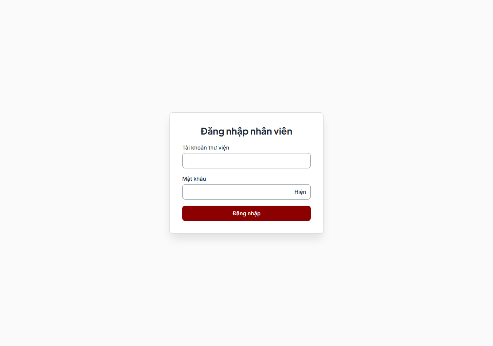
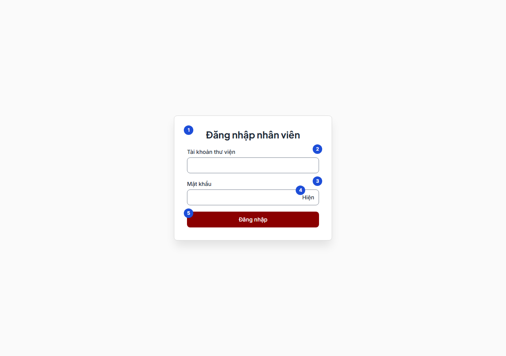

# Screen Spec: S-F00-03 Staff sign in

| Field | Value |
|---|---|
| Screen ID | `S-F00-03` |
| Screen name | Staff sign in |
| Actor | On-site Staff |
| Priority | Must |
| Feature | `F-00` (shared sign-in; no separate feature name is specified in `screen-list.md`) |
| Activity diagrams | `AD-UC-10`, `AD-UC-13` |
| Mockup image | `../img/S-F00-03/S-F00-03.png` |
| Status | Draft |
| Frame width | 1280px |
| Wireframe source | `screens/src/S-F00-03.html` (centred Sign-in card, D29; replaces the S-F00-03 page of `screens/src/wireframes-F00-F02-F04.drawio`) |
| Wireframe author | Ha |
| Screen spec author | Linh |
| UI conventions | v0.9 · 22/11/2026 |

## 1. Purpose

**Shown when:** On-site Staff open the staff-page address without a valid staff session and need to sign in with their internal library account, or after they choose `Đăng xuất` on a staff screen (`S-F04-01`, `S-F02-03`, `S-F02-04`; FR-04-21).

**The user leaves this screen when:** The internal library account is accepted and the staff role is verified; a valid staff session starts and `S-F04-01` opens. If credentials are rejected or the request fails, the staff member remains on this screen and can retry.

## 2. Mockup

| State | Image |
|---|---|
| Default | `../img/S-F00-03/S-F00-03.png`; `../img/S-F00-03/S-F00-03-numbered.png` |
| Empty | Not applicable: this is a credential-entry form. |
| Loading | `../img/S-F00-03/S-F00-03-loading.png`; `../img/S-F00-03/S-F00-03-loading-numbered.png` |
| Error — rejected credentials / missing staff role | `../img/S-F00-03/S-F00-03-error.png`; `../img/S-F00-03/S-F00-03-error-numbered.png` |
| Error — network failure | `../img/S-F00-03/S-F00-03-error-2.png`; `../img/S-F00-03/S-F00-03-error-2-numbered.png` |
| Success | `S-F04-01` (navigation outcome; no separate success screen) |

Use `ui-conventions.md` v0.8 §§3–6 for components, labels, messages, and design tokens. Staff frame: 1280px, exported at 1x.

## 3. Element inventory

**Numbering check:** Items 1–5 correspond to the Default wireframe annotations. Items 6–8 are conditional Error/Loading elements in Ha’s notes, not permanent controls on the Default screen. Component names follow v0.8 §3; in particular #4 is a **Text button** inside the Password input, not a second Password input.

| # | Element | Type | Content / data source | Required | Validation |
|---|---|---|---|---|---|
| 1 | Title | Sign-in card (title) | `Đăng nhập nhân viên` | Yes | Static text, centred at the top of the Sign-in card; no Screen header bar on this screen (D29). |
| 2 | Staff account | Text input | `Staff accounts` › staff account name; sample account shown in the wireframe: `staff.lan`. | Yes | Required. Authenticate against the internal library staff accounts; no additional client-side format rule is specified. |
| 3 | Password | Password input | Internal library account password (masked). | Yes | Required. Verify against the internal library account; no additional client-side format rule is specified. |
| 4 | Show password | Text button | Toggle text: `Hiện` / `Ẩn`. | No | Toggles password visibility only; must not alter the entered value. |
| 5 | Sign in | Primary button | `Đăng nhập`. | Yes | Submits the internal staff account and password for credential and staff-role verification. |
| 6 (state only) | Rejection / load error | Banner | Rejected credentials or missing staff role: `Không thể đăng nhập. Bạn kiểm tra thông tin tài khoản rồi thử lại.` Network failure: `MSG-04` — `Không tải được trang. Bạn kiểm tra kết nối mạng rồi thử lại.` | No | Show the generic rejection for both invalid credentials and missing staff role. Show `MSG-04` only for a load/network failure. |
| 7 (state only) | Checking credentials | Skeleton | `MSG-05` — skeleton only; no text by default. | No | Display while the system checks the internal account and staff role. |
| 8 (state only) | Try again | Secondary button | `Thử lại`. | No | Retry after a network failure; retain the staff account name. |

## 4. States

| State | What the user sees | Trigger |
|---|---|---|
| Default | One Sign-in card centred horizontally and vertically in the frame (D29): `Đăng nhập nhân viên`, the staff-account field, masked password field, `Hiện` / `Ẩn` Text button, and `Đăng nhập`. | Staff open the staff-page address without a valid staff session and the sign-in screen loads. |
| Empty (no data) | Not applicable: this is a credential-entry form, not a data list. Blank fields belong to the Default state. | — |
| Loading | Skeleton placeholders while the internal account and staff role are checked (`MSG-05`; no text by default). | Staff submit `Đăng nhập`. |
| Error | Rejected credentials or missing staff role use the same generic message: `Không thể đăng nhập. Bạn kiểm tra thông tin tài khoản rồi thử lại.` Network failure uses `MSG-04` and `Thử lại`; the account name is retained. | Credential/role verification is rejected, or the request fails to load. |
| Success / confirmation | No success toast or separate success screen. A valid staff session starts and `S-F04-01` opens. | Internal account is valid and has the staff role. |

## 5. Interactions and navigation

| # | Element | User action | System response | Goes to screen |
|---|---|---|---|---|
| 1 | Staff account and Password | Enter internal library credentials. | Store the values for the sign-in attempt; keep the password masked unless the visibility toggle is enabled. | stays |
| 2 | Show password | Toggle `Hiện` / `Ẩn`. | Show or mask the password without changing its value. | stays |
| 3 | Sign in | Submit or retry with `Đăng nhập` (AD-UC-10 `a3`; AD-UC-13 `a2`, `d1`). | Check the internal account and staff role. If accepted, start a valid staff session and write an audit entry (actor, action, time); otherwise show the generic rejection message and write no audit entry (D30). | `S-F04-01` on success; stays on rejection |
| 4 | Try again | Select `Thử lại` after a network failure. | Retry the failed request and retain the staff account name. | stays |

The wireframe uses `staff.lan` and a non-empty sample password as synthetic preview data; this is not a production credential.

## 6. Screen-level rules

| Rule ID | Rule | Source |
|---|---|---|
| SR-001 | Staff sign-in uses the internal library account, not the reader library-card sign-in flow. | FR-04-07; AD-UC-10 `a3`; AD-UC-13 `a2` |
| SR-002 | A staff session is created only after the internal account is accepted and the staff role is verified. | FR-04-07; FR-04-08 |
| SR-003 | A wrong account and an account without the staff role must produce the same user-facing rejection message; do not disclose which condition failed. | FR-04-18; AD-UC-10 `d1`; AD-UC-13 `d1`; L8-03 |
| SR-004 | The user may retry after rejection. | FR-04-18; AD-UC-10 `d1`; AD-UC-13 `d1` |
| SR-005 | A network/load failure uses the shared `MSG-04` wording and `Thử lại` action; retain the account name. | FR-04-20; `ui-conventions.md` §4; S-F00-03 wireframe notes |
| SR-006 | While credentials and role are being checked, show the shared `MSG-05` skeleton without loading text. | FR-04-07; `ui-conventions.md` §4 |
| SR-007 | Do not add Forgot password, Remember me, registration, or other unrequested controls. | Linh-screen-spec.md §1; Ha-wireframe-1.md §2.4 |
| SR-008 | After sign-in the staff session does not time out: staff stay signed in until they choose `Đăng xuất` on a staff screen, which ends the session and opens this screen. | FR-04-21; D7 |
| SR-009 | A successful staff sign-in writes an audit entry with actor, action and time, right after the staff session starts. This has no user interface. A rejected sign-in writes no audit entry. | FR-04-12; AD-UC-10 `s15`; AD-UC-13 `s12`; D30 |

## 7. Linked requirements

| FR ID | What this screen does for it |
|---|---|
| FR-04-07 | Accepts and verifies an internal library staff account; successful verification starts a staff session and opens `S-F04-01`. |
| FR-04-08 | Supports the staff-session access gate: staff without a valid session are sent to this screen. |
| FR-04-12 | A successful staff sign-in writes an audit entry (D30). |
| FR-04-18 | Rejects invalid credentials or a missing staff role with one generic message and allows retry. |
| FR-04-20 | Handles a network/load failure with `MSG-04` and the `Thử lại` action. |
| FR-04-21 | Destination of `Đăng xuất` on staff screens; the staff session started here stays valid until then (new FR, D7). |

## 8. Responsive and accessibility notes

- Design/export frame: 1280px for Staff (1x). Staff screens are supported from 1280px, the design frame; narrower widths, tablets and phones are not supported (`ui-conventions.md`, Responsive section; D45).
- Staff frame: 1280px, exported at 1x. The Sign-in card (max 400px) stays centred horizontally and vertically at every supported width (D29).
- Keep visible labels above both input fields; placeholder text must not replace a label.
- Password visibility must be communicated through the `Hiện` / `Ẩn` text control, not colour alone.
- Provide a visible 2px focus ring on every interactive element; staff must be able to use the keyboard.
- Text contrast: at least 4.5:1; input/control borders: at least 3:1.
- Staff input and control height: 40px; labels and button text: 14px; title: 24px, per `ui-conventions.md` v0.8 §6. Primary button uses solid `colour/brand-red` (#8B0000) with white text; error Banner uses `colour/error-red` (#C62828) with light error background and icon. Do not use unlisted Draw.io colours.

## 9. Open questions

None. Decisions: see [decision-index.md](../../decision-index.md#s-f00-03).

---

## Completion checklist

- [x] The mockup paths follow the Screen ID naming convention.
- [ ] All mockup exports have been corrected to v0.8 tokens and verified at 1280px width.
- [ ] Default, Loading, rejection Error and network Error state images have been verified.
- [x] Every element in Ha's notes appears in the element inventory, retaining the original `#` (with v0.8 component type correction for #4).
- [x] Every input element has a validation rule.
- [x] All five states are filled in or marked not applicable with a reason.
- [x] Every navigation target is a Screen ID that exists in the Screen List, or `stays`.
- [x] Every element that displays data names its data source.
- [x] Every linked FR exists in the Screen List / Function List references, and each screen action in the notes and activity diagrams is covered by an interaction row.
