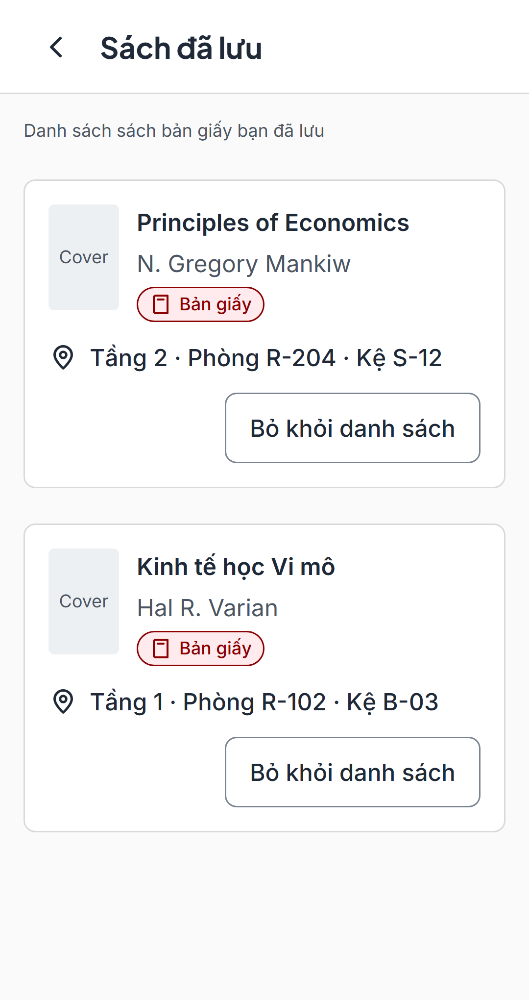
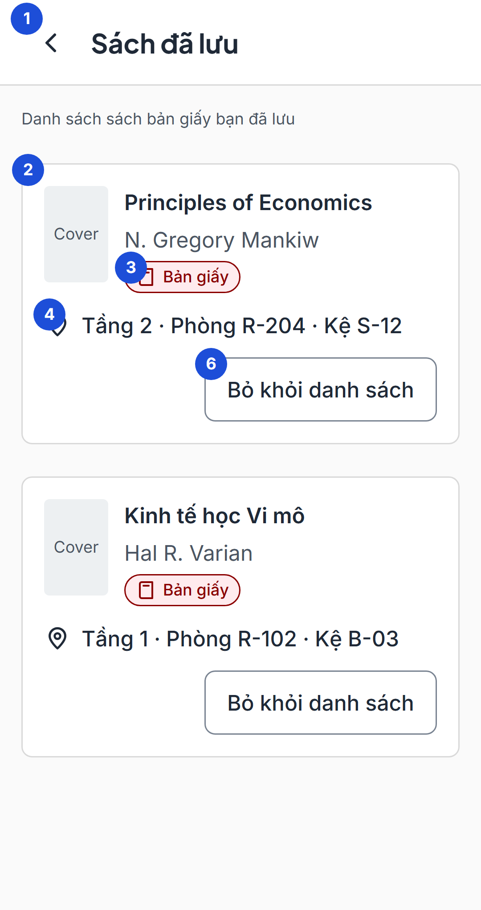

# Screen Spec: S-F03-03 Saved Books List

| Field | Value |
|---|---|
| Screen ID | `S-F03-03` |
| Screen name | Saved Books List |
| Actor | Reader |
| Priority | Should |
| Feature | `F-03` Discovery, Reading History & Recommendation |
| Activity diagrams | `AD-UC-12` |
| Mockup image | `../img/S-F03-03/S-F03-03.png` |
| Status | Draft |
| Frame width | 360px (export at 3x = 1080px) |
| Wireframe source | `../src/S-F03-03.html` (rebuilt 23/11/2026 from the exported images; the images are exported from it) |
| Wireframe author | Nhi |
| Screen spec author | Nhi |
| UI conventions | v0.8 |

## 1. Purpose

**Shown when:** A signed-in Reader opens **Saved books** from the existing OPAC personal area. If the Reader does not have a valid session, the shared sign-in modal `M-F00-01` is shown; choosing Sign in continues through `S-F00-01`, after which the saved-books request is resumed and the session is checked again.

**The user leaves this screen when:** They select Back to return to the existing OPAC personal area. Selecting **Bỏ khỏi danh sách** removes the selected saved book and refreshes this same screen. If no books remain, the Empty state is shown. Saving a physical book is performed from the existing OPAC book display / `S-F01-01` flow, not from this screen.

A missing or inconsistent shelf location is a state of the affected book row, not an Error state for the entire screen. Other saved books remain visible.

## 2. Mockup

Ảnh Default của màn hình S-F03-03 (một màn hình, cắt riêng), ảnh wireframe đánh số và ảnh riêng cho từng trạng thái.

**Numbered wireframe**

[Open original numbered image](../img/S-F03-03/S-F03-03-numbered.png)

**State → Image**

| State | Image | Numbered image |
|---|---|---|
| Default | `../img/S-F03-03/S-F03-03.png` | `../img/S-F03-03/S-F03-03-numbered.png` |
| Empty | `../img/S-F03-03/S-F03-03-empty.png` | — |
| Loading | `../img/S-F03-03/S-F03-03-loading.png` | — |
| Error | `../img/S-F03-03/S-F03-03-error.png` | — |
| Success — removed | `../img/S-F03-03/S-F03-03-success.png` | — |
| Location unavailable | `../img/S-F03-03/S-F03-03-error-2.png` | — |

Overview sheet of all states (reference only, not the main image): `../img/S-F03-03/S-F03-03-states.png`.

Use UI Conventions v0.8 for components, labels, messages and design tokens. Reader frame: 360px, target export at 3x (1080px).
## 3. Element inventory

Numbering follows Nhi's v0.8 wireframe notes. The unavailable-location Banner belongs to the affected row; it is not a page-level error.

| # | Element | Type | Content / data source | Required | Validation / visibility |
|---|---|---|---|---|---|
| 1 | Screen title and back navigation | Screen header | `Sách đã lưu` | Yes | Back returns to the existing OPAC personal area. |
| 2 | Saved book entry | Book row | Book cover placeholder, title and author for each saved physical book. Data source: Reader's saved-books list. | Conditional | Show one row per saved physical book. |
| 3 | Access-format label | Format label | `Bản giấy` with an icon. | Yes, for each row | UC-12 saves physical books only. Do not rely on colour alone. |
| 4 | Shelf location | Shelf location line | Synced location in the format `Tầng n · Phòng code · Kệ code`, with a location-pin icon. | Conditional | Show the location for each saved book when available; keep the full shelf code on one line where possible. |
| 5 | Unavailable shelf location | Banner | Exact `MSG-06`: `Chưa có vị trí kệ của sách này. Bạn hỏi quầy thông tin ở tầng trệt nhé.` | Conditional | Show only for the affected book. Other saved books remain visible. |
| 6 | Remove saved book | Secondary button | `Bỏ khỏi danh sách` | Conditional | Removes the selected book and refreshes the list. No confirmation modal is specified. This is a Could-scope action (`FR-03-08`). |
| 7 | Empty-list message | Empty state | `Bạn chưa lưu sách nào. Bấm Lưu vào danh sách ở trang vị trí kệ sách.` | Conditional | Show when the Reader has no saved books (`FR-03-25`). |
| 8 | Load error | Banner | `MSG-04`: `Không tải được trang. Bạn kiểm tra kết nối mạng rồi thử lại.` | Conditional | Show when the saved-books list cannot be loaded. Retain data already shown. |
| 9 | Retry action | Secondary button | `Thử lại` | Conditional | Retry retrieving the saved-books list after a load error. |
| 10 | Removal success feedback | Toast | `Đã bỏ sách khỏi danh sách.` | Conditional | Show after successful removal while the refreshed list is displayed. |

## 4. States

| State | What the user sees | Trigger / outcome |
|---|---|---|
| Default | `Sách đã lưu` and the Reader's saved physical books. Each row shows a cover placeholder, title, author, `Bản giấy` label, synced shelf location and `Bỏ khỏi danh sách` action. One row may demonstrate an unavailable shelf location. | Signed-in Reader opens the saved-books list and the list contains entries. |
| Empty | `Bạn chưa lưu sách nào. Bấm Lưu vào danh sách ở trang vị trí kệ sách.` | The Reader has no saved books (`FR-03-25`). |
| Loading | Skeleton placeholders while saved books and shelf locations are retrieved; no loading text by default (`MSG-05`). | The saved-books list is being retrieved. |
| Error | Shared `MSG-04` Banner and `Thử lại` action. Retain any data already shown. | The saved-books list fails to load (`FR-04-20`). |
| Success — removed | The selected book has been removed, the list is refreshed and a short success Toast appears. If no books remain, show Empty. | Reader selects `Bỏ khỏi danh sách` and the removal succeeds (`FR-03-08`). |
| Location unavailable | Only the affected book row shows exact `MSG-06`. All other saved books remain visible and usable. | The affected book's shelf location is missing or inconsistent (`FR-01-07`). This is a row-level state, not a screen-level Error. |

## 5. Interactions and navigation

| # | Element / event | User action | System response | Goes to screen |
|---|---|---|---|---|
| 1 | Entry from existing OPAC personal area | Reader opens `Saved books`. | Check Reader session. If valid, retrieve saved physical books and their synced shelf locations. If not signed in, ask the Reader to sign in. | `S-F03-03`; if not signed in, `M-F00-01` → `S-F00-01` |
| 2 | Back navigation | Reader taps Back. | Return to the existing OPAC personal area. | Existing OPAC personal area (exit) |
| 3 | Saved book entry | Reader views a saved book. | Display its title, author, `Bản giấy` label and synced shelf location where available. | Stays on `S-F03-03` |
| 4 | Unavailable shelf location | System finds missing or inconsistent shelf-location data for one saved book. | Show `MSG-06` in that book's row; keep other saved books visible. | Stays on `S-F03-03` |
| 5 | Remove saved book | Reader selects `Bỏ khỏi danh sách`. | Delete the selected entry and refresh the list. No confirmation modal. If no entries remain, show Empty. | Stays on `S-F03-03` |
| 6 | Removal success | System completes the removal. | Show the short success Toast over the refreshed list. | Stays on `S-F03-03` |
| 7 | Retry | Reader selects `Thử lại` after `MSG-04`. | Retry retrieving the saved-books list. | Stays on `S-F03-03` |
| 8 | Save a physical book | Reader saves a physical book from the existing OPAC book display / `S-F01-01` flow. | This is outside `S-F03-03`; after saving, the entry becomes available in this list. | Existing OPAC book display / `S-F01-01` (outside this screen) |

`M-F00-01` and `S-F00-01` are shared sign-in components; their content is specified in the shared screen documentation. No confirmation modal is defined for Remove.

## 6. Screen-level rules

| Rule ID | Rule | Source |
|---|---|---|
| SR-001 | Access to the saved-books list requires a valid Reader session. | `FR-04-08`; `AD-UC-12` |
| SR-002 | If the Reader is not signed in, use shared `M-F00-01`; do not create a separate sign-in screen for UC-12. | `FR-04-08`; Screen List; Nhi wireframe notes |
| SR-003 | The list contains saved physical books only; show the `Bản giấy` format label with an icon. | `FR-03-06`, `FR-03-07`; `AD-UC-12` |
| SR-004 | Display each saved book's title, author and synced shelf location. | `FR-03-07`; `AD-UC-12` |
| SR-005 | If a saved book's shelf location is missing or inconsistent, show exact `MSG-06` only on that book's row; other saved books remain visible. | `FR-01-07`; `AD-UC-12` |
| SR-006 | If no books have been saved, show the approved empty-list message. | `FR-03-25`; UI Conventions v0.8 |
| SR-007 | Remove deletes the selected saved entry and refreshes this screen. No confirmation modal is specified. | `FR-03-08`; `AD-UC-12`; Screen List |
| SR-008 | After removal, show a short success Toast. If the list becomes empty, show Empty. | `FR-03-08`; Nhi wireframe notes |
| SR-009 | A network/load failure uses shared `MSG-04` and `Thử lại`; data already shown is kept. | `FR-04-20`; Screen List notes; UI Conventions v0.8 |
| SR-010 | Saving a physical book is performed from the existing OPAC book display / `S-F01-01`, not from this list screen. | `FR-03-06`; `AD-UC-12`; Screen List |
| SR-011 | Do not add a Remove confirmation modal. | `AD-UC-12`; Screen List |

## 7. Linked requirements

| FR ID | What this screen does for it |
|---|---|
| `FR-03-06` | Displays physical books that were saved through the Save action on the existing book display / `S-F01-01`. |
| `FR-03-07` | Displays the Reader's saved physical books and each book's synced shelf location. |
| `FR-03-08` | Allows the Reader to remove a saved book and displays the refreshed list. |
| `FR-03-25` | Displays the empty-list message when no books have been saved. |
| `FR-01-07` | Displays `MSG-06` for an affected saved-book row when shelf location is missing or inconsistent. |
| `FR-04-08` | Enforces the Reader-session requirement before the saved-books request is allowed. |
| `FR-04-20` | Displays the `MSG-04` network-error Banner with `Thử lại` and keeps data already shown when the saved-books list cannot be loaded. |

## 8. Responsive and accessibility notes

- Reader frame: 360px; export at 3x (1080px). Smallest supported width: 360px.
- Use UI Conventions v0.8 design tokens and typography.
- Format labels must use an icon and the Vietnamese word `Bản giấy`; never communicate format by colour alone.
- Shelf-location lines include a location-pin icon and show floor, room and shelf codes. Keep the full shelf code on one line where possible.
- The unavailable-location Banner is scoped to the affected row; do not obscure other saved-book entries.
- Interactive targets must be at least 44×44px, with a visible 2px focus ring.
- Text contrast: at least 4.5:1; meaningful control boundaries: at least 3:1.
- Empty, loading, error and success feedback must remain distinguishable without relying on colour alone.
- Book titles, authors and shelf codes are synced catalogue data; the values in the wireframe are examples.

## 9. Open questions

None. Decisions: see [decision-index.md](../../decision-index.md#s-f03-03).

---

## Completion checklist

- [x] All ten numbered elements in Nhi's v0.8 notes are accounted for.
- [x] Default, Empty, Loading, Error, Success and Location unavailable states are described.
- [x] Location unavailable is explicitly treated as a row-level state, not a screen-level error.
- [x] Remove is documented without a confirmation modal.
- [x] Sign-in uses the shared modal and sign-in screen.
- [x] Navigation targets follow the Screen List and Usage Flow.
- [x] Network-error FR mapping (`FR-04-20`) and empty-message copy follow the Screen List and UI Conventions §4.
- [x] Priority follows the Screen List (Should).
- [x] Default and state exports are separate 1080px-wide images.
