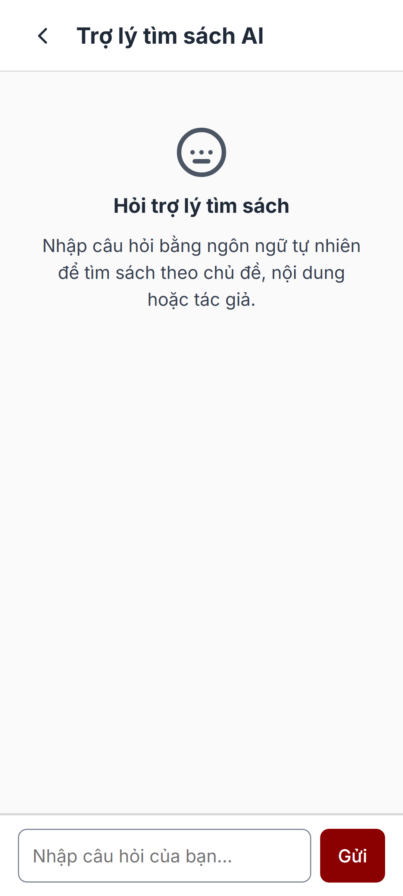

# Screen Spec: S-F03-06 AI chatbot book search

| Field | Value |
|---|---|
| Screen ID | `S-F03-06` |
| Screen name | AI chatbot book search |
| Vietnamese title | Trợ lý tìm sách AI |
| Frame width | 360px (export 3x = 1080px) |
| Actor | Reader |
| Priority | Could |
| Feature | F-03 Discovery, Reading History & Recommendation |
| Activity diagrams | `AD-UC-08` |
| Wireframe source | `../src/S-F03-06.html` |
| Mockup image | `../img/S-F03-06/S-F03-06.png` |
| Author | Trieu |
| Status | Draft |

---

## 1. Purpose

**Shown when:**
- A reader selects "Ask the library chatbot" (Trợ lý tìm sách AI) link on the existing OPAC main menu (`AD-UC-08` action `r1`).
- Or returns directly from `S-F00-02` after completing reader sign-in (if the inquiry was submitted while unauthenticated, `FR-03-18`, `L8-05`).

**The user leaves this screen when:**
- The reader taps the Back navigation button (`<`) in the screen header, returning to the existing OPAC main menu (`exit`).
- The reader taps "Xem chi tiết sách" on any book result card, opening that book on the existing OPAC Book Detail (`exit`, leading to `S-F01-01` / `UC-01`).
- The reader taps the fallback link "dùng bộ lọc hình thức" inside the AI error banner, navigating to `S-F03-01` (`UC-03 Access-format filter`).

---

## 2. Mockup

### State Mockup Inventory

| State | Image file | Description |
|---|---|---|
| Default | `../img/S-F03-06/S-F03-06.png` | Clean conversational screen with message composer ready at the bottom. |
| Numbered | `../img/S-F03-06/S-F03-06-numbered.png` | Default view with numbered callouts matching Section 3 Element Inventory. |
| Empty | `../img/S-F03-06/S-F03-06-empty.png` | Empty conversation thread with ready message composer (identical to Default per §2.3). |
| Loading | `../img/S-F03-06/S-F03-06-loading.png` | Reader query bubble displayed with assistant bubble showing “Đang tải…” (`MSG-05`). |
| Success / Results | `../img/S-F03-06/S-F03-06-success.png` | Conversational reply containing 4 rich book result cards with format labels and detail links. |
| No-match | `../img/S-F03-06/S-F03-06-no-match.png` | Assistant conversational message explaining that no catalogue titles matched the query (`FR-03-16`). |
| Error | `../img/S-F03-06/S-F03-06-error.png` | System error banner indicating temporary AI interruption with fallback link to `S-F03-01` (`FR-03-17`). |

*Visual styling strictly follows design tokens defined in [ui-conventions.md#6-design-tokens](../../ui-conventions.md#6-design-tokens).*

---

## 3. Element inventory

| # | Element | Type | Content / data source | Required | Validation |
|---|---|---|---|---|---|
| 1 | Back navigation | Screen header | Icon button `<` (Quay lại); returns to existing OPAC main menu | Yes | none |
| 2 | Screen title | Screen header | Static text: “Trợ lý tìm sách AI” | Yes | none |
| 3 | Reader message bubble | Chat bubble | Natural-language inquiry entered by reader; right-aligned, styled with `colour/info-bg` | Yes | none |
| 4 | Chatbot reply bubble | Chat bubble | Conversational assistant response; left-aligned, styled with `colour/surface` | Yes | none |
| 5 | Book result card | Book card | Embedded in assistant reply: book title, author, format label (“Bản giấy” / “Trực tuyến”) with icon, and action text link | Yes | none |
| 6 | Book detail action link | Text link | Static text: “Xem chi tiết sách” (D25); opens book on OPAC Book Detail | Yes | none |
| 7 | Chat input field | Text input | Multi-line text input in fixed composer; placeholder “Nhập câu hỏi tìm sách…” | Yes | Non-empty string upon submission |
| 8 | Send inquiry button | Primary button | Primary button labeled “Gửi”; submits query to AI Service; disabled when input is empty or loading | Yes | none |
| 9 | Typing / loading indicator | Chat bubble | Assistant bubble displaying “Đang tải…” (`MSG-05`) while querying AI service (up to 10s timeout) | Yes | none |
| 10 | No matching books reply | Chat bubble | Assistant bubble explaining no catalogue titles matched: “Rất tiếc, thư viện chưa có cuốn sách nào khớp với yêu cầu của bạn. Bạn thử tìm với các chủ đề liên quan xem sao nhé!” | Yes | none |
| 11 | AI service error banner | Banner | Banner alert with text: “Tìm kiếm bằng AI đang tạm ngưng. Bạn hãy dùng bộ lọc hình thức.” with embedded link to S-F03-01 | Yes | none |

---

## 4. States

| State | What the user sees | Trigger |
|---|---|---|
| Default | Clean conversational screen with screen header and message composer ready at the bottom. Previous session history loaded if authenticated. | Reader opens S-F03-06. |
| Empty (no data) | Identical to Default: empty chat thread with input placeholder “Nhập câu hỏi tìm sách…” and disabled “Gửi” button (§2.3). | First-time visitor or reader with no previous conversation history (`FR-03-09`). |
| Loading | User's sent query bubble displayed on the right; assistant bubble below displays “Đang tải…” (`MSG-05`); message composer input is disabled. | Reader submits inquiry; AI Service query in progress (`AD-UC-08 Q1`). |
| Success / Results | Assistant response summarizing findings, followed by 4 rich book cards (#5) with format labels and “Xem chi tiết sách” links; composer is re-enabled. | AI Service returns matching books from the synced catalogue (`FR-03-09`, `FR-03-10`). |
| No-match | Assistant reply bubble (#10) explaining no books matched the inquiry, suggesting broader topics or alternative search keywords. | AI Service finds zero catalogue titles matching the inquiry (`FR-03-16`). |
| Error | System error banner (#11) notifying that AI search is temporarily unavailable and offering a direct text link to `S-F03-01`. | AI Service fails, times out (>10s), or network connection is interrupted (`FR-03-17`, `FR-04-20`). |

---

## 5. Interactions and navigation

| # | Element | User action | System response | Goes to screen |
|---|---|---|---|---|
| 1 | Back navigation (#1) | Tap `<` button | Exits chatbot screen; returns to main menu | Existing OPAC main menu (`exit`) |
| 2 | Chat input field (#7) | Type search query | Updates input value; enables “Gửi” button if input contains non-whitespace text | `stays` |
| 3 | Gửi button (#8) [signed in] | Tap “Gửi” (or press Enter) with active session | Posts reader bubble (#3); clears input; shows Loading state (#9); queries AI Service; transitions to Success, No-match, or Error | `stays` (`AD-UC-08 r1`) |
| 4 | Gửi button (#8) [signed out] | Tap “Gửi” (or press Enter) without active session | Intercepts submission; opens sign-in prompt modal with `MSG-02`; preserves entered text; after sign-in via `S-F00-01` → `S-F00-02`, returns to `S-F03-06` and sends inquiry | `M-F00-01` (variant `MSG-02`; see `screen-spec-S-F00-01.md §3.1`) |
| 5 | Xem chi tiết sách (#6) | Tap link on any book result card | Navigates to Book Detail on current OPAC, allowing reader to view full details or shelf location (`UC-01`) | Existing OPAC Book Detail (`exit`, leading to `S-F01-01`) |
| 6 | Dùng bộ lọc hình thức (#11) | Tap fallback link in error banner | Navigates directly to Access-format filter screen | `S-F03-01` (`UC-03`) |

---

## 6. Screen-level rules

| Rule ID | Rule | Source |
|---|---|---|
| SR-F03-06-001 | Sign-in authentication is requested ONLY after submitting the first inquiry message (`L8-05`, `FR-03-18`), never upon opening the screen. Unauthenticated visitors may freely read and type inquiries. Submitting without a session prompts modal `M-F00-01` with message `MSG-02` (“Bạn cần đăng nhập bằng thẻ thư viện để trò chuyện với trợ lý tìm sách.”). | `FR-03-18`, `L8-05`, `AD-UC-08 d1, c1`, `ui-conventions.md §4` |
| SR-F03-06-002 | The maximum AI Service response timeout is strictly 10 seconds. If no reply is received within 10s, the system transitions to the Error state (`FR-03-17`). | `AD-UC-08 Q1` |
| SR-F03-06-003 | AI service interruption notices are transient session events and must NOT be saved into the reader's persistent conversation history. | `AD-UC-08 Q2` |
| SR-F03-06-004 | In release 1, readers cannot delete or clear their conversation history; inquiries and answers are permanently retained per reader account. | `AD-UC-08 Q3` |
| SR-F03-06-005 | Every reader inquiry and assistant answer is persisted in the Library Core System linked to the reader's library card. | `FR-03-10` |
| SR-F03-06-006 | When no books match, the assistant presents a conversational suggestion reply, never a system error banner. System error banners are strictly reserved for service/network failures. | `FR-03-16`, `ui-conventions.md §4` |
| SR-F03-06-007 | Book result cards embedded in assistant replies must display access format labels with SVG icons and provide a text link to the OPAC Book Detail. | `FR-03-09`, `ui-conventions.md §3` |
| SR-F03-06-008 | The message composer is fixed at the viewport bottom and contains exactly one Primary button labeled “Gửi”. | `ui-conventions.md §1, §3` |
| SR-F03-06-009 | Out of scope per W0 Table 3: floating chatbot widgets across other pages, voice input, file/image attachments, thumbs up/down rating, and conversation management dashboards. | `W0 Table 3` |

---

## 7. Linked requirements

| FR ID | What this screen does for it |
|---|---|
| FR-03-09 | Provides a conversational natural-language chat interface for discovering library catalogue books. |
| FR-03-10 | Records reader inquiries and chatbot responses into persistent conversation history linked to the reader account. |
| FR-03-16 | Displays conversational explanation and alternative keyword suggestions when no catalogue books match the query. |
| FR-03-17 | Displays system error banner with direct fallback text link to `S-F03-01` when the AI service is unavailable or times out. |
| FR-03-18 | Requires reader library card authentication before processing chatbot inquiries. |
| FR-04-08 | Enforces active reader session verification upon message submission. |
| FR-04-20 | Displays `MSG-04` / `FR-03-17` error banner with fallback link when network or backend data loading fails. |

---

## 8. Responsive and accessibility notes

- **Smallest supported width:** 360px (Reader mobile frame width; exported at 3x DPR = 1080px).
- **Collapses or stacks on narrow screen:** Conversation area scrolls independently with fixed bottom composer (`.message-composer`). Book cards inside bubbles stack title, author, format label, and action link vertically.
- **Information never carried by colour alone:**
  - Reader bubble uses background tint `colour/info-bg` plus right-alignment; assistant bubble uses `colour/surface` plus left-alignment.
  - Book format labels combine text ("Bản giấy", "Trực tuyến") with distinctive icons.
  - Error banner uses alert circle icon in addition to error color styling.
- **Text contrast and minimum size:**
  - Header font: Plus Jakarta Sans 20px (`--font-heading`).
  - Chat text & body: Inter 16px (`--font-size-body`), line height 1.5.
  - Message input: font size 16px (prevents unwanted mobile browser auto-zoom).
  - Primary button "Gửi": minimum 48px height (`--size-control`).

---

## 9. Open questions

None. Decisions: see [decision-index.md](../../decision-index.md#s-f03-06).

---

## Completion checklist

- [x] The mockup is a separate cropped image file, named with the Screen ID (`../img/S-F03-06/S-F03-06.png`).
- [x] Every visible element in the mockup appears in the element inventory (#1 to #11).
- [x] Every input element has a validation rule or an explicit "none".
- [x] All five states are filled in (Default, Empty, Loading, Success, No-match, Error).
- [x] Every navigation target is a Screen ID that exists in the Screen List (`M-F00-01`, `S-F03-01`, `stays`, OPAC Book Detail `exit`).
- [x] Every element that displays data names the field it displays.
- [x] Every linked FR exists in the Function List, and every action of this screen in an activity diagram is covered by an interaction row.
- [x] Modal trigger references `M-F00-01` with specific message variant (`MSG-02`).
- [x] Screen spec written in English with Vietnamese UI strings strictly preserved.
