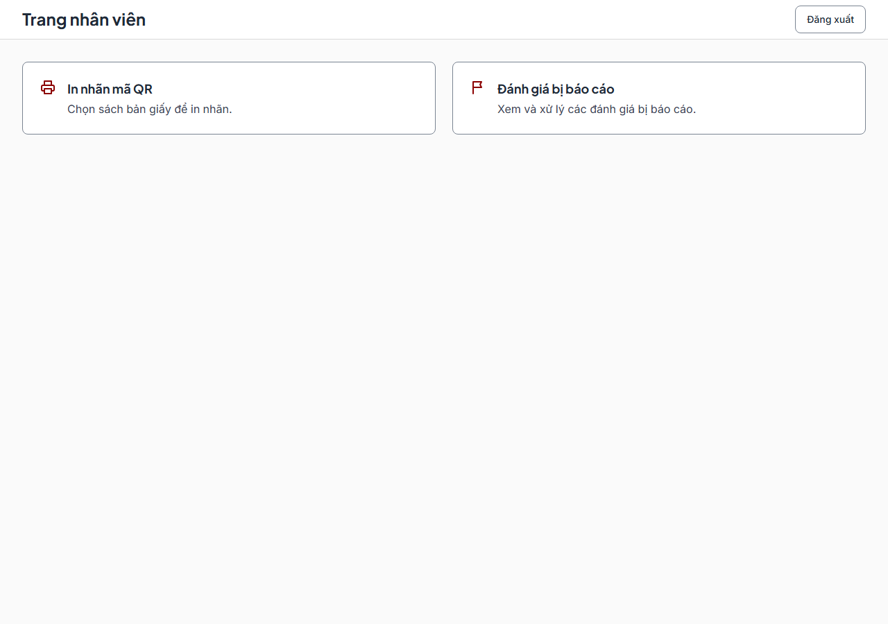
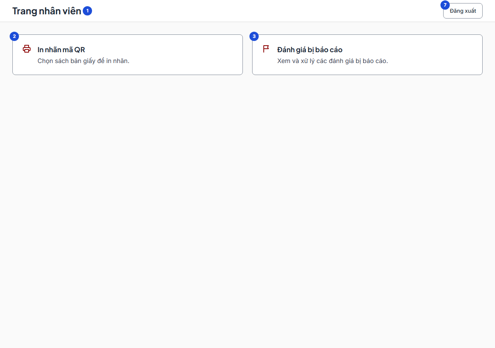

# Screen Spec: S-F04-01 Staff page

| Field | Value |
|---|---|
| Screen ID | `S-F04-01` |
| Screen name | Staff page |
| Actor | On-site Staff |
| Priority | Must (staff landing page); reported-reviews entry is Could |
| Feature | `F-04` |
| Activity diagrams | `AD-UC-10`, `AD-UC-13` |
| Mockup image | `../img/S-F04-01/S-F04-01.png` |
| Status | Draft |
| Frame width | 1280px (Staff, export 1x) |
| Wireframe source | `../src/S-F04-01.html` |
| Wireframe author | Ha |
| Screen spec author | Linh |
| UI conventions | v0.8 |

## 1. Purpose

**Shown when:** An On-site Staff member opens the staff page with a valid staff session, including after successful staff sign-in at `S-F00-03`.

**The user leaves this screen when:** They select **In nhãn mã QR** to open `S-F02-03`, or select **Đánh giá bị báo cáo** to open `S-F02-04` if the Could-scope UC-13 functionality is included, or select **Đăng xuất** to end the staff session and open `S-F00-03` (FR-04-21). If the staff session is missing or invalid, route to `S-F00-03` rather than exposing staff actions. The staff session does not time out: it stays valid until the staff member chooses **Đăng xuất** (D7).

## 2. Mockup

| State | Image / outcome |
|---|---|
| Default | `../img/S-F04-01/S-F04-01.png`, `../img/S-F04-01/S-F04-01-numbered.png` |
| Empty | N/A — the menu contains fixed task choices, not a data-driven list |
| Loading | `../img/S-F04-01/S-F04-01-loading.png`, `../img/S-F04-01/S-F04-01-loading-numbered.png` |
| Error (network/load) | `../img/S-F04-01/S-F04-01-error.png`, `../img/S-F04-01/S-F04-01-error-numbered.png` |
| Success | N/A — opening the menu is the Default state; tile actions navigate to their target screens |

## 3. Element inventory

Numbering follows `S-F04-01-notes.md` exactly. Elements #4–#6 are state-specific, not permanent Default controls. #7 `Đăng xuất` follows D7. Component names follow UI Conventions v0.8 §3.

| # | Element | Type | Content / data source | Required | Validation / visibility |
|---|---|---|---|---|---|
| 1 | Title | Screen header | `Trang nhân viên` (static title) | Yes | Show only after staff-session access check; no extra controls invented. |
| 2 | Print QR labels | Menu tile | `In nhãn mã QR` (staff task entry) | Yes | Selecting opens `S-F02-03`; requires a valid staff session. |
| 3 | Reported reviews | Menu tile | `Đánh giá bị báo cáo` (Could feature) | Conditional | Selecting opens `S-F02-04` **only if UC-13 is in the shipped scope**. Do not silently treat Could as Must. |
| 4 (Loading) | Staff page loading | Skeleton | `MSG-05`; no text by default | Conditional | Visible while the staff page loads; replaces task tiles as appropriate. |
| 5 (Error) | Network error | Banner | `MSG-04`: `Không tải được trang. Bạn kiểm tra kết nối mạng rồi thử lại.` | Conditional | Error Banner at top of content after a load/network failure. |
| 6 (Error) | Try again | Secondary button | `Thử lại` | Conditional | Retries the failed load; remains on this screen unless the staff session is invalid. |
| 7 | Sign out | Secondary button | `Đăng xuất`, in the Screen header (FR-04-21) | Yes | Shown in every state where the staff menu is shown; ends the staff session and opens `S-F00-03`. |

## 4. States

| State | What the user sees | Trigger / outcome |
|---|---|---|
| Default | `Trang nhân viên` with `Đăng xuất` in the header and two Menu tiles: `In nhãn mã QR` and `Đánh giá bị báo cáo` (the latter is Could-scope). | Valid staff session and staff-page data loaded. |
| Empty | Not applicable: task menu has fixed entries; no data list requires an Empty state. | — |
| Loading | Skeleton placeholders (`MSG-05`) with no text by default. | Opening/loading the staff page. |
| Error | Shared `MSG-04` error Banner plus `Thử lại`. If there is no valid staff session, route to `S-F00-03` instead of displaying a staff menu. | Network/server load failure or invalid session. |
| Success / confirmation | Not applicable: the page itself is the staff landing state. Selecting a tile navigates to the relevant workflow, with no separate success Toast. | Successful load returns Default. |

## 5. Interactions and navigation

| # | Element | User action | System response | Goes to screen |
|---|---|---|---|---|
| 1 | Staff page address / session gate | Open staff page. | Check valid staff session; render the staff menu only if authorised. | `S-F04-01` or `S-F00-03` |
| 2 | Print QR labels | Select `In nhãn mã QR`. | Open the QR label printing workflow. | `S-F02-03` |
| 3 | Reported reviews | Select `Đánh giá bị báo cáo`. | Open reported reviews if the Could feature is shipped. | `S-F02-04` (conditional) |
| 4 | Try again | Select `Thử lại` after `MSG-04`. | Retry loading the staff page; recheck the session if necessary. | stays; `S-F00-03` if session invalid |
| 5 | Sign out | Select `Đăng xuất` in the header. | End the staff session and open the staff sign-in screen (FR-04-21; D7). | `S-F00-03` |

## 6. Screen-level rules

| Rule ID | Rule | Source |
|---|---|---|
| SR-001 | Only an On-site Staff member with a valid staff session can access this page. | FR-04-07, FR-04-08; Ha notes |
| SR-002 | Without a valid staff session, navigate to `S-F00-03`. | FR-04-08; Ha notes |
| SR-003 | `In nhãn mã QR` navigates to `S-F02-03`. | FR-02-08; Ha notes |
| SR-004 | `Đánh giá bị báo cáo` is a Could-scope entry; it navigates to `S-F02-04` only if UC-13 ships. | FR-02-14; Ha notes |
| SR-005 | Loading uses `MSG-05` Skeleton; a network failure uses `MSG-04` Banner and `Thử lại`. | FR-04-08, FR-04-20; UI Conventions §4 |
| SR-006 | `Đăng xuất` in the header ends the staff session and opens `S-F00-03`. The staff session does not time out; it stays valid until the staff member signs out. Do not add other unapproved staff actions. | FR-04-21; D7 |
| SR-007 | Keep component names, labels, colours, and layout consistent with UI Conventions v0.8. | UI Conventions §§1, 3–6 |

## 7. Linked requirements

| FR ID | What this screen does for it |
|---|---|
| `FR-04-07` | Presents the staff landing page after successful staff sign-in. |
| `FR-04-08` | Enforces valid staff-session access and displays the loading state. |
| `FR-02-08` | Provides the entry to QR label printing (`S-F02-03`). |
| `FR-02-14` | Provides the conditional entry to reported-review handling (`S-F02-04`, Could scope). |
| `FR-04-20` | Handles network/load errors with shared `MSG-04` and retry. |
| `FR-04-21` | Provides `Đăng xuất`, which ends the staff session and opens `S-F00-03`; the session stays valid until then (new FR, D7). |

## 8. Responsive and accessibility notes

- **Frame:** Staff 1280px wide; export at 1x (1280px).
- **Narrower screens:** Staff screens are supported from 1280px, the design frame; narrower widths, tablets and phones are not supported (`ui-conventions.md`, Responsive section; D45).
- **Typography and tokens:** Use UI Conventions v0.8 §6, including the agreed title/body fonts, brand-red and neutral surfaces. No arbitrary Draw.io colours.
- **Keyboard:** Both Menu tiles, `Đăng xuất` and `Thử lại` must be keyboard accessible, with a visible 2px focus ring and clear accessible names.
- **Contrast:** At least 4.5:1 for normal text and 3:1 for meaningful control boundaries. Do not rely on colour alone to communicate errors or selection.
- **Staff controls:** Apply the v0.8 Staff sizing and spacing tokens; preserve legible text and visible focus.
- **Access:** A failed session check must not reveal staff task contents.

## 9. Open questions

None. Decisions: see [decision-index.md](../../decision-index.md#s-f04-01).

---

## Completion checklist

- [x] All seven numbered elements in Ha's notes are accounted for.
- [x] All five states are described or explicitly marked N/A.
- [x] Navigation targets follow Ha's notes and use existing Screen IDs.
- [x] All required UI messages use the shared v0.8 wording.
- [x] Could-scope staff action is marked conditional.
- [x] The scope of UC-13 is stated: Could, as in `screen-list.md`.
- [ ] Ha's exports have been verified at 1280px and reviewed against v0.8 tokens.
- [ ] Final cross-review and approval completed.
