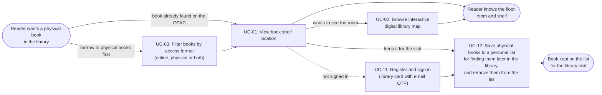
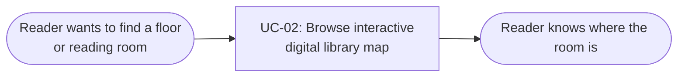
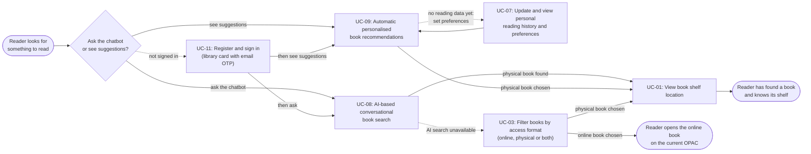
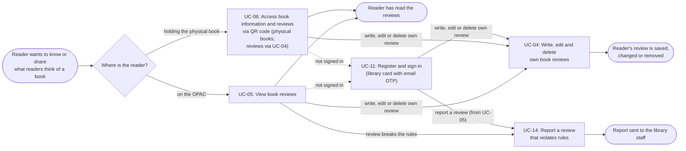
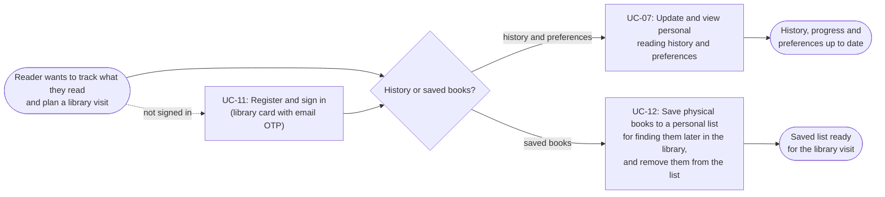
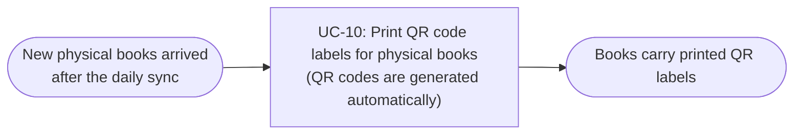
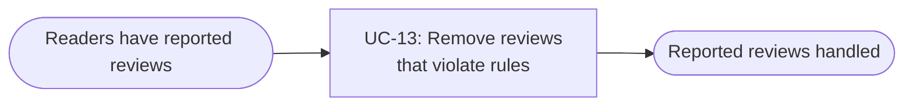

# Usage Flow: Group H Library Core System

| Field | Value |
|---|---|
| Product | Group H Library Core System |
| Version | v1.0 |
| Date | 2026-11-08 |
| Sources | W0 Table 1 (use case inventory); Use Case Diagram; Context Diagram; `ACTIVITY DIAGRAM/activity-index.md` and `AD-UC-01.md` to `AD-UC-14.md` |

The product is an add-on to the library's existing OPAC. Existing OPAC pages (catalogue and search
results, Book Detail, main menu, personal area, online book page) are where the reader comes from or
goes back to; they are situations or exits in the flows below, never boxes.

## Note

- [x] Every row of the Inputs check table in `ACTIVITY DIAGRAM/activity-index.md` is "Done" or logged
      as an open question. Rows 1, 2, 6 and 8 are Done. These rows are still Open and are logged as
      open questions (Inputs check of `ACTIVITY DIAGRAM/activity-index.md`):
  - Row 3 (Use Case Diagram): add a use case "Sync data from the library internal system" (started
    by time) for FR-04-09, FR-04-10, FR-04-11 and FR-01-05, and draw its activity diagram. Owner:
    Integrator. Logged as an open question (also open question L8-20 in `ACTIVITY DIAGRAM/activity-index.md`).
  - Row 4 (Sequence Diagrams): split the sequences that tell two use cases (User Interface Flow
    UC-01 + UC-02, User Review Interaction Flow UC-05 + UC-04, Book Review API Interaction UC-06 +
    UC-04, Reader Interaction Flow UC-07 + UC-09, User Review Reporting Flow UC-14 + UC-13) into one
    sequence per use case. Owners: A, C, D. Logged as an open question.
  - Row 5 (Sequence Diagrams): the reader's choices (map link, edit or delete own review, view
    history or set preferences) are now decisions in AD-UC-02, AD-UC-04 and AD-UC-07; in the
    sequences keep `alt` only for interaction conditions such as an API error. Owners: A, C, D.
    Logged as an open question.
  - Row 7 (Sequence Diagrams): in User Review Reporting Flow, change the step that opens the
    reported-reviews list from FR-02-10 to FR-02-14. Owner: C. Logged as an open question.

Sign-in convention used in every flow: UC-11 is drawn as a box reached by a dashed arrow
`"not signed in"`, then the flow goes on to the use case that needed it. A reader who is already
signed in skips UC-11. In the Step tables UC-11 is marked "(if not signed in)".

## Reader: find a book on the shelf

| Step | Use case | Activity diagram | Screens |
|---|---|---|---|
| (alt) | UC-03 Filter books by access format (online, physical or both) | `AD-UC-03.md` | S-F03-01 |
| 1 | UC-01 View book shelf location | `AD-UC-01.md` | S-F01-01, S-F01-02 |
| 2 | UC-02 Browse interactive digital library map | `AD-UC-02.md` | S-F01-02 |
| (if not signed in) | UC-11 Register and sign in (library card with email OTP) | `AD-UC-11.md` | S-F00-01, S-F00-02 (from modal "Sign in to continue?" on S-F01-01) |
| 3 (alt) | UC-12 Save physical books to a personal list for finding them later in the library, and remove them from the list | `AD-UC-12.md` | S-F01-01 (Save to my list), S-F03-03 |

The reader comes from the existing OPAC Book Detail page (UC-01 trigger) or from the access-format
results, where a physical book leads back to its Book Detail page. Showing the book's room on the map
is drawn in AD-UC-01; the arrow to UC-02 stands for browsing the map further (other floor, other
room); see open question L8-18 in `ACTIVITY DIAGRAM/activity-index.md`.

## Reader: find a reading room in the library

| Step | Use case | Activity diagram | Screens |
|---|---|---|---|
| 1 | UC-02 Browse interactive digital library map | `AD-UC-02.md` | S-F01-02 |

Kept as its own flow, not merged into the flow above: here the reader comes for a room, not a book,
and opens the map from the OPAC main menu (AD-UC-02 trigger "from the menu").

## Reader: discover books to read

| Step | Use case | Activity diagram | Screens |
|---|---|---|---|
| (if not signed in) | UC-11 Register and sign in (library card with email OTP) | `AD-UC-11.md` | S-F00-01, S-F00-02 (from modal "Sign in to continue?" on S-F03-06 or S-F03-07) |
| 1 | UC-08 AI-based conversational book search | `AD-UC-08.md` | S-F03-06 |
| 1 (alt) | UC-09 Automatic personalised book recommendations | `AD-UC-09.md` | S-F03-07 |
| (alt) | UC-07 Update and view personal reading history and preferences | `AD-UC-07.md` | S-F03-02 |
| (alt) | UC-03 Filter books by access format (online, physical or both) | `AD-UC-03.md` | S-F03-01 |
| 2 | UC-01 View book shelf location | `AD-UC-01.md` | S-F01-01, S-F01-02 |

The chatbot checks sign-in after the reader sends the first message (AD-UC-08); the flow shows only
that sign-in comes before the search can be used. UC-07 is reached when there is no reading data yet
and the reader is asked to set preferences (FR-03-19). UC-03 is reached when AI search is temporarily
unavailable (FR-03-17). A book card on S-F03-06, S-F03-07 or S-F03-01 opens the existing OPAC Book
Detail page, where the reader asks for the shelf location (UC-01).

## Reader: read and review a book

| Step | Use case | Activity diagram | Screens |
|---|---|---|---|
| 1 | UC-05 View book reviews | `AD-UC-05.md` | S-F02-01 |
| 1 (alt) | UC-06 Access book information and reviews via QR code (physical books; reviews via UC-04) | `AD-UC-06.md` | S-F02-02 |
| (if not signed in) | UC-11 Register and sign in (library card with email OTP) | `AD-UC-11.md` | S-F00-01, S-F00-02 (from modal "Sign in to continue?" on S-F02-01 or S-F02-02) |
| 2 | UC-04 Write, edit and delete own book reviews | `AD-UC-04.md` | S-F02-01, S-F02-02 (modal "Delete your review?") |
| 2 (alt) | UC-14 Report a review that violates rules | `AD-UC-14.md` | S-F02-01 (modal "Report this review?") |

The reader opens the reviews from the existing OPAC Book Detail page (UC-05) or by scanning the QR
label on the book with a phone camera (UC-06). Report is only offered from UC-05: AD-UC-06 has no
Report call. The arrow UC-05 to UC-04 is kept because S-F02-01 offers both, but AD-UC-05 has no
branch to UC-04 yet (open question L8-17 in `ACTIVITY DIAGRAM/activity-index.md`).

## Reader: keep my reading history and reading list

| Step | Use case | Activity diagram | Screens |
|---|---|---|---|
| (if not signed in) | UC-11 Register and sign in (library card with email OTP) | `AD-UC-11.md` | S-F00-01, S-F00-02 (from modal "Sign in to continue?" on S-F03-02 or S-F03-03) |
| 1 | UC-07 Update and view personal reading history and preferences | `AD-UC-07.md` | S-F03-02 |
| 1 (alt) | UC-12 Save physical books to a personal list for finding them later in the library, and remove them from the list | `AD-UC-12.md` | S-F03-03 |

The reader opens both from new links in the existing OPAC personal area. No arrow from UC-12 to
UC-01: the saved books list already shows the shelf location of each book (AD-UC-12, FR-03-07).

UC-11 has no flow of its own: the reader signs in only when a use case needs it (flows above).

## On-site Staff: label new physical books

| Step | Use case | Activity diagram | Screens |
|---|---|---|---|
| 1 | UC-10 Print QR code labels for physical books (QR codes are generated automatically) | `AD-UC-10.md` | S-F00-03, S-F04-01, S-F02-03 (modal "QR label sheet preview") |

Staff sign in inside UC-10 (and UC-13) with their internal library account on S-F00-03 before the
staff page opens (FR-04-07, FR-04-08), not through
UC-11, which is the reader sign-in (AD-UC-10). The printed labels are what make UC-06 possible for
readers (AD-UC-06 precondition).

## On-site Staff: moderate reported reviews

| Step | Use case | Activity diagram | Screens |
|---|---|---|---|
| 1 | UC-13 Remove reviews that violate rules | `AD-UC-13.md` | S-F00-03, S-F04-01, S-F02-04 (modal "Remove this review?") |

Staff sign in inside UC-13 with their internal library account (FR-04-07), not through UC-11. UC-13
handles the reports that readers send in UC-14 (flow "Reader: read and review a book"; AD-UC-13
precondition).

## Use cases without a flow

| Use case | Started by | Described in |
|---|---|---|
| UC-10 (part) Automatic QR code generation for new physical books (FR-02-07) | Time (daily catalogue sync finished) | `AD-UC-10.md` time event `t1`; no screen |
| UC-07 (part) Reading-history entries from borrowed books (FR-03-03) | Time (daily loan records sync finished, FR-04-10) | `AD-UC-07.md` time event `t1`; no screen |
| UC-07 (part) Reading-history entry when a signed-in reader opens an online book (FR-03-02) | Accept event from UC-03 (online book opened) | `AD-UC-07.md` accept event `e1`; `AD-UC-03.md` `s5` (open question L8-19 in `ACTIVITY DIAGRAM/activity-index.md`) |
| Sync data from the library internal system (planned; FR-04-09, FR-04-10, FR-04-11, FR-01-05) | Time (daily) / Library Internal System | Not drawn yet: activity-index Inputs check row 3, Open (Integrator); open question 5 |

## Checks before you save

- [x] Every actor that starts a use case has at least one flow. Reader: 5 flows; On-site Staff: 2
      flows.
- [x] An actor with clearly different goals has one flow per goal; no flow has more than about
      9 boxes. Boxes per flow: find a book 5, find a room 1, discover books 6, read and review 5,
      history and list 3, label books 1, moderate reviews 1. Largest flow: 6 boxes.
- [x] Every actor name matches the Use Case Diagram and the Context Diagram. "Reader" and "On-site
      Staff", as on the Context Diagram (READER, ON-SITE STAFF) and in the "Primary actor" row of
      every activity diagram.
- [x] Coverage: every in-scope use case of W0 Table 1 that a person starts appears in at least one
      flow, with the same ID and name. UC-01 (find a book, discover books), UC-02 (find a book, find
      a room), UC-03 (find a book, discover books), UC-04 (read and review), UC-05 (read and
      review), UC-06 (read and review), UC-07 (discover books, history and list), UC-08 (discover
      books), UC-09 (discover books), UC-10 (label books), UC-11 (find a book, discover books, read
      and review, history and list), UC-12 (find a book, history and list), UC-13 (moderate
      reviews), UC-14 (read and review). The timed parts are under "Use cases without a flow"; no
      Won't-have item appears.
- [x] No box is a click or a screen; no box tells two use cases. Every box is one `UC-xx` with its
      W0 name; the only diamonds are the reader's choice between use cases.
- [x] Every flow renders on mermaid.live. All 7 diagrams were parsed without error by Mermaid
      11.4.1 (the engine behind mermaid.live); every label is in double quotes and no node is named
      `end`.
- [x] After Block 2: every step has at least one screen, and every screen in the screen list
      appears in some step. All 15 screens appear: S-F00-01 and S-F00-02 (UC-11), S-F00-03 (UC-10,
      UC-13), S-F01-01 (UC-01, UC-12), S-F01-02 (UC-01, UC-02), S-F02-01 (UC-05, UC-04, UC-14),
      S-F02-02 (UC-06, UC-04), S-F02-03 (UC-10), S-F02-04 (UC-13), S-F03-01 (UC-03), S-F03-02
      (UC-07), S-F03-03 (UC-12), S-F03-06 (UC-08), S-F03-07 (UC-09), S-F04-01 (UC-10, UC-13).
