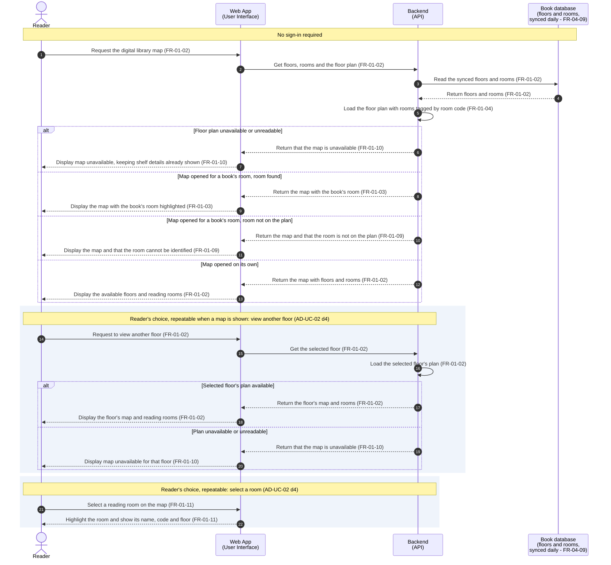

# Sequence Diagram: SD-UC-02 Browse interactive digital library map

| Field | Value |
|---|---|
| SD ID | SD-UC-02 |
| Use case | UC-02 Browse interactive digital library map |
| Feature | F-01 Book Location & Library Map |
| Primary actor | Reader |
| Participants | Reader · Web App · Backend · Book database |
| Trigger | The reader asks for the digital library map, from the menu or from a book's shelf location (UC-01) |
| Preconditions | No sign-in is needed (W0 Table 1). The digital floor plan exists and its room codes match the Library Internal System (FR-01-04). Floors and rooms have been synced (FR-04-09). |
| FRs covered | FR-01-02, FR-01-03, FR-01-04, FR-01-09, FR-01-10, FR-01-11 |
| Activity diagram | [AD-UC-02](../ACTIVITY%20DIAGRAM/AD-UC-02.md) |
| Redrawn from | `User Interface Flow-2026-10-12-031728.png` |
| Version / status | v2.0 · Draft |

## 1. Diagram

Blue sections are choices of the actor, grey sections run automatically, and `alt` / `opt` are system
conditions. Reading rules: [sequence-index.md](sequence-index.md#drawing-rules).

## 2. Changes from the original diagram

- Split from the combined UC-01 + UC-02 image (Inputs check 4).
- Added switching floors, selecting a room (FR-01-11) and the map errors of AD-UC-02.
- FR-01-04 now has its own step, because each message carries one FR.
