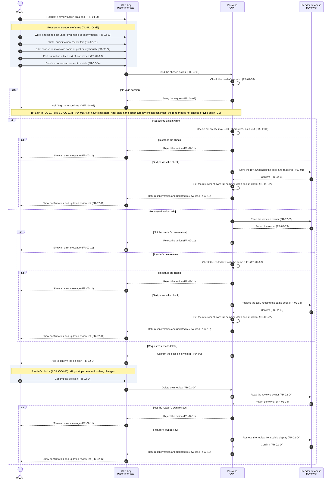

# Sequence Diagram: SD-UC-04 Write, edit and delete own book reviews

| Field | Value |
|---|---|
| SD ID | SD-UC-04 |
| Use case | UC-04 Write, edit and delete own book reviews |
| Feature | F-02 Reviews & QR |
| Primary actor | Reader |
| Participants | Reader · Web App · Backend · Reader database |
| Trigger | The reader asks to write, edit or delete a review on a book |
| Preconditions | The book is in the synced catalogue. The reader may not be signed in yet: the flow checks the session (FR-04-08) and calls Sign in (UC-11). |
| FRs covered | FR-02-01, FR-02-03, FR-02-04, FR-02-11, FR-02-12, FR-02-22, FR-04-08 |
| Activity diagram | [AD-UC-04](../ACTIVITY%20DIAGRAM/AD-UC-04.md) |
| Redrawn from | `User Review Interaction Flow-2026-10-12-032334.png` · `Book Review API Interaction-2026-10-12-032039.png` |
| Version / status | v2.1 · Draft |

## 1. Diagram

Blue sections are choices of the actor, grey sections run automatically, and `alt` / `opt` are system
conditions. Reading rules: [sequence-index.md](sequence-index.md#drawing-rules).

## 2. Changes from the original diagram

- Joins the write steps of Book Review API Interaction and the edit and delete steps of User Review Interaction Flow (Inputs check 4).
- Write, edit and delete are reader's choices, so they are marked sections instead of `opt` (Inputs check 5).
- Added the session check, the rejections (FR-02-11), the confirmation (FR-02-12) and the anonymous option (FR-02-22).
- v2.1 (23/11/2026): the reader chooses the action before the session check, so it continues by itself after sign-in (D1, AD-UC-04 v1.3).
- v2.1 (23/11/2026): the system then follows the requested action (`alt`, AD-UC-04 `d8`) and sets the name shown on the review (FR-02-22).
