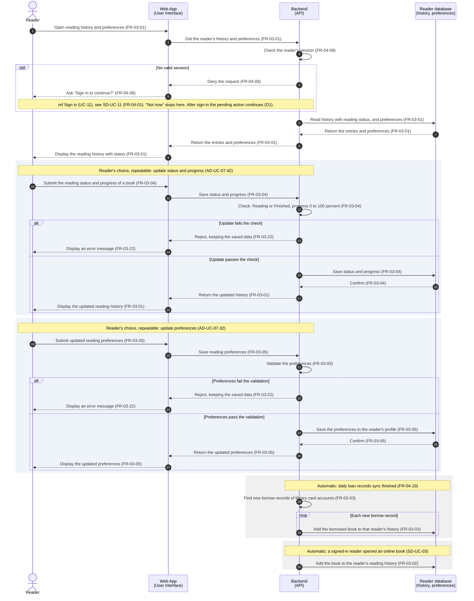

# Sequence Diagram: SD-UC-07 Update and view personal reading history and preferences

| Field | Value |
|---|---|
| SD ID | SD-UC-07 |
| Use case | UC-07 Update and view personal reading history and preferences |
| Feature | F-03 Discovery, Reading History & Recommendation |
| Primary actor | Reader; two parts start by themselves: a time event (daily loan sync finished) and an accept event (online book opened, from UC-03) |
| Participants | Reader · Web App · Backend · Reader database |
| Trigger | (a) The reader opens their reading history and preferences. (b) Time event: the daily loan records sync has finished (FR-04-10). (c) Accept event: a signed-in reader opened an online book from the filter results (AD-UC-03). |
| Preconditions | (a) The reader may not be signed in yet: the flow checks the session (FR-04-08) and calls Sign in (UC-11). (b) Loan records of library card accounts are synced daily (FR-04-10). |
| FRs covered | FR-03-01, FR-03-02, FR-03-03, FR-03-04, FR-03-05, FR-03-22, FR-04-08 |
| Activity diagram | [AD-UC-07](../ACTIVITY%20DIAGRAM/AD-UC-07.md) |
| Redrawn from | `Reader Interaction Flow-2026-10-12-031246.png` |
| Version / status | v2.0 · Draft |

## 1. Diagram

Blue sections are choices of the actor, grey sections run automatically, and `alt` / `opt` are system
conditions. Reading rules: [sequence-index.md](sequence-index.md#drawing-rules).

## 2. Changes from the original diagram

- Split from the combined UC-07 + UC-09 image (Inputs check 4). Recommendations are now in SD-UC-09.
- Viewing history and setting preferences are reader's choices, so they are no longer `alt` (Inputs check 5).
- The yellow note on automatic history entries is now two drawn flows. Added the session check and rejected updates (FR-03-22).
