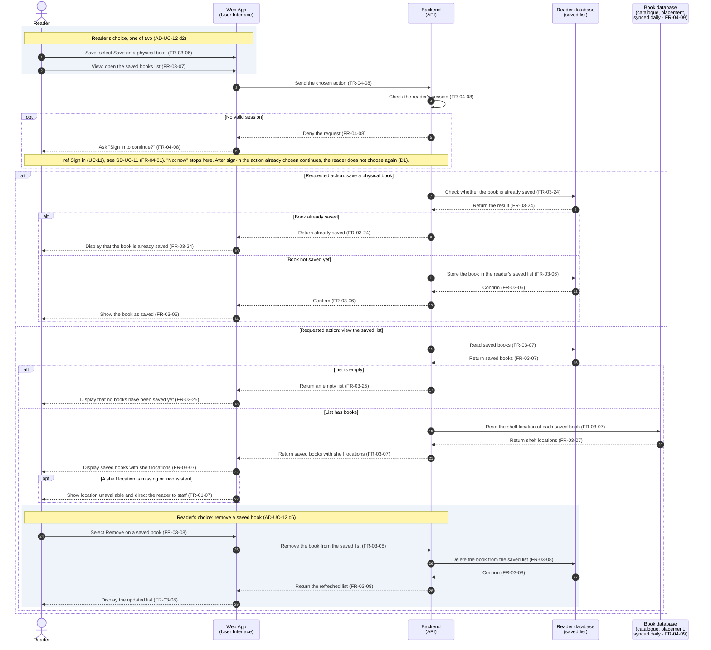

# Sequence Diagram: SD-UC-12 Save physical books to a personal list for finding them later in the library, and remove them from the list

| Field | Value |
|---|---|
| SD ID | SD-UC-12 |
| Use case | UC-12 Save physical books to a personal list for finding them later in the library, and remove them from the list |
| Feature | F-03 Discovery, Reading History & Recommendation |
| Primary actor | Reader |
| Participants | Reader · Web App · Backend · Reader database · Book database |
| Trigger | The reader asks for a saved-books action: save a physical book, or open the saved books list |
| Preconditions | The reader may not be signed in yet: the flow checks the session (FR-04-08) and calls Sign in (UC-11). |
| FRs covered | FR-01-07, FR-03-06, FR-03-07, FR-03-08, FR-03-24, FR-03-25, FR-04-08 |
| Activity diagram | [AD-UC-12](../ACTIVITY%20DIAGRAM/AD-UC-12.md) |
| Redrawn from | `Reader API Saved List-2026-10-12-033031.png` |
| Version / status | v2.2 · Draft |

## 1. Diagram

Blue sections are choices of the actor, grey sections run automatically, and `alt` / `opt` are system
conditions. Reading rules: [sequence-index.md](sequence-index.md#drawing-rules).

## 2. Changes from the original diagram

- Added the session check, already saved (FR-03-24), empty list (FR-03-25) and missing shelf location (FR-01-07).
- Removing a book is a reader's choice, so it is a marked section instead of `opt` (Inputs check 5).
- v2.1 (23/11/2026): the reader chooses the action before the session check, so it continues by itself after sign-in (D1, AD-UC-12 v1.2).
- v2.2 (23/11/2026): the first step "Request a saved-books action" is removed, as in AD-UC-12 v1.3 (L8-21).
