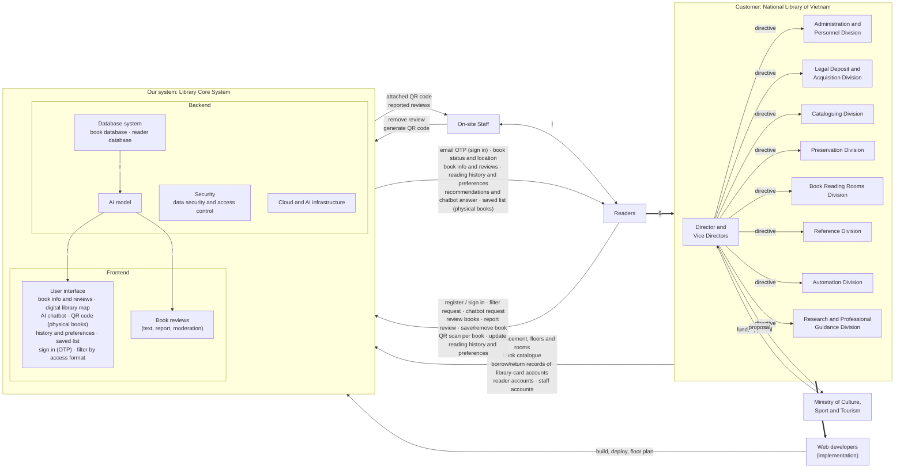

# Customer Value Chain Analysis: Group H Library Core System

## 1. Diagram

Solid arrows carry **information** (`!` in the original). Thick arrows carry **money** (`$`). The arrows from the
National Library to our system start at the library as a whole: the original does not say which division sends
each flow.

## 2. Actors and what each one gets

| Actor | Role in the chain | Gives | Gets |
|---|---|---|---|
| Ministry of Culture, Sport and Tourism | Owner and funder of the National Library | Funding, approval | Proposals from the library's directors |
| National Library of Vietnam (customer) | Buys the system; its Director and Vice Directors direct eight divisions | Catalogue, shelf placement, floors and rooms, loan records, reader and staff accounts (through the Library Internal System); payment to the web developers | A system that serves its readers and staff |
| Web developers | Build and run the system | Build, deployment, the digital floor plan | Payment from the library |
| On-site Staff | Library staff working in the reading rooms | Review removals, QR code generation and label printing | QR labels to attach, the list of reported reviews |
| Readers | People who use the library and its OPAC | Sign-in, searches, reviews, reports, saved books, QR scans, reading history and preferences; fees to the library | Shelf location, book information and reviews, reading history, recommendations and chatbot answers, saved list, OTP emails |

## 3. Problems and opportunities

These are stakeholder needs and opportunities derived from the value flows above and the agreed
[scope](../function-list/scope.md#table-2-feature-list), not new interview findings or measured claims.
They refine the earlier DBIZ1 themes of discoverability, personalisation and continued reader engagement
into the bounded DBIZ2 product. The existing OPAC and Library Internal System retain the work excluded in
[Table 3](../function-list/scope.md#table-3-wont-have).

| # | Stakeholder | Problem or opportunity |
|---|---|---|
| P-1 | Readers | Finding a catalogue record does not complete the visit: readers also need the physical copy's floor, room and shelf, or a clear indication that no physical location exists. |
| P-2 | Readers | Room and shelf codes are hard to use without a spatial reference; a digital floor map can help readers identify the reading room associated with a book. |
| P-3 | Readers | Catalogue descriptions alone do not provide other readers' experiences; readers need a place to read text reviews and control the reviews they contribute. |
| P-4 | Readers | A reader holding a physical book has an opportunity to reach that title's information and reviews directly by scanning its label. |
| P-5 | On-site Staff | Physical titles need printable QR labels; staff need to distinguish titles awaiting their first label from labelled titles needing another label for an additional copy. |
| P-6 | Readers, On-site Staff | Offensive language, advertising or personal information can make reviews unsafe or unhelpful; readers need a reporting route and staff need a bounded moderation workflow. |
| P-7 | Readers | Readers need to narrow discovery to online books, physical books or titles offered in both formats without rebuilding the OPAC's keyword search. |
| P-8 | Readers | Borrowed physical books and online books selected through this platform can support a continuous personal reading history, but reading status and progress still need reader input. |
| P-9 | Readers | Readers may discover physical books before a visit and need to keep a personal list with shelf locations, removing titles they no longer plan to find. |
| P-10 | Readers | Readers may know a topic or learning need without knowing a title; conversational discovery and recommendations offer a way to connect that need, stated preferences and prior activity to the collection. |
| P-11 | Readers, On-site Staff, National Library of Vietnam | Personal reader actions and staff-only tasks must be linked to the correct existing library identity and role without creating a second account-registration service. |
| P-12 | National Library of Vietnam | The add-on depends on catalogue, location, layout and loan information owned by the internal system; it needs refreshed data without changing the library's authoritative records or losing the last usable data during a failed sync. |
| P-13 | National Library of Vietnam | Sign-ins, label printing, review removals and sync runs need an actor/action/time record so operational events can be traced without adding a reporting dashboard. |
| P-14 | Web developers, Readers, On-site Staff | Changes can disrupt reader and staff journeys; developers need repeatable checks and controlled delivery, while users need a way to recover from failed network requests. |
| P-15 | Ministry of Culture, Sport and Tourism, National Library of Vietnam | The funding-and-approval chain offers an opportunity to review a clearly bounded service improvement through the library's proposal and agreed project deliverables, rather than expanding into a replacement library-management system. |

## 4. Stakeholder requirements

Each requirement states a stakeholder outcome as "<stakeholder> shall be able to ...".
The **From** column traces the outcome to the problems and opportunities above. These IDs are inputs for
system requirements in [the system architecture](../architecture/system-architecture.md); they do not
replace the detailed rules and priorities in [the FR list](../function-list/fr-list.md).
Features marked **Could** there remain optional; adding a stakeholder trace does not raise their priority.

| ID | Stakeholder requirement | From |
|---|---|---|
| StR-01 | Readers shall be able to find the floor, room and shelf of a physical copy and distinguish an online-only title or an unavailable location from a usable physical location. | P-1 |
| StR-02 | Readers shall be able to browse the library's floors and reading rooms and locate a book's room on the digital map when that room is mapped. | P-2 |
| StR-03 | Readers shall be able to read the published text reviews associated with a book. | P-3 |
| StR-04 | Readers shall be able to publish a text review under their library-card name or anonymously, and edit or delete their own reviews. | P-3 |
| StR-05 | Readers shall be able to open a physical title's information and reviews by scanning its QR label. | P-4 |
| StR-06 | On-site Staff shall be able to select physical titles awaiting their first QR label, preview and print their labels, and confirm when printing is complete. | P-5 |
| StR-07 | On-site Staff shall be able to reprint an existing QR label for additional copies of a previously labelled title. | P-5 |
| StR-08 | Readers shall be able to report another reader's review for offensive language, advertising or personal information. | P-6 |
| StR-09 | On-site Staff shall be able to inspect reported reviews, remove a review that violates the agreed rules, or dismiss a report when the review follows those rules. | P-6 |
| StR-10 | Readers shall be able to filter catalogue titles by online, physical or both access formats and continue to the existing OPAC for online content. | P-7 |
| StR-11 | Readers shall be able to revisit a personal history containing borrowed physical books from the synced loan records and online books they selected to open on the OPAC from this platform. | P-8 |
| StR-12 | Readers shall be able to update the reading status and progress of books in their personal reading history. | P-8 |
| StR-13 | Readers shall be able to save physical books in a personal list, revisit their shelf locations and remove saved books. | P-9 |
| StR-14 | Readers shall be able to state and update reading preferences for personalised discovery. | P-10 |
| StR-15 | Readers shall be able to describe a need through a chatbot and receive matching catalogue books, with the conversation retained for that reader. | P-10 |
| StR-16 | Readers shall be able to receive book recommendations informed by their history, preferences and chatbot conversations, including popular or trending alternatives when personal data or matching titles are insufficient. | P-10 |
| StR-17 | Readers shall be able to sign in with an existing library card and a one-time code sent to its registered email, then resume the protected action that started sign-in. | P-11 |
| StR-18 | On-site Staff shall be able to sign in with an existing internal library account, access their permitted QR-label and reported-review tasks, and explicitly sign out. | P-11 |
| StR-19 | The National Library of Vietnam shall be able to limit protected reader actions to signed-in readers and staff tasks to authenticated accounts with the staff role. | P-11 |
| StR-20 | The National Library of Vietnam shall be able to have catalogue, shelf, floor, room and loan data refreshed daily from its internal system without writes back to it, while retaining the last successful data if an import fails. | P-12 |
| StR-21 | The National Library of Vietnam shall be able to retain an actor/action/time audit record of successful sign-ins, confirmed label prints, review removals and sync runs. | P-13 |
| StR-22 | Web developers shall be able to receive automated unit- and integration-test results for every change pushed to the repository. | P-14 |
| StR-23 | Web developers shall be able to deliver a change merged to the main branch through an automated build and deployment only after the automated tests pass. | P-14 |
| StR-24 | Readers and On-site Staff shall be able to retry a failed network or loading request while retaining the information already shown on the screen. | P-14 |
| StR-25 | The Ministry of Culture, Sport and Tourism shall be able to review the library's proposed service improvement for approval through the existing proposal process, supported by the project's agreed scope and design deliverables. | P-15 |

### Feature coverage and downstream handoff

This table checks that every agreed feature has stakeholder requirements behind it. The FR references are
existing examples for the architecture author, not new or changed FRs.

| Feature | Stakeholder requirements | Existing scope and requirement anchors |
|---|---|---|
| F-01 Book Location & Library Map | StR-01, StR-02 | UC-01, UC-02; [FR-01-01](../function-list/fr-list.md#fr-01-01), [FR-01-02](../function-list/fr-list.md#fr-01-02), [FR-01-03](../function-list/fr-list.md#fr-01-03), [FR-01-04](../function-list/fr-list.md#fr-01-04), [FR-01-05](../function-list/fr-list.md#fr-01-05), [FR-01-06](../function-list/fr-list.md#fr-01-06). |
| F-02 Reviews & QR | StR-03–StR-09 | UC-04, UC-05, UC-06, UC-10, UC-13, UC-14; [FR-02-01](../function-list/fr-list.md#fr-02-01), [FR-02-02](../function-list/fr-list.md#fr-02-02), [FR-02-03](../function-list/fr-list.md#fr-02-03), [FR-02-04](../function-list/fr-list.md#fr-02-04), [FR-02-05](../function-list/fr-list.md#fr-02-05), [FR-02-07](../function-list/fr-list.md#fr-02-07), [FR-02-08](../function-list/fr-list.md#fr-02-08), [FR-02-09](../function-list/fr-list.md#fr-02-09), [FR-02-10](../function-list/fr-list.md#fr-02-10), [FR-02-20](../function-list/fr-list.md#fr-02-20), [FR-02-23](../function-list/fr-list.md#fr-02-23), [FR-02-25](../function-list/fr-list.md#fr-02-25). |
| F-03 Discovery, Reading History & Recommendation | StR-10–StR-16 | UC-03, UC-07, UC-08, UC-09, UC-12; [FR-03-01](../function-list/fr-list.md#fr-03-01), [FR-03-02](../function-list/fr-list.md#fr-03-02), [FR-03-03](../function-list/fr-list.md#fr-03-03), [FR-03-04](../function-list/fr-list.md#fr-03-04), [FR-03-05](../function-list/fr-list.md#fr-03-05), [FR-03-06](../function-list/fr-list.md#fr-03-06), [FR-03-07](../function-list/fr-list.md#fr-03-07), [FR-03-08](../function-list/fr-list.md#fr-03-08), [FR-03-09](../function-list/fr-list.md#fr-03-09), [FR-03-10](../function-list/fr-list.md#fr-03-10), [FR-03-11](../function-list/fr-list.md#fr-03-11), [FR-03-12](../function-list/fr-list.md#fr-03-12), [FR-03-19](../function-list/fr-list.md#fr-03-19), [FR-03-20](../function-list/fr-list.md#fr-03-20). |
| F-04 Platform, Access & Operations | StR-17–StR-24 | UC-11, UC-15 and staff access in UC-10/UC-13; [FR-04-01](../function-list/fr-list.md#fr-04-01), [FR-04-04](../function-list/fr-list.md#fr-04-04), [FR-04-07](../function-list/fr-list.md#fr-04-07), [FR-04-08](../function-list/fr-list.md#fr-04-08), [FR-04-09](../function-list/fr-list.md#fr-04-09), [FR-04-10](../function-list/fr-list.md#fr-04-10), [FR-04-11](../function-list/fr-list.md#fr-04-11), [FR-04-12](../function-list/fr-list.md#fr-04-12), [FR-04-13](../function-list/fr-list.md#fr-04-13), [FR-04-14](../function-list/fr-list.md#fr-04-14), [FR-04-20](../function-list/fr-list.md#fr-04-20), [FR-04-21](../function-list/fr-list.md#fr-04-21). |

- **Project-level requirement:** StR-25 belongs to the existing funding/approval relationship, not an application
  feature. It requires no Ministry account, approval screen, analytics dashboard or new data exchange.
- **Boundaries preserved:** no loans, keyword-search engine, online-content viewer, Google sign-in, account
  registration, catalogue editing or floor-plan editor is added. Reviews stay in this platform; nothing writes
  them back to the Library Internal System.
- **Priority and decisions preserved:** the Could pool (chatbot, recommendations, reporting/moderation) remains
  optional. [D40–D42 and D47–D50](../project/decision-index.md#group-decisions-22112026) remain the basis for
  reprinting, multi-page label sheets, online-selection events, integration and delivery rules.
- **Trace check:** P-1 through P-15 each have at least one StR. StR-01 through StR-24 cover F-01 through F-04;
  StR-25 is handed over as a project constraint. Linh can use these IDs in the architecture's From column
  without adding an unsupported system feature.

## 5. Notes on the redraw

- The two staff arrows of the original are drawn with stacked labels («Remove review / attached QR code»,
  «Generate QR code / reported reviews»). They are read here as: staff **send** "remove review" and "generate QR
  code"; staff **receive** the attached QR code and the reported reviews. QR codes are in fact generated
  automatically for new physical books (FR-02-07); staff print the labels (FR-02-08).
- The flow "reader feedback and rate books" from readers to the library was removed from the CVCA before this
  redraw ([scope.md](../function-list/scope.md#table-3-wont-have)): reviews stay inside this product.
- "Availability" was removed from the flow "book catalogue and availability" (check of 23/11/2026): copy
  availability stays on the existing OPAC. The reader flow "book status and location" is kept as drawn.
- Payment flows: Readers → National Library, National Library → Web developers.

