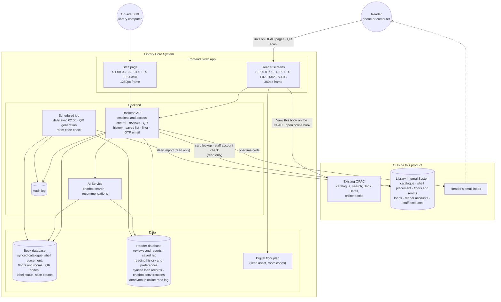

# System Architecture: Group H Library Core System

The parts of the system, the data each part keeps, and how the system connects to the library's existing systems.
This is the logical architecture drawn from the analysis documents. Technology choices (languages, frameworks,
hosting provider, AI model) are not part of it; they are made in DBIZ3 (see [section 9](#9-not-decided-here)).

| Field | Value |
|---|---|
| Version | v1.0 · 23/11/2026 |
| Status | Draft, waiting for group review |
| Built from | Participants and messages of [the 15 sequence diagrams](../use-case/sequence-index.md) · [context-diagram.md](../context/context-diagram.md) · [cvca.md](../context/cvca.md) (frontend / backend split) · data functions in [scope.md](../function-list/scope.md#table-4-data-functions) · F-04 FRs in [fr-list.md](../function-list/fr-list.md#f-04-platform-access--operations) |
| Rule | Every box and arrow below already appears in a sequence diagram or an FR. Nothing here adds scope. |

## 1. Diagram

## 2. Components

| Component | What it does | Main FRs | Sequence diagrams |
|---|---|---|---|
| Reader screens | The screens readers reach from links added to existing OPAC pages, or by scanning a QR label. Designed for a 360px phone frame (D44). | F-01, F-02, F-03 screens; FR-04-20 on every screen | SD-UC-01 … SD-UC-09, SD-UC-11, SD-UC-12, SD-UC-14 |
| Staff page | The minimal staff page: sign-in, QR label printing, reported reviews, sign-out. Designed for 1280px (D45). | FR-04-07, FR-04-21, FR-02-23, FR-02-08, FR-02-25, FR-02-14, FR-02-10 | SD-UC-10, SD-UC-13 |
| Backend API | Serves both frontends. Checks the session and role on every protected request, runs the business rules, writes audit entries, sends the OTP email itself (no outside email service, AD-UC-11 Q2). | FR-04-01, FR-04-04, FR-04-08, FR-04-12, FR-04-16, FR-04-17, FR-04-19, FR-04-20; all F-01 to F-03 rules | All except SD-UC-15 |
| Scheduled job | Runs once a day at 02:00, with no person: imports data from the Library Internal System, then generates QR codes for new physical books and reports room codes missing from the floor plan. Keeps the last good data and retries up to 3 times on failure. | FR-04-09, FR-04-10, FR-04-11, FR-02-07, FR-01-05 | SD-UC-15, SD-UC-10 (trigger b) |
| AI Service | Inside the Library Core System. Answers chatbot questions with books from the synced catalogue and builds recommendation lists from the reader's history, preferences and conversations. When it is unavailable the screens say so and offer the access-format filter instead. | FR-03-09, FR-03-10, FR-03-11, FR-03-16 … FR-03-21 | SD-UC-08, SD-UC-09 |
| Audit log | One entry (actor, action, time) for every sign-in, label print, review removal and sync run. | FR-04-12 | SD-UC-10, SD-UC-11, SD-UC-13, SD-UC-15 |
| Digital floor plan | A drawing of every floor, built once by the project team; each reading room carries the room code of the Library Internal System. | FR-01-04, FR-01-02, FR-01-03 | SD-UC-01, SD-UC-02 |

## 3. Data stores

ILF = kept and changed by this product. EIF = a read-only copy of data owned by the Library Internal System.

| Store | Holds | ILF / EIF | Filled by |
|---|---|---|---|
| Book database | Book catalogue (titles, authors, subjects, summaries, access formats) | EIF | Daily sync (FR-04-09) |
| Book database | Shelf placement, floors and rooms | EIF | Daily sync (FR-04-09) |
| Book database | QR codes (one per book title, shared by all copies, D40), label-printed status, scan counts | ILF | Scheduled job (FR-02-07), staff printing (FR-02-08), QR scans (FR-02-06) |
| Reader database | Book reviews and reports | ILF | Readers (FR-02-01, FR-02-09), staff (FR-02-10) |
| Reader database | Saved books list | ILF | Readers (FR-03-06, FR-03-08) |
| Reader database | Reading history and preferences | ILF | Readers (FR-03-04, FR-03-05), selections of online books (FR-03-02), synced loans (FR-03-03) |
| Reader database | Loan records of library card accounts | EIF | Daily sync (FR-04-10) |
| Reader database | Chatbot conversations | ILF | AI Service (FR-03-10) |
| Reader database | Online book read log, with no reader identity | ILF | Selections of online books (FR-03-13) |
| Not stored | Reader accounts (card number, email) and staff accounts | EIF | Looked up in the Library Internal System at sign-in (FR-04-01, FR-04-07) |
| Audit log | Actor, action, time | ILF | Backend API and Scheduled job (FR-04-12) |

## 4. Connections to outside systems

| Outside system | Direction | When | If it fails |
|---|---|---|---|
| Library Internal System: catalogue, placement, floors and rooms, loans | Read only, into this product | Daily at 02:00 (UC-15) | Keep the last successful data, retry up to 3 times, write the error to the audit log (FR-04-11) |
| Library Internal System: reader accounts | Read only | When a reader enters a card number (FR-04-01) | The sign-in screen shows an error and the reader can try again (FR-04-20) |
| Library Internal System: staff accounts and role | Read only | When staff sign in (FR-04-07) | Sign-in rejected with an error, staff can try again (FR-04-18) |
| Existing OPAC | Links both ways; no data exchange | Readers arrive from links added to OPAC pages (D47); they leave through «Xem sách trên OPAC» and online-book links | Not applicable |
| Reader's email inbox | Out: one-time code | At reader sign-in (FR-04-04) | The screen says the code could not be sent and offers a new one (FR-04-16) |

Nothing is ever written back to the Library Internal System ([context-diagram.md](../context/context-diagram.md#3-rules-the-boundary-sets)).

## 5. Main flows

| Flow | Path through the parts | Detail |
|---|---|---|
| Reader sign-in | Reader screens → Backend API → Library Internal System (card lookup) → OTP email → Reader screens → Backend API (code check, session, audit) | [sd-uc-11.md](../use-case/sd-uc-11.md) |
| Staff sign-in | Staff page → Backend API → Library Internal System (account and role) → session and audit | [sd-uc-10.md](../use-case/sd-uc-10.md), [sd-uc-13.md](../use-case/sd-uc-13.md) |
| QR scan | Phone camera → Reader screens (QR landing page) → Backend API → Book database (book, scan count) and Reader database (reviews) | [sd-uc-06.md](../use-case/sd-uc-06.md) |
| QR labels | Scheduled job creates codes after the sync → staff list books awaiting a label → printable sheet → «Đã in xong» records the print and the audit entry | [sd-uc-10.md](../use-case/sd-uc-10.md) |
| Chatbot search | Reader screens → Backend API (session check) → AI Service → Book database and Reader database | [sd-uc-08.md](../use-case/sd-uc-08.md) |
| Daily sync | Scheduled job → Library Internal System → Book database and Reader database → room code check → audit | [sd-uc-15.md](../use-case/sd-uc-15.md) |

## 6. Security and sessions

| Topic | Rule | Source |
|---|---|---|
| Access control | Every protected reader action and every staff screen is refused without a valid session of the right role. | FR-04-08 |
| Reader sign-in | Library card number, then a 6-digit code emailed to the address on the card; the code expires after 5 minutes, works once, and is cancelled after 5 wrong tries. Only library card holders sign in; there are no online accounts or Google sign-in. | FR-04-01, FR-04-04, FR-04-17; scope Table 3 |
| After reader sign-in | The reader returns to the screen where sign-in started and the waiting action continues. | D1 |
| Staff session | No time-out; it ends only when staff choose «Đăng xuất». | D7, FR-04-21 |
| Audit | Sign-ins, label prints, review removals and sync runs are logged with actor, action and time. | FR-04-12 |
| Privacy | The online read log keeps only the book and the time, with no reader identity. | FR-03-13; open question in [fr-list.md](../function-list/fr-list.md#open-questions-w5-4) |

## 7. Delivery and operations

| Topic | Rule | Source |
|---|---|---|
| Automated tests | Every change pushed to the repository runs the unit and integration tests. | FR-04-14 (Must, D50) |
| Deployment | A change merged to the main branch is built and deployed to the hosting environment only when the tests pass. | FR-04-13 |
| Monitoring | No automatic error tracking or alerts in release 1; library staff check the system by hand. | FR-04-15 (Won't), D47 |
| Network errors | Every screen keeps the data already shown, shows MSG-04 and offers «Thử lại». | FR-04-20 |

## 8. Decisions this architecture follows

| ID | Decision |
|---|---|
| AD-UC-11 Q2 | No outside email service: the system sends the OTP email itself. |
| D7 | Staff session has no time-out. |
| D40 | One QR code per book title, shared by all physical copies. |
| D44, D45 | Reader screens from 360px, staff screens from 1280px. |
| D47 | The internal system holds the access format; the library agrees to the new links on the OPAC pages; staff watch errors by hand. |
| D48 | The daily sync is UC-15, started by time. |

All decisions: [decision-index.md](../project/decision-index.md).

## 9. Not decided here

The analysis does not choose the technology. These choices are a pending task in
[decision-index.md](../project/decision-index.md#pending-tasks), to be recorded as decision rows before DBIZ3
coding starts:

- programming languages and frameworks for the Web App, Backend API and Scheduled job;
- database product for the Book database, Reader database and Audit log;
- hosting environment and the tool that runs tests and deployment (FR-04-13, FR-04-14);
- AI model and where it runs (the CVCA names "Cloud and AI infrastructure");
- how the system sends email without an outside email service (AD-UC-11 Q2);
- how the Library Internal System is read: database export, file or interface.
