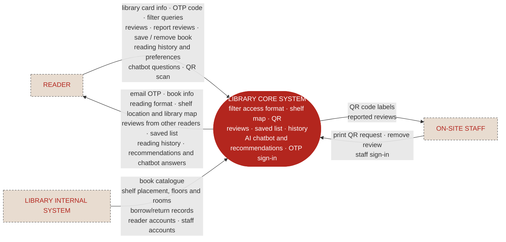

# Context Diagram: Group H Library Core System

The system boundary: the outside parties our system talks to and the information that crosses the boundary.

| Field | Value |
|---|---|
| Version | v1.0 · 23/11/2026 |
| Redrawn from | [Context diagram.pdf @ cd61897](https://github.com/chihvcte-beep/dbiz2-group-h/blob/cd61897/%5BDBIZ%202%5D%20GROUP%20H/Context%20diagram.pdf) (original, kept in Git history), with "availability" removed (check of 23/11/2026) |
| Status | Draft, waiting for group review |
| Used by | [scope.md](../function-list/scope.md#table-4-data-functions) (data the system keeps or only reads), [system-architecture.md](../architecture/system-architecture.md), source traces "DFD L0" in [fr-list.md](../function-list/fr-list.md) |

## 1. Diagram

## 2. Flows across the boundary

| From | To | Information |
|---|---|---|
| Reader | Library Core System | Library card info, OTP code, filter queries, reviews, report reviews, save / remove book, reading history and preferences, chatbot questions, QR scan |
| Library Core System | Reader | Email OTP, book info, reading format, shelf location and library map, reviews from other readers, saved list, reading history, recommendations and chatbot answers |
| Library Internal System | Library Core System | Book catalogue, shelf placement, floors and rooms, borrow/return records, reader accounts, staff accounts |
| On-site Staff | Library Core System | Print QR request, remove review, staff sign-in |
| Library Core System | On-site Staff | QR code labels, reported reviews |

## 3. Rules the boundary sets

- **Read only from the Library Internal System.** Nothing flows back to it: the system never writes the catalogue,
  shelf codes, loans or accounts (FR-04-09, FR-04-10; [scope.md](../function-list/scope.md#table-3-wont-have)).
- The existing OPAC is not an external entity here: it is where readers already are, and this product adds links to
  its pages ([screen-list.md](../external-design/screen-list.md)).
- "Availability" was removed from the flows of the original (check of 23/11/2026): copy availability and borrow
  status stay on the existing OPAC and are not read by this product ([scope.md](../function-list/scope.md#table-3-wont-have)).
- The daily sync that brings the internal data in is UC-15, started by time (D48).
