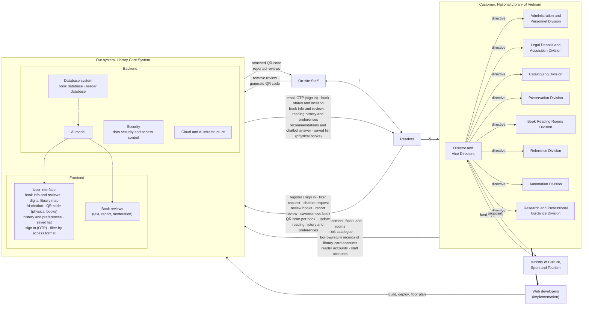

# Customer Value Chain Analysis: Group H Library Core System

Who pays whom, who gives what information to whom, and where our system sits among them.

| Field | Value |
|---|---|
| Version | v1.0 · 23/11/2026 |
| Redrawn from | [CVCA.pdf @ cd61897](https://github.com/chihvcte-beep/dbiz2-group-h/blob/cd61897/%5BDBIZ%202%5D%20GROUP%20H/CVCA.pdf) (original, kept in Git history), with "availability" removed (check of 23/11/2026) |
| Status | Draft, waiting for group review |
| Used by | [scope.md](../function_list/scope.md) (coverage check: every primary actor is served by a feature), [context_diagram.md](context_diagram.md) |

## 1. Diagram

Solid arrows carry **information** (`!` in the original). Thick arrows carry **money** (`$`). The arrows from the
National Library to our system start at the library as a whole: the original does not say which division sends
each flow.

## 2. Actors and what each one gets

| Actor | Role in the chain | Gives | Gets |
|---|---|---|---|
| Ministry of Culture, Sport and Tourism | Owner and funder of the National Library | Funding, approval | Proposals from the library's directors |
| National Library of Vietnam (customer) | Buys the system; its Director and Vice Directors direct eight divisions | Catalogue, shelf placement, floors and rooms, loan records, reader and staff accounts (through the Library Internal System); payment to the web developers | A system that serves its readers and staff |
| Web developers | Build and run the system | Build, deployment, the digital floor plan | Payment from the library |
| On-site Staff | Library staff working in the reading rooms | Review removals, QR code generation and label printing | QR labels to attach, the list of reported reviews |
| Readers | People who use the library and its OPAC | Sign-in, searches, reviews, reports, saved books, QR scans, reading history and preferences; fees to the library | Shelf location, book information and reviews, reading history, recommendations and chatbot answers, saved list, OTP emails |

## 3. Notes on the redraw

- The two staff arrows of the original are drawn with stacked labels («Remove review / attached QR code»,
  «Generate QR code / reported reviews»). They are read here as: staff **send** "remove review" and "generate QR
  code"; staff **receive** the attached QR code and the reported reviews. QR codes are in fact generated
  automatically for new physical books (FR-02-07); staff print the labels (FR-02-08).
- The flow "reader feedback and rate books" from readers to the library was removed from the CVCA before this
  redraw ([scope.md](../function_list/scope.md#table-3-wont-have)): reviews stay inside this product.
- "Availability" was removed from the flow "book catalogue and availability" (check of 23/11/2026): copy
  availability stays on the existing OPAC. The reader flow "book status and location" is kept as drawn.
- Payment flows: Readers → National Library, National Library → Web developers.
