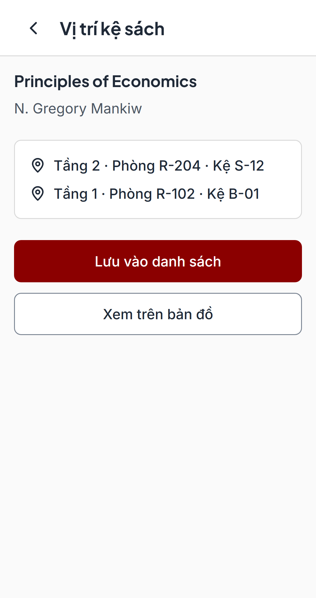
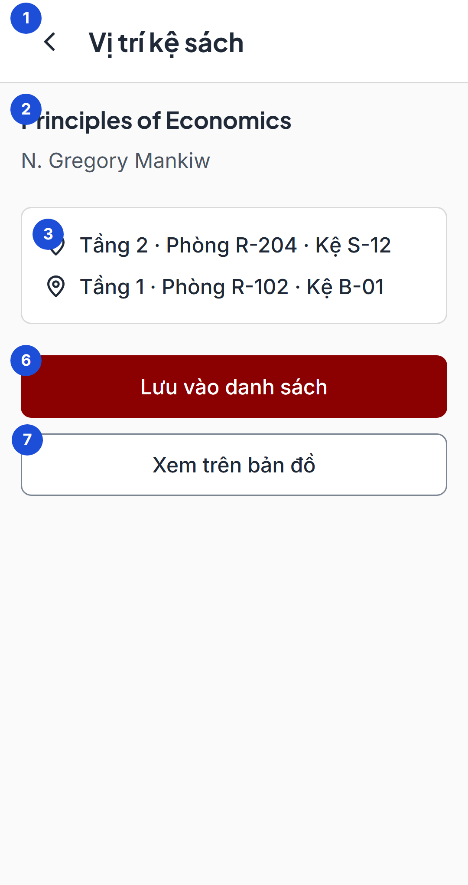

# Screen Spec: S-F01-01 Shelf location (with Save to my list)

| Field | Value |
|---|---|
| Screen ID | `S-F01-01` |
| Screen name | Shelf location (with Save to my list) |
| Actor | Reader |
| Priority | Must |
| Feature | `F-01` |
| Activity diagrams | `AD-UC-01`, `AD-UC-12` (Save action) |
| Mockup image | [s-f01-01.png](../img/s-f01-01/s-f01-01.png) |
| Status | Draft |
| Frame width | 360px (export at 3x = 1080px) |
| Wireframe source | [s-f01-01.html](../src/s-f01-01.html) (rebuilt 23/11/2026 from the exported images; the images are exported from it) |
| Wireframe author | Nhi |
| Screen spec author | Nhi |
| UI conventions | v0.8 |

## 1. Purpose

**Shown when:** A Reader selects **Shelf location** on the existing OPAC Book Detail page to see the floor, room and shelf code for a book. The screen may also be reopened from `S-F01-02` using Back. This screen does not require Reader sign-in for viewing shelf information.

**The user leaves this screen when:** They select Back to return to the existing OPAC Book Detail page, or select **Xem trên bản đồ** to open `S-F01-02`. Selecting **Lưu vào danh sách** keeps the Reader on this screen after a successful save. If the Reader is not signed in, the shared modal `M-F00-01` is shown; choosing Sign in continues through `S-F00-01` and returns to the requested action.

## 2. Mockup

Ảnh Default của màn hình S-F01-01 (một màn hình, cắt riêng), ảnh wireframe đánh số và ảnh riêng cho từng trạng thái.

**Numbered wireframe**

[Open original numbered image](../img/s-f01-01/s-f01-01-numbered.png)

**State → Image**

| State | Image | Numbered image |
|---|---|---|
| Default | [s-f01-01.png](../img/s-f01-01/s-f01-01.png) | [s-f01-01-numbered.png](../img/s-f01-01/s-f01-01-numbered.png) |
| Empty | Not applicable: single-book location view, not a list. | — |
| Loading | [s-f01-01-loading.png](../img/s-f01-01/s-f01-01-loading.png) | — |
| Error — shelf location unavailable | [s-f01-01-error.png](../img/s-f01-01/s-f01-01-error.png) | [s-f01-01-error-numbered.png](../img/s-f01-01/s-f01-01-error-numbered.png) |
| Error — network/load failure | [s-f01-01-error-2.png](../img/s-f01-01/s-f01-01-error-2.png) | [s-f01-01-error-2-numbered.png](../img/s-f01-01/s-f01-01-error-2-numbered.png) |
| Success — saved | [s-f01-01-success.png](../img/s-f01-01/s-f01-01-success.png) | [s-f01-01-success-numbered.png](../img/s-f01-01/s-f01-01-success-numbered.png) |
| Message — already saved | [s-f01-01-success-2.png](../img/s-f01-01/s-f01-01-success-2.png) | [s-f01-01-success-2-numbered.png](../img/s-f01-01/s-f01-01-success-2-numbered.png) |
| Information — online only | [s-f01-01-online-only.png](../img/s-f01-01/s-f01-01-online-only.png) | [s-f01-01-online-only-numbered.png](../img/s-f01-01/s-f01-01-online-only-numbered.png) |

Overview sheet of all states (reference only, not the main image): [s-f01-01-states.png](../img/s-f01-01/s-f01-01-states.png).

Use UI Conventions v0.8 for components, labels, messages and design tokens. Reader frame: 360px, target export at 3x (1080px).
## 3. Element inventory

Numbering follows `S-F01-01` wireframe notes. State-only retry behaviour is listed separately and is not a permanent Default control.

| # | Element | Type | Content / data source | Required | Validation / visibility |
|---|---|---|---|---|---|
| 1 | Back button and screen title | Screen header | `Vị trí kệ sách` | Yes | Back returns to the existing OPAC Book Detail page. |
| 2 | Book title and author | Section title | Book catalogue: title and author. Illustrative sample: `Principles of Economics` — `N. Gregory Mankiw`. | Yes | Display the selected book's catalogue data. |
| 3 | Shelf location line | Shelf location line | Book placement and library layout: floor, room code and shelf code. Example: `Tầng 2 · Phòng R-204 · Kệ S-12`. | Conditional | Show one line for each physical copy, the primary shelf location returned by the sync first (D27); include the map-pin icon. Do not imply stock/borrowing availability. |
| 4 | Unavailable shelf location | Banner | `MSG-06`: `Chưa có vị trí kệ của sách này. Bạn hỏi quầy thông tin ở tầng trệt nhé.` | Conditional | Show when shelf location is missing or inconsistent. Keep the book title visible. |
| 5 | Online-only information | Banner | `Sách này chỉ có bản trực tuyến, không có vị trí trên kệ.` | Conditional | Show for an online-only book. Do not show shelf location, Save or View on map actions. |
| 6 | Save to my list | Primary button | `Lưu vào danh sách` | Conditional | Show only for physical books. One Primary button is visible at a time. Requires a valid Reader session; otherwise open `M-F00-01`. |
| 7 | View on map | Secondary button | `Xem trên bản đồ` | Conditional | Show only when a physical copy has a usable room location. Opens `S-F01-02`. This is a Could-scope action (`FR-01-03`). |
| 8 | Save confirmation | Toast | `Đã lưu sách vào danh sách của bạn.` | Conditional | Show after a successful save. |
| State only | Already-saved feedback | Informational Toast | `Sách này đã có trong danh sách của bạn.` | Conditional | Show when the book is already saved; do not add a duplicate entry. |
| State only | Network retry | Secondary button | `Thử lại` with shared `MSG-04` | Conditional | Show after a network/load failure; retain data already shown. |

## 4. States

| State | What the user sees | Trigger / outcome |
|---|---|---|
| Default | `Vị trí kệ sách`, book title and author, one shelf-location line per physical copy (the primary shelf location from the sync first, D27), and applicable Save / View on map actions. | Reader opens Shelf location from the existing OPAC Book Detail page. |
| Empty | Not applicable: this is a single-book location view, not a list. | — |
| Loading | Skeleton placeholders matching the title, location and action areas; no loading text. | System retrieves the book and shelf-location data. |
| Error — shelf location unavailable | `MSG-06` appears in place of shelf-location details while the book title remains visible. Hide View on map when there is no usable room location. | Shelf location is missing or inconsistent (`FR-01-07`). |
| Error — network/load failure | Shared `MSG-04`: `Không tải được trang. Bạn kiểm tra kết nối mạng rồi thử lại.` with `Thử lại`. Keep data already shown. | A network/load request fails (`FR-04-20`). |
| Success — saved | Keep the Default layout and show `Đã lưu sách vào danh sách của bạn.` as a Toast. | The physical book is added to the Reader's saved list (`FR-03-06`). |
| Message — already saved | Keep the Default layout and show `Sách này đã có trong danh sách của bạn.` as an informational Toast. No duplicate is added. | The book already exists in the Reader's saved list (`FR-03-24`). |
| Information — online only | Show `Sách này chỉ có bản trực tuyến, không có vị trí trên kệ.` Do not show shelf location, Save or View on map. | The selected book has no physical copy (`FR-01-06`). |

## 5. Interactions and navigation

| # | Element | User action | System response | Goes to screen |
|---|---|---|---|---|
| 1 | Entry | Select `Shelf location` on the existing OPAC Book Detail page. | Retrieve and display the selected book's shelf-location information. | `S-F01-01` |
| 2 | Back | Select Back. | Return to the OPAC Book Detail page from which the Reader opened this screen. | Existing OPAC Book Detail (exit) |
| 3 | View on map | Select `Xem trên bản đồ`. | Open the library map at the book's floor and highlight its room when the room code exists on the map. | `S-F01-02` |
| 4 | Save to my list — signed in | Select `Lưu vào danh sách`. | Check for an existing saved entry. If new, add the physical book and show the save Toast. | Stays on `S-F01-01` |
| 5 | Save to my list — not signed in | Select `Lưu vào danh sách`. | Ask the Reader to sign in through the shared sign-in modal. | `M-F00-01`; Sign in continues to `S-F00-01` |
| 6 | Save to my list — already saved | Select `Lưu vào danh sách` when the book is already saved. | Do not add a duplicate; show the already-saved informational Toast. | Stays on `S-F01-01` |
| 7 | Retry | Select `Thử lại` after `MSG-04`. | Retry the failed request and retain data already shown. | Stays on `S-F01-01` |

`M-F00-01` is a shared modal and is specified in the shared screen documentation; do not duplicate its content here.

## 6. Screen-level rules

| Rule ID | Rule | Source |
|---|---|---|
| SR-001 | Display the selected book's title and author and its shelf location, with one location line per physical copy. The primary shelf location returned by the sync is listed first; it is the location used on the QR label and for the S-F02-03 order. | `FR-01-01`; `AD-UC-01`; D13; D27; Nhi wireframe notes |
| SR-002 | If the book is online-only, show the online-only information and do not show shelf location, Save or View on map. | `FR-01-06`; `AD-UC-01` |
| SR-003 | If shelf location is missing or inconsistent, show the exact `MSG-06` wording and keep the book title visible. | `FR-01-07`; UI Conventions v0.8 |
| SR-004 | Save is available only for physical books. | `FR-03-06`; `AD-UC-12`; Nhi wireframe notes |
| SR-005 | A Reader without a valid session must use `M-F00-01` before the signed-in Save action can continue. | `FR-04-08`; `AD-UC-12`; Screen List |
| SR-006 | Check for an existing saved entry before adding a book; do not create a duplicate. | `FR-03-24`; `AD-UC-12` |
| SR-007 | `Xem trên bản đồ` is a Could-scope action and is shown only when a physical copy has a usable room location. | `FR-01-03`; Screen List; Nhi wireframe notes |
| SR-008 | Do not add a link from this screen to the saved-books list. | L8-06; Nhi wireframe notes |
| SR-009 | A network/load failure uses shared `MSG-04` and `Thử lại`. | `FR-04-20`; UI Conventions v0.8 |
| SR-010 | Do not display copy availability, borrowing status or a list of copies available to borrow. | W0 scope; Nhi wireframe notes |

## 7. Linked requirements

| FR ID | What this screen does for it |
|---|---|
| `FR-01-01` | Displays the floor, room and shelf code for each physical copy of the selected book. |
| `FR-01-06` | Displays the online-only information when the book has no physical copy. |
| `FR-01-07` | Displays `MSG-06` when shelf location is missing or inconsistent. |
| `FR-01-03` | Provides the conditional `Xem trên bản đồ` entry to `S-F01-02` (Could scope). |
| `FR-03-06` | Provides the Save action for physical books. |
| `FR-03-24` | Displays already-saved feedback and prevents duplicate entries. |
| `FR-04-20` | Handles network/load errors with `MSG-04` and `Thử lại`. |
| `FR-04-08` | Requires a valid Reader session for the Save action; sign-in is handled through `M-F00-01`. |

## 8. Responsive and accessibility notes

- Reader frame: 360px; export at 3x (1080px). Smallest supported width: 360px.
- Use UI Conventions v0.8 design tokens and typography; do not introduce arbitrary colours.
- Shelf-location lines include a map-pin icon and readable floor, room and shelf codes.
- Keep the full shelf code on one line where possible; do not rely on colour alone to communicate location or state.
- Interactive targets must be at least 44×44px, with a visible 2px focus ring.
- Text contrast: at least 4.5:1; meaningful control boundaries: at least 3:1.
- Toast feedback must remain readable and must not obscure the book title or essential location information.
- Book title, author and shelf codes are synced catalogue data; the values in the wireframe are examples.

## 9. Open questions

None. Decisions: see [decision-index.md](../../../project/decision-index.md#s-f01-01).

---

## Completion checklist

- [x] All eight numbered elements in Nhi's v0.8 notes are accounted for.
- [x] Empty is marked not applicable with a reason.
- [x] Loading, location-unavailable, network-error, saved, already-saved and online-only states are described.
- [x] Navigation targets use existing Screen IDs or existing OPAC destinations.
- [x] The shared sign-in modal is referenced, not redefined.
- [x] Success Toast wording and already-saved feedback follow UI Conventions §4.
- [x] Default, state and numbered exports are separate 1080px-wide images.
