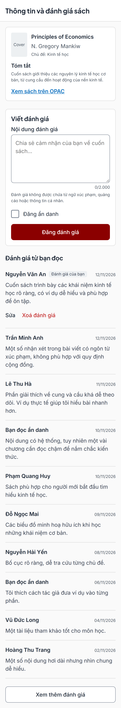

# Screen Spec: S-F02-02 Book information and reviews (QR landing page)

| Field | Value |
|---|---|
| Screen ID | `S-F02-02` |
| Screen name | Book information and reviews (QR landing page) |
| Actor | Reader |
| Priority | Must (edit and delete own review are Could parts inside this Must screen) |
| Feature | `F-02 Reviews & QR` |
| Activity diagrams | `AD-UC-06`, `AD-UC-04` (called) |
| Mockup image | [s-f02-02.png](../img/s-f02-02/s-f02-02.png) |
| Frame width | 360px (exported 3x = 1080px) |
| Wireframe source | [s-f02-02.html](../src/s-f02-02.html) |
| Author | Hoa |
| Status | Draft |

## 1. Purpose

**Shown when:** The reader scans the QR code label on a physical book with a phone camera to open the QR landing link (`AD-UC-06` r1), or returns directly to this screen after completing OTP verification on `S-F00-02` following a signed-out review action (`AD-UC-04` c1).

**The user leaves this screen when:** There is no Back button (D5). The reader taps the “Xem sách trên OPAC” link (`#3`) to open the book’s existing OPAC Book Detail page (exit) (`L8-08`), or triggers a signed-out write, edit, or delete review action and chooses “Đăng nhập” in `M-F00-01` to go to `S-F00-01`. In the invalid-QR error state, where there is no book to open, the “Về OPAC” link (`#16`) opens the existing OPAC main menu (D37).

## 2. Mockup

Numbered reference image: [s-f02-02-numbered.png](../img/s-f02-02/s-f02-02-numbered.png) (element numbers `#1`–`#10` match Section 3; feedback elements `#11`–`#16` appear in non-default states; no Back button, Load more as `#10` — D5, D6).

Visual styling, spacing, typography, and colour tokens follow [ui-conventions.md#6-design-tokens](../../ui-conventions.md#6-design-tokens).

### State → Image

| State | Image |
|---|---|
| Default | [s-f02-02.png](../img/s-f02-02/s-f02-02.png) |
| Empty | [s-f02-02-empty.png](../img/s-f02-02/s-f02-02-empty.png) |
| Loading | [s-f02-02-loading.png](../img/s-f02-02/s-f02-02-loading.png) |
| Error (invalid QR / book not found) | [s-f02-02-error.png](../img/s-f02-02/s-f02-02-error.png) |
| Error-2 (network / load failure) | [s-f02-02-error-2.png](../img/s-f02-02/s-f02-02-error-2.png) |
| Error-3 (review validation / ownership rejection) | [s-f02-02-error-3.png](../img/s-f02-02/s-f02-02-error-3.png) |
| Success | [s-f02-02-success.png](../img/s-f02-02/s-f02-02-success.png) |

## 3. Element inventory

This screen embeds the **same review panel as `S-F02-01`** (`#4`–`#10`, `#12`, `#14`), reusing identical component names and rules (`L8-07`), with the Report action omitted.

| # | Element | Type | Content / data source | Required | Validation |
|---|---|---|---|---|---|
| 1 | Screen title | Screen header | Title “Thông tin và đánh giá sách” only; **no Back button** in any state, because the page is opened only by scanning the QR label (D5; exception to [ui-conventions.md](../../ui-conventions.md) §3 Screen header) | Yes | none |
| 2 | Book information | Book row | Neutral grey “Cover” placeholder block; `Book catalogue › title` (e.g., “Principles of Economics”), `Book catalogue › author` (e.g., “N. Gregory Mankiw”), `Book catalogue › subjects` (e.g., “Chủ đề: Kinh tế học”), and section “Tóm tắt” with `Book catalogue › summary`; no Format label (D21) (`FR-02-05`) | Yes | none |
| 3 | OPAC book link | Text link | “Xem sách trên OPAC” (`FR-02-05`, `L8-08`) | Yes | none |
| 4 | Review editor (same review panel as `S-F02-01`) | Text area with counter | Section heading “Viết đánh giá”, label “Nội dung đánh giá”, placeholder “Chia sẻ cảm nhận của bạn về cuốn sách...”, bound to `Book review › review text`; counter `<n>/2.000` (e.g., `0/2.000`). In edit mode, pre-fills the reader’s existing `Book review › review text` and displays a cancel edit control (`FR-02-01`, `FR-02-03`, `FR-02-04`, `FR-02-11`) | Yes | Required on submit: plain text only, 1–2,000 characters (`FR-02-01`, `FR-02-03`, `FR-02-11`). Reject empty text or >2,000 characters |
| 5 | Anonymous posting (same review panel as `S-F02-01`) | Checkbox | Label “Đăng ẩn danh”; bound to `Reader accounts › full registered name` (unchecked by default: displays full name as registered; checked: displays “Bạn đọc ẩn danh”) (`FR-02-22`) | No | none |
| 6 | Review hint (same review panel as `S-F02-01`) | Text area with counter | Hint line of `#4`, directly under the field (below `#14` Inline error when it is shown), small `colour/text-muted` text: “Đánh giá không được chứa từ ngữ xúc phạm, quảng cáo hoặc thông tin cá nhân.” (`MSG-14`, D20). Passive text: not a link, no action | No | none |
| 7 | Submit review (same review panel as `S-F02-01`) | Primary button | “Đăng đánh giá” (create mode) / “Lưu thay đổi” (edit mode) (`FR-02-01`, `FR-02-03`) | Yes | none |
| 8 | Own review (same review panel as `S-F02-01`) | Review item | Section heading “Đánh giá từ bạn đọc”; `Book review › reviewer` (full name or “Bạn đọc ẩn danh”), badge “Đánh giá của bạn”, `Book review › posted date` (`dd/MM/yyyy`), `Book review › review text` (no internal review ID displayed on UI); Text buttons “Sửa” and “Xoá đánh giá” (`.danger` variant); no Report action (`FR-02-03`, `FR-02-04`, `FR-02-13`, `FR-02-22`) | No | none |
| 9 | Other readers’ reviews / Page-level feedback | Review item / Banner | **Review item:** `Book review › reviewer` (full name or “Bạn đọc ẩn danh”), `Book review › posted date` (`dd/MM/yyyy`), `Book review › review text` (no internal review ID displayed on UI; no Report action on QR page) (`FR-02-02`, `FR-02-13`, `FR-02-22`). **Banner (error states):** Invalid QR error (“Không tìm thấy sách.” with next-step guidance, `FR-02-16`), `MSG-04` network error (“Không tải được trang. Bạn kiểm tra kết nối mạng rồi thử lại.”, `FR-04-20`), or non-owner edit/delete rejection (`FR-02-11`) | No | none |
| 10 | Load more reviews (same review panel as `S-F02-01`) | Load more button | “Xem thêm đánh giá”, full width at the end of the review list; shown while more published reviews remain; each tap appends the next 10 published reviews (`FR-02-02`, D6) | No | none |
| 11 | Empty list message | Empty state | “Không có đánh giá nào để hiển thị. Hãy là người đầu tiên viết đánh giá cho cuốn sách này.” while `#2` Book information remains visible (`FR-02-15`) | No | none |
| 12 | Success confirmation | Toast | “Đã đăng đánh giá.” / “Đã cập nhật đánh giá.” / “Đã xoá đánh giá.” (`FR-02-12`) | No | none |
| 13 | Loading placeholder | Skeleton | Placeholder blocks matching `#2` Book information, `#4–#7` review editor, and `#8–#9` review list (`MSG-05`) | No | none |
| 14 | Field validation feedback | Inline error | Shared review-panel validation error displayed directly under `#4` Review editor with “!” icon and 2px `colour/error-red` field border when review text is empty or exceeds 2,000 characters (`FR-02-01`, `FR-02-11`) | No | none |
| 15 | Retry action | Secondary button | “Thử lại” inside the `MSG-04` error Banner (`FR-04-20`) | No | none |
| 16 | Way out of the invalid-QR error | Text link | “Về OPAC”, in the error Banner; shown only when the QR code is linked to no book, because `#3` has no book to open (D37) | No | none |

## 4. States

| State | What the user sees | Trigger |
|---|---|---|
| Default | `#1` Screen header (title only, no Back), `#2` Book information (cover placeholder, title, author, subjects, summary), `#3` “Xem sách trên OPAC” link, `#4–#7` empty Review editor (`0/2.000`, “Đăng ẩn danh” unchecked, “Đăng đánh giá”), and `#8–#9` published reviews (newest first, excluding `Removed` reviews; own reviews show “Sửa” and “Xoá đánh giá”; other readers’ reviews have no Report action; first 10 reviews), and `#10` Load more button “Xem thêm đánh giá” at the end of the list while more published reviews remain (`FR-02-05`, `FR-02-01`, `FR-02-02`, `FR-02-03`, `FR-02-04`, `FR-02-13`, `FR-02-22`). | Reader scans a valid physical book QR code that links to a book in the synced catalogue with at least 1 published review (`AD-UC-06` r1). |
| Empty (no data) | `#1` Screen header, `#2` Book information, `#3` OPAC book link, `#4–#7` Review editor, and `#11` Empty state message replacing the review list; no `#10` Load more (`FR-02-15`). | Scanned QR code links to a valid book in the catalogue that has 0 published reviews (all reviews are `Removed` or none exist) (`FR-02-15`). |
| Loading | `#1` Screen header and `#13` Skeleton blocks replacing book information and review content; no loading text (`MSG-05`). | Initial page load upon QR scan, or saving/updating/deleting a review. |
| Error | **Error (invalid QR / book not found):** `#9` error Banner displays “Không tìm thấy sách.” with next-step guidance and the `#16` “Về OPAC” link (`FR-02-16`, D37). **Error-2 (network / load failure):** Existing page content preserved; `#9` error Banner displays `MSG-04` (“Không tải được trang. Bạn kiểm tra kết nối mạng rồi thử lại.”) with `#15` Secondary button “Thử lại” (`FR-04-20`). **Error-3 (review validation / ownership rejection):** Existing page content preserved; `#4` Review editor gets 2px `colour/error-red` border with `#14` Inline error below the field (`FR-02-01`, `FR-02-11`), or `#9` error Banner displays non-owner action rejection (`FR-02-11`). | QR code is not linked to any book in the synced catalogue (`FR-02-16`); network/server fails while loading or saving (`FR-04-20`); reader submits empty or >2,000-character review text (`AD-UC-04` d3 [No], d5 [No]); or reader attempts to edit/delete another reader’s review (`AD-UC-04` d4 [No], d7 [No]). |
| Success / confirmation | `#12` Toast appears for 4 seconds (“Đã đăng đánh giá.”, “Đã cập nhật đánh giá.”, or “Đã xoá đánh giá.”) and the review list refreshes to reflect the saved, updated, or removed review (`FR-02-12`). | Reader successfully submits a new review (`AD-UC-04` s3), saves an edited review (`AD-UC-04` s5), or confirms deletion in `M-F02-01-01` (`AD-UC-04` s6). |

## 5. Interactions and navigation

| # | Element | User action | System response | Goes to screen |
|---|---|---|---|---|
| 1 | `#10` Load more button (`Xem thêm đánh giá`) | tap | Appends the next 10 published reviews (newest first, excluding `Removed`) below the list; the button disappears when no more published reviews remain. Same behaviour as on `S-F02-01` (`FR-02-02`, D6). | stays |
| 2 | `#3` OPAC book link (`Xem sách trên OPAC`) | tap | Leaves the QR landing page and opens the book’s existing OPAC Book Detail page (`FR-02-05`, `L8-08`). | Existing OPAC Book Detail (exit) |
| 3 | `#4` Review editor / `#5` Anonymous posting / `#7` Submit review (`Đăng đánh giá` / `Lưu thay đổi`) [signed in] | type plain text, optionally toggle “Đăng ẩn danh”, and tap submit | Validates text (1–2,000 chars, plain text). If invalid, shows `#14` Inline error. If valid, saves new review (`FR-02-01`, `FR-02-22`) or updates own review (`FR-02-03`), shows `#12` Toast (“Đã đăng đánh giá.” or “Đã cập nhật đánh giá.”), and refreshes `#8–#9` review list (`FR-02-12`). | stays |
| 4 | `#4` Review editor / `#7` Submit review [signed out] | attempt to write/submit a review without a valid session | Denies unauthenticated write (`FR-04-08`) and opens sign-in prompt `M-F00-01` (`MSG-01`). If reader chooses “Đăng nhập”, navigates to `S-F00-01` → `S-F00-02` and returns to `S-F02-02` upon OTP acceptance (`L8-01`). | `M-F00-01` (see [screen-spec-s-f00-01.md](screen-spec-s-f00-01.md) §3.1) |
| 5 | `#8` Own review › `Sửa` [signed in] | tap | Switches `#4` Review editor into edit mode pre-filled with the selected review’s text, changes `#7` Primary button to “Lưu thay đổi”, and displays a cancel edit control (`FR-02-03`, `AD-UC-06` c2). | stays |
| 6 | `#8` Own review › `Sửa` [signed out] | tap | Denies unauthenticated edit (`FR-04-08`) and opens `M-F00-01` (`MSG-01`). | `M-F00-01` (see [screen-spec-s-f00-01.md](screen-spec-s-f00-01.md) §3.1) |
| 7 | `#8` Own review › `Xoá đánh giá` [signed in] | tap | Opens shared confirmation modal `M-F02-01-01` over dimmed `S-F02-02` (`AD-UC-06` c3, `AD-UC-04` r4/d6). | `M-F02-01-01` (see [screen-spec-s-f02-01.md](screen-spec-s-f02-01.md) §3.1) |
| 8 | `#8` Own review › `Xoá đánh giá` [signed out] | tap | Denies unauthenticated delete (`FR-04-08`) and opens `M-F00-01` (`MSG-01`). | `M-F00-01` (see [screen-spec-s-f00-01.md](screen-spec-s-f00-01.md) §3.1) |
| 9 | `#15` Retry action (`Thử lại`) | tap | Retries the failed load or save request and clears the `MSG-04` Banner on success (`FR-04-20`). | stays |
| 10 | `#16` “Về OPAC” [invalid QR] | tap | Leaves the page and opens the existing OPAC main menu (D37). | Existing OPAC main menu (exit) |

## 6. Screen-level rules

| Rule ID | Rule | Source |
|---|---|---|
| SR-001 | **Same review panel as `S-F02-01`, without Report:** `S-F02-02` embeds the identical review editor, anonymity toggle, own-review actions (“Sửa”, “Xoá đánh giá”), and deletion modal `M-F02-01-01` defined in [screen-spec-s-f02-01.md](screen-spec-s-f02-01.md) using the same component names (`L8-07`), but omits “Báo cáo đánh giá” (`UC-14` is not called from `AD-UC-06`). | `L8-07`, `AD-UC-06`, [ui-conventions.md](../../ui-conventions.md) §3 |
| SR-002 | **Public reading, authenticated mutations:** Scanning a QR code to view book details and published reviews requires no sign-in (`FR-02-05`, `FR-02-02`). Creating, editing, or deleting a review requires a valid reader session; unauthenticated attempts open `M-F00-01` (`MSG-01`) and return to `S-F02-02` after OTP sign-in. | `FR-04-08`, `AD-UC-04` d0/d1, `L8-01` |
| SR-003 | **Exit path to existing OPAC:** Because `S-F02-02` is entered externally via a phone camera QR scan, it provides the “Xem sách trên OPAC” Text link (`#3`) to the book’s existing OPAC Book Detail page (`L8-08`). | `FR-02-05`, `L8-08`, [screen-transition.md](../../screen-transition.md) §1 |
| SR-004 | **Invalid QR code handling:** When the scanned QR code does not map to any book in the synced catalogue, the system displays “Không tìm thấy sách.” (`FR-02-16`). | `FR-02-16`, [screen-list.md](../../screen-list.md) |
| SR-005 | **Background QR scan counting:** Opening `S-F02-02` for a valid physical book triggers a background QR scan count increment (`FR-02-06`) with no separate UI element on this screen. | `FR-02-06`, [screen-list.md](../../screen-list.md) |
| SR-006 | **Visibility, identity, and validation rules:** Published reviews exclude `Removed` reviews (`FR-02-13`), display either the registered card full name or “Bạn đọc ẩn danh” (`FR-02-22`), hide internal review IDs, allow multiple reviews per reader (`AD-UC-04` Q1), and enforce 1–2,000 plain-text characters (`FR-02-01`, `FR-02-03`, `FR-02-11`). | `FR-02-01`, `FR-02-03`, `FR-02-11`, `FR-02-13`, `FR-02-22`, `AD-UC-04` Q1 |
| SR-007 | **Could scope boundary:** Edit own review (`FR-02-03`) and Delete own review (`FR-02-04`) are Could parts inside this Must screen; if cut from release scope, their controls and `M-F02-01-01` are omitted without removing `S-F02-02`. | [screen-list.md](../../screen-list.md) notes, `AD-UC-04` Q4 |
| SR-008 | **No Back button:** The Screen header shows only the title in every state (Default, Empty, Loading, Error, Success, and when the reader returns after sign-in). The only way to open `S-F02-02` is scanning the QR label on the book; the way out is the “Xem sách trên OPAC” Text link (`#3`), or `#16` “Về OPAC” when the QR code is linked to no book (D37). This is an exception to the [ui-conventions.md](../../ui-conventions.md) §3 Screen header rule. | D5 |
| SR-009 | **Review paging (same as `S-F02-01`):** Published reviews are shown 10 per page, newest first. `#10` “Xem thêm đánh giá” is shown whenever more published reviews remain after those already displayed, and is hidden when none remain. | `FR-02-02`, D6 |

## 7. Linked requirements

| FR ID | What this screen does for it |
|---|---|
| `FR-02-01` | Provides the shared review editor (`#4`, 1–2,000 plain-text characters) and “Đăng đánh giá” button (`#7`) to submit a new review from the QR landing page. |
| `FR-02-02` | Displays published reviews (`#8`, `#9`) for the scanned book, newest first, 10 per page, with `#10` Load more button “Xem thêm đánh giá” while more published reviews remain. |
| `FR-02-03` | Provides “Sửa” on the reader’s own review (`#8`), pre-fills `#4`, and saves changes via “Lưu thay đổi” (`#7`). |
| `FR-02-04` | Provides “Xoá đánh giá” on the reader’s own review (`#8`) and confirms removal from public display via modal `M-F02-01-01`. |
| `FR-02-05` | Displays physical book information (`#2`: title, author, subjects, summary) and the “Xem sách trên OPAC” link (`#3`) upon scanning a valid book QR code. |
| `FR-02-11` | Rejects empty/over-limit review text via `#14` Inline error and rejects non-owner edit/delete attempts via `#9` Banner. |
| `FR-02-12` | Displays confirmation Toast (`#12`) and refreshes the review list (`#8–#9`) after creating, editing, or deleting a review. |
| `FR-02-13` | Excludes reviews in state `Removed` from the displayed review list (`#8–#9`). |
| `FR-02-15` | Replaces the review list with Empty state message `#11` while keeping `#2` Book information visible when the book has no published reviews. |
| `FR-02-16` | Displays the “Không tìm thấy sách.” error state (`#9` Banner, with `#16` “Về OPAC”) when the scanned QR code is linked to no book. |
| `FR-02-22` | Provides the “Đăng ẩn danh” checkbox (`#5`) and displays either the registered card full name or “Bạn đọc ẩn danh” on each review item (`#8–#9`). |
| `FR-04-08` | Checks reader session on write, edit, and delete review actions, opening `M-F00-01` (`MSG-01`) when signed out. |
| `FR-04-20` | Preserves currently displayed data and shows `MSG-04` Banner (`#9`) with “Thử lại” (`#15`) when loading or saving fails due to a network/server error. |

## 8. Responsive and accessibility notes

- **Smallest supported width:** 360px (Reader mobile viewport opened from phone camera, exported at 3x = 1080px).
- **What collapses or stacks on a narrow screen:** All sections (`#2` Book information, `#3` OPAC link, `#4–#7` Review editor, `#8–#9` Review items, `#10` Load more button) stack vertically in a single 100%-width column with 16px screen padding (`space/unit`). Confirmation modal `M-F02-01-01` stacks buttons vertically at 360px with Destructive button on top and Secondary button (“Huỷ”) below ([ui-conventions.md](../../ui-conventions.md) §3).
- **Information never carried by colour alone:** Validation errors on `#4` combine a 2px `colour/error-red` field border with `#14` Inline error containing a “!” icon and explanatory text; `#9` error Banners pair left border colour with an icon and text; `#3` “Xem sách trên OPAC” Text link uses underline + `colour/link`; Destructive actions (`#8` “Xoá đánh giá”, `M-F02-01-01` `#2`) pair `colour/error-red` with explicit labels and a trash icon ([ui-conventions.md](../../ui-conventions.md) §5).
- **Text contrast and minimum size:** All text and control borders meet WCAG 2.2 AA (`≥ 4.5:1` for body/labels/links, `≥ 3:1` for borders and 20px `Plus Jakarta Sans` title) using tokens in [ui-conventions.md](../../ui-conventions.md) §6. `#4` Text area uses 16px `Inter` text to prevent mobile browser zoom on focus. Interactive targets (`#5` Checkbox row 44px height, `#7` Primary button 48px height, `#10` Load more button 48px height, full width) meet the 44×44px Reader minimum ([ui-conventions.md](../../ui-conventions.md) §5). Focusable controls display a 2px `colour/focus` (`#1074C3`) focus ring with 2px offset.

## 9. Open questions

None. Decisions: see [decision-index.md](../../../project/decision-index.md#s-f02-02).

---

## Completion checklist

- [x] The mockup is a separate cropped image file, named with the Screen ID ([s-f02-02.png](../img/s-f02-02/s-f02-02.png)).
- [x] Every visible element in the mockup appears in the element inventory (`#1`–`#10` in Default; `#11`–`#15` in Empty/Loading/Error/Success states).
- [x] Every input element has a validation rule or an explicit "none" (`#4` Text area with counter has 1–2,000 plain-text rule; `#5` Checkbox has `none`).
- [x] All five states are filled in, or marked "not applicable" with a reason (`Default`, `Empty`, `Loading`, `Error` / `Error-2` / `Error-3`, `Success`).
- [x] Every navigation target is a Screen ID that exists in the Screen List (`M-F00-01`, `M-F02-01-01`), `stays`, or `Existing OPAC Book Detail (exit)`.
- [x] Every element that displays data names the field it displays (`Book catalogue › title/author/subjects/summary`, `Book review › review text/reviewer/posted date`, `Reader accounts › full registered name`).
- [x] Every linked FR exists in the Function List, and every action of this screen in an activity diagram is covered by an interaction row (`AD-UC-06`, `AD-UC-04`).