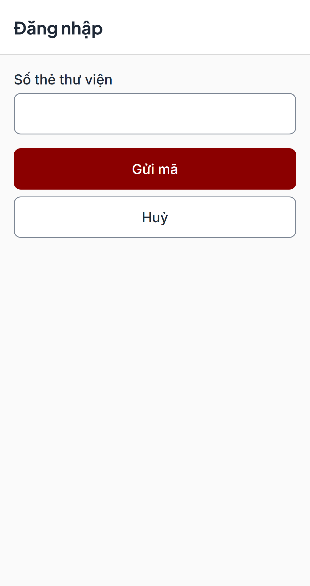
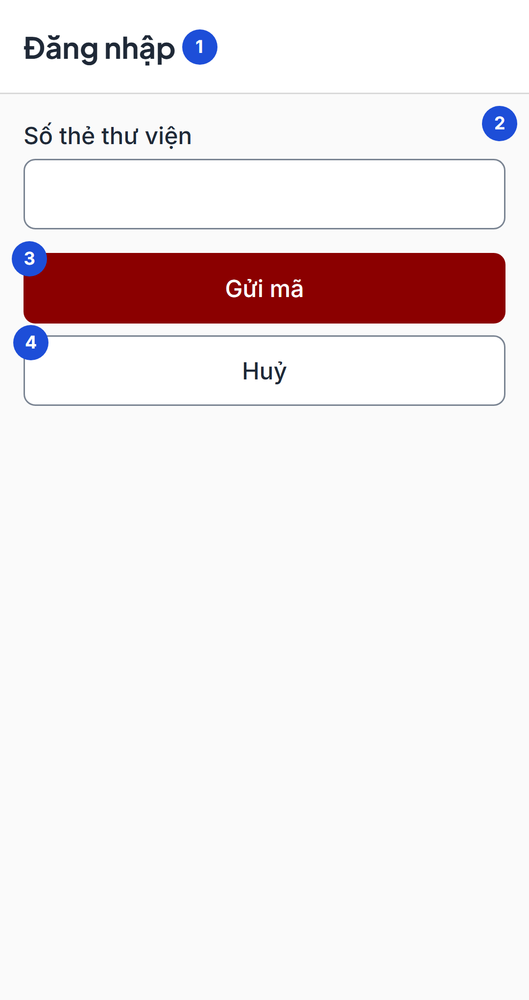
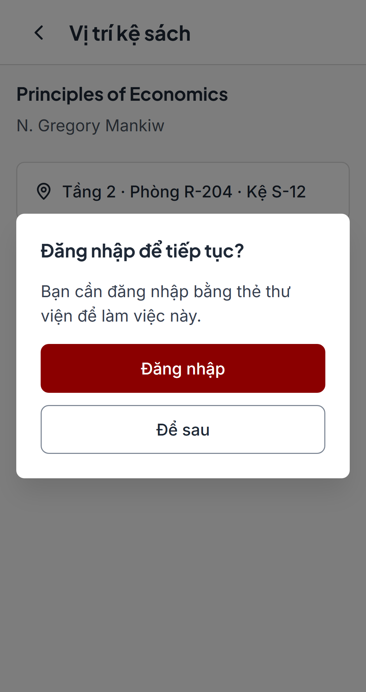
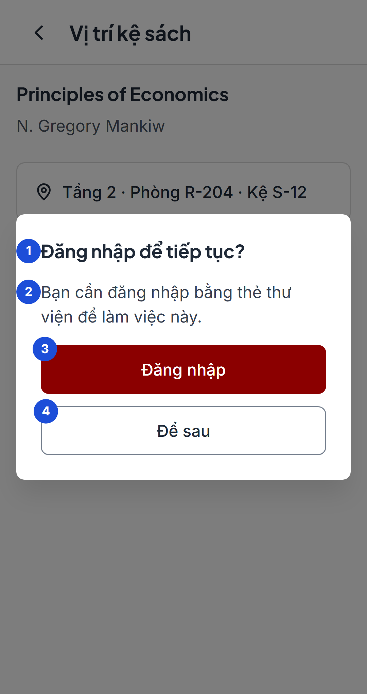

# Screen Spec: S-F00-01 Sign in: library card number

| Field | Value |
| --- | --- |
| Screen ID | S-F00-01 |
| Screen name | Sign in: library card number |
| Actor | Reader |
| Priority | Must |
| Feature | F-00 shared sign-in (Screen List grouping) |
| Activity diagrams | AD-UC-11 + AD-UC-04/07/08/09/12/14 for M-F00-01 |
| Mockup image | [s_f00_01.png](../img/s_f00_01/s_f00_01.png) |
| Status | Draft |
| Frame width | 360px, export 3x = 1080px |
| Wireframe source | [s_f00_01.html](../src/s_f00_01.html) · modal M-F00-01: [m_f00_01.html](../src/m_f00_01.html) |
| Author | Ha |
| UI conventions | v0.8, 21/11/2026 |

## 1. Purpose

**Shown when:** A reader without a session requests a protected action or chooses Sign in on the existing OPAC main menu (D34).

**The user leaves this screen when:** The card is found and S-F00-02 opens, or Cancel returns to the sign-in origin.

## 2. Mockup

Styles follow [UI conventions v0.8](../../ui_conventions.md#6-design-tokens). Each image contains one product frame.

| State | Image |
| --- | --- |
| Default | [s_f00_01.png](../img/s_f00_01/s_f00_01.png), [s_f00_01_numbered.png](../img/s_f00_01/s_f00_01_numbered.png) |
| Empty | Not applicable: this is a form. |
| Loading | [s_f00_01_loading.png](../img/s_f00_01/s_f00_01_loading.png), [s_f00_01_loading_numbered.png](../img/s_f00_01/s_f00_01_loading_numbered.png) |
| Error | [s_f00_01_error.png](../img/s_f00_01/s_f00_01_error.png), [s_f00_01_error_numbered.png](../img/s_f00_01/s_f00_01_error_numbered.png) |
| Error — format | [s_f00_01_error_2.png](../img/s_f00_01/s_f00_01_error_2.png), [s_f00_01_error_2_numbered.png](../img/s_f00_01/s_f00_01_error_2_numbered.png) |
| Error — network | [s_f00_01_error_3.png](../img/s_f00_01/s_f00_01_error_3.png), [s_f00_01_error_3_numbered.png](../img/s_f00_01/s_f00_01_error_3_numbered.png) |
| Success | S-F00-02 |

### Modal M-F00-01

## 3. Element inventory

| # | Element | Type | Content / data source | Required | Validation |
| --- | --- | --- | --- | --- | --- |
| 1 | Title | Screen header | Đăng nhập | Yes | none |
| 2 | Library card number | Text input | Reader accounts › library card number (seven digits, leading zero kept) | Yes | Exactly 7 digits; keep leading zeros; no spaces. Reject malformed input with the inline message in the image. |
| 3 | Send code | Primary button | Gửi mã | Yes | none |
| 4 | Cancel | Secondary button | Huỷ | Yes | none |
| 5 | Card format error | Inline error | Số thẻ thư viện gồm 7 chữ số. Bạn kiểm tra lại nhé. | No | none |
| 6 | Rejection / load error | Banner | Không thể đăng nhập. Bạn kiểm tra thông tin rồi thử lại. / MSG-04 | No | none |
| 7 | Card lookup | Skeleton | MSG-05 | No | none |
| 8 | Try again | Secondary button | Thử lại | Yes | none |

### 3.1 Modal M-F00-01 Sign in to continue?

| # | Element | Type | Content / data source | Required | Validation |
| --- | --- | --- | --- | --- | --- |
| 1 | Title | Modal | Đăng nhập để tiếp tục? | Yes | none |
| 2 | Message | Modal | MSG-01, MSG-02 or MSG-03 | Yes | none |
| 3 | Sign in | Primary button | Đăng nhập | Yes | none |
| 4 | Not now | Secondary button | Để sau | Yes | none |

Shared by S-F01-01, S-F02-01, S-F02-02, S-F03-02, S-F03-03, S-F03-06 and S-F03-07. Other specs link to this §3.1.

| Variant | Exact title / body / actions | Source |
| --- | --- | --- |
| General | Đăng nhập để tiếp tục? / Bạn cần đăng nhập bằng thẻ thư viện để làm việc này. / Đăng nhập / Để sau | MSG-01; FR-04-08 |
| Chatbot | Bạn cần đăng nhập bằng thẻ thư viện để trò chuyện với trợ lý tìm sách. | MSG-02; FR-03-18 |
| Recommendations | Gợi ý riêng cho bạn cần tài khoản thẻ thư viện. Hãy đăng nhập để xem. | MSG-03; FR-03-21 |

Title and actions are shared by all variants. Sign in opens S-F00-01. Not now closes the overlay and ends the request. After code acceptance or Cancel, return to the saved origin (L8-01). Code acceptance returns the reader to the origin and the pending action (e.g. save book, post review, report review) continues automatically. Cancel (Huỷ) on S-F00-01 or S-F00-02 returns to the origin with the pending action kept waiting and nothing on screen lost; the action is not carried out, and M-F00-01 asks again when the reader repeats it (D1).

## 4. States

| State | What the user sees | Trigger |
| --- | --- | --- |
| Default | Card input, send and cancel. | The reader chooses Sign in from the shared modal or the existing OPAC main menu (D34). |
| Empty | Not applicable: this is a form with no list. | Not applicable: this screen has an input form, not a data list. |
| Loading | Lookup in progress, submit disabled. | The reader submits a well-formed card number; the lookup request is pending (FR-04-01). |
| Error | Không thể đăng nhập. Bạn kiểm tra thông tin rồi thử lại. The same text is used for any card rejection. | The card lookup is rejected (FR-04-01). |
| Error — format | Số thẻ thư viện gồm 7 chữ số. Bạn kiểm tra lại nhé. | The entered value is not exactly seven digits (ui-conventions §2). |
| Error — network | MSG-04, card number retained. | The lookup request fails because of a network or server error (FR-04-20). |
| Success | Card found. Open code screen, or its send-error state if delivery failed. | The library card lookup succeeds (AD-UC-11 d1 [Yes]); failed email delivery is handled on S-F00-02 (FR-04-16). |

| Modal state | What the user sees | Trigger |
| --- | --- | --- |
| M-F00-01 › Default | General (MSG-01): “Bạn cần đăng nhập bằng thẻ thư viện để làm việc này.” | FR-04-08 |
| M-F00-01 › Wording variant — chatbot | Chatbot (MSG-02): “Bạn cần đăng nhập bằng thẻ thư viện để trò chuyện với trợ lý tìm sách.” | FR-03-18 |
| M-F00-01 › Wording variant — recommendations | Recommendations (MSG-03): “Gợi ý riêng cho bạn cần tài khoản thẻ thư viện. Hãy đăng nhập để xem.” | FR-03-21 |
| M-F00-01 › Empty | Not applicable: the modal only asks the reader to choose. | — |
| M-F00-01 › Loading | Not applicable: the modal only asks the reader to choose. | — |
| M-F00-01 › Error | Not applicable: the modal only asks the reader to choose. | — |
| M-F00-01 › Success | Not applicable: the modal only asks the reader to choose. | — |

## 5. Interactions and navigation

| # | Element | User action | System response | Goes to screen |
| --- | --- | --- | --- | --- |
| 1 | S-F00-01 › Library card number | Enter or correct seven digits. | Keep the number as text, including its leading zero. | stays |
| 2 | S-F00-01 › Send code | Submit with Send code, element 3 (AD-UC-11 r1). Card 0012345 illustrates the valid-lookup path to S-F00-02. Rejections stay here. | Validate seven digits, request card lookup. On match request OTP and open S-F00-02. On rejection use the same generic message and stay. Failed email delivery is shown on S-F00-02. | S-F00-02 / stays |
| 3 | S-F00-01 › Cancel | Return to the origin (L8-01). | Return to the origin screen with the pending action kept waiting: nothing entered or shown on the origin is lost (e.g. a typed review). The action is not carried out without a session; when the reader repeats it, M-F00-01 asks again (D1). | S-F01-01 / S-F02-01 / S-F02-02 / S-F03-02 / S-F03-03 / S-F03-06 / S-F03-07 / Existing OPAC entry page (exit) |
| 4 | S-F00-01 › Try again | Retry after a network failure. | Retry the failed request while retaining displayed data and entered values (FR-04-20). | stays |
| 5 | M-F00-01 › Sign in | Open reader sign-in. After OTP acceptance return to the origin and continue the requested action (L8-01). | Save the origin Screen ID and the pending action, close the shared prompt and open the library-card form. No code is verified by this modal. When S-F00-02 accepts the code, the reader returns to the origin and the pending action continues automatically (D1). | S-F00-01 |
| 6 | M-F00-01 › Not now | Close and end the pending request. | Dismiss M-F00-01 and end the pending request, leaving the origin visible. | stays |

## 6. Screen-level rules

| Rule ID | Rule | Source |
| --- | --- | --- |
| SR-001 | A card number is a seven-digit string. Keep a leading zero. | ui-conventions §2; FR-04-01 |
| SR-002 | Use one generic rejection for every unsuccessful card lookup. Never reveal card existence in the rejection text. | AD-UC-11 question 4; FR-04-01 |
| SR-003 | A valid card lookup advances to S-F00-02. Success has no separate page. | AD-UC-11 d1; [screen_transition.md](../../screen_transition.md) |
| SR-004 | Keep the sign-in origin and the pending action through OTP and Cancel. After the OTP is accepted, return to the origin and continue the pending action automatically. On Cancel, return to the origin with the pending action still waiting and nothing on screen lost; it runs only after a valid sign-in, so repeating it re-opens M-F00-01. | L8-01; FR-04-08; D1 |
| SR-005 | M-F00-01 uses MSG-01, MSG-02 or MSG-03 verbatim. Not now ends the request at the origin. | ui-conventions §4; FR-04-08, FR-03-18, FR-03-21 |
| SR-006 | Keep entered data on a failed request and offer retry. | FR-04-20 |

## 7. Linked requirements

| FR ID | What this screen does for it |
| --- | --- |
| FR-04-01 | Card lookup and OTP handoff. |
| FR-04-08 | Shared protected-action sign-in prompt. |
| FR-03-18 | MSG-02 chatbot sign-in wording. |
| FR-03-21 | MSG-03 recommendations sign-in wording. |
| FR-04-16 | Handoff to OTP email-delivery failure. |
| FR-04-20 | Retain data and retry after network failure. |

## 8. Responsive and accessibility notes

- Smallest product width is 360px. Use one 360px column with full-width primary controls and vertically stacked secondary actions.
- Use the shared token fonts, 16px input text, body 16px and small text at least 12px. Reader targets are at least 44 × 44px. Text contrast must meet ui-conventions §5.
- Error feedback has a message, icon and error styling. Use visible labels, keyboard focus rings and DOM order matching the inventory. Loading disables duplicate submissions.
- Modal focus enters the dialog, remains within it while open, and returns to its trigger on dismissal. Print is a browser-controlled exit. An accepted sign-in returns focus to the origin action.

## 9. Open questions

None. Decisions: see [decision_index.md](../../../project/decision_index.md#s-f00-01).

---

## Completion checklist

- [x] The mockup is a separate cropped image file, named with the Screen ID.
- [x] Every visible element in the mockup appears in the element inventory.
- [x] Every input element has a validation rule or an explicit none.
- [x] All five states are filled in, or marked not applicable with a reason.
- [x] Every navigation target is a Screen ID in the Screen List or a documented modal/browser exit.
- [x] Every element that displays data names its field.
- [x] Every linked FR exists in the current Function List and every AD user action has an interaction row.
- [x] Modal inventory and interactions are included where applicable.
- [ ] Cross-review by Hoa and final review by Chi are complete.
