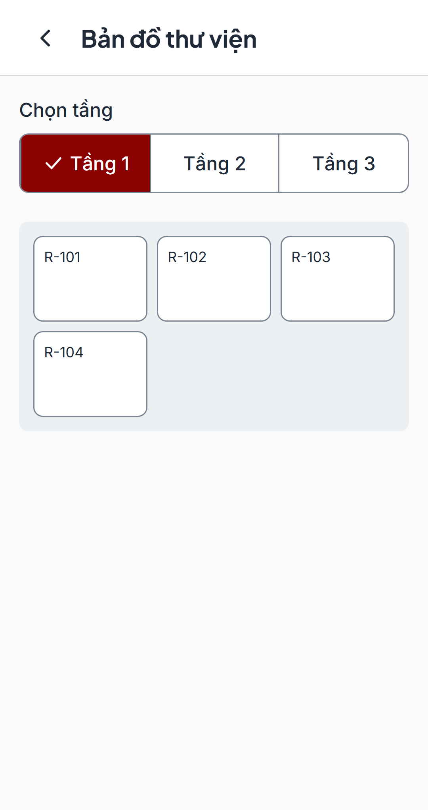
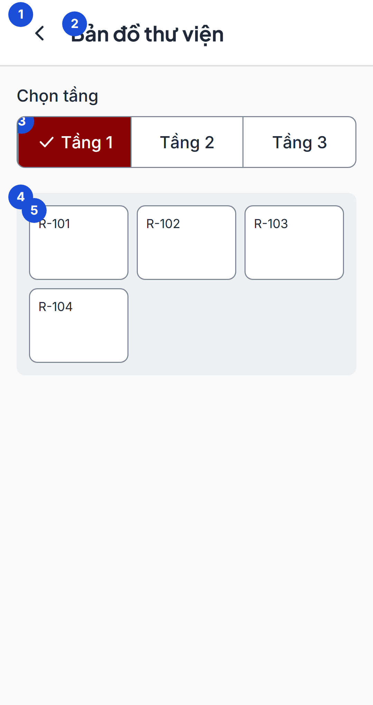

# Screen Spec: S-F01-02 Interactive digital library map

| Field | Value |
|---|---|
| Screen ID | `S-F01-02` |
| Screen name | Interactive digital library map |
| Actor | Reader |
| Priority | Must |
| Feature | `F-01` |
| Activity diagrams | `AD-UC-01`, `AD-UC-02` |
| Mockup image | [s_f01_02.png](../img/s_f01_02/s_f01_02.png) |
| Status | Draft |
| Frame width | 360px (export at 3x = 1080px) |
| Wireframe source | [s_f01_02.html](../src/s_f01_02.html) (rebuilt 23/11/2026 from the exported images; the images are exported from it) |
| Wireframe author | Nhi |
| Screen spec author | Nhi |
| UI conventions | v0.8 |

## 1. Purpose

**Shown when:** A Reader opens **Library map** from the existing OPAC main menu, or selects **Xem trên bản đồ** on `S-F01-01` to see the room containing a book. These are two distinct entry paths and must produce different initial map states.

- **From the OPAC main menu (`UC-02`):** show the lowest floor number by default, with no room highlighted and no shelf-location details.
- **From `S-F01-01` (`UC-01`):** show the book's floor, retain its shelf-location details above the map and highlight its room if the room code exists on the retrieved floor plan.

**The user leaves this screen when:** They select Back. Back returns to `S-F01-01` when the map was opened from a book, or to the existing OPAC main menu when opened from the menu. Floor switching and room selection stay on this screen; they do not create additional screens.

## 2. Mockup

Ảnh Default của màn hình S-F01-02 (một màn hình, cắt riêng), ảnh wireframe đánh số và ảnh riêng cho từng trạng thái.

**Numbered wireframe**

[Open original numbered image](../img/s_f01_02/s_f01_02_numbered.png)

**State → Image**

| State | Image | Numbered image |
|---|---|---|
| Default — opened from OPAC menu | [s_f01_02.png](../img/s_f01_02/s_f01_02.png) | [s_f01_02_numbered.png](../img/s_f01_02/s_f01_02_numbered.png) |
| Default — opened from a book | No separate image drawn; the from-book view with the room highlighted is [s_f01_02_success.png](../img/s_f01_02/s_f01_02_success.png). | — |
| Empty | Not applicable: map view, not a list. | — |
| Loading | [s_f01_02_loading.png](../img/s_f01_02/s_f01_02_loading.png) | — |
| Error — map unavailable, opened from a book (MSG-07) | [s_f01_02_error.png](../img/s_f01_02/s_f01_02_error.png) | — |
| Error — map unavailable, opened from the OPAC menu (MSG-12, D23) | [s_f01_02_error_menu.png](../img/s_f01_02/s_f01_02_error_menu.png) | — |
| Error — room cannot be identified | [s_f01_02_error_2.png](../img/s_f01_02/s_f01_02_error_2.png) | [s_f01_02_error_2_numbered.png](../img/s_f01_02/s_f01_02_error_2_numbered.png) |
| Error — selected floor unavailable | [s_f01_02_error_3.png](../img/s_f01_02/s_f01_02_error_3.png) | [s_f01_02_error_3_numbered.png](../img/s_f01_02/s_f01_02_error_3_numbered.png) |
| Success — book room highlighted | [s_f01_02_success.png](../img/s_f01_02/s_f01_02_success.png) | [s_f01_02_success_numbered.png](../img/s_f01_02/s_f01_02_success_numbered.png) |
| Success — selected room | [s_f01_02_selected_room.png](../img/s_f01_02/s_f01_02_selected_room.png) | [s_f01_02_selected_room_numbered.png](../img/s_f01_02/s_f01_02_selected_room_numbered.png) |

Overview sheet of all states (reference only, not the main image): [s_f01_02_states.png](../img/s_f01_02/s_f01_02_states.png).

Use UI Conventions v0.8 for components, labels, messages and design tokens. Reader frame: 360px, target export at 3x (1080px).
## 3. Element inventory

Numbering follows Nhi's wireframe notes and [s_f01_02_numbered.png](../img/s_f01_02/s_f01_02_numbered.png) (marker 1 = Back button, marker 2 = screen title).

| # | Element | Type | Content / data source | Required | Validation / visibility |
|---|---|---|---|---|---|
| 1 | Back button | Screen header | Back accessible name: `Quay lại`. | Yes | Back destination depends on the entry point: `S-F01-01` when opened from a book; existing OPAC main menu when opened from the menu. |
| 2 | Screen title | Screen header | `Bản đồ thư viện` | Yes | Always shown. |
| 3 | Floor selector | Segmented control | Available floors, e.g. `Tầng 1`, `Tầng 2`, `Tầng 3`. | Yes | When opened from the OPAC menu, select the lowest floor number by default. When opened from a book, select the book's floor. |
| 4 | Floor plan | Floor plan | Simple block plan for one floor, with one tile per room. Data comes from synced floor and room data. | Yes | Do not draw or imply a verified real-library floor plan when geometry is not supplied. |
| 5 | Reading room | Room tile | Room code on each tile. Default: white with border. Selected: brand-red fill and white text. Book room: highlight fill, 3px highlight border and `Sách của bạn ở đây` label. | Yes | Room state must not be communicated by colour alone. |
| 6 | Shelf location details | Shelf location line | `Tầng <n> · Phòng <code> · Kệ <code>` | Conditional | Shown only when opened from `S-F01-01`; retain the book's shelf details above the map. |
| 7 | Map unavailable message | Banner | Opened from a book: `MSG-07`: `Bản đồ tạm thời không hiển thị được. Thông tin vị trí kệ vẫn ở phía trên.` Opened from the OPAC menu: `MSG-12`: `Bản đồ tạm thời không hiển thị được. Bạn thử lại sau nhé.` (D23). | Conditional | Show when the required floor plan cannot be read. If opened from a book, show `MSG-07` and keep shelf details visible; if opened from the OPAC menu, show `MSG-12`. |
| 8 | Room not found message | Banner | `MSG-08`: `Không tìm thấy phòng này trên bản đồ. Thông tin vị trí kệ vẫn ở phía trên.` | Conditional | Show when the book's room code is not found on the retrieved floor plan. |
| 9 | Selected-room details | Banner / room details area | `<room name> (<room code>), Tầng <n>`. Example: `Phòng đọc A (R-204), Tầng 2`. | Conditional | Show after the Reader selects a room tile. |

## 4. States

| State | What the user sees | Trigger / outcome |
|---|---|---|
| Default — opened from OPAC menu | `Bản đồ thư viện`, floor selector and available room tiles. The lowest floor number (e.g. `Tầng 1`) is selected; no room is highlighted and no shelf-location details are shown. | Reader chooses `Library map` from the existing OPAC main menu (`UC-02`). |
| Default — opened from a book | The book's floor is selected, the book's shelf-location details remain visible above the map, and its room is highlighted if its room code exists on the plan. | Reader selects `Xem trên bản đồ` on `S-F01-01` (`UC-01`). |
| Empty | Not applicable: this is a map view, not a list. A missing or unreadable floor plan is an Error state, never an empty map. | — |
| Loading | Skeleton placeholders while synced floor/room data and the floor plan are retrieved. | Reader opens the map or switches floors and the required data is being retrieved. |
| Error — map unavailable | Opened from a book: show `MSG-07` and keep the shelf-location details visible. Opened from the OPAC menu: show `MSG-12` (D23). Do not render an empty map when the floor plan cannot be read. | The requested floor plan is missing or cannot be read (`FR-01-10`). |
| Error — room cannot be identified | Show `MSG-08`, then display the plain map with available floors and rooms. Keep shelf-location details visible. Example missing room code: `R-299`. | The book's room code is not found on the retrieved floor plan (`FR-01-09`). |
| Error — selected floor unavailable | Show the map-unavailable message (`MSG-07` when opened from a book, `MSG-12` when opened from the OPAC menu) above the previous floor's map. Keep the previous map visible so the Reader can choose again. | Reader switches to a floor whose plan cannot be read (`FR-01-10`). |
| Success — book room highlighted | Display the book's floor plan with its room highlighted. Keep shelf-location details visible. Use highlight fill, a 3px border and `Sách của bạn ở đây` label. | Map opened from `S-F01-01` and the room code exists on the plan (`FR-01-03`). |
| Success — selected room | Highlight the selected room and display its room name, room code and floor, e.g. `Phòng đọc A (R-204), Tầng 2`. | Reader selects a room tile (`FR-01-11`). |

## 5. Interactions and navigation

| # | Element | User action / system event | System response | Goes to screen |
|---|---|---|---|---|
| 1 | Entry from OPAC main menu | Reader chooses `Library map`. | Open the map and select the lowest floor number by default; do not highlight a room. | `S-F01-02` |
| 2 | Entry from `S-F01-01` | Reader chooses `Xem trên bản đồ`. | Open the book's floor, retain shelf details and highlight its room if the room code exists on the plan. | `S-F01-02` |
| 3 | Floor selector | Reader chooses another floor. | Retrieve and display that floor's plan and reading rooms if available. | Stays on `S-F01-02` |
| 4 | Floor selector — selected floor unavailable | System cannot read the selected floor's plan. | Show the map-unavailable message (`MSG-07` from a book, `MSG-12` from the OPAC menu) above the previous floor's map; keep the previous map visible. | Stays on `S-F01-02` |
| 5 | Room tile | Reader selects a reading room. | Highlight the selected room and show its name, room code and floor. | Stays on `S-F01-02` |
| 6 | Back — opened from a book | Reader selects Back. | Return to the shelf-location screen. | `S-F01-01` |
| 7 | Back — opened from OPAC menu | Reader selects Back. | Return to the existing OPAC main menu. | Existing OPAC main menu (exit) |
| 8 | Finish | Reader has explored the desired floor or room. | End the activity; no selection is saved. | Activity ends |

## 6. Screen-level rules

| Rule ID | Rule | Source |
|---|---|---|
| SR-001 | The map is read-only; floors and rooms come from synced data. There is no screen for editing floor plans or room data. | `FR-01-02`; `AD-UC-02`; Nhi wireframe notes |
| SR-002 | When opened from the OPAC menu, select the lowest floor number by default and do not highlight a room. | `AD-UC-02`; Nhi wireframe notes |
| SR-003 | When opened from `S-F01-01`, select the book's floor, keep shelf-location details visible and highlight the book's room if its room code exists on the plan. | `FR-01-03`; `AD-UC-01` |
| SR-004 | Floor switching and room selection remain on `S-F01-02`; they do not open another screen. | `AD-UC-02` |
| SR-005 | If the room code is not found, show exact `MSG-08` and retain shelf-location details. | `FR-01-09`; UI Conventions v0.8 |
| SR-006 | If a floor plan cannot be read, show exact `MSG-07` when the map was opened from a book, or exact `MSG-12` when it was opened from the OPAC menu; never show an empty map. | `FR-01-10`; UI Conventions §4; D23 |
| SR-007 | If a floor switch fails, retain the previous floor's map and show the map-unavailable message above it. | `FR-01-10`; `AD-UC-02` |
| SR-008 | The book's room highlight uses fill, a 3px border and the text label `Sách của bạn ở đây`; do not rely on colour alone. | `FR-01-03`; Nhi wireframe notes |
| SR-009 | A selected room displays its room name, room code and floor. | `FR-01-11`; `AD-UC-02` |
| SR-010 | Do not invent a real floor-plan geometry, complete floor inventory or complete room-code inventory when these data are not supplied. | Nhi wireframe notes |
| SR-011 | Do not add a list of books in a room or staff controls for editing floor plans. | W0 scope; Nhi wireframe notes |

## 7. Linked requirements

| FR ID | What this screen does for it |
|---|---|
| `FR-01-02` | Displays the interactive floor selector and floor plan with room tiles. |
| `FR-01-03` | Highlights the book's room when the map is opened from `S-F01-01`, retaining shelf details. |
| `FR-01-09` | Displays `MSG-08` when the book's room code cannot be identified on the map. |
| `FR-01-10` | Displays `MSG-07` (opened from a book) or `MSG-12` (opened from the OPAC menu) when a floor plan is unavailable; retains shelf details and the previous map when a floor switch fails. |
| `FR-01-11` | Displays the selected room's name, room code and floor. |

## 8. Responsive and accessibility notes

- Reader frame: 360px; export at 3x (1080px). Smallest supported width: 360px.
- Use UI Conventions v0.8 design tokens and typography.
- Room tiles and all interactive targets must be at least 44×44px.
- Provide a visible 2px focus ring on interactive controls.
- Room states must be distinguishable by more than colour: use borders, labels and selected-state indicators.
- Text contrast: at least 4.5:1; meaningful control boundaries: at least 3:1.
- The selected floor and selected room must be programmatically and visually identifiable.
- Use a simple block plan with one tile per room (UI Conventions §3 Floor plan: no real library drawing). Floors, rooms and room codes come from the synced floor and room data (`FR-01-02`); the values in the wireframe (`Tầng 1`–`Tầng 3`, `R-201`–`R-204`) are examples.

## 9. Open questions

None. Decisions: see [decision_index.md](../../../project/decision_index.md#s-f01-02).

---

## Completion checklist

- [x] All numbered elements are documented and match the numbered image.
- [x] The two entry paths and their different initial states are separated.
- [x] Empty is marked not applicable with a reason.
- [x] Loading, all three error outcomes and both success outcomes are described.
- [x] Back destinations follow the entry path.
- [x] Floor switching and room selection remain on this screen.
- [x] Linked requirements are listed.
- [x] Floors, rooms and room codes come from synced data; the floor plan is a block plan (no real library drawing).
- [x] Default, state and numbered exports are separate 1080px-wide images.
