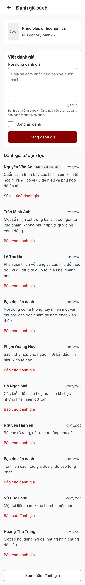
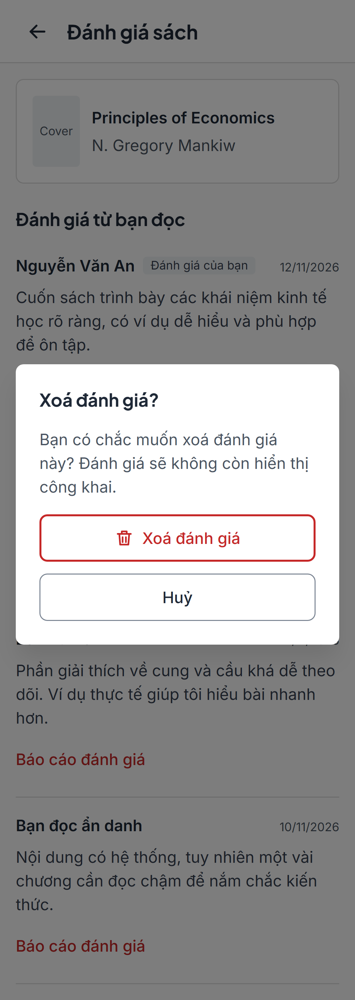
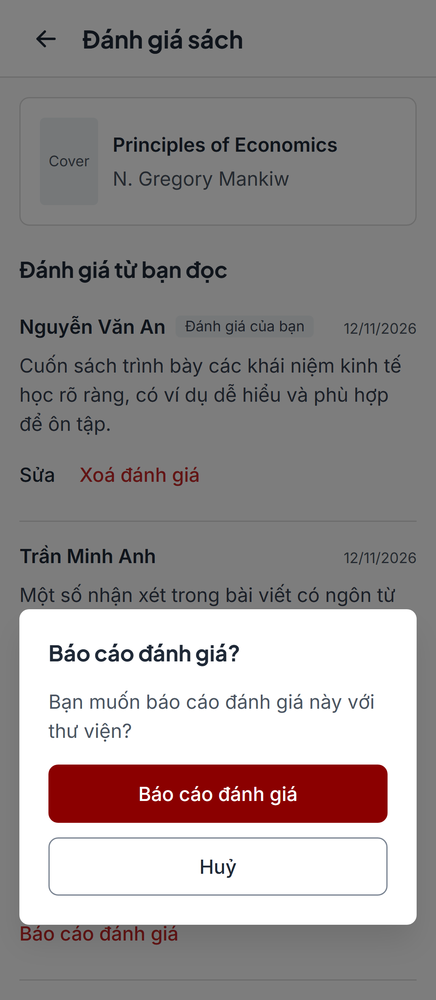

# Screen Spec: S-F02-01 Book reviews

| Field | Value |
|---|---|
| Screen ID | `S-F02-01` |
| Screen name | Book reviews |
| Actor | Reader |
| Priority | Must (edit/delete own review and report review are Could parts inside this Must screen) |
| Feature | `F-02 Reviews & QR` |
| Activity diagrams | `AD-UC-05`, `AD-UC-04`, `AD-UC-14` |
| Mockup image | [s_f02_01.png](../img/s_f02_01/s_f02_01.png) |
| Frame width | 360px (exported 3x = 1080px) |
| Wireframe source | [s_f02_01.html](../src/s_f02_01.html) |
| Author | Hoa |
| Status | Draft |

## 1. Purpose

**Shown when:** The reader selects the "Reviews" link on the existing OPAC Book Detail page (`AD-UC-05` r1), or returns directly to this screen after completing OTP verification on `S-F00-02` following a signed-out review or report action (`AD-UC-04` c1, `AD-UC-14` c1).

**The user leaves this screen when:** The reader taps the Back icon button ("Quay lại") in the screen header to return to the existing OPAC Book Detail page (exit), or triggers a signed-out write, edit, delete, or report action and chooses "Đăng nhập" in `M-F00-01` to go to `S-F00-01`.

## 2. Mockup

Numbered reference image: [s_f02_01_numbered.png](../img/s_f02_01/s_f02_01_numbered.png) (element numbers match Section 3). Additional numbered error references: [s_f02_01_error_numbered.png](../img/s_f02_01/s_f02_01_error_numbered.png), [s_f02_01_error_2_numbered.png](../img/s_f02_01/s_f02_01_error_2_numbered.png), [s_f02_01_error_3_numbered.png](../img/s_f02_01/s_f02_01_error_3_numbered.png).

Visual styling, spacing, typography, and colour tokens follow [ui_conventions.md#6-design-tokens](../../ui_conventions.md#6-design-tokens).

### State → Image

| State | Image |
|---|---|
| Default | [s_f02_01.png](../img/s_f02_01/s_f02_01.png) |
| Empty | [s_f02_01_empty.png](../img/s_f02_01/s_f02_01_empty.png) |
| Loading | [s_f02_01_loading.png](../img/s_f02_01/s_f02_01_loading.png) |
| Error (field validation) | [s_f02_01_error.png](../img/s_f02_01/s_f02_01_error.png) |
| Error-2 (network / load failure) | [s_f02_01_error_2.png](../img/s_f02_01/s_f02_01_error_2.png) |
| Error-3 (duplicate report / non-owner action) | [s_f02_01_error_3.png](../img/s_f02_01/s_f02_01_error_3.png) |
| Error-4 (report on the reader's own review, D39) | [s_f02_01_error_4.png](../img/s_f02_01/s_f02_01_error_4.png) |
| Success | [s_f02_01_success.png](../img/s_f02_01/s_f02_01_success.png) |

### Modal M-F02-01-01 Delete your review?

Rendered centred over `S-F02-01` (and reused over `S-F02-02`) dimmed by `colour/overlay`.

### Modal M-F02-01-02 Report this review?

Rendered centred over `S-F02-01` dimmed by `colour/overlay`.

## 3. Element inventory

| # | Element | Type | Content / data source | Required | Validation |
|---|---|---|---|---|---|
| 1 | Back and screen title | Screen header | Back icon button (accessible name “Quay lại”); title “Đánh giá sách” | Yes | none |
| 2 | Book context | Book row | Neutral grey “Cover” placeholder block; `Book catalogue › title` (e.g., “Principles of Economics”) and `Book catalogue › author` (e.g., “N. Gregory Mankiw”); no Format label (D21) (`FR-02-02`) | Yes | none |
| 3 | Review editor | Text area with counter | Section heading “Viết đánh giá”, label “Nội dung đánh giá”, placeholder “Chia sẻ cảm nhận của bạn về cuốn sách...”, bound to `Book review › review text`; counter `<n>/2.000` (e.g., `0/2.000`). In edit mode, pre-fills the reader’s existing `Book review › review text` and displays a cancel edit action (`FR-02-01`, `FR-02-03`, `FR-02-11`) | Yes | Required on submit: plain text only, 1–2,000 characters (`FR-02-01`, `FR-02-03`, `FR-02-11`). Reject empty text or >2,000 characters |
| 4 | Anonymous posting | Checkbox | Label “Đăng ẩn danh”; bound to `Reader accounts › full registered name` (unchecked by default: displays full name as registered; checked: displays “Bạn đọc ẩn danh”) (`FR-02-22`) | No | none |
| 5 | Review hint | Text area with counter | Hint line of `#3`, directly under the field (below `#12` Inline error when it is shown), small `colour/text-muted` text: “Đánh giá không được chứa từ ngữ xúc phạm, quảng cáo hoặc thông tin cá nhân.” (`MSG-14`, D20). Passive text: not a link, no action. These are the three criteria staff apply when they remove a reported review (`AD-UC-13` d3) | No | none |
| 6 | Submit review | Primary button | “Đăng đánh giá” (create mode) / “Lưu thay đổi” (edit mode) (`FR-02-01`, `FR-02-03`) | Yes | none |
| 7 | Own review | Review item | Section heading “Đánh giá từ bạn đọc”; `Book review › reviewer` (full name or “Bạn đọc ẩn danh”), badge “Đánh giá của bạn”, `Book review › posted date` (`dd/MM/yyyy`), `Book review › review text` (no internal review ID displayed on UI); Text buttons “Sửa” and “Xoá đánh giá” (`.danger` variant) (`FR-02-03`, `FR-02-04`, `FR-02-13`, `FR-02-22`) | No | none |
| 8 | Other readers’ reviews | Review item | `Book review › reviewer` (full name or “Bạn đọc ẩn danh”), `Book review › posted date` (`dd/MM/yyyy`), `Book review › review text` (no internal review ID displayed on UI); Text button “Báo cáo đánh giá” (`.danger` variant, shown on `S-F02-01` only) (`FR-02-02`, `FR-02-09`, `FR-02-13`, `FR-02-21`, `FR-02-22`) | No | none |
| 9 | Next page | Load more button | “Xem thêm đánh giá”; appends the next 10 reviews below the list, newest first; shown while more published reviews remain (`FR-02-02`, D6) | No | none |
| 10 | Empty list message | Empty state | “Không có đánh giá nào để hiển thị. Hãy là người đầu tiên viết đánh giá cho cuốn sách này.” (or book-not-found variant when the book does not exist); replaces the review list (`FR-02-15`) | No | none |
| 11 | Page-level feedback | Banner | `MSG-04` network/load error (“Không tải được trang. Bạn kiểm tra kết nối mạng rồi thử lại.”); duplicate report (“Bạn đã báo cáo đánh giá này.”); own review (“Bạn không thể báo cáo đánh giá của chính mình.”); or non-owner edit/delete rejection (“Không thể thực hiện thao tác trên đánh giá không thuộc về bạn.”) (`FR-04-20`, `FR-02-21`, `FR-02-24`, `FR-02-11`) | No | none |
| 12 | Field validation feedback | Inline error | Displayed directly under `#3` Review editor with “!” icon and 2px `colour/error-red` field border when review text is empty (e.g., “Bạn chưa viết nội dung đánh giá. Hãy nhập ít nhất 1 ký tự.”) or exceeds 2,000 characters (`FR-02-01`, `FR-02-11`) | No | none |
| 13 | Success confirmation | Toast | “Đã đăng đánh giá.” / “Đã cập nhật đánh giá.” / “Đã xoá đánh giá.” / “Đã gửi báo cáo.” (`FR-02-12`, `FR-02-09`) | No | none |
| 14 | Loading placeholder | Skeleton | Placeholder blocks matching the layout of `#2` Book context, `#3–#6` review form, and `#7–#8` review list (`MSG-05`) | No | none |
| 15 | Retry action | Secondary button | “Thử lại” inside the `MSG-04` error Banner (`FR-04-20`) | No | none |

### 3.1 Modal M-F02-01-01 Delete your review?

| # | Element | Type | Content / data source | Required | Validation |
|---|---|---|---|---|---|
| 1 | Confirmation dialog | Modal | Title “Xoá đánh giá?”; short body confirming permanent removal of the reader’s own review from public display; the review text is not quoted, it stays visible behind the dimmed overlay (D22) (`FR-02-04`) | Yes | none |
| 2 | Confirm deletion | Destructive button | “Xoá đánh giá” with trash icon before label (`FR-02-04`) | Yes | none |
| 3 | Cancel deletion | Secondary button | “Huỷ” (`FR-02-04`) | Yes | none |

### 3.2 Modal M-F02-01-02 Report this review?

| # | Element | Type | Content / data source | Required | Validation |
|---|---|---|---|---|---|
| 1 | Report confirmation dialog | Modal | Title “Báo cáo đánh giá?”; short confirmation body with no reason input field; the review text is not quoted, it stays visible behind the dimmed overlay (D22) (`FR-02-09`) | Yes | none |
| 2 | Submit report | Primary button | “Báo cáo đánh giá” (`FR-02-09`, `FR-02-21`) | Yes | none |
| 3 | Cancel report | Secondary button | “Huỷ” (`FR-02-09`) | Yes | none |

## 4. States

| State | What the user sees | Trigger |
|---|---|---|
| Default | `#1` Screen header, `#2` Book context, `#3–#6` empty Review editor (`0/2.000`, “Đăng ẩn danh” unchecked, “Đăng đánh giá”), and `#7–#8` published reviews (10 per page, newest first, excluding `Removed` reviews; own reviews show “Sửa” and “Xoá đánh giá”; other readers’ reviews show “Báo cáo đánh giá”), plus `#9` “Xem thêm đánh giá” while more published reviews remain beyond the first 10 (`FR-02-01`, `FR-02-02`, `FR-02-03`, `FR-02-04`, `FR-02-09`, `FR-02-13`, `FR-02-22`). | Reader opens `S-F02-01` for a valid book that has at least 1 published review (`AD-UC-05` d2 [Yes]). |
| Empty (no data) | `#1` Screen header, `#2` Book context and `#3–#6` Review editor (both only when the book exists), and `#10` Empty state message replacing the review list (`FR-02-15`). | Book has 0 published reviews (all reviews are `Removed` or none exist), or the book ID is not found in the catalogue (`AD-UC-05` d1 [No], d2 [No]). |
| Loading | `#1` Screen header and `#14` Skeleton blocks matching the book context, review editor, and review list; no loading text (`MSG-05`). | Initial page load, loading the next page via `#9`, or saving/updating/deleting/reporting a review. |
| Error | **Error (field validation):** Existing page content and review list preserved; `#3` Review editor gets 2px `colour/error-red` border, counter turns red if >2,000, and `#12` Inline error appears below the field (`FR-02-01`, `FR-02-11`). **Error-2 (network / load failure):** Existing page content preserved; `#11` error Banner displays `MSG-04` (“Không tải được trang. Bạn kiểm tra kết nối mạng rồi thử lại.”) with `#15` Secondary button “Thử lại” (`FR-04-20`). **Error-3 (business rule rejection):** Existing page content preserved; `#11` error Banner displays “Bạn đã báo cáo đánh giá này.” (`FR-02-21`), “Bạn không thể báo cáo đánh giá của chính mình.” (`FR-02-24`) or “Không thể thực hiện thao tác trên đánh giá không thuộc về bạn.” (`FR-02-11`). | Reader submits empty or >2,000-character review text (`AD-UC-04` d3 [No], d5 [No]); network/server fails while loading or saving (`FR-04-20`); reader reports an already-reported review (`AD-UC-14` d2 [Yes]); reader who wrote the review requested Report before signing in (`AD-UC-14` d3 [Yes]); or reader attempts to edit/delete another reader’s review (`AD-UC-04` d4 [No], d7 [No]). |
| Success / confirmation | `#13` Toast appears for 4 seconds (“Đã đăng đánh giá.”, “Đã cập nhật đánh giá.”, “Đã xoá đánh giá.”, or “Đã gửi báo cáo.”) and the review list refreshes to reflect the saved, updated, or removed review (`FR-02-12`, `FR-02-09`). | Reader successfully submits a new review (`AD-UC-04` s3), saves an edited review (`AD-UC-04` s5), confirms deletion in `M-F02-01-01` (`AD-UC-04` s6), or confirms a report in `M-F02-01-02` (`AD-UC-14` s3). |
| M-F02-01-01 › Default | Modal dialog “Xoá đánh giá?” over dimmed `S-F02-01` with Destructive button “Xoá đánh giá” and Secondary button “Huỷ” (`FR-02-04`). | Signed-in reader taps “Xoá đánh giá” on `#7` Own review (`AD-UC-04` r4). |
| M-F02-01-01 › Empty / Loading / Error / Success | Not applicable: `M-F02-01-01` is a confirmation modal with no list; loading, error, and success states are displayed on the parent screen (`S-F02-01` or `S-F02-02`) after confirmation. | — |
| M-F02-01-02 › Default | Modal dialog “Báo cáo đánh giá?” over dimmed `S-F02-01` with Primary button “Báo cáo đánh giá” and Secondary button “Huỷ”; no reason input (`FR-02-09`). | Signed-in reader taps “Báo cáo đánh giá” on `#8` Other readers’ reviews (`AD-UC-14` r1). |
| M-F02-01-02 › Empty / Loading / Error / Success | Not applicable: `M-F02-01-02` is a confirmation modal with no list; duplicate-report errors (`FR-02-21`) and report confirmation (`FR-02-09`) appear on `S-F02-01` after confirmation. | — |

## 5. Interactions and navigation

| # | Element | User action | System response | Goes to screen |
|---|---|---|---|---|
| 1 | `#1` Back (`Quay lại`) | tap | Exits `S-F02-01` and returns to the book’s existing OPAC detail page. | Existing OPAC Book Detail (exit) |
| 2 | `#3` Review editor / `#4` Anonymous posting / `#6` Submit review (`Đăng đánh giá` / `Lưu thay đổi`) [signed in] | type plain text, optionally toggle “Đăng ẩn danh”, and tap submit | Validates text (1–2,000 chars, plain text). If invalid, shows `#12` Inline error. If valid, saves new review (`FR-02-01`, `FR-02-22`) or updates own review (`FR-02-03`), shows `#13` Toast (“Đã đăng đánh giá.” or “Đã cập nhật đánh giá.”), and refreshes `#7–#8` review list (`FR-02-12`). | stays |
| 3 | `#3` Review editor / `#6` Submit review [signed out] | attempt to write/submit a review without a valid session | Denies unauthenticated write (`FR-04-08`) and opens sign-in prompt `M-F00-01` (`MSG-01`). If reader chooses “Đăng nhập”, navigates to `S-F00-01` → `S-F00-02` and returns to `S-F02-01` upon OTP acceptance (`L8-01`). | `M-F00-01` (see [screen_spec_s_f00_01.md](screen_spec_s_f00_01.md) §3.1) |
| 4 | `#7` Own review › `Sửa` [signed in] | tap | Switches `#3` Review editor into edit mode pre-filled with the selected review’s text, changes `#6` Primary button to “Lưu thay đổi”, and displays a cancel edit control (`FR-02-03`). | stays |
| 5 | `#7` Own review › `Sửa` [signed out] | tap | Denies unauthenticated edit (`FR-04-08`) and opens `M-F00-01` (`MSG-01`). | `M-F00-01` (see [screen_spec_s_f00_01.md](screen_spec_s_f00_01.md) §3.1) |
| 6 | `#7` Own review › `Xoá đánh giá` [signed in] | tap | Opens confirmation modal `M-F02-01-01` over dimmed `S-F02-01` (`AD-UC-04` r4, d6). | `M-F02-01-01` |
| 7 | `#7` Own review › `Xoá đánh giá` [signed out] | tap | Denies unauthenticated delete (`FR-04-08`) and opens `M-F00-01` (`MSG-01`). | `M-F00-01` (see [screen_spec_s_f00_01.md](screen_spec_s_f00_01.md) §3.1) |
| 8 | `#8` Other readers’ reviews › `Báo cáo đánh giá` [signed in] | tap | Opens report confirmation modal `M-F02-01-02` over dimmed `S-F02-01` (`AD-UC-14` r1). | `M-F02-01-02` |
| 9 | `#8` Other readers’ reviews › `Báo cáo đánh giá` [signed out] | tap | Denies unauthenticated report (`FR-04-08`) and opens `M-F00-01` (`MSG-01`). After sign-in, if the reader wrote this review, no report is saved, `M-F02-01-02` does not open and `#11` Banner shows “Bạn không thể báo cáo đánh giá của chính mình.” (`FR-02-24`, D39). | `M-F00-01` (see [screen_spec_s_f00_01.md](screen_spec_s_f00_01.md) §3.1) |
| 10 | `#9` Load more button (`Xem thêm đánh giá`) | tap | Appends the next 10 published reviews (newest first) below the list and hides `#9` when no more published reviews remain (`FR-02-02`, `AD-UC-05` r2). | stays |
| 11 | `#15` Retry action (`Thử lại`) | tap | Retries the failed load or save request and clears the `MSG-04` Banner on success (`FR-04-20`). | stays |
| 12 | `M-F02-01-01` › `#2` `Xoá đánh giá` | tap | Verifies ownership (`AD-UC-04` d7), sets review state to `Removed` (hidden from public display, `FR-02-04`), closes modal, shows `#13` Toast “Đã xoá đánh giá.”, and refreshes review list (`FR-02-12`). | stays |
| 13 | `M-F02-01-01` › `#3` `Huỷ` | tap | Closes `M-F02-01-01` without changing the review (`AD-UC-04` r5). | stays |
| 14 | `M-F02-01-02` › `#2` `Báo cáo đánh giá` | tap | Checks if reader already reported this review (`AD-UC-14` d2). If yes, closes modal and shows `#11` Banner “Bạn đã báo cáo đánh giá này.” (`FR-02-21`). If no, saves an `Open` report (`FR-02-09`), closes modal, and shows `#13` Toast “Đã gửi báo cáo.” (`AD-UC-14` s3, s4). | stays |
| 15 | `M-F02-01-02` › `#3` `Huỷ` | tap | Closes `M-F02-01-02` without saving a report (`FR-02-09`). | stays |

## 6. Screen-level rules

| Rule ID | Rule | Source |
|---|---|---|
| SR-001 | **Public reading, authenticated mutations:** Viewing published reviews requires no sign-in (`FR-02-02`). Creating, editing, deleting, or reporting a review requires a valid reader session; unauthenticated attempts open `M-F00-01` (`MSG-01`) and return to `S-F02-01` after OTP sign-in. | `FR-04-08`, `AD-UC-04` d0/d1, `AD-UC-14` d0/d1, `L8-01` |
| SR-002 | **Self-report prohibited:** The “Báo cáo đánh giá” action is rendered only on reviews written by other readers. A reader’s own reviews render “Sửa” and “Xoá đánh giá” only, never “Báo cáo đánh giá”. A signed-out reader sees the action on every review because the author is not known yet; after sign-in a report on the reader's own review is rejected (`FR-02-24`, D39). | `AD-UC-14` Q2, `AD-UC-14` d3, [ui_conventions.md](../../ui_conventions.md) §3 |
| SR-003 | **Shared review panel contract:** The review editor, own-review actions (“Sửa”, “Xoá đánh giá”), and modal `M-F02-01-01` defined here use stable component names reused identically on `S-F02-02` (except `S-F02-02` omits “Báo cáo đánh giá”). | `L8-07`, [ui_conventions.md](../../ui_conventions.md) §3 |
| SR-004 | **Pagination and ordering:** Published reviews are displayed 10 items per page, ordered newest first (`dd/MM/yyyy`). “Xem thêm đánh giá” is shown whenever more published reviews remain beyond those already displayed (even one more), and hidden once all published reviews are shown. | `FR-02-02`, `AD-UC-05` Q1, D6 |
| SR-005 | **Multiple reviews per reader allowed:** A signed-in reader may submit more than one review for the same book; submitting a new review does not overwrite prior reviews unless the reader explicitly uses “Sửa”. | `FR-02-01`, `AD-UC-04` Q1 |
| SR-006 | **Visibility of removed and reported reviews:** Reviews in state `Removed` (deleted by author or removed by staff) are never displayed (`FR-02-13`). Reviews in state `Published` that have an `Open` report remain publicly visible until staff remove them (`FR-02-10`). | `FR-02-13`, `FR-02-10`, `AD-UC-05` s3, `AD-UC-14` |
| SR-007 | **Reviewer identity and anonymity:** Each review displays either the reader’s full name exactly as registered on their library card account, or “Bạn đọc ẩn danh” if the reader checked “Đăng ẩn danh” when submitting/editing. Internal review IDs are never shown on the UI. | `FR-02-22`, [ui_conventions.md](../../ui_conventions.md) §2 |
| SR-008 | **Text validation and ownership enforcement:** Review text must be non-empty plain text of 1 to 2,000 characters (`FR-02-01`, `FR-02-03`). Readers can edit or delete only their own reviews (`FR-02-11`), and can submit at most one report per review (`FR-02-21`). | `FR-02-01`, `FR-02-03`, `FR-02-04`, `FR-02-11`, `FR-02-21` |
| SR-009 | **Report modal simplicity:** Modal `M-F02-01-02` contains no reason text box or category selector, and uses explicit action labels (“Báo cáo đánh giá” / “Huỷ”) rather than “Có” / “Không”. | `FR-02-09`, `L8-10`, `AD-UC-14` Q1, [ui_conventions.md](../../ui_conventions.md) §1 |
| SR-010 | **Could scope boundary:** Edit own review (`FR-02-03`), Delete own review (`FR-02-04`), and Report review (`FR-02-09`, `FR-02-21`, `FR-02-24`) are Could features inside this Must screen; if cut from release scope, their controls and modals are omitted without removing `S-F02-01`. | [screen_list.md](../../screen_list.md) notes, `AD-UC-04` Q4 |

## 7. Linked requirements

| FR ID | What this screen does for it |
|---|---|
| `FR-02-01` | Provides the review editor (`#3`, 1–2,000 plain-text characters) and “Đăng đánh giá” button (`#6`) to submit a new review for the book. |
| `FR-02-02` | Displays book context (`#2`) and published reviews (`#7`, `#8`) paginated at 10 per page (newest first) with “Xem thêm đánh giá” (`#9`). |
| `FR-02-03` | Provides “Sửa” on the reader’s own review (`#7`), loads existing text into `#3`, and saves changes via “Lưu thay đổi” (`#6`). |
| `FR-02-04` | Provides “Xoá đánh giá” on the reader’s own review (`#7`) and confirms removal from public display via modal `M-F02-01-01`. |
| `FR-02-09` | Provides “Báo cáo đánh giá” on other readers’ reviews (`#8`), confirms submission via modal `M-F02-01-02`, and shows “Đã gửi báo cáo.” (`#13`). |
| `FR-02-11` | Rejects empty/over-limit text via `#12` Inline error and rejects non-owner edit/delete attempts via `#11` error Banner. |
| `FR-02-12` | Displays confirmation Toast (`#13`) and refreshes the review list (`#7–#8`) after creating, editing, or deleting a review. |
| `FR-02-13` | Excludes reviews in state `Removed` from the displayed list (`#7–#8`) and total pagination count. |
| `FR-02-15` | Replaces the review list with Empty state message `#10` when the book is not found or has no published reviews. |
| `FR-02-21` | Prevents duplicate reports by the same reader on the same review and displays “Bạn đã báo cáo đánh giá này.” in `#11` Banner. |
| `FR-02-24` | Rejects a report on the reader's own review after sign-in and shows “Bạn không thể báo cáo đánh giá của chính mình.” in `#11` Banner. |
| `FR-02-22` | Provides the “Đăng ẩn danh” checkbox (`#4`) and displays either the registered card full name or “Bạn đọc ẩn danh” on each review item (`#7–#8`). |
| `FR-04-08` | Checks reader session on write, edit, delete, and report actions, opening `M-F00-01` (`MSG-01`) when signed out. |
| `FR-04-20` | Preserves currently displayed data and shows `MSG-04` Banner (`#11`) with “Thử lại” (`#15`) when loading or saving fails due to a network/server error. |

## 8. Responsive and accessibility notes

- **Smallest supported width:** 360px (Reader mobile viewport, exported at 3x = 1080px).
- **What collapses or stacks on a narrow screen:** All sections (`#2` Book row, `#3–#6` Review editor card, `#7–#8` Review items, `#9` Load more button) stack vertically in a single 100%-width column with 16px screen padding (`space/unit`). Inside `M-F02-01-01` and `M-F02-01-02`, action buttons stack vertically at 360px with the Primary/Destructive button on top and Secondary button (“Huỷ”) below ([ui_conventions.md](../../ui_conventions.md) §3).
- **Information never carried by colour alone:** Validation errors on `#3` combine a 2px `colour/error-red` field border with `#12` Inline error containing a “!” icon and explanatory text; counter `#3` pairs red text with an icon above 2,000 characters; `#11` Banners pair left border colour with an icon and text; Destructive actions (`#7` “Xoá đánh giá”, `M-F02-01-01` `#2`) pair `colour/error-red` with explicit labels and a trash icon ([ui_conventions.md](../../ui_conventions.md) §5).
- **Text contrast and minimum size:** All text and control borders meet WCAG 2.2 AA (`≥ 4.5:1` for body/labels/links, `≥ 3:1` for borders and 20px `Plus Jakarta Sans` title) using tokens in [ui_conventions.md](../../ui_conventions.md) §6. `#3` Text area uses 16px `Inter` text to prevent mobile browser zoom on focus. Interactive targets (`#1` Back button 44×44px, `#4` Checkbox row 44px height, `#6` Primary button 48px height, `#9` Load more button 48px height) meet the 44×44px Reader minimum ([ui_conventions.md](../../ui_conventions.md) §5). Focusable controls display a 2px `colour/focus` (`#1074C3`) focus ring with 2px offset.

## 9. Open questions

None. Decisions: see [decision_index.md](../../../project_brief/decision_index.md#s-f02-01).

---

## Completion checklist

- [x] The mockup is a separate cropped image file, named with the Screen ID ([s_f02_01.png](../img/s_f02_01/s_f02_01.png), plus [m_f02_01_01.png](../img/m_f02_01_01/m_f02_01_01.png) and [m_f02_01_02.png](../img/m_f02_01_02/m_f02_01_02.png)).
- [x] Every visible element in the mockup appears in the element inventory (`#1`–`#15` on `S-F02-01`, `#1`–`#3` on `M-F02-01-01`, `#1`–`#3` on `M-F02-01-02`).
- [x] Every input element has a validation rule or an explicit "none" (`#3` Text area with counter has 1–2,000 plain-text rule; `#4` Checkbox has `none`).
- [x] All five states are filled in, or marked "not applicable" with a reason (covered for `S-F02-01` and both modals).
- [x] Every navigation target is a Screen ID that exists in the Screen List (`M-F00-01`, `M-F02-01-01`, `M-F02-01-02`), `stays`, or `Existing OPAC Book Detail (exit)`.
- [x] Every element that displays data names the field it displays (`Book catalogue › title/author`, `Book review › review text/reviewer/posted date`, `Reader accounts › full registered name`).
- [x] Every linked FR exists in the Function List, and every action of this screen in an activity diagram is covered by an interaction row (`AD-UC-04`, `AD-UC-05`, `AD-UC-14`).