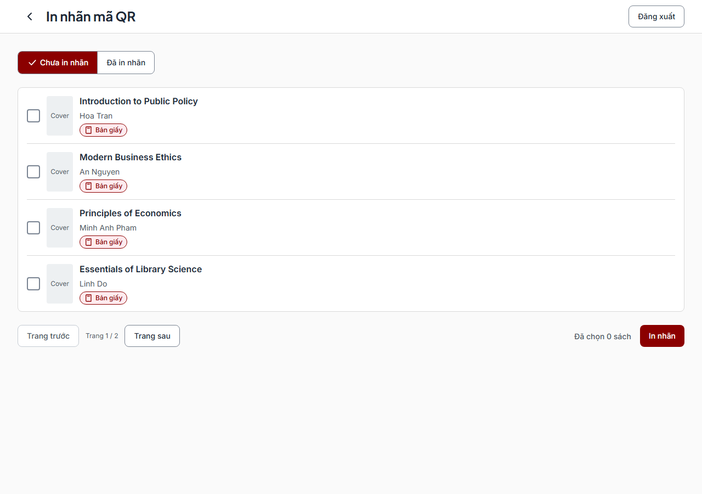
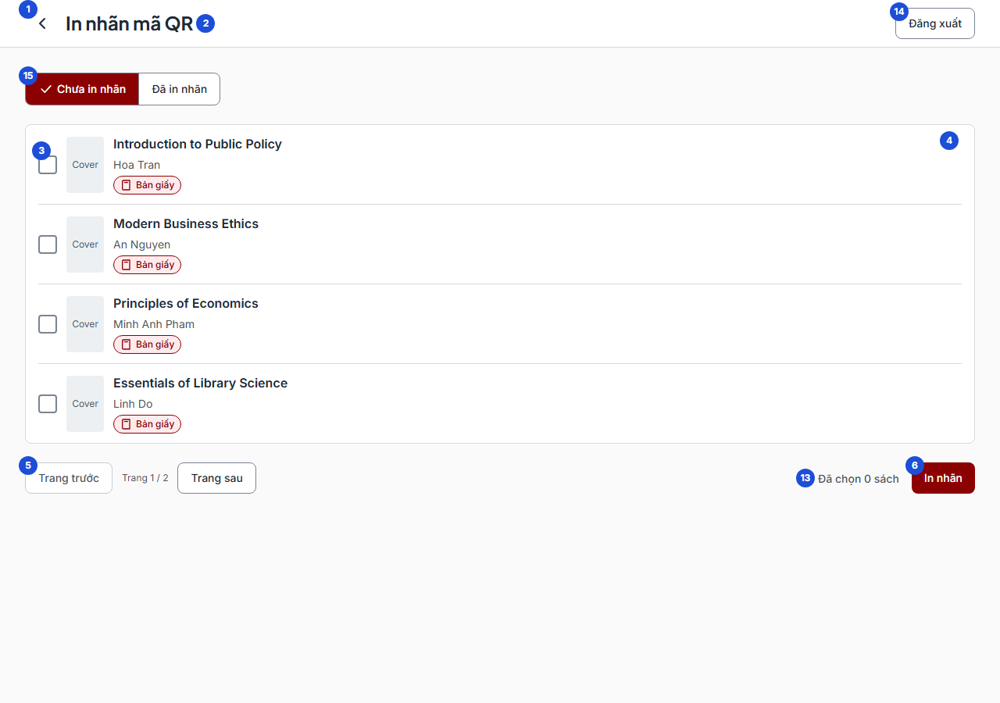
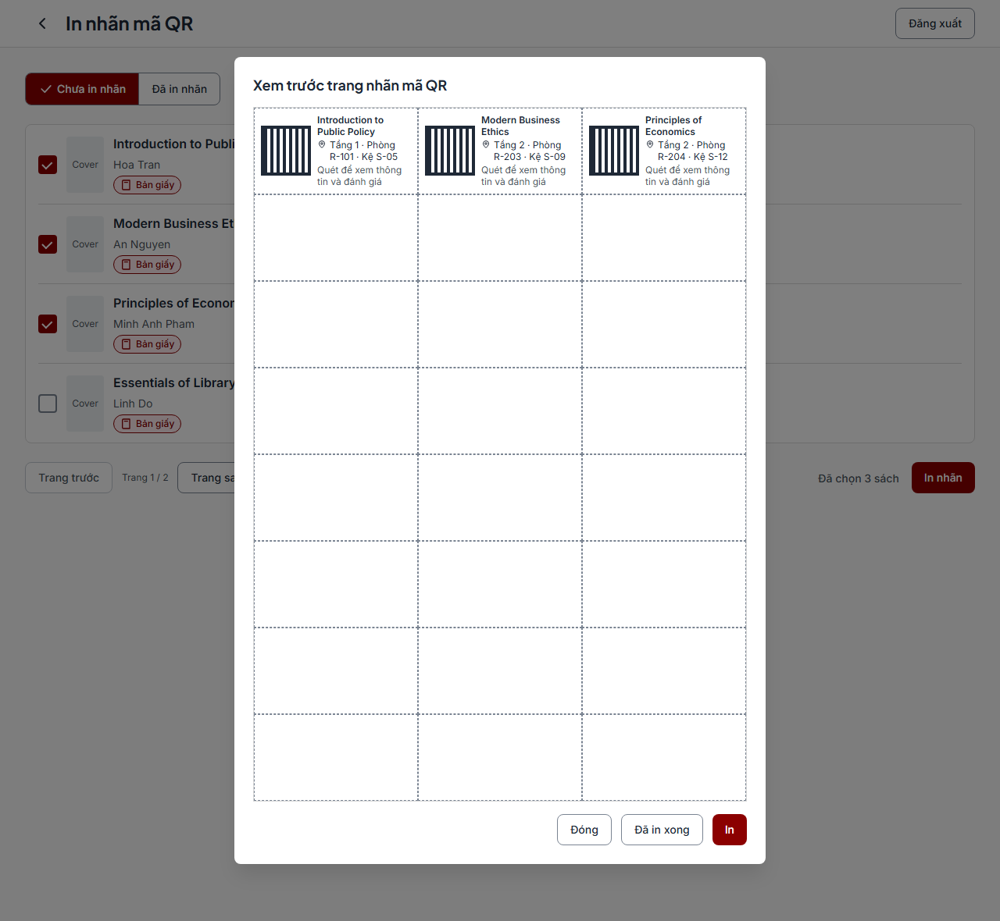
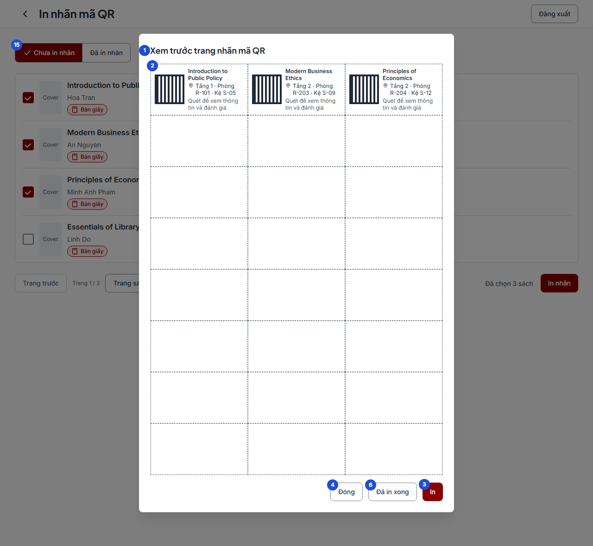

# Screen Spec: S-F02-03 QR code label printing

| Field | Value |
| --- | --- |
| Screen ID | S-F02-03 |
| Screen name | QR code label printing |
| Actor | On-site Staff |
| Priority | Must |
| Feature | F-02 Reviews & QR |
| Activity diagrams | AD-UC-10 |
| Mockup image | [s_f02_03.png](../img/s_f02_03/s_f02_03.png) |
| Status | Draft |
| Frame width | 1280px, export 1x |
| Wireframe source | [s_f02_03.html](../src/s_f02_03.html) · modal M-F02-03-01: state `#modal` of the same file |
| Author | Ha |
| UI conventions | v0.8, 21/11/2026 |

## 1. Purpose

**Shown when:** Signed-in On-site Staff choose Print QR labels on S-F04-01. The screen opens on the filter «Chưa in nhãn»; «Đã in nhãn» lists the books whose label can be reprinted for another copy (D40).

**The user leaves this screen when:** Back opens S-F04-01. «Đăng xuất» ends the staff session and opens S-F00-03 (FR-04-21). Producing a label sheet opens the existing M-F02-03-01 overlay; choosing «Đã in xong» or «Đóng» in it keeps staff on S-F02-03.

**Which books are listed (D3):** the physical books in the synced catalogue that have never had a QR label printed. Books added since the last catalogue sync appear here and stay until their label is printed (FR-02-23). A book counts as label-printed only when staff choose «Đã in xong» in M-F02-03-01; «Đóng» or a failed print records nothing and the books stay listed (D12).

**Which books are listed under «Đã in nhãn» (D40):** the physical books already recorded as label-printed. All copies of a title share one QR code, so a reprint generates no new code and the label carries no shelf location (FR-02-07, FR-02-25).

## 2. Mockup

Styles follow [UI conventions v0.8](../../ui_conventions.md#6-design-tokens). Each image contains one product frame.

| State | Image |
| --- | --- |
| Default | [s_f02_03.png](../img/s_f02_03/s_f02_03.png), [s_f02_03_numbered.png](../img/s_f02_03/s_f02_03_numbered.png) |
| Empty | [s_f02_03_empty.png](../img/s_f02_03/s_f02_03_empty.png), [s_f02_03_empty_numbered.png](../img/s_f02_03/s_f02_03_empty_numbered.png) |
| Loading | [s_f02_03_loading.png](../img/s_f02_03/s_f02_03_loading.png), [s_f02_03_loading_numbered.png](../img/s_f02_03/s_f02_03_loading_numbered.png) |
| Error — no selection | [s_f02_03_error.png](../img/s_f02_03/s_f02_03_error.png), [s_f02_03_error_numbered.png](../img/s_f02_03/s_f02_03_error_numbered.png) |
| Error — all lack QR | [s_f02_03_error_2.png](../img/s_f02_03/s_f02_03_error_2.png), [s_f02_03_error_2_numbered.png](../img/s_f02_03/s_f02_03_error_2_numbered.png) |
| Error — network | [s_f02_03_error_3.png](../img/s_f02_03/s_f02_03_error_3.png), [s_f02_03_error_3_numbered.png](../img/s_f02_03/s_f02_03_error_3_numbered.png) |
| Warning — some lack QR | [s_f02_03_warning.png](../img/s_f02_03/s_f02_03_warning.png), [s_f02_03_warning_numbered.png](../img/s_f02_03/s_f02_03_warning_numbered.png) |
| Success | [s_f02_03_success.png](../img/s_f02_03/s_f02_03_success.png) |
| Next page | [s_f02_03_page_2.png](../img/s_f02_03/s_f02_03_page_2.png) |
| Reprint list («Đã in nhãn») | [s_f02_03_reprint.png](../img/s_f02_03/s_f02_03_reprint.png), [s_f02_03_reprint_numbered.png](../img/s_f02_03/s_f02_03_reprint_numbered.png) |
| Reprint list — empty | [s_f02_03_reprint_empty.png](../img/s_f02_03/s_f02_03_reprint_empty.png) |

### Modal M-F02-03-01

Variants: [reprint](../img/m_f02_03_01/m_f02_03_01_reprint.png) (D40) · [more than one A4 page](../img/m_f02_03_01/m_f02_03_01_multipage.png) (D41).

## 3. Element inventory

| # | Element | Type | Content / data source | Required | Validation |
| --- | --- | --- | --- | --- | --- |
| 1 | Back | Screen header | Quay lại | Yes | none |
| 2 | Title | Screen header | In nhãn mã QR | Yes | none |
| 3 | Select physical books | Checkbox | Selection for each physical book | Yes | Only listed physical books (never label-printed) can be selected. Ticks are kept when staff change pages. Require at least one on Print labels (FR-02-17). |
| 4 | Physical book | Book row | Book catalogue › title, author, access format. One row per book title. List = physical books in the synced catalogue with no QR label printed yet, 20 rows per page, ordered by the book's primary shelf location returned by the sync (Book placement & library layout › floor, then room code, then shelf code; the same location shown on S-F01-01) (FR-02-23; D13). | Yes | none |
| 5 | Pagination | Secondary button | Trang trước / Trang sau (20 rows per page) | Yes | none |
| 6 | Print labels | Primary button | In nhãn; «In lại nhãn» under the filter «Đã in nhãn» (FR-02-25; D40) | Yes | none |
| 8 | Validation / load error | Banner | Hãy chọn ít nhất 1 sách bản giấy. / MSG-04 | No | none |
| 9 | Books without QR codes | Banner | Book catalogue › title for each omitted book | No | none |
| 10 | Catalogue loading | Skeleton | MSG-05 | No | none |
| 11 | No books awaiting a label | Empty state | “Tất cả sách bản giấy đã được in nhãn. Sách mới sẽ hiện ở đây sau lần đồng bộ danh mục tiếp theo.” (ui-conventions §4; D3, D15). Under «Đã in nhãn»: “Chưa có sách nào được in nhãn.” (FR-02-25; D40) | No | none |
| 12 | Try again | Secondary button | Thử lại | Yes | none |
| 13 | Selected count | Selection counter | “Đã chọn <n> sách”, passive text shown next to «In nhãn»; n = all ticked books across every page (D3b, D16). | Yes | none |
| 14 | Sign out | Secondary button | “Đăng xuất”, in the staff Screen header (FR-04-21; D7). | Yes | none |
| 15 | Label status filter | Segmented control | «Chưa in nhãn» (selected when the screen opens) / «Đã in nhãn»; changing it returns to page 1 and clears the ticks (FR-02-23, FR-02-25; D40). | Yes | One option at a time |

### 3.1 Modal M-F02-03-01 QR label sheet preview

| # | Element | Type | Content / data source | Required | Validation |
| --- | --- | --- | --- | --- | --- |
| 1 | Title | Modal | Xem trước trang nhãn mã QR | Yes | none |
| 2 | A4 preview | Label sheet | A4 portrait decal sheet, 3 columns × 8 rows = 24 labels of 70×37 mm. One label per book title (not per copy). Each label: Book QR codes › QR code on the left; on the right Book catalogue › title (max 2 lines, cut with “…”), shelf location line «Tầng n · Phòng code · Kệ code» from the book's primary shelf location returned by the sync (Book placement & library layout › floor, room code, shelf code; the same location shown on S-F01-01; D13), and a small line “Quét để xem thông tin và đánh giá” (D4). A reprint label has no shelf location line (D40). More than 24 books continue on further A4 pages, which the preview scrolls through (D41). | Yes | none |
| 3 | Print | Primary button | In | Yes | none |
| 4 | Close | Secondary button | Đóng. Records nothing: the books stay in the S-F02-03 list (D12). | Yes | none |
| 5 | Omitted books | Banner | Book catalogue › title for each book left out (partial success only) | No | none |
| 6 | Printed | Secondary button | “Đã in xong”, next to «In» / «Đóng». The only action that records the books on the sheet as label-printed (FR-02-08; D12, D17). On a reprint it writes only the audit entry (FR-02-25; D40). | Yes | none |
| 7 | Sheet pages | Selection counter | “Trang A4 <n> / <m> · <k> nhãn”, shown only when the sheet has more than one A4 page (FR-02-08; D41). | No | none |

## 4. States

| State | What the user sees | Trigger |
| --- | --- | --- |
| Default | Header with «Đăng xuất»; physical books never label-printed (20 per page, ordered floor → room → shelf of the primary shelf location, D13), checkboxes, «Đã chọn <n> sách» and In nhãn. | A signed-in staff member chooses Print QR labels on S-F04-01 (FR-02-08, FR-02-23). |
| Empty | No physical books are waiting for a QR label (#11). | Every physical book in the synced catalogue already has a printed QR label (FR-02-23). |
| Loading | Skeleton while opening the book list. | The list of physical books awaiting a label is pending. |
| Error — no selection | Hãy chọn ít nhất 1 sách bản giấy. | Staff choose In nhãn with no selected physical book (FR-02-17). |
| Error — all lack QR | Modern Business Ethics and Essentials of Library Science are listed. No sheet is produced. | None of the selected books has a QR code (FR-02-18). |
| Error — network | MSG-04, existing selections retained. | Loading the list or producing a sheet fails (FR-04-20). |
| Warning — some lack QR | Modern Business Ethics is listed as omitted. | Some selected books have no QR code and some are eligible (FR-02-18). |
| Success | Two QR labels from three selected books. M-F02-03-01 overlays the list. Nothing is recorded yet: the two books leave the list only after staff choose «Đã in xong»; after «Đóng» they stay listed (D12). | Eligible labels were produced and the preview opens (FR-02-08); the illustrated sample selects three books and omits one. |
| Next page | The next 20 books awaiting a label, continuing the floor → room → shelf order; ticks on other pages are kept and «Đã chọn <n> sách» counts them. | Staff choose Trang sau and another page is available (FR-02-23). |
| Reprint list | Filter on «Đã in nhãn»: the labelled books, 20 per page in floor → room → shelf order, checkboxes, «Đã chọn <n> sách» and «In lại nhãn». | Staff choose «Đã in nhãn» (FR-02-25; D40). |
| Reprint list — empty | “Chưa có sách nào được in nhãn.” (#11). | No book has a printed label yet (FR-02-25). |

| Modal state | What the user sees | Trigger |
| --- | --- | --- |
| M-F02-03-01 › Default | A4 3 × 8 sheet preview (24 labels of 70×37 mm) with three labels filled, and «In» / «Đã in xong» / «Đóng». | FR-02-08 |
| M-F02-03-01 › Empty | Not applicable: validation keeps the user on S-F02-03. | — |
| M-F02-03-01 › Loading | Not applicable: the preview opens after the sheet is ready. | — |
| M-F02-03-01 › Error | Not applicable: validation and failures are shown on S-F02-03. | — |
| M-F02-03-01 › Success — partial | Two-label A4 3 × 8 preview and the omitted book name. | FR-02-08, FR-02-18 |
| M-F02-03-01 › More than one A4 page | The sheet continues on further A4 pages; #7 shows “Trang A4 1 / 2 · 25 nhãn” and the preview scrolls through the pages. | More than 24 eligible books are selected (FR-02-08; D41). |
| M-F02-03-01 › Reprint | Labels with the existing QR code, the title and the scan line, no shelf location; «In» / «Đã in xong» / «Đóng». | Staff choose «In lại nhãn» (FR-02-25; D40). |
| M-F02-03-01 › Reprint confirmed | The preview closes; an audit entry is written; the books stay in the «Đã in nhãn» list; their ticks are cleared. | Staff choose «Đã in xong» on a reprint (FR-02-25, FR-04-12; D40). |
| M-F02-03-01 › Printed confirmed | The preview closes; the books on the sheet are recorded as label-printed and leave the S-F02-03 list; their ticks are cleared and «Đã chọn <n> sách» is updated. | Staff choose «Đã in xong» (FR-02-08; D12). |
| M-F02-03-01 › Closed without confirming | The preview closes; nothing is recorded; the books stay in the list with their ticks kept, so staff can print again. | Staff choose «Đóng», including after a failed print (D12, D18). |

## 5. Interactions and navigation

| # | Element | User action | System response | Goes to screen |
| --- | --- | --- | --- | --- |
| 1 | S-F02-03 › Back | Return to the staff page. | Return to the linked preceding screen. | S-F04-01 |
| 2 | S-F02-03 › Select physical books | Check or uncheck books (AD-UC-10 a1). | Update the selected physical books, keep ticks made on other pages and update «Đã chọn <n> sách» (#13) with the total across all pages (D3b). | stays |
| 3 | S-F02-03 › Pagination | Move between pages of physical books. | Show the next or preceding 20 books awaiting a label, in floor → room → shelf order; keep all ticks (FR-02-23; D3b–D3d). | stays |
| 4 | S-F02-03 › Print labels | Build a sheet with Print labels, element 6 (AD-UC-10 a2). Include only eligible checked books (from every page) and list omitted titles. | Recheck the staff session/role. Require selection, omit books without QR codes and list their titles. If eligible books remain, build the sheet (one label per book title) and open M-F02-03-01; otherwise stay. Nothing is recorded as label-printed and no audit entry is written at this point (FR-02-08; D12, D32). | M-F02-03-01 / stays |
| 5 | S-F02-03 › Print labels | Recheck staff session before creating a sheet (FR-04-08). | If the staff session is no longer valid, produce no sheet and open staff sign-in. | S-F00-03 |
| 6 | S-F02-03 › Try again | Retry after a network failure. | Retry the failed request while retaining displayed data and entered values (FR-04-20). | stays |
| 7 | M-F02-03-01 › Print | Open the browser print dialog (AD-UC-10 a5). | Open the browser print dialog for the A4 3 × 8 decal sheet (AD-UC-10 a5). | Browser print dialog (exit) |
| 8 | M-F02-03-01 › Close | Dismiss the preview without confirming, e.g. after a failed print (AD-UC-10 a9). | Dismiss the existing preview modal and restore S-F02-03. Record nothing: the books on the sheet stay in the list, their ticks are kept and «Đã chọn <n> sách» is unchanged, so staff can print again (D12, D18). | S-F02-03 |
| 9 | S-F02-03 › Sign out | Choose «Đăng xuất» in the header. | End the staff session and open the staff sign-in screen (FR-04-21; D7). | S-F00-03 |
| 10 | M-F02-03-01 › Printed | Choose «Đã in xong» after the labels came out of the printer (AD-UC-10 a8). | Record that a label has been printed for each book on the sheet, write the print audit entry (FR-04-12; D32), close the preview and restore S-F02-03: those books no longer appear in the list, their ticks are cleared and «Đã chọn <n> sách» is updated (FR-02-08; D12). On a reprint: write the audit entry only; the books stay in the «Đã in nhãn» list (FR-02-25; D40). | S-F02-03 |
| 11 | S-F02-03 › Label status filter | Choose «Chưa in nhãn» or «Đã in nhãn» (AD-UC-10 d13, a11). | Show that list from page 1 and clear the ticks (FR-02-23, FR-02-25; D40). | stays |
| 12 | S-F02-03 › In lại nhãn | Build a reprint sheet from the ticked labelled books (AD-UC-10 a13). | Recheck the staff session/role and require at least one book (FR-02-17). Build the sheet from the existing QR codes, with no new code and no shelf location, and open M-F02-03-01 (FR-02-25; D40). | M-F02-03-01 / stays |

## 6. Screen-level rules

| Rule ID | Rule | Source |
| --- | --- | --- |
| SR-001 | Check valid staff session and role when opening the screen and again before producing the sheet. Without them open S-F00-03. | FR-04-08; AD-UC-10 d0 |
| SR-002 | Print labels with no selection produces no sheet and shows “Hãy chọn ít nhất 1 sách bản giấy.” | FR-02-17 |
| SR-003 | List the title of every selected book without a QR code and omit it. If none are eligible, produce no sheet. | FR-02-18; AD-UC-10 d3, d4 |
| SR-004 | With three selected books and one missing QR code, the preview contains two labels and names the omitted book. | AD-UC-10 acceptance test d3 [No] → d4 [Yes] |
| SR-005 | Produce the printable sheet before the preview is shown. Producing the sheet does not record any book as label-printed and writes no audit entry. The audit entry (actor, action, time) is written when staff choose «Đã in xong» (see SR-012). | FR-02-08, FR-04-12; AD-UC-10 s4, s13, s5; D3, D12, D32 |
| SR-006 | List only the physical books in the synced catalogue that have never had a QR label printed, 20 per page, ordered by floor, then room code, then shelf code (the walking order along the shelves). For a title whose copies sit on several shelves, use the book's primary shelf location returned by the sync — the same location shown on S-F01-01. Books new since the last sync stay listed until their label is recorded as printed. | FR-02-23; D3, D3c, D3d, D13 |
| SR-007 | Sheet: A4 portrait decal sheet, 3 columns × 8 rows = 24 labels of 70×37 mm. One label per book title, not per copy. Each label: QR code on the left; on the right the title (max 2 lines, cut with “…”), «Tầng n · Phòng code · Kệ code» (the book's primary shelf location returned by the sync, D13) and the small line “Quét để xem thông tin và đánh giá”. | FR-02-08; D4, D13 |
| SR-008 | In in M-F02-03-01 opens the browser print dialog. «Đã in xong» and «Đóng» both return to the selection screen. «In» is the only Primary button in M-F02-03-01; «Đã in xong» and «Đóng» are Secondary buttons. | FR-02-08; AD-UC-10 a4, a5, a8, a9; D17 |
| SR-009 | Keep existing selections and displayed book data when a request fails; offer retry. | FR-04-20 |
| SR-010 | Ticks are kept when staff change pages; «Đã chọn <n> sách» next to «In nhãn» shows the total ticked on all pages, and In nhãn uses all of them. | D3b |
| SR-011 | The staff session stays valid until the staff member chooses «Đăng xuất» (no time-out). «Đăng xuất» ends the session and opens S-F00-03. | FR-04-21; D7 |
| SR-012 | A book is recorded as label-printed only when staff choose «Đã in xong» in M-F02-03-01; the record covers each book on that sheet. «Đóng» — including after a failed print — records nothing: the books stay in the list with their ticks kept. | FR-02-08; AD-UC-10 d9, a8, s13; D12, D18 |
| SR-013 | One QR code per book title, shared by all its copies. A reprint uses the existing code, generates no new code, prints no shelf location and does not change the book's label status. Its «Đã in xong» writes the audit entry. | FR-02-07, FR-02-25, FR-04-12; D40 |
| SR-014 | A sheet holds 24 labels per A4 page. More than 24 eligible books continue on further A4 pages; «Đã in xong» records every book on all pages. | FR-02-08; D41 |

## 7. Linked requirements

| FR ID | What this screen does for it |
| --- | --- |
| FR-02-08 | Select, prepare, preview and print QR labels; when staff confirm that the sheet was printed («Đã in xong»), record that a label has been printed for each book on the sheet (D12). |
| FR-02-23 | List physical books awaiting a QR label, 20 per page, ordered by floor, room and shelf code of the book's primary shelf location returned by the sync (new FR; D3, D13). |
| FR-02-25 | List labelled books under «Đã in nhãn» and reprint their existing QR code with no shelf location (new FR; D40). |
| FR-02-17 | Require selection. |
| FR-02-18 | Omit and list books without QR codes. |
| FR-04-08 | Staff role/session check. |
| FR-04-21 | «Đăng xuất» ends the staff session and opens S-F00-03; the session stays valid until then (new FR, D7). |
| FR-04-12 | Print audit entry, written when staff choose «Đã in xong» (D32). |
| FR-04-20 | Retain data and retry. |

## 8. Responsive and accessibility notes

- Staff screen: designed at 1280px. Staff screens are supported from 1280px, the design frame; narrower widths, tablets and phones are not supported ([ui_conventions.md](../../ui_conventions.md), Responsive section; D45).
- Use the shared token fonts, 16px input text, body 16px and small text at least 12px. Reader targets are at least 44 × 44px. Text contrast must meet ui-conventions §5.
- Error feedback has a message, icon and error styling. Use visible labels, keyboard focus rings and DOM order matching the inventory. Loading disables duplicate submissions.
- Modal focus enters the dialog, remains within it while open, and returns to its trigger on dismissal. Print is a browser-controlled exit. After closing the preview, return focus to In nhãn.

## 9. Open questions

None. Decisions: see [decision_index.md](../../../project_brief/decision_index.md#s-f02-03).

---

## Completion checklist

- [x] The mockup is a separate cropped image file, named with the Screen ID.
- [x] Every visible element in the mockup appears in the element inventory.
- [x] Every input element has a validation rule or an explicit none.
- [x] All five states are filled in, or marked not applicable with a reason.
- [x] Every navigation target is a Screen ID in the Screen List or a documented modal/browser exit.
- [x] Every element that displays data names its field.
- [x] Every linked FR exists in the current Function List and every AD user action has an interaction row.
- [x] Modal inventory and interactions are included where applicable.
- [ ] Cross-review by Hoa and final review by Chi are complete.
