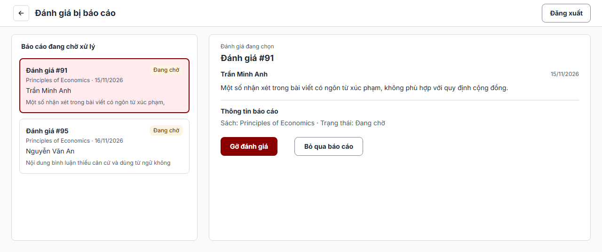
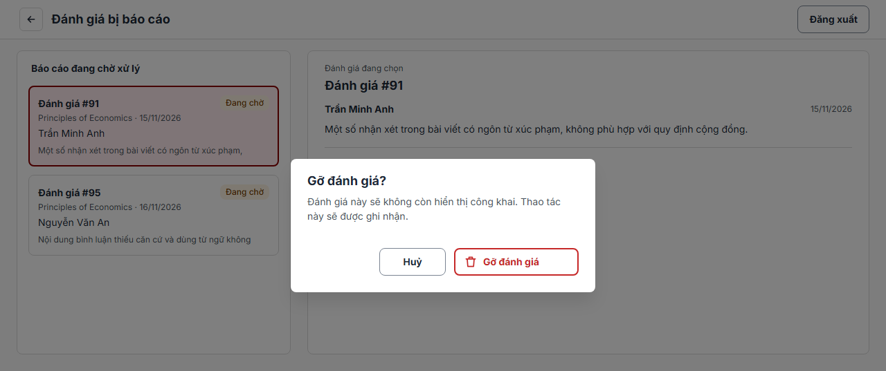

# Screen Spec: S-F02-04 Reported reviews

| Field | Value |
|---|---|
| Screen ID | `S-F02-04` |
| Screen name | Reported reviews |
| Actor | On-site Staff |
| Priority | Could |
| Feature | `F-02 Reviews & QR` |
| Activity diagrams | `AD-UC-13` |
| Mockup image | [s_f02_04.png](../img/s_f02_04/s_f02_04.png) |
| Frame width | 1280px (exported 1x = 1280px) |
| Wireframe source | [s_f02_04.html](../src/s_f02_04.html) |
| Author | Hoa |
| Status | Draft |

## 1. Purpose

**Shown when:** Signed-in On-site Staff select the “Reported reviews” task tile on `S-F04-01` (`AD-UC-13` a1).

**The user leaves this screen when:** Staff click the Back icon button (“Quay lại”) in the screen header to return to `S-F04-01`, or click «Đăng xuất» (`#11`) at the right of the header to end the staff session and go to `S-F00-03` (`FR-04-21`, D7).

## 2. Mockup

Numbered reference image: [s_f02_04_numbered.png](../img/s_f02_04/s_f02_04_numbered.png) (element numbers `#1`–`#5` and `#11` match Section 3; feedback elements `#6`–`#10` appear in non-default states; re-exported 22/11/2026 with «Đăng xuất» `#11`).

Visual styling, spacing, typography, and colour tokens follow [ui_conventions.md#6-design-tokens](../../ui_conventions.md#6-design-tokens).

### State → Image

| State | Image |
|---|---|
| Default | [s_f02_04.png](../img/s_f02_04/s_f02_04.png) |
| Empty | [s_f02_04_empty.png](../img/s_f02_04/s_f02_04_empty.png) |
| Loading | [s_f02_04_loading.png](../img/s_f02_04/s_f02_04_loading.png) |
| Error (network / load failure) | [s_f02_04_error.png](../img/s_f02_04/s_f02_04_error.png) |
| Success (review removed) | [s_f02_04_success.png](../img/s_f02_04/s_f02_04_success.png) |
| Success-2 (report dismissed) | [s_f02_04_success_2.png](../img/s_f02_04/s_f02_04_success_2.png) |

### Modal M-F02-04-01 Remove this review?

Numbered reference image: [m_f02_04_01_numbered.png](../img/m_f02_04_01/m_f02_04_01_numbered.png) (element numbers `#1`–`#3` match Section 3.1). Rendered centred over `S-F02-04` (header with «Đăng xuất» still visible behind the overlay) dimmed by `colour/overlay`.

## 3. Element inventory

| # | Element | Type | Content / data source | Required | Validation |
|---|---|---|---|---|---|
| 1 | Back and screen title | Screen header | Back icon button (accessible name “Quay lại”); title “Đánh giá bị báo cáo” (`FR-02-14`) | Yes | none |
| 2 | Open report queue | Review item | Left-column section heading “Báo cáo đang chờ xử lý”; list of `Open` report cards displaying `Book review › review ID` (e.g., “Đánh giá #91”, “Đánh giá #95”), status label “Đang chờ”, `Book catalogue › title` (e.g., “Principles of Economics”), `Book review › posted date` (`dd/MM/yyyy`), `Book review › reviewer` (full registered name or “Bạn đọc ẩn danh”), and truncated `Book review › review text` (`FR-02-14`, `FR-02-19`) | Yes | none |
| 3 | Selected review detail | Review item | Right-column detail panel displaying label “Đánh giá đang chọn”, `Book review › review ID` (e.g., “Đánh giá #91”), `Book review › reviewer`, `Book review › posted date` (`dd/MM/yyyy`), full `Book review › review text`, and section “Thông tin báo cáo” with `Book catalogue › title` and `Review report › status` (“Trạng thái: Đang chờ”); no report-reason field (`FR-02-10`, `FR-02-20`) | Yes | none |
| 4 | Remove selected review | Primary button | “Gỡ đánh giá” (`FR-02-10`) | Yes | none |
| 5 | Dismiss selected report | Secondary button | “Bỏ qua báo cáo” (`FR-02-20`) | Yes | none |
| 6 | Empty queue message | Empty state | “Không có đánh giá bị báo cáo nào đang chờ xử lý.” (`FR-02-19`) | No | none |
| 7 | Page feedback | Banner | `MSG-04` network/load error (“Không tải được trang. Bạn kiểm tra kết nối mạng rồi thử lại.”) (`FR-04-20`, `FR-02-10`, `FR-02-20`) | No | none |
| 8 | Loading placeholder | Skeleton | Placeholder blocks matching `#2` queue list and `#3` selected review detail (`MSG-05`) | No | none |
| 9 | Success confirmation | Toast | “Đã gỡ đánh giá.” (when review removed, `FR-02-10`) or “Đã bỏ qua báo cáo.” (when report dismissed, `FR-02-20`) | No | none |
| 10 | Retry action | Secondary button | “Thử lại” inside the `MSG-04` error Banner (`FR-04-20`) | No | none |
| 11 | Sign out | Secondary button | «Đăng xuất» at the right end of the screen header, shown in every state and behind `M-F02-04-01` (`FR-04-21`, D7) | Yes | none |

### 3.1 Modal M-F02-04-01 Remove this review?

| # | Element | Type | Content / data source | Required | Validation |
|---|---|---|---|---|---|
| 1 | Removal confirmation dialog | Modal | Title “Gỡ đánh giá?”; body “Đánh giá này sẽ không còn hiển thị công khai. Thao tác này sẽ được ghi nhận.”; short confirmation only: the review text is not quoted, it stays visible behind the dimmed overlay (D22) (`FR-02-10`, `FR-04-12`) | Yes | none |
| 2 | Confirm removal | Destructive button | “Gỡ đánh giá” with trash icon before label (`FR-02-10`, `FR-04-12`) | Yes | none |
| 3 | Cancel removal | Secondary button | “Huỷ” (`FR-02-10`) | Yes | none |

## 4. States

| State | What the user sees | Trigger |
|---|---|---|
| Default | `#1` Screen header with `#11` «Đăng xuất» at the right, `#2` left-column queue of `Open` reported reviews (e.g., `#91` selected with active border, `#95` unselected), `#3` right-column full review and report metadata for the selected review, and `#4` “Gỡ đánh giá” + `#5` “Bỏ qua báo cáo” action buttons (`FR-02-14`, `FR-02-10`, `FR-02-20`). | Signed-in On-site Staff open `S-F02-04` when at least one `Open` review report exists (`AD-UC-13` d2 [Yes]). |
| Empty (no data) | `#1` Screen header with `#11` «Đăng xuất» and `#6` Empty state message (“Không có đánh giá bị báo cáo nào đang chờ xử lý.”); queue, detail panel, and action buttons are hidden (`FR-02-19`). | No review reports are in `Open` status upon initial load (`AD-UC-13` d2 [No]), or after the last open report is removed/dismissed. |
| Loading | `#1` Screen header with `#11` «Đăng xuất» and `#8` Skeleton blocks replacing the queue and detail panels; no loading text (`MSG-05`). | Initial load of reported reviews, or reloading the queue after removing a review or dismissing a report (`AD-UC-13` m1). |
| Error | `#1` Screen header with `#11` «Đăng xuất» and `#7` error Banner displaying `MSG-04` (“Không tải được trang. Bạn kiểm tra kết nối mạng rồi thử lại.”) with `#10` Secondary button “Thử lại”; no Empty or Toast shown (`FR-04-20`). | Network or server error occurs while retrieving reported reviews or submitting a remove/dismiss action (`FR-04-20`). |
| Success / confirmation | **Success (review removed):** `#9` Toast displays “Đã gỡ đánh giá.” for 4 seconds; handled review (e.g., `#91`) is removed from public display (`Removed`) and leaves `#2` queue; next open report (e.g., `#95`) becomes selected in `#3` detail panel (`FR-02-10`, `FR-04-12`). **Success-2 (report dismissed):** `#9` Toast displays “Đã bỏ qua báo cáo.” for 4 seconds; handled review (e.g., `#91`) remains `Published` publicly but leaves `#2` queue; next open report (e.g., `#95`) becomes selected in `#3` detail panel (`FR-02-20`). | Staff confirm removal in `M-F02-04-01` (`AD-UC-13` s5, s6) or click `#5` “Bỏ qua báo cáo” (`AD-UC-13` s7). |
| M-F02-04-01 › Default | Confirmation modal “Gỡ đánh giá?” over dimmed `S-F02-04` with body text explaining public removal and audit logging, Secondary button “Huỷ” (left), and Destructive button “Gỡ đánh giá” (right) (`FR-02-10`, `FR-04-12`). | Staff click `#4` “Gỡ đánh giá” on `S-F02-04` (`AD-UC-13` a4). |
| M-F02-04-01 › Empty / Loading / Error / Success | Not applicable: `M-F02-04-01` is a confirmation modal with no list; loading, error, and success states appear on parent `S-F02-04` after confirmation. | — |

## 5. Interactions and navigation

| # | Element | User action | System response | Goes to screen |
|---|---|---|---|---|
| 1 | `#1` Back (`Quay lại`) | click | Exits `S-F02-04` and returns to the staff task menu `S-F04-01` (`AD-UC-13` d5 [No]). | `S-F04-01` |
| 2 | `#2` Open report queue item | click | Highlights the clicked report card in `#2` and updates `#3` Selected review detail with that review’s text, metadata, and report status (`AD-UC-13` a3). | stays |
| 3 | `#4` Remove selected review (`Gỡ đánh giá`) | click | Opens confirmation modal `M-F02-04-01` over dimmed `S-F02-04` (`AD-UC-13` a4, d4). | `M-F02-04-01` |
| 4 | `#5` Dismiss selected report (`Bỏ qua báo cáo`) | click | Sets `Review report › status` to `Dismissed`, keeps `Book review › status` as `Published` publicly, removes the item from `#2` queue (`FR-02-20`), reloads the queue (`AD-UC-13` s7, m1), and shows `#9` Toast “Đã bỏ qua báo cáo.”. | stays |
| 5 | `#10` Retry action (`Thử lại`) | click | Retries the failed load or moderation request and clears the `MSG-04` Banner on success (`FR-04-20`). | stays |
| 6 | `M-F02-04-01` › `#2` `Gỡ đánh giá` | click | Sets `Book review › status` to `Removed` (hidden from public display, `FR-02-10`), sets `Review report › status` to `Upheld`, writes an audit log entry (`FR-04-12`), closes modal, reloads `#2` queue (`AD-UC-13` s5, s6, m1), and shows `#9` Toast “Đã gỡ đánh giá.”. | stays |
| 7 | `M-F02-04-01` › `#3` `Huỷ` | click | Closes `M-F02-04-01` without changing the review or report; review stays `Published` and remains in `#2` queue (`AD-UC-13` d4 [No]). | stays |
| 8 | `#11` Sign out (`Đăng xuất`) | click | Ends the staff session and opens the staff sign-in screen; works in every state of `S-F02-04` (`FR-04-21`, D7). | `S-F00-03` |
| 9 | Any action, staff session no longer valid | click | Changes nothing and opens the staff sign-in screen (`FR-04-08`, D36). | `S-F00-03` |

## 6. Screen-level rules

| Rule ID | Rule | Source |
|---|---|---|
| SR-001 | **Staff session prerequisite:** `S-F02-04` is accessible only from `S-F04-01` after On-site Staff authenticate with an internal library account holding the staff role (`FR-04-07`, `FR-04-08`). | `FR-04-07`, `FR-04-08`, `AD-UC-13` d0, `L8-02` |
| SR-002 | **Human moderation judgement:** The system displays reported reviews for manual staff inspection and does not automatically classify or remove review text (`AD-UC-13` d3). | `AD-UC-13` business rules |
| SR-003 | **Confirmation and audit logging on removal:** Removing a reported review requires explicit confirmation via modal `M-F02-04-01` (`FR-02-10`), transitions the review to `Removed` (no longer publicly displayed) and the report to `Upheld`, and records an audit entry (`FR-04-12`). | `FR-02-10`, `FR-04-12`, `AD-UC-13` s5/s6 |
| SR-004 | **Dismissal preserves public review:** Dismissing a report (`#5` “Bỏ qua báo cáo”) requires no confirmation modal, sets the report status to `Dismissed`, removes the report from `#2` open queue, and leaves the review `Published` publicly (`FR-02-20`). | `FR-02-20`, `AD-UC-13` a5/s7 |
| SR-005 | **Distinct action feedback:** Removing a review displays Toast “Đã gỡ đánh giá.” (`Success`), whereas dismissing a report displays Toast “Đã bỏ qua báo cáo.” (`Success-2`), reloading the open queue after each action (`AD-UC-13` m1). | `FR-02-10`, `FR-02-20`, `AD-UC-13` m1 |
| SR-006 | **Queue reload for concurrent moderation:** After each remove or dismiss action, the open report queue reloads from the server so reports already handled by another staff member are no longer listed (`AD-UC-13` m1). | `AD-UC-13` reading notes (`m1`) |
| SR-007 | **Staff session until sign-out:** The staff session does not expire by time; staff stay signed in until they click «Đăng xuất» (`#11`), which ends the session and opens `S-F00-03`. | `FR-04-21`, D7 |

## 7. Linked requirements

| FR ID | What this screen does for it |
|---|---|
| `FR-02-10` | Displays selected reported review details (`#3`), provides “Gỡ đánh giá” (`#4`), confirms removal in modal `M-F02-04-01`, hides the review from public display, and shows “Đã gỡ đánh giá.” (`#9`). |
| `FR-02-14` | Retrieves and displays the queue of reviews with `Open` reports (`#2`) for On-site Staff moderation. |
| `FR-02-19` | Displays Empty state `#6` (“Không có đánh giá bị báo cáo nào đang chờ xử lý.”) when no reported reviews are waiting. |
| `FR-02-20` | Provides “Bỏ qua báo cáo” (`#5`) to dismiss the report, keep the review publicly visible, remove it from `#2` queue, and show “Đã bỏ qua báo cáo.” (`#9`). |
| `FR-04-12` | Triggers backend audit entry logging when staff confirm review removal in `M-F02-04-01` (`AD-UC-13` s6). |
| `FR-04-20` | Displays `MSG-04` error Banner (`#7`) with “Thử lại” (`#10`) when loading or updating reported reviews fails due to a network/server error. |
| `FR-04-21` | Provides «Đăng xuất» (`#11`) in the screen header; signing out ends the staff session and opens `S-F00-03`. The staff session stays valid until sign-out (no time-out) (D7). |

## 8. Responsive and accessibility notes

- **Smallest supported width:** 1280px (On-site Staff desktop viewport, exported at 1x = 1280px).
- **What collapses or stacks on a narrow screen:** At 1280px, `#2` Open report queue (left column) and `#3` Selected review detail (right column) sit side-by-side with 32px screen padding (`space/unit`). Inside `M-F02-04-01`, buttons sit horizontally with Secondary button (“Huỷ”) on the left and Destructive button (“Gỡ đánh giá”) on the right ([ui_conventions.md](../../ui_conventions.md) §3).
- **Information never carried by colour alone:** Selected queue card in `#2` pairs a `colour/brand-red` border with subtle highlight fill and updates `#3` “Đánh giá đang chọn” heading; `#4` Primary button (“Gỡ đánh giá”) uses solid `colour/brand-red` fill while `M-F02-04-01` `#2` Destructive button uses a 2px `colour/error-red` outline + trash icon + text label; `#7` error Banner pairs left border colour with an icon and text ([ui_conventions.md](../../ui_conventions.md) §5).
- **Text contrast and minimum size:** All text and control borders meet WCAG 2.2 AA (`≥ 4.5:1` for body/labels, `≥ 3:1` for borders and 24px `Plus Jakarta Sans` Staff title) using tokens in [ui_conventions.md](../../ui_conventions.md) §6. Interactive targets (`#1` Back button 44×44px, `#4` Primary button 40px height, `#5` Secondary button 40px height, `#11` «Đăng xuất» Secondary button 40px height, queue cards) exceed the 24×24 CSS px desktop minimum ([ui_conventions.md](../../ui_conventions.md) §5). All interactive elements display a 2px `colour/focus` (`#1074C3`) focus ring with 2px offset for keyboard navigation.

## 9. Open questions

None. Decisions: see [decision_index.md](../../../project/decision_index.md#s-f02-04).

---

## Completion checklist

- [x] The mockup is a separate cropped image file, named with the Screen ID ([s_f02_04.png](../img/s_f02_04/s_f02_04.png), plus [m_f02_04_01.png](../img/m_f02_04_01/m_f02_04_01.png)).
- [x] Every visible element in the mockup appears in the element inventory (`#1`–`#5` and `#11` in Default, `#6`–`#10` in non-default states; `#1`–`#3` in `M-F02-04-01`).
- [x] Every input element has a validation rule or an explicit "none" (no text inputs on `S-F02-04` or `M-F02-04-01`; all elements marked `none`).
- [x] All five states are filled in, or marked "not applicable" with a reason (`Default`, `Empty`, `Loading`, `Error`, `Success` / `Success-2`, plus modal states).
- [x] Every navigation target is a Screen ID that exists in the Screen List (`S-F04-01`, `S-F00-03`, `M-F02-04-01`) or `stays`.
- [x] Every element that displays data names the field it displays (`Book review › review ID/review text/reviewer/posted date`, `Book catalogue › title`, `Review report › status`).
- [x] Every linked FR exists in the Function List, and every action of this screen in an activity diagram is covered by an interaction row (`AD-UC-13`).