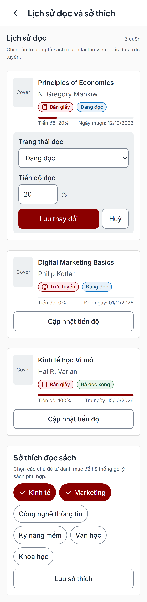

# Screen Spec: S-F03-02 Reading history and preferences

| Field | Value |
|---|---|
| Screen ID | `S-F03-02` |
| Screen name | Reading history and preferences |
| Vietnamese title | Lịch sử đọc và sở thích |
| Frame width | 360px (export 3x = 1080px) |
| Actor | Reader |
| Priority | Should |
| Feature | F-03 Discovery, Reading History & Recommendation |
| Activity diagrams | `AD-UC-07` |
| Wireframe source | [s_f03_02.html](../src/s_f03_02.html) |
| Mockup image | [s_f03_02.png](../img/s_f03_02/s_f03_02.png) |
| Author | Trieu |
| Status | Draft |

---

## 1. Purpose

**Shown when:**
- A signed-in reader selects "Lịch sử đọc" (Reading history) from the existing OPAC Personal Area (`AD-UC-07` action `r1`).
- Or a reader taps the «Sở thích» button in the `S-F03-07` (Book recommendations) header, at any time (D10b), or the "Thiết lập sở thích đọc ngay" prompt link on `S-F03-07` when no reading data is available yet.
- Or returns directly from `S-F00-02` after completing reader sign-in (if the screen was initially opened without an active session).

**The user leaves this screen when:**
- The reader taps the Back navigation button (`<`) in the screen header, returning to the existing OPAC Personal Area (or back to `S-F03-07` if originally invoked from the recommendations prompt).

---

## 2. Mockup

### State Mockup Inventory

| State | Image file | Description |
|---|---|---|
| Default | [s_f03_02.png](../img/s_f03_02/s_f03_02.png) | Standard view displaying reading history list with status badges, progress bars, update triggers, and subject preference chips. |
| Numbered | [s_f03_02_numbered.png](../img/s_f03_02/s_f03_02_numbered.png) | Default view with numbered callouts matching Section 3 Element Inventory. |
| Empty | [s_f03_02_empty.png](../img/s_f03_02/s_f03_02_empty.png) | Empty history state when the reader has zero loan and zero online reading records; preferences section remains visible and editable. |
| Loading | [s_f03_02_loading.png](../img/s_f03_02/s_f03_02_loading.png) | Skeleton cards and lines displayed during data retrieval (`MSG-05`). |
| Error (Inline) | [s_f03_02_error.png](../img/s_f03_02/s_f03_02_error.png) | Inline error state when an invalid reading progress percentage (e.g. 120%) is entered. |
| Error (Numbered) | [s_f03_02_error_numbered.png](../img/s_f03_02/s_f03_02_error_numbered.png) | Inline error state with numbered callout on the inline alert element. |
| Error (Page load) | [s_f03_02_error_2.png](../img/s_f03_02/s_f03_02_error_2.png) | Page-level network or system error banner with `MSG-04` and "Thử lại" action. |
| Success | [s_f03_02_success.png](../img/s_f03_02/s_f03_02_success.png) | Success state with updated progress/preferences and floating toast confirmation. |

*Visual styling strictly follows design tokens defined in [ui_conventions.md#6-design-tokens](../../ui_conventions.md#6-design-tokens).*

---

## 3. Element inventory

| # | Element | Type | Content / data source | Required | Validation |
|---|---|---|---|---|---|
| 1 | Back navigation | Screen header | Icon button `<` (Quay lại); returns to OPAC Personal Area or S-F03-07 | Yes | none |
| 2 | Screen title | Screen header | Static text: “Lịch sử đọc và sở thích” | Yes | none |
| 3 | History section title | Headings | Static text: “Lịch sử đọc” with count badge (e.g. “3 cuốn”) and subtext | Yes | none |
| 4 | Reading history entry | Book card | Book catalogue › title, author, neutral grey “Cover” placeholder; loan/read timestamp (e.g. “12/10/2026”), format label (“Bản giấy” / “Trực tuyến”) with icon, and reading status badge | Yes | none |
| 5 | Reading status badge | Status badge | Reading history & preferences › reading status; exactly two states: “Đang đọc” (info style) or “Đã đọc xong” (success style) | Yes | none |
| 6 | Progress indicator | Progress bar | Reading history & preferences › reading progress; numeric percentage (0–100%) and visual progress bar fill | Yes | none |
| 7 | Update progress trigger | Secondary button | Static text: “Cập nhật tiến độ”; expands inline edit panel on the selected history card | Yes | none |
| 8 | Status selector | Select | Dropdown with exactly two options: “Đang đọc” (Reading) and “Đã đọc xong” (Finished) | Yes | Must be one of the two allowed values (`FR-03-04`) |
| 9 | Progress input | Text input | Integer field with “%” suffix; pre-filled with current reading progress | Yes | Integer between 0 and 100 inclusive (`FR-03-04`, `FR-03-22`) |
| 10 | Save progress button | Primary button | Static text: “Lưu thay đổi”; single primary button on screen; submits updated status & progress | Yes | none |
| 11 | Cancel edit button | Secondary button | Static text: “Huỷ”; collapses inline edit panel without saving changes | Yes | none |
| 12 | Preferences section title | Headings | Static text: “Sở thích đọc sách” with subtext “Chọn các chủ đề từ danh mục để hệ thống gợi ý sách phù hợp.” | Yes | none |
| 13 | Subject selector | Multi-select chips | One chip per active catalogue subject: “Kinh tế”, “Marketing”, “Công nghệ thông tin”, “Kỹ năng mềm”, “Văn học”, “Khoa học”; each chip toggles on its own (selected = fill + check icon) (S-F03-02 Q5) | No | Must be valid active subjects in synced catalogue (`FR-03-05`) |
| 14 | Save preferences button | Secondary button | Static text: “Lưu sở thích”; validates and saves selected subjects | Yes | none |
| 15 | Empty history message | Empty state | `MSG-13`: “Chưa có lịch sử đọc nào. Sách bạn mượn hoặc đọc trực tuyến sẽ tự động xuất hiện tại đây.” with book icon ([ui_conventions.md](../../ui_conventions.md) §4; D24) | Yes | none |
| 16 | Invalid progress error | Inline error | Red 2px border, “!” icon, and static text: “Tiến độ đọc phải từ 0% đến 100%. Dữ liệu đã lưu trước đó được giữ nguyên.” | Yes | none |
| 17 | Page-level load error | Banner | Static text: “Không tải được trang. Bạn kiểm tra kết nối mạng rồi thử lại.” (`MSG-04`) with secondary button “Thử lại” | Yes | none |
| 18 | Success confirmation | Toast | Floating toast with text: “Đã cập nhật tiến độ đọc.” or “Đã lưu sở thích đọc.” | Yes | none |
| 19 | Loading placeholder | Skeleton | Skeleton cards and lines for reading history entries and subject chips | Yes | none |

---

## 4. States

| State | What the user sees | Trigger |
|---|---|---|
| Default | Reading history list showing 3 books with format labels, status badges, progress bars, and update triggers. Below is the subject preferences section with subject chips. | Reader navigates to S-F03-02 with an active session and existing history data. |
| Empty (no data) | Empty state with book icon and `MSG-13` “Chưa có lịch sử đọc nào. Sách bạn mượn hoặc đọc trực tuyến sẽ tự động xuất hiện tại đây.” (D24); preferences section remains visible and editable. | Active reader session has zero loan transactions and zero online reading records (`FR-03-01*`). |
| Loading | Skeleton cards and lines across history and preferences sections (`aria-busy="true"`). | Screen initial load or network retrieval in progress (`MSG-05`). |
| Error (Inline) | 2px red border around progress input (#9), inline error with “!” (#16) appears directly under input; previous saved progress (e.g. 20%) is retained without data loss. Also handles invalid subject preferences (`AD-UC-07 d4 [No]`). | Reader submits a progress value outside 0–100% (e.g. 120%) or invalid subject choices (`FR-03-22`). |
| Error (Page load) | Page-level banner (`banner.error`) with text `MSG-04` and secondary button “Thử lại”. | Network failure or Library Core System unresponsive during initial page load (`FR-04-20`). |
| Success / confirmation | Updated progress (e.g. 65%) or subject preferences reflected in UI; floating toast notification (`.toast.is-floating`) “Đã cập nhật tiến độ đọc.” appears for 4 seconds (ui-conventions §3 Toast). | Reader successfully submits valid status & progress or valid preferences. |

---

## 5. Interactions and navigation

| # | Element | User action | System response | Goes to screen |
|---|---|---|---|---|
| 1 | Entry without session | Reader opens S-F03-02 without active session | System intercepts unauthenticated access; displays sign-in prompt modal | `M-F00-01` (variant `MSG-01`; see [screen_spec_s_f00_01.md](screen_spec_s_f00_01.md) §3.1) |
| 2 | Back navigation (#1) | Tap `<` button | Returns to referrer | Existing OPAC personal area (or `S-F03-07` if arrived from recommendations prompt) |
| 3 | Cập nhật tiến độ (#7) | Tap button on history card | Expands inline edit panel (#8, #9, #10, #11) on that card; pre-fills current status and progress | `stays` |
| 4 | Lưu thay đổi (#10) [valid] | Tap “Lưu thay đổi” with progress in 0–100% | Validates input; saves status and progress to Library Core System; collapses edit panel; updates card view; displays floating toast (#18) | `stays` |
| 5 | Lưu thay đổi (#10) [invalid] | Tap “Lưu thay đổi” with progress < 0% or > 100% | Rejects update; retains existing saved progress in database; applies 2px red border to input and displays inline error (#16) | `stays` (`FR-03-22`) |
| 6 | Huỷ (#11) | Tap “Huỷ” button | Discards unsaved form input; collapses inline edit panel; reverts to previous values | `stays` |
| 7 | Subject chips (#13) | Tap a chip | Toggles the selected state of that subject | `stays` |
| 8 | Lưu sở thích (#14) | Tap “Lưu sở thích” button | Validates subjects against synced catalogue; persists preferences; displays floating toast (#18) | `stays` (`FR-03-05`) |
| 9 | Thử lại (#17) | Tap “Thử lại” button on error banner | Retries fetching reading history and preferences from backend | `stays` |

---

## 6. Screen-level rules

| Rule ID | Rule | Source |
|---|---|---|
| SR-F03-02-001 | Unauthenticated access strictly opens modal `M-F00-01` with message `MSG-01` (“Bạn cần đăng nhập bằng thẻ thư viện để xem và quản lý lịch sử đọc.”). Successful login via `S-F00-01` → `S-F00-02` returns directly to `S-F03-02`. | `FR-04-08`, `AD-UC-07 d1, c1`, [ui_conventions.md](../../ui_conventions.md) §4 |
| SR-F03-02-002 | Reading progress must be an integer constrained strictly between 0 and 100 inclusive. | `FR-03-04`, `AD-UC-07 r2` |
| SR-F03-02-003 | If validation of reading progress or reading preferences fails, the system must retain previously saved data without data loss or corruption. | `FR-03-22`, `AD-UC-07 d3 [No]` |
| SR-F03-02-004 | Reading status and reading progress are decoupled inputs: a reader can mark a book as "Đã đọc xong" (Finished) even if progress is recorded at less than 100%. | `AD-UC-07 Q4` |
| SR-F03-02-005 | Reading history entries are populated automatically via daily loan sync (`FR-03-03`) or online book access (`FR-03-02`). There is no manual "Add book to history" button. Each borrow transaction creates a discrete history row. | `W0 Table 3`, `AD-UC-07 Q2` |
| SR-F03-02-006 | Reading preferences subjects must only be selected from active subjects synced from the library catalogue. | `FR-03-05`, `AD-UC-07 Q3` |
| SR-F03-02-007 | Only one Primary button is permitted on the screen at any time: “Lưu thay đổi” (#10) is Primary; “Lưu sở thích” (#14) is Secondary. | [ui_conventions.md](../../ui_conventions.md) §3 |
| SR-F03-02-008 | Information must never be conveyed by colour alone: format labels include distinct SVG icons and text; reading status badges include borders and text; inline error includes warning icon `!`. | [ui_conventions.md](../../ui_conventions.md) §5 |

---

## 7. Linked requirements

| FR ID | What this screen does for it |
|---|---|
| FR-03-01 | Displays the reader's complete reading history with titles, authors, format, and timestamps. |
| FR-03-02 | Displays reading history entries automatically generated when signed-in readers access online books. |
| FR-03-03 | Displays reading history entries automatically generated via daily loan records sync. |
| FR-03-04 | Provides controls to update reading status (“Đang đọc” / “Đã đọc xong”) and reading progress percentage (0–100%). |
| FR-03-05 | Allows the reader to select and save subject preferences from the active library catalogue. |
| FR-03-22 | Rejects invalid reading progress (>100% or <0%), displays an inline error alert, and preserves previously saved data. |
| FR-04-08 | Enforces active reader session verification prior to displaying reading history or preferences. |
| FR-04-20 | Displays `MSG-04` error banner with a retry button when network or backend data loading fails. |

---

## 8. Responsive and accessibility notes

- **Smallest supported width:** 360px (Reader mobile frame width; exported at 3x DPR = 1080px).
- **Collapses or stacks on narrow screen:** Inline edit form stacks controls vertically (Select dropdown, then Number input, followed by button row with Primary "Lưu thay đổi" and Secondary "Huỷ"). Subject chips wrap onto as many lines as needed; each chip keeps the 44px minimum target.
- **Information never carried by colour alone:**
  - Access format uses both icon (open book for physical, globe for online) and explicit Vietnamese text ("Bản giấy", "Trực tuyến").
  - Reading status badge uses distinct border styling and text ("Đang đọc", "Đã đọc xong").
  - Inline error uses exclamation mark icon `!` and 2px border alongside red text.
- **Text contrast and minimum size:**
  - Header font: Plus Jakarta Sans 20px (`--font-heading`).
  - Body text: Inter 16px (`--font-size-body`), line height 1.5.
  - Interactive touch targets: minimum 48px height (`--size-control`) with minimum 44px hit area.
  - Form inputs provide clear `:focus-visible` outline (3px focus ring).

---

## 9. Open questions

None. Decisions: see [decision_index.md](../../../project_brief/decision_index.md#s-f03-02).

---

## Completion checklist

- [x] The mockup is a separate cropped image file, named with the Screen ID ([s_f03_02.png](../img/s_f03_02/s_f03_02.png)).
- [x] Every visible element in the mockup appears in the element inventory (#1 to #19).
- [x] Every input element has a validation rule or an explicit "none".
- [x] All five states are filled in (Default, Empty, Loading, Error, Success).
- [x] Every navigation target is a Screen ID that exists in the Screen List (`M-F00-01`, `S-F03-07`, `stays`).
- [x] Every element that displays data names the field it displays.
- [x] Every linked FR exists in the Function List, and every action of this screen in an activity diagram is covered by an interaction row.
- [x] Modal trigger references `M-F00-01` with specific message variant (`MSG-01`).
- [x] Screen spec written in English with Vietnamese UI strings strictly preserved.
