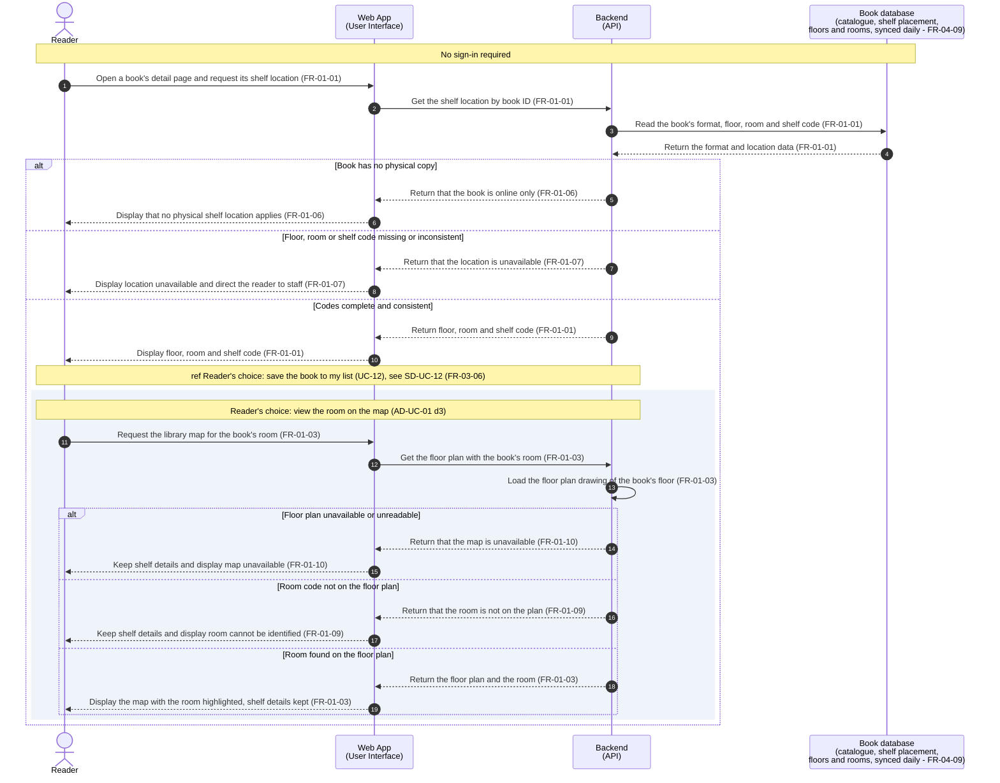

# Sequence Diagram: SD-UC-01 View book shelf location

| Field | Value |
|---|---|
| SD ID | SD-UC-01 |
| Use case | UC-01 View book shelf location |
| Feature | F-01 Book Location & Library Map |
| Primary actor | Reader |
| Participants | Reader · Web App · Backend · Book database |
| Trigger | The reader opens a book's detail page and asks for its shelf location |
| Preconditions | None for the reader: no sign-in is needed (W0 Table 1). The catalogue and shelf placement have been synced from the Library Internal System (FR-04-09). |
| FRs covered | FR-01-01, FR-01-03, FR-01-06, FR-01-07, FR-01-09, FR-01-10 |
| Activity diagram | [AD-UC-01](../../activity_diagram/ad_uc_01.md) |
| Redrawn from | `User Interface Flow-2026-10-12-031728.png` |
| Version / status | v2.1 · Draft |

## 1. Diagram

Blue sections are choices of the actor, grey sections run automatically, and `alt` / `opt` are system
conditions. Reading rules: [sequence_index.md](sequence_index.md#drawing-rules).

## 2. Changes from the original diagram

- Split from the combined UC-01 + UC-02 image (Inputs check 4). The map browsing is now in SD-UC-02.
- The optional map link is a reader's choice, so it is a marked section instead of `opt` (Inputs check 5).
- The floor plan is loaded by the Backend, not read from the Book database: W0 Table 4 says the drawing is a fixed asset.
- Added the edge cases of AD-UC-01: FR-01-06, FR-01-07, FR-01-09, FR-01-10.
- v2.1 (23/11/2026): the call to UC-12 (save the book), as `c1` in AD-UC-01.
