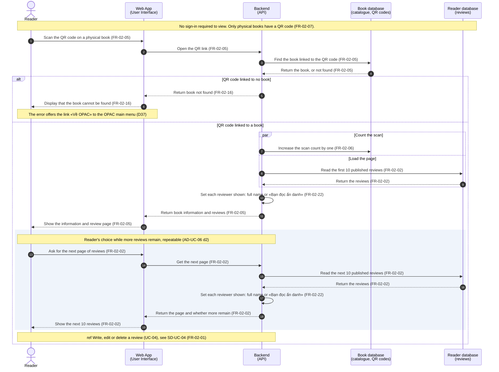

# Sequence Diagram: SD-UC-06 Access book information and reviews via QR code (physical books; reviews via UC-04)

| Field | Value |
|---|---|
| SD ID | SD-UC-06 |
| Use case | UC-06 Access book information and reviews via QR code (physical books; reviews via UC-04) |
| Feature | F-02 Reviews & QR |
| Primary actor | Reader |
| Participants | Reader · Web App · Backend · Book database · Reader database |
| Trigger | The reader scans the QR code on a physical book |
| Preconditions | The book has a QR code (FR-02-07) and a printed label (UC-10). No sign-in is needed to view the page. |
| FRs covered | FR-02-02, FR-02-05, FR-02-06, FR-02-16, FR-02-22 |
| Activity diagram | [AD-UC-06](../../activity_diagram/ad_uc_06.md) |
| Redrawn from | `Book Review API Interaction-2026-10-12-032039.png` |
| Version / status | v2.1 · Draft |

## 1. Diagram

Blue sections are choices of the actor, grey sections run automatically, and `alt` / `opt` are system
conditions. Reading rules: [sequence_index.md](sequence_index.md#drawing-rules).

## 2. Changes from the original diagram

- Split from the combined UC-06 + UC-04 image (Inputs check 4). Writing a review is now in SD-UC-04.
- The old step with two FRs is now two steps, drawn in parallel as in the fork of AD-UC-06.
- Added the QR code linked to no book (FR-02-16) and the next page of reviews (D6).
- v2.1 (23/11/2026): added the reviewer name (FR-02-22) and the way out of the invalid-QR error (D37), as in AD-UC-06 v1.3.
