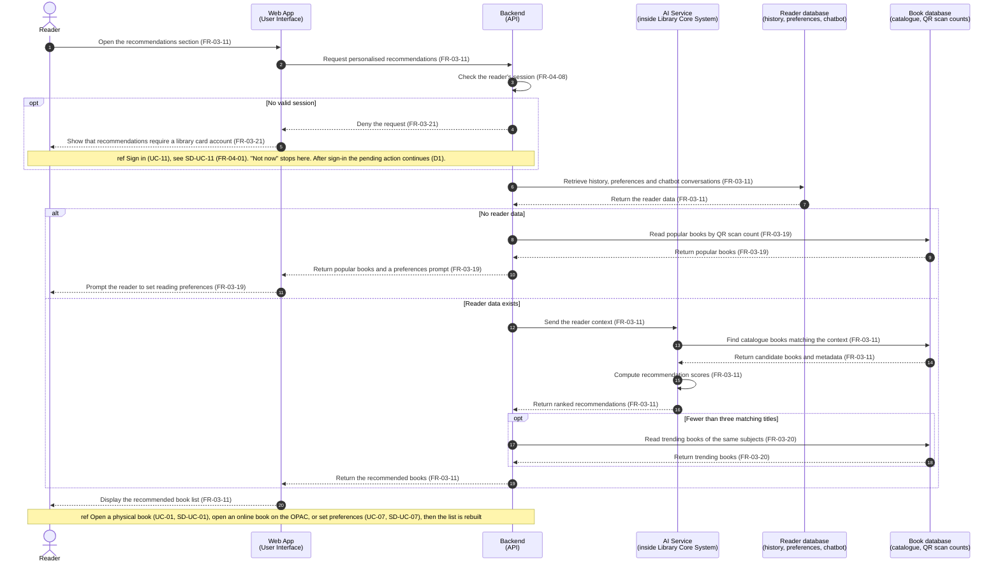

# Sequence Diagram: SD-UC-09 Automatic personalised book recommendations

| Field | Value |
|---|---|
| SD ID | SD-UC-09 |
| Use case | UC-09 Automatic personalised book recommendations |
| Feature | F-03 Discovery, Reading History & Recommendation |
| Primary actor | Reader |
| Participants | Reader · Web App · Backend · AI Service · Reader database · Book database |
| Trigger | The reader opens the recommendations section |
| Preconditions | The reader may not be signed in yet: the flow checks the session and shows a sign-in prompt (FR-03-21). |
| FRs covered | FR-03-11, FR-03-19, FR-03-20, FR-03-21, FR-04-08 |
| Activity diagram | [AD-UC-09](../../activity_diagram/ad_uc_09.md) |
| Redrawn from | `Reader Interaction Flow-2026-10-12-031246.png` |
| Version / status | v2.1 · Draft |

## 1. Diagram

Blue sections are choices of the actor, grey sections run automatically, and `alt` / `opt` are system
conditions. Reading rules: [sequence_index.md](sequence_index.md#drawing-rules).

## 2. Changes from the original diagram

- Split from the combined UC-07 + UC-09 image (Inputs check 4).
- Added the sign-in prompt (FR-03-21), popular books when there is no reader data (FR-03-19) and the top-up (FR-03-20).
- v2.1 (23/11/2026): a recommended online book opens on the OPAC (AD-UC-09 v1.3).
