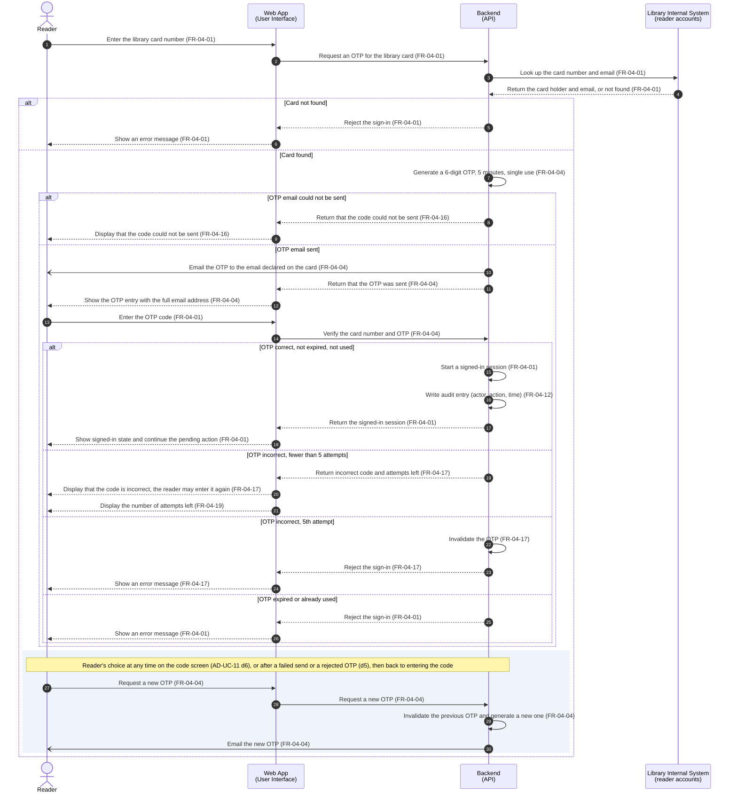

# Sequence Diagram: SD-UC-11 Register and sign in (library card with email OTP)

| Field | Value |
|---|---|
| SD ID | SD-UC-11 |
| Use case | UC-11 Register and sign in (library card with email OTP) |
| Feature | F-04 Platform, Access & Operations |
| Primary actor | Reader |
| Participants | Reader · Web App · Backend · Library Internal System |
| Trigger | The reader submits their library card number, directly or from the "Sign in (UC-11)" step of another use case |
| Preconditions | The reader holds a library card whose record in the Library Internal System has an email address. |
| FRs covered | FR-04-01, FR-04-04, FR-04-12, FR-04-16, FR-04-17, FR-04-19 |
| Activity diagram | [AD-UC-11](../../activity_diagram/ad_uc_11.md) |
| Redrawn from | `Library Sign-In OTP Pipeline-2026-10-12-035036.pdf` |
| Version / status | v2.2 · Draft |

## 1. Diagram

Blue sections are choices of the actor, grey sections run automatically, and `alt` / `opt` are system
conditions. Reading rules: [sequence_index.md](sequence_index.md#drawing-rules).

## 2. Changes from the original diagram

- The image had no FR labels. Every step now cites one FR.
- Added a failed OTP email (FR-04-16), the 5-attempt limit (FR-04-17, FR-04-19) and a new OTP (FR-04-04).
- The full email is shown (D2). The pending action continues after sign-in (D1).
- v2.1 (23/11/2026): the incorrect-code message and the attempts left are two steps, as `s9` and `s13` in AD-UC-11 v1.3.
- v2.2 (23/11/2026): a new OTP can be requested at any time on the code screen (AD-UC-11 v1.4).
