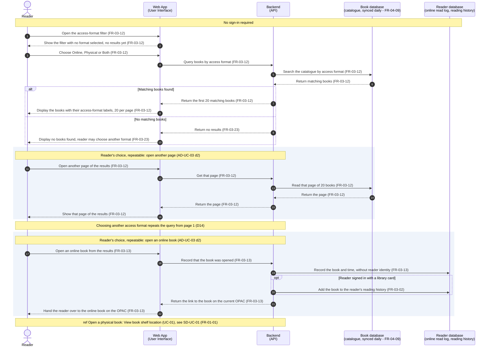

# Sequence Diagram: SD-UC-03 Filter books by access format (online, physical or both)

| Field | Value |
|---|---|
| SD ID | SD-UC-03 |
| Use case | UC-03 Filter books by access format (online, physical or both) |
| Feature | F-03 Discovery, Reading History & Recommendation |
| Primary actor | Reader |
| Participants | Reader · Web App · Backend · Book database · Reader database |
| Trigger | The reader opens the access-format filter |
| Preconditions | No sign-in is needed (W0 Table 1). The catalogue, with the access format of each book, has been synced (FR-04-09). |
| FRs covered | FR-03-02, FR-03-12, FR-03-13, FR-03-23 |
| Activity diagram | [AD-UC-03](../activity/ad-uc-03.md) |
| Redrawn from | `User Interface Flow-2026-10-12-032159.png` |
| Version / status | v2.1 · Draft |

## 1. Diagram

Blue sections are choices of the actor, grey sections run automatically, and `alt` / `opt` are system
conditions. Reading rules: [sequence-index.md](sequence-index.md#drawing-rules).

## 2. Changes from the original diagram

- Added the no-result case (FR-03-23) and opening an online book (FR-03-13, FR-03-02), as in AD-UC-03.
- The filter opens with no format selected (D19).
- v2.1 (23/11/2026): added paging, 20 books per page, and the return to page 1 when the format changes (FR-03-12; D9, D14, D33).
