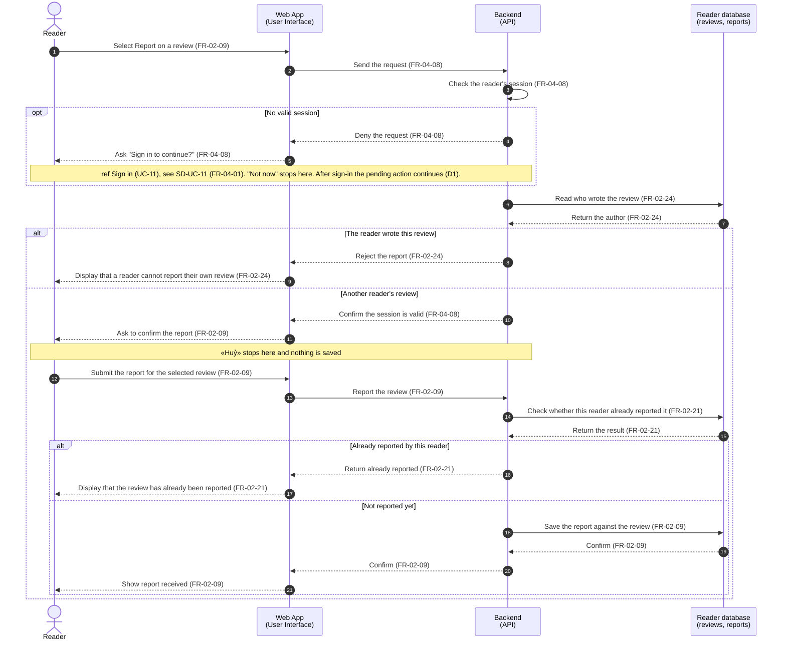

# Sequence Diagram: SD-UC-14 Report a review that violates rules

| Field | Value |
|---|---|
| SD ID | SD-UC-14 |
| Use case | UC-14 Report a review that violates rules |
| Feature | F-02 Reviews & QR |
| Primary actor | Reader |
| Participants | Reader · Web App · Backend · Reader database |
| Trigger | The reader selects Report on a review (usually from UC-05) |
| Preconditions | The review is on public display. The reader may not be signed in yet: the flow checks the session (FR-04-08) and calls Sign in (UC-11). |
| FRs covered | FR-02-09, FR-02-21, FR-02-24, FR-04-08 |
| Activity diagram | [AD-UC-14](../activity/ad-uc-14.md) |
| Redrawn from | `User Review Reporting Flow-2026-10-12-035252.pdf` |
| Version / status | v2.1 · Draft |

## 1. Diagram

Blue sections are choices of the actor, grey sections run automatically, and `alt` / `opt` are system
conditions. Reading rules: [sequence-index.md](sequence-index.md#drawing-rules).

## 2. Changes from the original diagram

- Split from the combined UC-14 + UC-13 image (Inputs check 4). Staff handling is now in SD-UC-13.
- Added the session check, the confirmation step and the duplicate report rule (FR-02-21).
- v2.1 (23/11/2026): a reader cannot report their own review, also when the report was requested before sign-in (FR-02-24, D39, AD-UC-14 v1.4).
