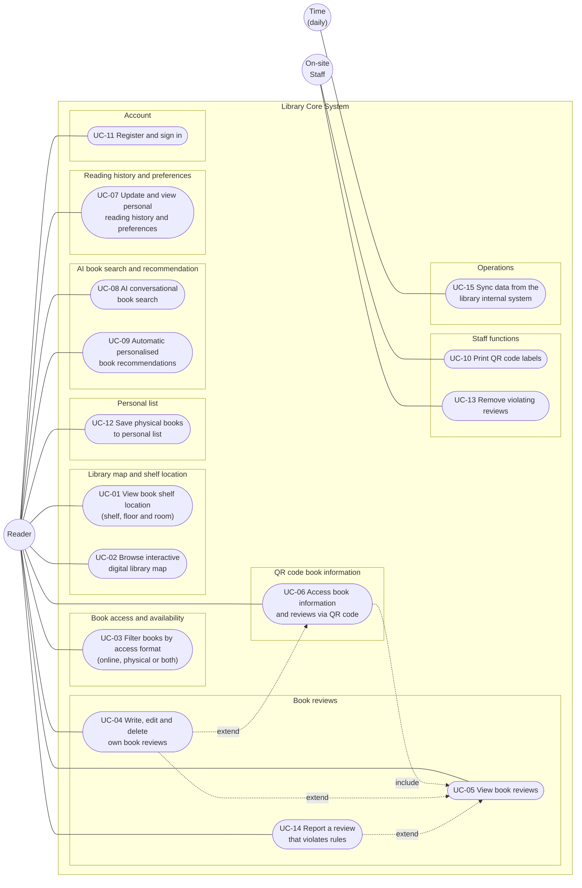

# Use Cases: Group H Library Core System

Who uses the system for what, and the full list of use cases with links to their activity and sequence diagrams.

| Field | Value |
|---|---|
| Version | v1.0 · 23/11/2026 |
| Redrawn from | [Use case diagram.pdf @ cd61897](https://github.com/chihvcte-beep/dbiz2-group-h/blob/cd61897/%5BDBIZ%202%5D%20GROUP%20H/Use%20case%20diagram.pdf) (original, kept in Git history) and W0 Table 1 of the frozen workbook |
| Status | Draft, waiting for group review |
| Changes from the PDF | Applied the changes agreed on 23/11/2026 (D48; check of 23/11/2026): UC-15 added, started by time; On-site Staff no longer linked to UC-11 (staff sign in with their internal account, FR-04-07); relation UC-14 → UC-06 removed; UC-04 and UC-14 now extend UC-05. UC-14 is named as in W0 Table 1. |

## 1. Diagram

Rounded boxes are use cases, grouped by area as in the original. Dotted arrows are `include` and `extend`
relations; an `extend` arrow points from the optional use case to the one it extends.

## 2. Actors

| Actor | Who | Signs in with |
|---|---|---|
| Reader | Anyone using the library's OPAC. Some use cases need a library card. | Library card number and a one-time code sent to the card's email (UC-11) |
| On-site Staff | Library staff in the reading rooms | Their internal library account (FR-04-07), not UC-11 |
| Time | The daily schedule that starts the sync; the data comes from the Library Internal System | Not a person |

## 3. Use case inventory (W0 Table 1)

Priority is the effective priority of the use case's main FR in [fr-list.md](../function-list/fr-list.md).

| Use case | Name | Primary actor | Feature | Sign-in required | Priority | Activity diagram | Sequence diagram |
|---|---|---|---|---|---|---|---|
| UC-01 | View book shelf location | Reader | F-01 | No | Must | [ad-uc-01.md](../activity/ad-uc-01.md) | [sd-uc-01.md](sd-uc-01.md) |
| UC-02 | Browse interactive digital library map | Reader | F-01 | No | Must | [ad-uc-02.md](../activity/ad-uc-02.md) | [sd-uc-02.md](sd-uc-02.md) |
| UC-03 | Filter books by access format (online, physical or both) | Reader | F-03 | No | Should | [ad-uc-03.md](../activity/ad-uc-03.md) | [sd-uc-03.md](sd-uc-03.md) |
| UC-04 | Write, edit and delete own book reviews | Reader | F-02 | Yes | Must | [ad-uc-04.md](../activity/ad-uc-04.md) | [sd-uc-04.md](sd-uc-04.md) |
| UC-05 | View book reviews | Reader | F-02 | No | Must | [ad-uc-05.md](../activity/ad-uc-05.md) | [sd-uc-05.md](sd-uc-05.md) |
| UC-06 | Access book information and reviews via QR code (physical books; reviews via UC-04) | Reader | F-02 | No | Must | [ad-uc-06.md](../activity/ad-uc-06.md) | [sd-uc-06.md](sd-uc-06.md) |
| UC-07 | Update and view personal reading history and preferences | Reader | F-03 | Yes | Should | [ad-uc-07.md](../activity/ad-uc-07.md) | [sd-uc-07.md](sd-uc-07.md) |
| UC-08 | AI-based conversational book search | Reader | F-03 | Yes | Could | [ad-uc-08.md](../activity/ad-uc-08.md) | [sd-uc-08.md](sd-uc-08.md) |
| UC-09 | Automatic personalised book recommendations | Reader | F-03 | Yes | Could | [ad-uc-09.md](../activity/ad-uc-09.md) | [sd-uc-09.md](sd-uc-09.md) |
| UC-10 | Print QR code labels for physical books (QR codes are generated automatically) | On-site Staff | F-02 | Staff login | Must | [ad-uc-10.md](../activity/ad-uc-10.md) | [sd-uc-10.md](sd-uc-10.md) |
| UC-11 | Register and sign in (library card with email OTP) | Reader | F-04 | No | Must | [ad-uc-11.md](../activity/ad-uc-11.md) | [sd-uc-11.md](sd-uc-11.md) |
| UC-12 | Save physical books to a personal list for finding them later in the library, and remove them from the list | Reader | F-03 | Yes | Should | [ad-uc-12.md](../activity/ad-uc-12.md) | [sd-uc-12.md](sd-uc-12.md) |
| UC-13 | Remove reviews that violate rules | On-site Staff | F-02 | Staff login | Could | [ad-uc-13.md](../activity/ad-uc-13.md) | [sd-uc-13.md](sd-uc-13.md) |
| UC-14 | Report a review that violates rules | Reader | F-02 | Yes | Could | [ad-uc-14.md](../activity/ad-uc-14.md) | [sd-uc-14.md](sd-uc-14.md) |
| UC-15 | Sync data from the library internal system | Time (daily sync); data from the Library Internal System | F-04 | No (no person) | Must | [ad-uc-15.md](../activity/ad-uc-15.md) | [sd-uc-15.md](sd-uc-15.md) |

Indexes: [activity-index.md](../activity/activity-index.md) · [sequence-index.md](sequence-index.md).

## 4. Relations

| Relation | Meaning |
|---|---|
| UC-06 include UC-05 | The QR landing page always shows the book's reviews. |
| UC-04 extend UC-06 | From the QR page a signed-in reader may write, edit or delete own review (L8-07). |
| UC-04 extend UC-05 | From a book's reviews (S-F02-01) a signed-in reader may write, edit or delete own review (L8-17; AD-UC-05 `c2`–`c4`). |
| UC-14 extend UC-05 | From a book's reviews (S-F02-01) a signed-in reader may report another reader's review. Not on the QR page: S-F02-02 omits Report ([screen-spec-s-f02-02.md](../external-design/screens/specs/screen-spec-s-f02-02.md) SR-001), so the original UC-14 → UC-06 arrow was removed. |
