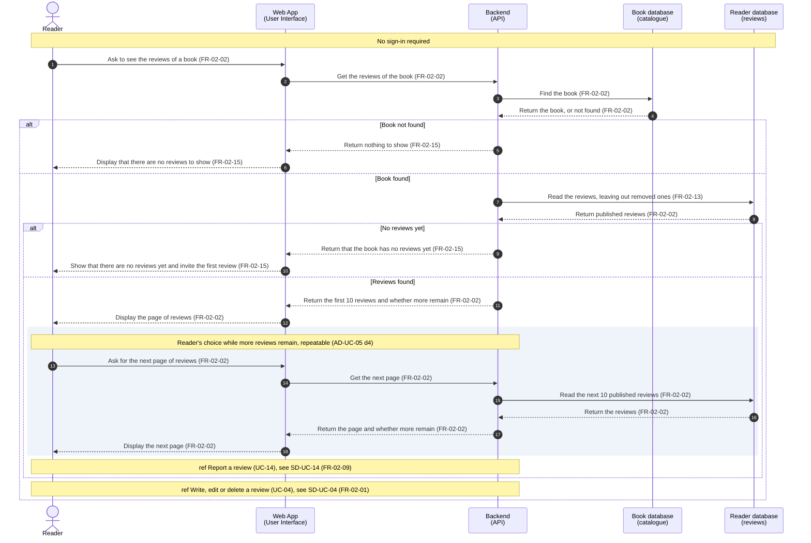

# Sequence Diagram: SD-UC-05 View book reviews

| Field | Value |
|---|---|
| SD ID | SD-UC-05 |
| Use case | UC-05 View book reviews |
| Feature | F-02 Reviews & QR |
| Primary actor | Reader |
| Participants | Reader · Web App · Backend · Book database · Reader database |
| Trigger | The reader asks to see the reviews of a book |
| Preconditions | None: no sign-in is needed to read reviews (W0 Table 1). |
| FRs covered | FR-02-02, FR-02-13, FR-02-15 |
| Activity diagram | [AD-UC-05](../activity/ad_uc_05.md) |
| Redrawn from | `User Review Interaction Flow-2026-10-12-032334.png` |
| Version / status | v2.1 · Draft |

## 1. Diagram

Blue sections are choices of the actor, grey sections run automatically, and `alt` / `opt` are system
conditions. Reading rules: [sequence_index.md](sequence_index.md#drawing-rules).

## 2. Changes from the original diagram

- Split from the combined UC-05 + UC-04 image (Inputs check 4). Edit and delete are now in SD-UC-04.
- Added: book not found or no reviews (FR-02-15), removed reviews left out (FR-02-13), 10 reviews per page (D6).
- v2.1 (23/11/2026): a book with no reviews yet invites the first review, and the page calls UC-04 (AD-UC-05 v1.2, L8-17).
