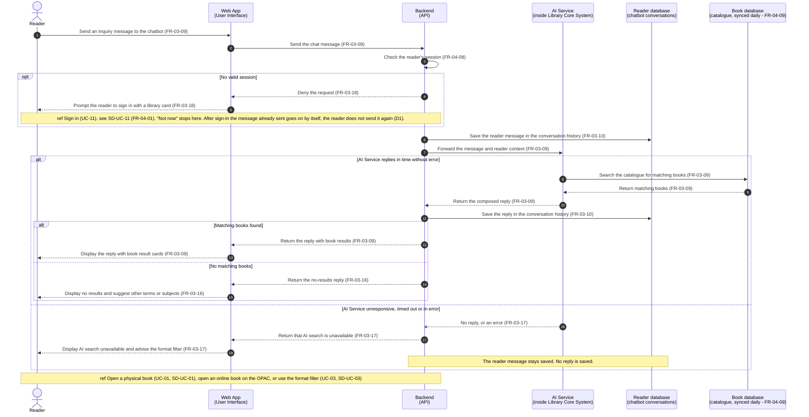

# Sequence Diagram: SD-UC-08 AI-based conversational book search

| Field | Value |
|---|---|
| SD ID | SD-UC-08 |
| Use case | UC-08 AI-based conversational book search |
| Feature | F-03 Discovery, Reading History & Recommendation |
| Primary actor | Reader |
| Participants | Reader · Web App · Backend · AI Service · Reader database · Book database |
| Trigger | The reader sends an inquiry message to the chatbot |
| Preconditions | The reader may not be signed in yet: the flow checks the session and prompts sign-in with a library card (FR-03-18). |
| FRs covered | FR-03-09, FR-03-10, FR-03-16, FR-03-17, FR-03-18, FR-04-08 |
| Activity diagram | [AD-UC-08](../activity/ad_uc_08.md) |
| Redrawn from | `AI Service Chatbot-2026-10-12-032513.png` |
| Version / status | v2.2 · Draft |

## 1. Diagram

Blue sections are choices of the actor, grey sections run automatically, and `alt` / `opt` are system
conditions. Reading rules: [sequence_index.md](sequence_index.md#drawing-rules).

## 2. Changes from the original diagram

- Added the sign-in prompt (FR-03-18), no results (FR-03-16) and AI failure (FR-03-17), as in AD-UC-08.
- Participant names are cleaned (the image showed "WebApp as Web App").
- v2.1 (23/11/2026): the note on sign-in now says that the message goes on by itself (D1, AD-UC-08 v1.3).
- v2.2 (23/11/2026): an online book card opens the book on the OPAC (AD-UC-08 v1.4).
