# Sequence Diagram: SD-UC-10 Print QR code labels for physical books (QR codes are generated automatically)

| Field | Value |
|---|---|
| SD ID | SD-UC-10 |
| Use case | UC-10 Print QR code labels for physical books (QR codes are generated automatically) |
| Feature | F-02 Reviews & QR |
| Primary actor | On-site Staff; the automatic QR generation is started by time (daily sync finished) |
| Participants | On-site Staff · Web App · Backend · Book database · Library Internal System |
| Trigger | (a) On-site Staff open the staff page to print QR labels. (b) Time event: the daily catalogue sync has finished. |
| Preconditions | Staff have an internal library account (FR-04-07). The catalogue is synced daily (FR-04-09). |
| FRs covered | FR-02-07, FR-02-08, FR-02-17, FR-02-18, FR-02-23, FR-02-25, FR-04-07, FR-04-08, FR-04-12, FR-04-18, FR-04-21 |
| Activity diagram | [AD-UC-10](../activity/ad_uc_10.md) |
| Redrawn from | `QR Code Label Printing-2026-10-12-033525.png` |
| Version / status | v2.3 · Draft |

## 1. Diagram

Blue sections are choices of the actor, grey sections run automatically, and `alt` / `opt` are system
conditions. Reading rules: [sequence_index.md](sequence_index.md#drawing-rules).

```mermaid
---
config:
  sequence:
    actorMargin: 110
---
sequenceDiagram
  autonumber
  actor S as On-site Staff
  participant W as Web App<br/>(Staff page)
  participant B as Backend<br/>(API)
  participant BDB as Book database<br/>(catalogue, QR codes, label status)
  participant LIS as Library Internal System<br/>(staff accounts)
  S->>W: Open the staff page (FR-04-08)
  W->>B: Check the staff session and role (FR-04-08)
  opt No valid staff session or role
    B-->>W: Deny the request (FR-04-08)
    W-->>S: Show the staff sign-in (FR-04-08)
    loop Until sign-in succeeds or staff stop trying
      S->>W: Sign in with the internal library account (FR-04-07)
      W->>B: Submit the credentials (FR-04-07)
      B->>LIS: Verify the account and the staff role (FR-04-07)
      LIS-->>B: Return the verification result (FR-04-07)
      alt Valid account with the staff role
        B->>B: Start a staff session (FR-04-07)
        B->>B: Write audit entry (actor, action, time) (FR-04-12)
        B-->>W: Open the staff page (FR-04-07)
      else Wrong account or no staff role
        B-->>W: Reject the sign-in (FR-04-18)
        W-->>S: Show an error message (FR-04-18)
      end
    end
  end
  W-->>S: Show the staff page (FR-04-08)
  S->>W: Open QR label printing (FR-02-23)
  W->>B: Get physical books awaiting a QR label (FR-02-23)
  B->>BDB: Read books never labelled, 20 per page, by floor, room, shelf (FR-02-23)
  BDB-->>B: Return the page of books (FR-02-23)
  alt No book is waiting for a label
    B-->>W: Return an empty list (FR-02-23)
    W-->>S: Display that every physical book already has a printed label (FR-02-23)
  else At least one book is waiting
    B-->>W: Return the page of books (FR-02-23)
    W-->>S: Show the list of books awaiting a label (FR-02-23)
    rect rgba(120, 160, 220, 0.12)
      Note over S,B: Staff choice, repeatable: open another page (AD-UC-10 d7)
      S->>W: Open another page of the list (FR-02-23)
      W->>B: Get that page (FR-02-23)
      B->>BDB: Read that page (FR-02-23)
      BDB-->>B: Return the page (FR-02-23)
      B-->>W: Return the page (FR-02-23)
      W-->>S: Show that page, keeping the ticks (FR-02-23)
    end
    S->>W: Select physical books (FR-02-08)
    S->>W: Choose Print labels (FR-02-08)
    alt No book selected
      W-->>S: Ask to select at least one physical book (FR-02-17)
    else At least one book selected
      W->>B: Request the label sheet for the selected books (FR-02-08)
      B->>BDB: Read QR codes and primary shelf locations (FR-02-08)
      BDB-->>B: Return QR codes and locations (FR-02-08)
      alt None of the selected books has a QR code
        B-->>W: Return that no sheet can be produced (FR-02-18)
        W-->>S: List the books without a QR code (FR-02-18)
        rect rgba(120, 160, 220, 0.12)
          Note over S,W: Staff choice: select other books or stop (AD-UC-10 d12)
        end
      else At least one book has a QR code
        opt Some selected books have no QR code
          B-->>W: Return the books left out (FR-02-18)
          W-->>S: List the books left out (FR-02-18)
        end
        B->>B: Produce the label sheet, 24 labels per A4 page (FR-02-08)
        B-->>W: Return the printable sheet (FR-02-08)
        W-->>S: Show the label sheet preview (FR-02-08)
        S->>W: Print the QR code labels (FR-02-08)
        alt Labels printed correctly
          S->>W: Confirm «Đã in xong» (FR-02-08)
          W->>B: Record the sheet as printed (FR-02-08)
          B->>BDB: Record a printed label for each book on the sheet (FR-02-08)
          BDB-->>B: Confirm (FR-02-08)
          B->>B: Write audit entry (actor, action, time) (FR-04-12)
          B-->>W: Confirm (FR-02-08)
          W-->>S: Show the list without the printed books (FR-02-23)
          rect rgba(120, 160, 220, 0.12)
            Note over S,B: Staff choice: print another sheet from the reloaded list, or stop (AD-UC-10 d11)
          end
        else Print failed or staff close the preview
          S->>W: Close the preview «Đóng» (FR-02-08)
          W-->>S: Return to the list with ticks kept, nothing recorded (FR-02-08)
        end
      end
    end
  end
  rect rgba(120, 160, 220, 0.12)
    Note over S,B: Staff choice: the «Đã in nhãn» filter, to reprint labels for other copies (AD-UC-10 d13, D40)
    S->>W: Choose the «Đã in nhãn» filter (FR-02-25)
    W->>B: Get the books that already have a printed label (FR-02-25)
    B->>BDB: Read labelled books, 20 per page, by floor, room, shelf (FR-02-25)
    BDB-->>B: Return the page of books (FR-02-25)
    B-->>W: Return the page of books (FR-02-25)
    alt No book has a printed label yet
      W-->>S: Display that no book has a printed label yet (FR-02-25)
    else At least one labelled book
      W-->>S: Show the labelled books (FR-02-25)
      S->>W: Select books and choose «In lại nhãn» (FR-02-25)
      alt No book selected
        W-->>S: Ask to select at least one book (FR-02-17)
      else At least one book selected
        W->>B: Request the reprint sheet (FR-02-25)
        B->>BDB: Read the existing QR codes and titles (FR-02-25)
        BDB-->>B: Return QR codes and titles (FR-02-25)
        B-->>W: Return the reprint sheet, no shelf location (FR-02-25)
        W-->>S: Show the reprint preview (FR-02-25)
        S->>W: Print the labels (FR-02-25)
        alt Labels printed correctly
          S->>W: Confirm «Đã in xong» (FR-02-25)
          W->>B: Confirm the reprint (FR-02-25)
          B->>B: Write audit entry (actor, action, time) (FR-04-12)
          B-->>W: Confirm (FR-02-25)
          W-->>S: Keep the books in the labelled list (FR-02-25)
        else Print failed or staff close the preview
          S->>W: Close the preview «Đóng» (FR-02-25)
          W-->>S: Return to the list with ticks kept, nothing recorded (FR-02-25)
        end
      end
    end
  end
  rect rgba(120, 160, 220, 0.12)
    Note over S,B: Staff choice, available on every staff screen (D7)
    S->>W: Choose «Đăng xuất» (FR-04-21)
    W->>B: Close the staff session (FR-04-21)
    B-->>W: Confirm the session is closed (FR-04-21)
    W-->>S: Show the staff sign-in (FR-04-21)
  end
  rect rgba(150, 150, 150, 0.14)
    Note over B,BDB: Automatic: daily catalogue sync finished (FR-04-09)
    B->>BDB: Find the books added by the sync (FR-02-07)
    BDB-->>B: Return the new books (FR-02-07)
    loop Each new physical book without a QR code
      B->>BDB: Save one unique QR code linked to the book title (FR-02-07)
    end
  end
```

## 2. Changes from the original diagram

- Added the list of books awaiting a label (FR-02-23), «Đã in xong» / «Đóng» (FR-02-08, D12) and sign-out (FR-04-21, D7).
- Added staff sign-in with its audit entry and rejection (FR-04-07, FR-04-12, FR-04-18, D30), the selection errors (FR-02-17, FR-02-18) and QR generation (FR-02-07).
- v2.1 (23/11/2026): added opening QR label printing from the staff page, the empty list (MSG-11) and the choices to print another sheet or select other books (AD-UC-10 v1.6).
- v2.1 (23/11/2026): the audit entry of a label print is now written after «Đã in xong», not when the sheet is produced (D32).
- v2.2 (23/11/2026): one QR code per title, reprint from the «Đã in nhãn» filter with no shelf location (FR-02-25, D40), and 24 labels per A4 page with further pages when needed (D41).
- v2.3 (23/11/2026): the sheet is shown in the preview and printed with the browser print dialog, not as a PDF file.
