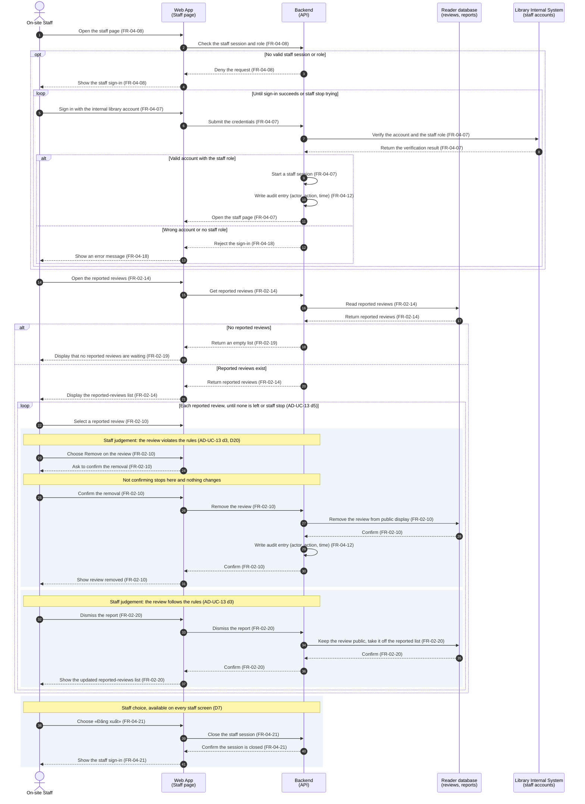

# Sequence Diagram: SD-UC-13 Remove reviews that violate rules

| Field | Value |
|---|---|
| SD ID | SD-UC-13 |
| Use case | UC-13 Remove reviews that violate rules |
| Feature | F-02 Reviews & QR |
| Primary actor | On-site Staff |
| Participants | On-site Staff · Web App · Backend · Reader database · Library Internal System |
| Trigger | On-site Staff open the staff page to handle the reported reviews |
| Preconditions | Staff have an internal library account (FR-04-07). Readers have reported reviews through UC-14. |
| FRs covered | FR-02-10, FR-02-14, FR-02-19, FR-02-20, FR-04-07, FR-04-08, FR-04-12, FR-04-18, FR-04-21 |
| Activity diagram | [AD-UC-13](../activity/ad_uc_13.md) |
| Redrawn from | `User Review Reporting Flow-2026-10-12-035252.pdf` |
| Version / status | v2.1 · Draft |

## 1. Diagram

Blue sections are choices of the actor, grey sections run automatically, and `alt` / `opt` are system
conditions. Reading rules: [sequence_index.md](sequence_index.md#drawing-rules).

## 2. Changes from the original diagram

- Split from the combined UC-14 + UC-13 image (Inputs check 4). Reporting is now in SD-UC-14.
- Opening the reported list now cites FR-02-14 instead of FR-02-10 (Inputs check 7, AD-UC-13 Q4).
- Added staff sign-in with its audit entry (FR-04-07, FR-04-12, D30), the empty list (FR-02-19), dismissing a report (FR-02-20) and sign-out (FR-04-21).
- v2.1 (23/11/2026): staff handle one reported review after another (`loop`, AD-UC-13 d5).
