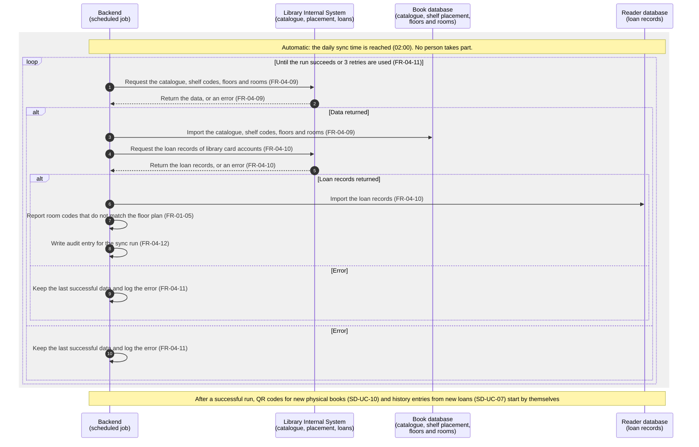

# Sequence Diagram: SD-UC-15 Sync data from the library internal system

| Field | Value |
|---|---|
| SD ID | SD-UC-15 |
| Use case | UC-15 Sync data from the library internal system |
| Feature | F-04 Platform, Access & Operations |
| Primary actor | None: started by time (daily sync time) |
| Participants | Backend · Library Internal System · Book database · Reader database |
| Trigger | Time event: the daily sync time is reached (02:00) |
| Preconditions | The connection to the Library Internal System is set up. The digital floor plan exists (FR-01-04). |
| FRs covered | FR-01-05, FR-04-09, FR-04-10, FR-04-11, FR-04-12 |
| Activity diagram | [AD-UC-15](../activity/ad_uc_15.md) |
| Redrawn from | New on 23/11/2026 (no original diagram; D48) |
| Version / status | v1.0 · Draft |

## 1. Diagram

Blue sections are choices of the actor, grey sections run automatically, and `alt` / `opt` are system
conditions. Reading rules: [sequence_index.md](sequence_index.md#drawing-rules).

## 2. Changes from the original diagram

- New diagram for UC-15, which gives the daily sync its own use case (Inputs check 3, L8-20, D48).
- Nothing is written back to the Library Internal System (W0 Table 4).
