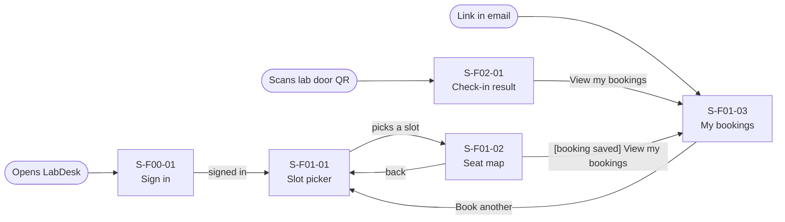
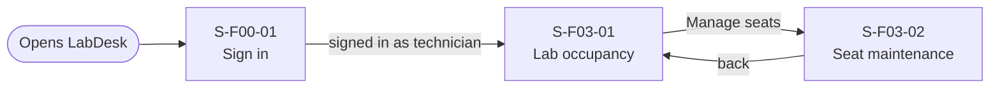

# Screen Transition Diagram: LabDesk (worked example)

> Worked example for teaching. Not a student submission and not a real product.

## 1. Student

Main task "book a seat": S-F01-01 → S-F01-02 → success state. Two screens from the start screen.

## 2. Lab Technician

## Checks

- Every screen in the Screen List appears: yes (7 of 7).
- Every screen reachable from an entry point: yes.
- No dead ends: yes.
- Usage-flow paths: every arrow of [usage-flow.md](usage-flow.md) has a path (table below).
- Sign in is shared; signed-out users who open an email or QR link see S-F00-01 first and then
  return to the screen they asked for (screen-level rule in S-F00-01).

## Usage-flow paths

| Actor | Usage-flow arrow | Path on this diagram |
|---|---|---|
| Student | UC-01 to UC-03 | S-F01-02 Seat map → S-F01-03 My bookings ("[booking saved] View my bookings") |
| Student | UC-03 to UC-04 | The student leaves LabDesk and walks to the lab; entry point "Scans lab door QR" → S-F02-01 |
| Student | UC-03 to UC-02 | Same screen: S-F01-03 My bookings, modal "Cancel booking?" |
| Lab Technician | UC-07 to UC-06 | S-F03-01 Lab occupancy → S-F03-02 Seat maintenance ("Manage seats") |
| Lab Technician | UC-06 to UC-07 | S-F03-02 Seat maintenance → S-F03-01 Lab occupancy ("back") |

LabDesk has 7 screens, so a single diagram would also work; it keeps one per actor because the two
actors share only the sign-in screen.
