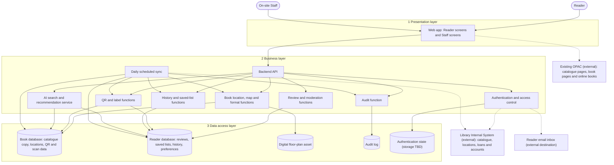

# Architecture: Group H Library Core System

The Library Core System is a web-based add-on to the National Library of Vietnam's existing OPAC. It provides book location, a digital library map, reviews and QR labels, discovery and personal reading features, and minimal staff operations. This document describes the logical system architecture without selecting implementation technologies.

| Field | Value |
|---|---|
| Version | v1.3 · 26/11/2026 |
| Status | Draft — StR mappings verified against Ha’s `minh-ha` branch; ADR files pending |
| Inputs | [CVCA](../context/cvca.md) (StR mapping based on [Ha’s `minh-ha` version](https://github.com/chihvcte-beep/dbiz2-group-h-opac/blob/minh-ha/cvca.md); not yet available at the linked `main` path), [Context Diagram](../context/context-diagram.md), [Use Case Diagram](../use-case/use-case.md) |
| Detailed requirements | [Function List](../function-list/fr-list.md); [Scope and data functions](../function-list/scope.md) |
| Design basis | [Sequence diagrams](../use-case/sequence-index.md); [Decision index](../project/decision-index.md) |

## 1. System requirements

The system requirements (SyR) consolidate the in-scope features into system-level capabilities. The **From** column uses the exact `StR-xx` identifiers in [Ha’s CVCA on branch `minh-ha`](https://github.com/chihvcte-beep/dbiz2-group-h-opac/blob/minh-ha/cvca.md), §4 Stakeholder requirements (read 26/11/2026). This branch version has not yet been merged into `main`; after merging, the relative [CVCA](../context/cvca.md) link will provide the same trace.

| ID | System requirement | From |
|---|---|---|
| SyR-01 | The system shall show floor, room and shelf for each physical copy and distinguish online-only titles and unavailable locations. | StR-01 |
| SyR-02 | The system shall display floors and reading rooms and identify a selected book's room when mapped. | StR-02 |
| SyR-03 | The system shall display published reviews and let signed-in readers publish under their library-card name or anonymously, edit and delete their own reviews. | StR-03, StR-04 |
| SyR-04 | The system shall provide QR-linked information and reviews for physical titles and let staff select, preview, print, confirm and reprint labels using one QR per title. | StR-05, StR-06, StR-07 |
| SyR-05 | The system shall filter the synced catalogue by access format and link readers to the existing OPAC for online content. | StR-10 |
| SyR-06 | The system shall maintain signed-in readers' history from synced loans and online-book selections, allow manual status and progress updates, maintain preferences and allow saving and removing physical titles with shelf locations. | StR-11, StR-12, StR-13, StR-14 |
| SyR-07 | The system shall support conversational catalogue search with retained conversations and personalised recommendations using history, preferences and conversations, including popular or trending alternatives when needed (Could). | StR-15, StR-16 |
| SyR-08 | The system shall authenticate readers using library-card email OTP, resume the initiating action, authenticate staff using internal accounts, enforce roles and allow explicit staff sign-out. | StR-17, StR-18, StR-19 |
| SyR-09 | The system shall allow readers to report another reader's review and authorised staff to inspect reports, remove violating reviews or dismiss reports (Could). | StR-08, StR-09 |
| SyR-10 | The system shall import catalogue, shelf, layout and loan data daily without write-back, retaining the last successful data on failure. | StR-20 |
| SyR-11 | The system shall retain actor, action and time for successful sign-ins, confirmed label prints, review removals and sync runs. | StR-21 |
| SyR-12 | The system shall let users retry failed network or loading requests while retaining displayed information. | StR-24 |
| SyR-13 | The delivery process shall run automated unit and integration tests on every pushed change. | StR-22 |
| SyR-14 | The delivery process shall build and deploy changes merged to main only after automated tests pass. | StR-23 |

The source CVCA maps **StR-25** to the Ministry’s existing proposal/approval process. This is a **project-level constraint**, not a software system requirement: it does not add a Ministry user account, approval workflow, dashboard, or new integration. All application-facing StR-01–StR-24 have at least one SyR above.

The detailed and testable requirements are in [fr-list.md](../function-list/fr-list.md). The four features are F-01 Book Location & Library Map, F-02 Reviews & QR, F-03 Discovery, Reading History & Recommendation, and F-04 Platform, Access & Operations ([scope.md](../function-list/scope.md#table-2-feature-list)). A SyR does not change the priority or scope of its underlying FRs.

## 2. Functional design

Each system requirement is divided into subordinate functions. Functions with optional/Could scope remain optional according to the linked FRs.

| Function | Serves |
|---|---|
| Present reader and staff screens | SyR-01–SyR-09, SyR-12 |
| Retrieve shelf locations and map data | SyR-01, SyR-02 |
| Manage and retrieve reviews | SyR-03 |
| Report and moderate reviews (Could) | SyR-09 |
| Generate QR codes, resolve QR-linked details and count scans (scan counting optional) | SyR-04 |
| Select, preview, confirm and reprint labels | SyR-04 |
| Filter catalogue and resolve OPAC destinations | SyR-05 |
| Maintain history, preferences and saved lists | SyR-06 |
| Search conversationally and recommend books (Could) | SyR-07 |
| Authenticate readers and staff, manage OTP and sessions, enforce roles | SyR-08 |
| Import and validate data, retry failed imports and retain last good data | SyR-10, SyR-01, SyR-02, SyR-06 |
| Record audit events | SyR-11 |
| Handle failed requests | SyR-12 |
| Retain displayed data and offer retry | SyR-12 |
| Keep catalogue, locations and QR data | SyR-01, SyR-02, SyR-04, SyR-05, SyR-10 |
| Keep reviews, history, preferences, saved lists, loans and conversations | SyR-03, SyR-06, SyR-07, SyR-09, SyR-10 |
| Maintain transient OTP and session state | SyR-08 |
| Keep audit records | SyR-11 |
| Provide floor-plan representation | SyR-02 |
| Run automated tests | SyR-13 |
| Build and deploy tested main changes | SyR-14 |

## 3. Physical design

Functions are allocated to elements in a **three-layer logical architecture**, following the teacher's example. This is a logical allocation, not a choice of programming language, cloud provider, database engine or AI model.

Solid arrows show internal interaction between system elements; dotted arrows indicate interactions with external systems. The web app enters and exits existing OPAC pages through links. The Library Internal System is read-only from this product; the OTP email reaches the reader without a separately selected external email-service component ([AD-UC-11 Q2](../project/decision-index.md)). The scheduler invokes the daily import and QR-generation functions without a person initiating them (UC-15 and UC-10).

### 3.1 Runtime function allocation

| Function | Element | Layer |
|---|---|---|
| Present reader and staff screens | Web app | Presentation |
| Retrieve shelf locations and map data | Book location, map and format functions | Business |
| Manage and retrieve reviews | Review and moderation functions | Business |
| Report and moderate reviews (Could) | Review and moderation functions | Business |
| Generate QR codes, resolve QR-linked details and count scans (scan counting optional) | QR and label functions | Business |
| Select, preview, confirm and reprint labels | QR and label functions | Business |
| Filter catalogue and resolve OPAC destinations | Book location, map and format functions | Business |
| Maintain history, preferences and saved lists | History and saved-list functions | Business |
| Search conversationally and recommend books (Could) | AI search and recommendation service | Business |
| Authenticate readers and staff, manage OTP and sessions, enforce roles | Authentication and access control | Business |
| Import and validate data, retry failed imports and retain last good data | Daily scheduled sync | Business |
| Record audit events | Audit function | Business |
| Handle failed requests | Backend API | Business |
| Retain displayed data and offer retry | Web app | Presentation |
| Keep catalogue, locations and QR data | Book database | Data access |
| Keep reviews, history, preferences, saved lists, loans and conversations | Reader database | Data access |
| Maintain transient OTP and session state | Authentication state (storage TBD) | Data access |
| Keep audit records | Audit log | Data access |
| Provide floor-plan representation | Digital floor-plan asset | Data access |

All Lesson 8 screens belong to the Presentation layer. The data groups follow [scope.md](../function-list/scope.md#table-4-data-functions).

### 3.2 Development and deployment (outside runtime)

| Function | Element | Layer |
|---|---|---|
| Run automated tests | Automated tests | Delivery (outside runtime) |
| Build and deploy tested main changes | Build and deployment | Delivery (outside runtime) |

Delivery is a supporting lifecycle process, not a fourth runtime layer or a service called by the Backend API. Tooling and hosting remain undecided. The runtime and delivery allocations together cover every function in section 2.

## 4. Decisions

The agreed decision sources are documented in [decision-index.md](../project/decision-index.md). **The `docs/architecture/adr/` folder is not yet on `main` (checked 26/11/2026).** ADR rows below are **mapping placeholders**, not accepted ADR files: Hoa must confirm the final numbering and links when her ADRs are committed. Do not mark ADR status `Accepted` solely because the underlying group decision is recorded.

| ADR | Decision | Status |
|---|---|---|
| Pending — proposed ADR for web-app structure | One web app serving Reader and On-site Staff screens; separate backend functions | Group architecture design; ADR pending |
| Pending — proposed ADR for OTP | Reader OTP email is sent by this product, not via an external email service (AD-UC-11 Q2) | Group decision recorded; ADR pending |
| Pending — proposed ADR for staff session | Staff sessions have no timeout and end on «Đăng xuất» (D7) | Group decision recorded; ADR pending |
| Pending — proposed ADR for QR labels | One QR code per book title, shared by copies; reprint labels omit shelf location (D40) | Group decision recorded; ADR pending |
| Pending — proposed ADR for screen frames | Reader 360px and Staff 1280px; narrower widths unsupported (D44, D45) | Group decisions recorded; ADR pending |
| Pending — proposed ADR for internal data integration | Read-only data exchange and timed daily sync (D47, D48) | Group decisions recorded; ADR pending |

## Change log

| Version | When | Change | Why |
|---|---|---|---|
| v1.0 | 23/11/2026 | Logical architecture, components, data stores, external connections, security and operations | Initial design from sequence diagrams, context and FRs |
| v1.1 | 26/11/2026 | Reorganized into SyR, functional design, three-layer physical design, decisions and change log; retained detailed architecture notes below | Align with the teacher's [LabDesk format](https://github.com/chienact-code/dbiz2-labdesk-example/blob/main/docs/architecture/architecture.md) and [task assignment](../project/task-assignment-26-11.md) |
| v1.2 | 26/11/2026 | Replaced all SyR `From` placeholders with StR IDs from Ha's `minh-ha` CVCA; recorded StR-25 as a project-level constraint | Complete stakeholder-to-system requirements trace without adding scope |

| v1.3 | 26/11/2026 | Refined SyR coverage, separated delivery from runtime, aligned function allocation and clarified authentication state and risks | Architecture review; no change to agreed scope or FR priorities |

## 5. Component responsibilities and major flows

| Component | Responsibility | Main FRs / diagrams |
|---|---|---|
| Reader screens | UI for location, map, reviews, QR, filter, saved list, history, AI discovery and OTP | F-01 to F-04; reader [screen list](../external-design/screen-list.md) |
| Staff screens | Minimal staff page, sign-in, QR label print/reprint, moderation and sign-out | FR-04-07, FR-04-21, FR-02-08, FR-02-25; UC-10, UC-13 |
| Backend API | Enforce sessions and business rules, handle data access, OTP and audits | FR-04-01, FR-04-08, FR-04-12, FR-04-20; all interactive UCs |
| Scheduled job | Daily read-only data import at 02:00, QR generation and missing room-code checks; retry on failure | FR-04-09, FR-04-10, FR-04-11, FR-02-07, FR-01-05; UC-15 |
| AI service | Conversational catalogue search and personalized book recommendations | FR-03-09 to FR-03-11; UC-08, UC-09 |
| Digital floor plan | Fixed floor/room display asset with room codes matched to the internal system | FR-01-04; UC-01, UC-02 |
| Audit log | Operational events: sign-in, label print, review removal and sync | FR-04-12 |

| Flow | Path | Reference |
|---|---|---|
| Reader sign-in | Reader screen → authentication → internal account lookup → OTP email → OTP validation → session | [SD-UC-11](../use-case/sd-uc-11.md) |
| Staff sign-in | Staff screen → account and role check → staff session → staff page | [SD-UC-10](../use-case/sd-uc-10.md), [SD-UC-13](../use-case/sd-uc-13.md) |
| QR book access | Phone camera → QR landing page → book record and scan count → reviews | [SD-UC-06](../use-case/sd-uc-06.md) |
| QR label print/reprint | Scheduled QR creation → staff selection → label preview → print/reprint confirmation → audit | [SD-UC-10](../use-case/sd-uc-10.md) |
| AI search | Reader → access check → AI service → synced book catalogue and permitted reader data | [SD-UC-08](../use-case/sd-uc-08.md) |
| Daily sync | Scheduled job → read-only internal system → local stores → room check and audit | [SD-UC-15](../use-case/sd-uc-15.md) |

## 6. Data access and external systems

ILF means data kept and updated by this product. EIF means data owned by the Library Internal System and read by this product. The exact groups follow W0 Table 4.

| Data store / group | Holds | ILF / EIF | Updated or obtained through |
|---|---|---|---|
| Book database — synced catalogue | Titles, authors, subjects, summaries, access formats | EIF | Read-only daily 02:00 catalogue sync (FR-04-09) |
| Book database — placement | Shelf placements, floors, room codes | EIF | Read-only daily 02:00 catalogue/layout sync (FR-04-09) |
| Book database — QR data | Shared per-title QR codes, label-printed status, scan counts | ILF | QR generation, first-print confirmation and scanning; reprint confirmation audits without changing label status (FR-02-07, FR-02-08, FR-02-25, FR-02-06) |
| Reader database — reviews | Review texts, report status and moderation outcomes | ILF | Reader review/report actions and staff moderation |
| Reader database — saved list | Saved physical books | ILF | Reader save/remove actions |
| Reader database — reading | History, status, progress, preferences and conversations | ILF | Reader actions, online-book events, AI conversations and synced loan records |
| Reader database — loans | Synced loan records | EIF | Read-only daily 02:00 loan sync (FR-04-10) |
| Reader database — anonymous reads | Book and time only, no reader identity | ILF | Online-book openings (FR-03-13) |
| Library Internal System — accounts | Library-card holder and staff account/role information | External read-only source; no local account master | On-demand sign-in checks (FR-04-01, FR-04-07) |
| Authentication state | Temporary OTP validity, attempt count and authenticated session/role state; logical requirement only, storage mechanism TBD | Transient operational state; not a new W0 data group | Authentication and access control (FR-04-08, FR-04-17, FR-04-21) |
| Audit log | Actor, action and time | ILF | Backend and scheduled operations (FR-04-12) |

| Outside system | Interaction / direction | Failure handling |
|---|---|---|
| Library Internal System | Read catalogue, location, layout, loans and account/role information; **no write-back** | Daily sync keeps last successful data and retries up to three times (FR-04-11); access errors show the applicable failure state |
| Existing OPAC | Reader entry links, exits to book details and online books; no additional data exchange | Existing OPAC pages remain outside this product |
| Reader email inbox | Receives OTP generated and sent by this product | Code-send failure handled by the reader sign-in flow (FR-04-16) |

## 7. Security, accessibility and operations

| Topic | Architectural rule | Source |
|---|---|---|
| Access control | Protect reader-only actions and all staff pages by checking the appropriate session and role | FR-04-08 |
| Reader sign-in | Library-card number + one-time 6-digit emailed code; valid for 5 minutes, one use, revoked after five wrong attempts | FR-04-01, FR-04-04, FR-04-17 |
| Reader return flow | After successful sign-in return to the initiating screen and continue its pending action | [Decision index](../project/decision-index.md) D1 |
| Staff sessions | No inactivity timeout; «Đăng xuất» terminates the session | [Decision index](../project/decision-index.md) D7; FR-04-21 |
| Privacy | Anonymous online-read events contain book and time, not identity; retention/privacy notice remains open | FR-03-13; [decision-index.md](../project/decision-index.md#pending-tasks) |
| Reader and Staff UI | Reader screens designed and supported at 360px; Staff at 1280px; smaller widths unsupported | D44, D45; [UI conventions](../external-design/ui-conventions.md) |
| Network errors | Retain already displayed information, show MSG-04 and allow «Thử lại» | FR-04-20 |
| Automated tests | Run unit/integration tests for changes | FR-04-14 (Must; D50) |
| Deployment | Build and deploy merges to `main` only after tests pass | FR-04-13 |
| Monitoring | No automatic tracking/alerts in release 1; library staff monitor issues manually | FR-04-15 Won't; D47 |

### 7.1 Risks and open design questions

- **Staff session (D7):** no inactivity timeout is an agreed rule, not a new recommendation. An unattended authenticated workstation may permit unauthorised actions. Session storage, revocation implementation and any additional safeguards require team approval; this document does not introduce a timeout.
- **Daily sync (D48):** data can be stale between imports or after a failed import. The agreed last-good-data fallback preserves usability but does not guarantee current shelf locations. Acceptable staleness and whether to show freshness information require confirmation; no real-time sync or new screen requirement is introduced.
- **Authentication state:** OTP and session state are logically required by the existing rules. Their storage, protection and lifecycle implementation remain DBIZ3 choices; no new account master or costed data function is asserted.

## 8. Not decided here

The following implementation choices are **not** established by the current analysis and must not be inferred from this diagram. The decisions are pending for DBIZ3 and should be recorded in [decision-index.md](../project/decision-index.md#pending-tasks) and, where appropriate, an ADR: programming language and framework, database products, hosting and CI/CD tools, AI model and hosting, email delivery mechanism without a separate external email-service component, and the technical method for reading Library Internal System data (export, file or interface).

The [architecture task assignment](../project/task-assignment-26-11.md) requires **every SyR** to point to at least one actual `StR-xx`, and **every decision row** to link to Hoa's actual ADR file. The first condition has been satisfied against Ha's `minh-ha` CVCA (pending its merge into `main`). The ADR condition remains pending until Hoa's actual ADR files are committed; the Decision table does not claim accepted ADRs.
