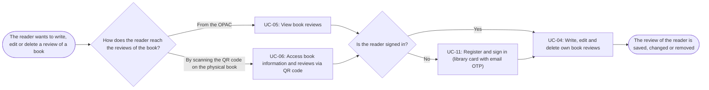

# Usage Flow: Group H Library Core System

<!--
DBIZ2 Lesson 8 template. File: docs/external-design/usage-flow.md
One map per actor and goal: the order in which an actor uses the system's use cases in real life
to reach one goal. An actor with one goal gets one flow; an actor who comes for clearly different
goals gets one flow per goal.
It is the bridge between Lesson 7 (one activity diagram = one use case) and the screens
(one actor moves through several use cases). Do not copy objectives, features or the architecture
here: they already live in W0, the Function List and your Lesson 4 architecture.
-->

| Field | Value |
|---|---|
| Product | Group H Library Core System |
| Version | v0.1 |
| Date | 2026-11-06 |
| Sources | W0 Table 1 (use case inventory); Use Case Diagram; `docs/activity/activity-index.md` |

## Before you draw: is Lesson 4 still true?

The Inputs check table at the top of `activity-index.md` has 8 findings. Rows 1, 2, 6 and 8 are
"Done". Rows 3, 4, 5 and 7 are still "Open" and are logged as open questions:

- Row 3: a use case "Sync data from the library internal system" (started by time) is still to be added.
- Row 4: the sequences User Review Interaction Flow (UC-05 + UC-04) and Book Review API Interaction
  (UC-06 + UC-04) still tell two use cases and are to be split into one sequence per use case.
- Row 5: the sequence User Review Interaction Flow still uses `opt` / `alt` for the reader's choice to
  edit or delete a review; the choice is now a decision in AD-UC-04.
- Row 7: a step of the sequence User Review Reporting Flow cites FR-02-10 instead of FR-02-14.

None of them changes the flow below: it uses only use cases and the order in which the reader uses them.

- [ ] Every row of the Inputs check table has Status "Done", or is logged as an open question.

## Reader: write, edit or delete a review of a book

| Step | Use case | Activity diagram | Screens (fill in after Block 2) |
|---|---|---|---|
| 1a | UC-05 View book reviews (reached from the OPAC) | `AD-UC-05.md` | S-F02-01 |
| 1b | UC-06 Access book information and reviews via QR code (reached by scanning the QR code) | `AD-UC-06.md` | S-F02-02 |
| 2 | UC-11 Register and sign in (library card with email OTP), only when the reader is not signed in | `AD-UC-11.md` | S-F00-01 |
| 3 | UC-04 Write, edit and delete own book reviews | `AD-UC-04.md` | S-F02-01 |

Step 1 is one of 1a or 1b, never both. Step 2 is skipped when the reader already has a valid session.

## Use cases without a flow

No use case in this flow is started by time or by an external system. UC-04 is started by the Reader.
