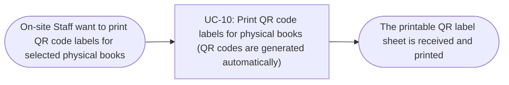

# Usage Flow: Group H Library Core System

<!--
DBIZ2 Lesson 8 template. File: docs/external-design/usage-flow.md
One map per actor and goal: the order in which an actor uses the system's use cases in real life
to reach one goal. An actor with one goal gets one flow; an actor who comes for clearly different
goals gets one flow per goal.
It is the bridge between Lesson 7 (one activity diagram = one use case) and the screens
(one actor moves through several use cases). Do not copy objectives, features or the architecture
here: they already live in W0, the Function List and your Lesson 4 architecture.
-->

| Field | Value |
|---|---|
| Product | Group H Library Core System |
| Version | v0.1 |
| Date | 2026-11-07 |
| Sources | W0 Table 1 (use case inventory); Use Case Diagram; `AD-UC-10.md`; `screen-list-UC10.md`; `docs/activity/activity-index.md` |

## Before you draw: is Lesson 4 still true?

The Inputs check table at the top of `activity-index.md` has 8 findings. Rows 1, 2, 6 and 8 are
"Done". Rows 3, 4, 5 and 7 are still "Open" and are logged as open questions:

- Row 3: a use case "Sync data from the library internal system" (started by time) is still to be added.
- Row 4: the sequences User Review Interaction Flow (UC-05 + UC-04) and Book Review API Interaction
  (UC-06 + UC-04) still tell two use cases and are to be split into one sequence per use case.
- Row 5: the sequence User Review Interaction Flow still uses `opt` / `alt` for the reader's choice to
  edit or delete a review; the choice is now a decision in AD-UC-04.
- Row 7: a step of the sequence User Review Reporting Flow cites FR-02-10 instead of FR-02-14.

These findings do not change the staff-initiated flow below. The automatic QR generation is started
by the daily catalogue sync finishing, so it is listed separately under "Use cases without a flow".

- [ ] Every row of the Inputs check table has Status "Done", or is logged as an open question.

## On-site Staff: print QR code labels for physical books

| Step | Use case | Activity diagram | Screens |
|---|---|---|---|
| 1 | UC-10 Print QR code labels for physical books (QR codes are generated automatically) | `AD-UC-10.md` | S-F00-02, S-F02-03 |

The staff member uses the shared staff sign-in screen (`S-F00-02`) only when they do not have a
valid staff session. After access is allowed, they select physical books and choose Print labels on
the QR Code Label Printing screen (`S-F02-03`). The system produces a printable sheet for selected
books that have QR codes, leaves out and lists selected books without QR codes, and writes an audit
entry when a label sheet is produced. If no selected book has a QR code, no sheet is produced.
The empty-selection, partial-result and no-label outcomes are states of `S-F02-03`, not separate
screens.

## Use cases without a flow

| Use case / process | Started by | Described in |
|---|---|---|
| Automatic QR generation for new physical books (part of UC-10; FR-02-07) | Time (when the daily catalogue sync has finished) | `AD-UC-10.md`; no screen is involved |

The automatic process finds books added by the daily catalogue sync and generates a unique QR code
for each new physical book that does not yet have one. Online-only books do not receive QR codes.
No actor navigates to a screen to start this process.
